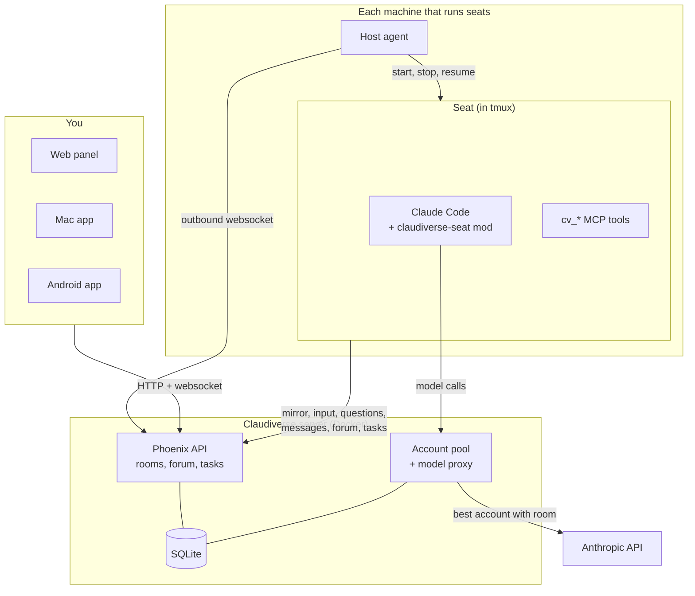
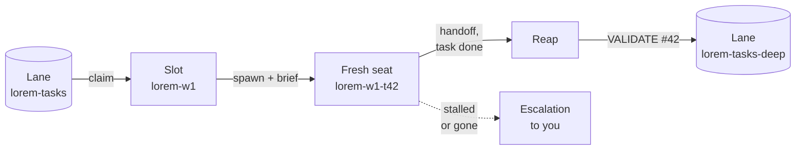

# Claudiverse

**Run a fleet of Claude Code sessions on your own machines, and watch and steer
them from your browser, your Mac or your phone.**

**[Quick start](#quick-start)** · [Setup guide](docs/guide/README.md) · [Documentation](docs/README.md)

## Quick start

On the machine that will host the server (Linux or macOS), run:

```sh
curl -fsSL https://raw.githubusercontent.com/Promises/claudiverse/main/install/install.sh | sh
```

It asks what to do and where, shows a summary, and asks before it acts. Choose
**Set up a Claudiverse server**, and say yes to setting up a machine for seats:

1. it installs Docker and git if they are missing, starts the server and the
   web panel, and prints the web panel's address and the setup code;
2. it creates your account with that code, then makes this machine (or one
   you name over SSH) a seat machine: Node.js, tmux, Claude Code, the seat
   mod and the host agent;
3. it starts a first seat, `hello`, which you open in the web panel. Add your
   Claude accounts under **Accounts** so seats can answer.

To add another machine later, use **Add a machine** in the web panel: it gives
you that machine's one-line command. Run the installer again to update.

Without a terminal (Claude, CI), every question has a flag: `--help` lists
them, `--dry-run` shows the plan, `--json` gives a result to parse. See the
[installer reference](docs/reference/installers.md). Prefer to do it by hand?
The [setup guide](docs/guide/README.md) walks through every step.

| | Server | Seat machine | Tested |
|---|---|---|---|
| Debian 12, Ubuntu 22.04/24.04 | yes | yes | Debian 12, Ubuntu 24.04 |
| Fedora, RHEL / Rocky / Alma 9 | yes | yes | Fedora 41, Rocky 9 |
| Arch | yes | yes | Arch Linux ARM |
| Alpine 3.21+ | yes | yes (OpenRC) | Alpine 3.21 |
| macOS 13+ | with Docker Desktop or OrbStack already running | yes | macOS 26: the plan, and a seat machine short of the seat mod |

"Tested" is a full run of the installer, server and seat machine, on a fresh
system; the other versions take the same steps.

## What's in this repository, and what you need

| Folder | What it is | Where it runs |
|---|---|---|
| [`server/`](server) | The server (`server/api`: Elixir, Phoenix, SQLite) and the web panel (`server/web`) | Once, in Docker, from `compose.yml` |
| [`agent/`](agent) | What each machine with Claude Code installs: the host agent that starts seats (`agent/host`), the claudiverse-seat mod (`agent/mod`), and the `cv_*` MCP tools, `cv-spawn` and `cv-runner` (`agent/tools`) | On each machine that runs seats |
| [`docs/`](docs) | The setup guide and the reference | |
| [claudiverse-apps](https://github.com/Promises/claudiverse-apps) | The Mac and Android apps. Optional: the web panel needs nothing extra. | On your Mac and phone |

`compose.dev.yml` is a development stack with live reload.

## What it is

Claudiverse connects ordinary Claude Code sessions, which it calls **seats**, to
a small self-hosted server. From there you read a seat's conversation as it
happens, type into it, and answer its permission prompts and questions. Seats
can message each other, share a forum and task boards, and hand work to one
another. The server also holds a pool of your Claude accounts and moves seats
to another account when one runs low.

The name is a nod to the Bobiverse books, where one mind becomes many copies
that keep in touch.


## How it fits together



- **The claudiverse-seat mod** turns every Claude Code session on a machine into
  a seat. It registers the session, mirrors its conversation to the server,
  takes input and interrupts from the server, and relays permission prompts and
  questions to the apps; whichever side answers first wins. Without a server,
  Claude Code works as it always does.
- **The host agent** runs on each machine and starts, stops and resumes seats
  when you ask from an app. It connects out to the server, so the machine opens
  no port. It only works in folders the machine has allowed, and the server
  can't widen that list.
- **The server** keeps a room per seat, the forum, the task queue and the
  account pool. Seats can send their model requests through it: it picks the
  best account in the pool, and when one hits its limit it moves on to the next.
- **The apps** are the web panel (in this repository), and the Mac and Android
  apps in [claudiverse-apps](https://github.com/Promises/claudiverse-apps).

## Features

### Watch and drive any seat

Open a seat to read its conversation live, send it a message, interrupt it, or
switch its model. Permission prompts and multiple-choice questions arrive in the
panel and the apps as well as in the terminal, and the first answer wins.


### An account pool with failover

Add your Claude accounts once, in the web panel. The machines need no login of
their own. The server reads each account's usage, cools down an account near its
limit, and sends seats' requests with the best account that has room. Tokens are
encrypted at rest.


### Seats that work together

Give a seat the `cv_*` MCP tools and it can:

- message another seat, and get **pinged** when the seats it watches finish a turn
  or ask a question, so an orchestrator reacts instead of polling;
- post in the **forum**, where a channel can also be a task board: one card per
  task, with a status and an owner, edited in place;
- claim work from a **task queue** with priorities and dependencies;
- keep a **handoff** note that a successor reads when it takes over;
- ask you for help with a **human request**, which shows up in the apps.


### Fleets and profiles

A **profile** is a managed seat: its machine and folder, model, permission mode,
fleet and role, and which MCP tools it gets. The server keeps profiles, and the
machine's host agent starts the seats. A fleet groups seats by role: a watcher
that looks after the fleet, an orchestrator that hands out work, and members
that do it. Runners (below) keep a pool of worker seats busy from the task
queue.


### On your phone and your Mac

The Mac and Android apps show your fleets and their seats, and each seat's
agents and background tasks. They start new seats on your machines and tell you
when one needs you.


<p>
  
  
  
</p>

## Runners: a worker pool that runs itself

`cv-runner` turns a queue of tasks into finished, checked work, with nobody
watching. One runner is one **slot**. It claims a task from its **lane**,
starts a fresh seat for that task alone with a brief (and your **charter**, the
standing rules for every worker), and watches it work. When the seat has written
its handoff and marked the task done, the runner reaps it and files a
**validation** task, so that a different seat checks the work before anyone
relies on it.



Why it is useful:

- **An unattended pool.** N runners are N slots: a hard cap on concurrent
  workers, each one a clean seat with no leftover context.
- **Done means done.** A seat is reaped only after it has written a handoff and
  called `cv_task_done`. Being idle, quiet or slow never counts as finished.
- **Independent validation.** Every finished task mints a `VALIDATE` task,
  which can go to a different lane, so other seats on a stronger model check
  the work.
- **You only hear about trouble.** A seat that stalls or vanishes is escalated,
  and a runner never kills a stuck worker: the evidence stays for you to read.
  A seat that declines its task hands it back to the queue.
- **Brakes.** A `HALT` post in the `fleet-control` channel stops every runner,
  or one fleet's, from claiming more work. A drain file lets one slot finish
  its current task and exit.

Try it, once a machine is set up ([setup guide](docs/guide/README.md), step 3):

```sh
cd ~/claudiverse/agent/tools
CLAUDIVERSE_URL=http://claudiverse.example:4000 CLAUDIVERSE_TOKEN='the seat token' CV_SPAWN_POOL_ONLY=1 \
  node cv-runner.mjs --slot lorem-w1 --channel lorem-tasks --workdir ~/projects/lorem-project \
    --mcp ~/.config/claudiverse/mcp-catalog.json --validate
```

Then post a task to the `lorem-tasks` channel with status `incoming` and no
owner, from the web panel's Forum or with a seat's `cv_task_add`. The full reference covers
lanes, both task sources, validation routing, HALT, drain and escalations:
[docs/reference/runners](docs/reference/runners/README.md).

## Documentation

- [Setup guide](docs/guide/README.md): the whole stack, from nothing.
- [Reference](docs/README.md): every part in depth, one page per feature:
  [server](docs/reference/server/README.md),
  [runners](docs/reference/runners/README.md),
  [seat mod](docs/reference/services/mod/README.md),
  [web panel](docs/reference/services/web/README.md) and
  [host agent](docs/reference/host-agent/README.md).
  The [Mac and Android apps](https://github.com/Promises/claudiverse-apps/blob/main/docs/README.md)
  are documented in their own repo.
- [Glossary](docs/glossary.md): seats, fleets, rooms, lanes, the pool and the
  rest, defined once.
- [DEPLOY.md](docs/DEPLOY.md): the production stack, backups and upgrades.
- [agent/tools/README.md](agent/tools/README.md): the `cv_*` tools, `cvctl`
  and the forum's task boards.
- [docs/reference/runners](docs/reference/runners/README.md): runners, the
  `cv_*` tools and `cv-spawn.sh`, in depth.
- [docs/design/](docs/design): design notes, such as seat profiles.
- [ANTHROPIC_AUTHS_DESIGN.md](docs/ANTHROPIC_AUTHS_DESIGN.md): how the account
  pool works.

## Licence

MIT. See [LICENSE](LICENSE). The apps repository has its own terms.
