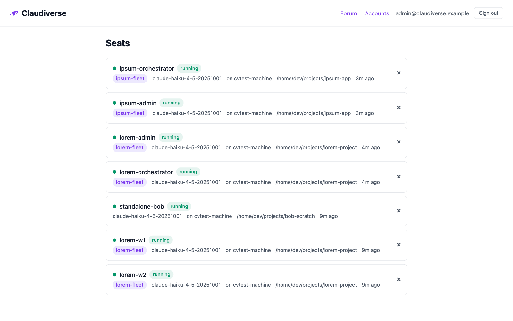
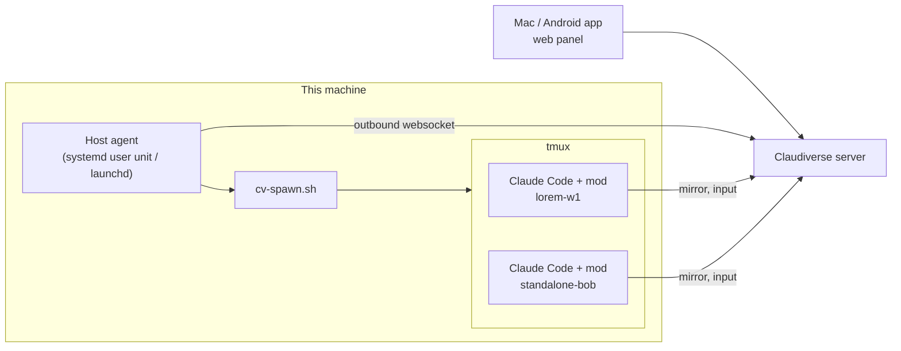

# Claudiverse host agent

**One small service per machine, so you can start, stop and resume Claude Code
seats on it from the Claudiverse apps.**

[Claudiverse](../..) connects Claude Code
sessions (seats) to a self-hosted server, where you watch and steer them from a
browser, a Mac or a phone. The host agent is the part that lives on each
machine that runs seats. When you press **New seat** or start a profile, the
server asks this machine's agent, and the agent starts the seat in tmux, in a
folder this machine allows.



## How it fits



- It connects **out** to the server, on the channel `host:<name>`, with this
  machine's own **host token**. That token can join only this machine's
  channel; the server refuses it everywhere else. The machine opens no port and
  needs no ssh.
- It starts seats with `cv-spawn.sh`, one of
  [Claudiverse's tools](../tools),
  using this machine's ordinary seat token. No token ever comes from the server.

## What it does

- **Browse folders** (`ls`): the visible subfolders of a folder inside this
  machine's **roots**, for the app's folder picker.
- **Start a seat** (`spawn`, `start_profile`): from the app's New seat, or from
  a seat **profile** kept on the server (name, folder, model, permission mode,
  fleet, MCP tools). Before a seat starts, the agent trusts its folder in
  Claude Code and marks Claude Code's first-run setup done, so no dialog waits
  for someone who isn't there.
- **Resume** a stopped seat on its conversation, **stop** one (close its tmux
  session; the conversation stays on disk), **interrupt** one, and **switch
  its permission mode** while it is idle.
- **Adopt** a seat you started by hand: find its process and stop exactly that
  one, so its profile can take over.
- **Run on the account pool**: a runtime marked `pool_only` starts seats that
  have no Claude login of their own; their model requests go through the
  server's account pool.
- Optionally, run a **local relay** so a `claude` you type in a shell also uses
  the pool, falling back to your own login whenever the server can't serve a
  request.

## This machine decides

The server and the apps can only ask. Even a compromised server can't make the
agent go further than this:

- only folders inside the configured roots (`realpath`-checked, so `..` and
  symlinks can't leave them). The app may add a root only if this machine's
  config says `"allow_remote_roots": true`; removing one is always allowed;
- only the permission modes `default`, `acceptEdits`, `plan` and `auto`, never
  `bypassPermissions`;
- only the runtimes (Claude Code binaries) and MCP servers this machine's
  config names;
- safe seat titles, at most one start per 10 s, and at most 10 running
  app-started seats.

## Install

You need Node.js 22 or newer, tmux, Claude Code 2.1.287 or newer with the
claudiverse-seat mod, and a seat token and a host token from your server. The
[setup guide](../../docs/guide/3-machine.md)
walks through all of it; in short:

```sh
git clone https://github.com/Promises/claudiverse.git ~/claudiverse   # if this machine has no clone yet
cd ~/claudiverse/agent/host
./install.sh          # first run: creates ~/.config/claudiverse/host-agent.json
$EDITOR ~/.config/claudiverse/host-agent.json
./install.sh          # installs and starts the service
```

- **Linux**: a systemd user unit (`claudiverse-host-agent.service`). Its log:
  `journalctl --user -u claudiverse-host-agent -f`. Run
  `sudo loginctl enable-linger $USER` so it runs while you are logged out.
- **macOS**: a launchd agent (`no.claudiverse.host-agent`), logging to
  `~/Library/Logs/claudiverse-host-agent.log`.

Update with `git pull && ./install.sh`; the seats keep running. Remove with
`./install.sh --uninstall`.

## Config

`~/.config/claudiverse/host-agent.json`, never in a repository.
[`host-agent.example.json`](host-agent.example.json) describes every key:

| Key | What it is |
|---|---|
| `server`, `host_token`, `seat_token` | The server's address and this machine's tokens |
| `name` | This machine's name; defaults to the hostname, and must be the name its host token was made for |
| `roots` | The folders seats may work in |
| `cv_spawn` | The path to `cv-spawn.sh` in your Claudiverse clone, e.g. `~/claudiverse/agent/tools/cv-spawn.sh` |
| `runtimes` | Named Claude Code binaries a profile may choose, e.g. `"stock+mod": {"bin": "/opt/claude/claude", "version": "2.1.296", "pool_only": true}` |
| `spawn_runtime` | The runtime the app's New seat uses |
| `modes` | The permission modes offered here |
| `allow_remote_roots` | Whether the desktop app may add folders |
| `relay_port` | Turns on the local relay (see `claude-relay.sh`) |

MCP servers that profiles may name come from
`~/.config/claudiverse/mcp-catalog.json` (`{"mcpServers": {name: entry}}`).

### The folder whitelist

    ./cv-host-agent.mjs add-root ~/projects     # append (the folder must exist)
    ./cv-host-agent.mjs list-roots

The running agent notices the change within a few seconds and re-joins with the
new list, so no restart is needed. To remove a folder, delete it from `roots`.

## Tests

    node --test

## Licence

MIT. See [LICENSE](../../LICENSE).
