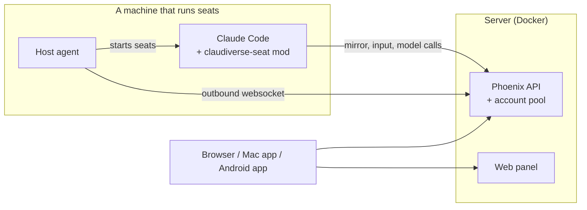

# Setting up Claudiverse

This guide installs the whole stack from nothing: the server, your Anthropic
accounts, one machine that runs seats, a first seat, and the apps. Plan on
about half an hour.

A **seat** is a Claude Code session connected to your Claudiverse server. You
can watch it, type into it and answer its questions from the web panel or the
apps, and seats can talk to each other.

## The steps

1. [The server](1-server.md): Docker Compose, and your account with the setup code.
2. [Anthropic accounts](2-accounts.md): add your Claude accounts to the server's pool.
3. [A machine for seats](3-machine.md): Claude Code, the claudiverse-seat mod
   and the host agent.
4. [Your first seat](4-first-seat.md): start it and talk to it from the web panel.
5. [The apps](5-apps.md): the web panel, the Mac app and the Android app.
6. [Troubleshooting](6-troubleshooting.md).

The server and the seat machine can be the same computer. The examples call the
server `claudiverse.example`; use your server's hostname or IP address instead.

## What you need

- A computer for the server with **Docker Engine and Docker Compose v2**
  (Linux, or Docker Desktop on macOS or Windows).
- One or more machines for seats: **Linux or macOS**, with Node.js 22 or newer
  and tmux. The guide shows the commands for Debian/Ubuntu and for macOS
  with Homebrew.
- A **Claude subscription** (Pro or Max) for each account you add to the pool.
  The machines that run seats need no Claude login of their own.

## The three repositories

| Repository | What it is | Licence |
|---|---|---|
| [claudiverse-oss](https://github.com/Promises/claudiverse-oss) | The server, the web panel, the seat mod and the orchestration tools | MIT |
| [claudiverse-host-agent-oss](https://github.com/Promises/claudiverse-host-agent-oss) | The per-machine agent that starts seats | MIT |
| [claudiverse-apps](https://github.com/Promises/claudiverse-apps) | The Mac and Android apps | see its README |
