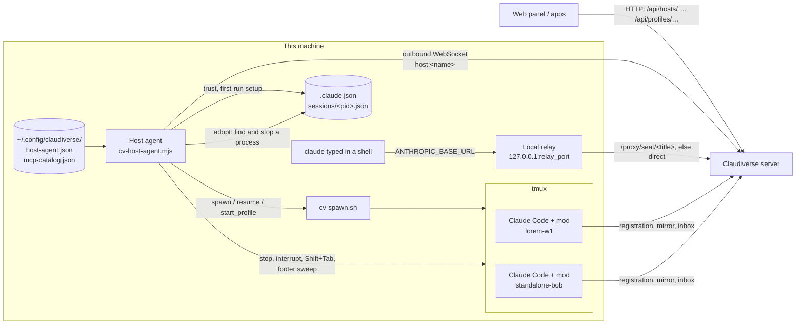

# Host agent reference

The host agent is one small Node.js service per machine that runs seats. It
connects out to the Claudiverse server on the channel `host:<name>` with the
machine's own host token, and answers the server's requests: list folders,
start, resume, stop and interrupt seats, switch a seat's permission mode, and
take over a seat someone started by hand. The machine opens no port and needs
no ssh. The server and the apps can only ask: the agent decides what this
machine allows (folders, runtimes, MCP servers, permission modes, limits), so
even a compromised server cannot make it go further.

For installation in a few steps, see the host agent's
[README](../../../agent/host/README.md). These pages describe every feature in depth.

## Overview

## Pages

| Page | What it covers |
|---|---|
| [channel.md](channel.md) | The outbound WebSocket, the `host:<name>` channel, the join payload, request/reply frames, every op and refusal code, reconnects and re-joins |
| [starting-seats.md](starting-seats.md) | `spawn`, `resume` and `start_profile`; runtimes (`config_dir`, `oauth_token_file`, `pool_only`), `spawn_runtime`, the MCP catalog, the `cv-spawn.sh` command line, the environment a seat gets, the checks and limits |
| [roots.md](roots.md) | The folder whitelist, `ls`, the `add-root` and `list-roots` commands, remote `add_root` / `remove_root` and `allow_remote_roots`, the macOS privacy timeout |
| [trust-and-setup.md](trust-and-setup.md) | Folder trust and Claude Code's first-run setup, written to `.claude.json` before a seat starts |
| [seat-control.md](seat-control.md) | `stop`, `interrupt`, `set_mode` and the mode sweep (`seat_modes`) |
| [adopt.md](adopt.md) | `locate_seat` and `release_seat`: putting a hand-started seat under a profile |
| [relay.md](relay.md) | The optional local relay and `claude-relay.sh`, which run a plain `claude` on the account pool with a direct fallback |
| [install-and-service.md](install-and-service.md) | `install.sh`, the systemd user unit (`KillMode=process`), the launchd agent, logs, updates and removal |
| [configuration.md](configuration.md) | Every config key, environment variable, limit and timing |

## Related pages

- [Documentation index](README.md) and [glossary](../../glossary.md)
- [Server: profiles and the host channel](../server/profiles-and-hosts.md)
- [Server reference](../server/README.md)
- [Mod reference](../services/mod/README.md)
- [Mac app](https://github.com/Promises/claudiverse-apps/blob/main/docs/mac/README.md)
- [Android app](https://github.com/Promises/claudiverse-apps/blob/main/docs/android/README.md)

## Source

- `cv-host-agent.mjs`
- `lib/rules.mjs`, `lib/adopt.mjs`, `lib/mode.mjs`, `lib/relay.mjs`
- `install.sh`, `service/`, `claude-relay.sh`, `host-agent.example.json`
