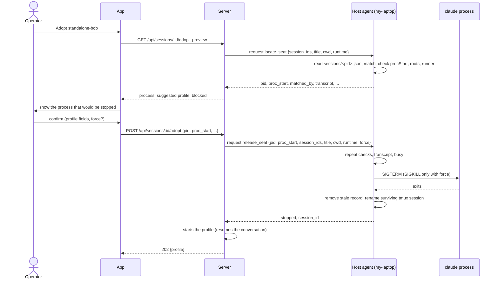

# Adopting a hand-started seat

Adopt puts a Claude Code seat that someone started by hand (a plain `claude` in a terminal or tmux) under a seat profile, so the app can stop, start and restart it like any other profile seat. The host agent's part is two requests on its channel: `locate_seat` finds the one process that is the seat and says what adopting would stop, and `release_seat` stops exactly that process. The server then starts the profile, which resumes the same conversation in a tmux session the agent runs.

The agent never guesses. It finds the process from Claude Code's own session records, checks that the process is still the one the record was written for, checks that its folder is inside the machine's allowed roots, and refuses when more than one process could be the seat.

## How it works

### Claude Code's session records

Claude Code writes `<config dir>/sessions/<pid>.json` for every process it runs and removes it when the process exits. The fields the agent reads:

| Field | Use |
|---|---|
| `pid` | Must be an integer. The process to act on. |
| `sessionId` | Must be a UUID. The conversation id. |
| `cwd` | The seat's folder. Checked against the roots; compared with the request's `cwd` for tmux matching. |
| `procStart` | The process start time, in the form of `ps -o lstart=` printed in UTC, for example `Mon Jan  5 09:12:30 2026`. Guards against pid reuse. |
| `tmux` | `<tmux session name>:<window>.<pane>`, for example `standalone-bob:@3.%3`. The part before the first colon is the tmux session name. |
| `status` | `busy` when mid-turn; release refuses `busy` unless forced. Other values are passed through. |
| `version`, `name` | Reported back by `locate_seat`. |
| `startedAt` | Only used to sort records, newest first. |

A file is read only if its name matches `<digits>.json`. A record that cannot be parsed (half-written, or removed while being read), or whose `pid` is not an integer or whose `sessionId` is not a UUID, is skipped silently. Each record also carries the config dir and file it came from.

The patched Claude Code binary writes these records too.

### Which config dirs are searched

The agent reads the `sessions` folder of:

- the machine's config dir, `claude_config_dir` (from the `CLAUDE_CONFIG_DIR` environment variable, else `~/.claude`), and
- the `config_dir` of every entry under `runtimes` in the agent config.

Only absolute paths count; duplicates are read once.

A separate lookup decides which config dir holds the conversation transcript for a given runtime (`runtimeConfigDir`):

- A runtime not listed under `runtimes` has none (`locate_seat` then reports `transcript: null`; `release_seat` refuses with `not_allowed`).
- A runtime with an absolute `config_dir` uses it.
- A runtime without one uses `claude_config_dir`.

A transcript is found at `<config dir>/projects/<folder slug>/<session id>.jsonl`, where the slug is the folder path with every character outside `A-Za-z0-9` replaced by `-`. If that file is missing, every project folder under `<config dir>/projects` is tried.

### Matching the seat to a process

The server sends the seat's known conversation ids (`session_ids`), its `title` and its `cwd`. Records whose pid is no longer alive are dropped first. Then:

1. **By conversation id.** Records whose `sessionId` equals one of `session_ids` (compared case-insensitively). If any match, the result is `matched_by: "session_id"`.
2. **By tmux session name and folder.** Only if no id matched, and only if both `title` and `cwd` were sent: records whose tmux session name equals `title` and whose `cwd` equals the request's `cwd` exactly. The result is `matched_by: "tmux_title"`. A patched seat's server row can carry a stale conversation id while its process has a different one, which is why this fallback exists. The operator confirms the match in the app, and `matched_by` tells the app which kind it was.

Either step must leave exactly one distinct pid. Two or more distinct pids is refused with `several`; the agent does not pick. If neither step matches, the refusal is `not_found`.

A pid counts as alive if `kill(pid, 0)` succeeds or fails with `EPERM`.

### Checks on the matched process

`locate_seat` and `release_seat` both run the same checks (`adoptable`), in this order:

1. **Pid reuse.** The record's `procStart` is compared with the live `TZ=UTC ps -o lstart= -p <pid>`, ignoring runs of whitespace. A difference means the pid now belongs to another process: `process_changed`.
2. **Roots.** The record's `cwd` must resolve (real path, symlinks followed) to a folder inside one of the machine's roots. Otherwise `outside_roots`, with the resolved folder in the reply's `path`. See [roots.md](roots.md).
3. **Runner worker.** The agent lists `ps -axo args=` and finds every `cv-runner.mjs` command line with a `--slot <name>`. A title that starts with `<slot>-t` is a worker of that runner (workers are named `<slot>-t<task>`) and is refused with `runner`. The match is a prefix of `<slot>-t`, so a slot named `w4` does not claim a title starting `w40-t`.

### `locate_seat`: the preview

`locate_seat` runs the checks above and changes nothing. It reports the process, how it was matched, and whether the requested runtime could resume the conversation (`transcript`: `true` or `false` if a runtime was named and exists on this machine, `null` otherwise). The app shows this to the operator before anything is stopped.

### `release_seat`: stopping the process

`release_seat` repeats the checks (the process may have changed since the preview) and then:

1. Confirms the matched record is the pid and start time the preview showed (`pid`, `proc_start`); otherwise `process_changed`.
2. Requires `runtime` to be configured here (`not_allowed`) and the conversation to exist in that runtime's config dir (`not_found`), so the profile resumes the conversation instead of silently starting a new one.
3. Refuses a seat whose record says `status: "busy"` unless `force` is `true` (`busy`).
4. Logs `adopt <title>: stopping pid <pid> (<version>, <tmux or "no tmux">)` and sends `SIGTERM` to that one pid, then polls every 200 ms for up to 10 s for it to exit.
5. If it is still alive after 10 s: without `force`, refuses with `busy`; with `force` (exactly `true`), sends `SIGKILL` and polls up to 5 s more. A process that survives is `error`.
6. Waits up to 2 s for Claude Code to remove its own session record, then removes the file itself if it is still there, so the next `locate_seat` does not see a ghost.
7. If the record's tmux session name equals `title` and that tmux session still exists (for example a shell pane that outlives the process), renames it to `<title>-pre-adopt` so the profile can take the name, and logs `adopt <title>: its old tmux session lives on as <title>-pre-adopt`.

The reply is `{"stopped": <pid>, "session_id": "<lowercase conversation id>"}`. Starting the profile is not done by the agent: the server then starts the profile, resuming the same conversation.

### Flow



## Configuration

Adopt has no keys of its own. It uses:

| Key | Default | Effect on adopt |
|---|---|---|
| `claude_config_dir` | `$CLAUDE_CONFIG_DIR`, else `~/.claude` | Searched for session records; the transcript dir of a runtime without its own `config_dir`. |
| `runtimes.<name>.config_dir` | none | Also searched for session records; the transcript dir for that runtime. Must be absolute to count. |
| `roots` | `[]` | The seat's `cwd` must be inside one of them. See [roots.md](roots.md). |

See [configuration.md](configuration.md) for the full config file. The fixed values (10 s SIGTERM wait, 5 s SIGKILL wait, 2 s record-removal wait, `-pre-adopt` suffix) are not configurable.

## Interface

### Channel requests

Both arrive as `request` events on the `host:<name>` channel; the agent answers with a `reply` carrying the same `request_id`. See [channel.md](channel.md) for the framing.

Success: `{"request_id": "...", "ok": true, "result": {...}}`.
Refusal: `{"request_id": "...", "ok": false, "code": "<code>", "error": "<message>"}`, plus `"path"` for `outside_roots`.

#### `locate_seat`

Request args:

```json
{
  "session_ids": ["3f6c2a1e-8b4d-4c7a-9e21-5d0b7a6f4c13"],
  "title": "standalone-bob",
  "cwd": "/home/me/projects/app",
  "runtime": "stock+mod"
}
```

`session_ids` may be empty or absent; `title` and `cwd` are needed only for the tmux fallback; `runtime` is optional.

Result:

```json
{
  "pid": 48213,
  "proc_start": "Mon Jan  5 09:12:30 2026",
  "tmux": "standalone-bob:@3.%3",
  "status": "idle",
  "version": "2.1.289",
  "matched_by": "session_id",
  "session_id": "3f6c2a1e-8b4d-4c7a-9e21-5d0b7a6f4c13",
  "cwd": "/home/me/projects/app",
  "name": null,
  "transcript": true
}
```

`tmux`, `status`, `version` and `name` are `null` when the record lacks them. `session_id` is lowercased. `transcript` is `null` when no `runtime` was sent or the runtime is not configured here.

#### `release_seat`

Request args:

```json
{
  "pid": 48213,
  "proc_start": "Mon Jan  5 09:12:30 2026",
  "session_ids": ["3f6c2a1e-8b4d-4c7a-9e21-5d0b7a6f4c13"],
  "title": "standalone-bob",
  "cwd": "/home/me/projects/app",
  "runtime": "stock+mod",
  "force": false
}
```

`pid` and `proc_start` are the values `locate_seat` returned. `force` must be exactly `true` to take effect.

Result:

```json
{ "stopped": 48213, "session_id": "3f6c2a1e-8b4d-4c7a-9e21-5d0b7a6f4c13" }
```

### Refusal codes

| Code | Raised by | Message |
|---|---|---|
| `not_found` | both | `no running Claude Code process here has its conversation id` followed by `, or runs in a tmux session named <title> in its folder` when a title was sent |
| `several` | both | `<n> running processes match its conversation id (pids <list>); adopt one by hand`, or `... match its tmux session name and folder (pids <list>); ...` |
| `process_changed` | both | `pid <pid> is no longer the process its record names; look again` |
| `process_changed` | release | `the seat now runs as pid <pid>, not the pid <given> the preview showed; look again` |
| `outside_roots` | both | `<cwd> is outside this machine's allowed folders` (reply includes `path`, the resolved folder) |
| `not_found` | both | `<cwd> does not exist`, from the roots check |
| `not_permitted` | both | the roots check could not read the folder within 5 s (on macOS, a pending privacy prompt) |
| `bad_request` | both | `<cwd> is not a folder` |
| `runner` | both | `<title> is a worker of a cv-runner slot here; its runner stops and starts it` |
| `not_allowed` | release | `runtime <runtime> is not configured here` |
| `not_found` | release | `runtime <runtime> keeps conversations in <dir>, and <session id> is not there; it would start a new conversation` |
| `busy` | release | `<title> is mid-turn; wait, or stop it anyway` (record `status` is `busy`, no `force`) |
| `busy` | release | `pid <pid> did not exit within 10 s of SIGTERM; stop it anyway to kill it` (no `force`) |
| `error` | release | `pid <pid> survived SIGKILL` |
| `error` | any | Any other failure (for example `kill` failing); the message is the underlying error and the agent logs `error in <op>: ...`. |

### App-facing endpoints

The server exposes these to the app (app or super token only; other tokens get 403 `adopting seats is app-only`):

- `GET /api/sessions/:id/adopt_preview` asks the agent for `locate_seat` (15 s timeout) and returns `{process, existing_profile, suggested, blocked}`.
- `POST /api/sessions/:id/adopt` creates or edits the profile, asks the agent for `release_seat` (30 s timeout), and starts the profile. It answers 202 `{profile}`; 409 `{error, code}` with `code` one of `busy`, `profile_running`, `runner`, `process_changed`, `several`, `blocked` (any other agent refusal is reported as `blocked`); 504 with `code: "offline"` when the agent is offline or does not answer.

The server requires an agent of version 0.9.0 or newer for adopting.

## Failure modes and troubleshooting

- **`no running Claude Code process here has its conversation id`**. No live process has a record with that conversation id (or, for the tmux fallback, a tmux session of that name in that folder). Check that the seat runs on this machine, and that its config dir is either `claude_config_dir` or a runtime's `config_dir`; a seat using a different `CLAUDE_CONFIG_DIR` is invisible to the agent.
- **`several`**. Two live processes share the conversation id (or the tmux name and folder). Stop the extra one by hand and look again.
- **`process_changed`**. The record's start time no longer matches `ps`. Either the pid was reused or the seat restarted between preview and confirmation. Preview again.
- **`outside_roots`**. The seat's folder is not under a root. Add it with `cv-host-agent.mjs add-root <folder>` (see [roots.md](roots.md)).
- **`runner`**. The seat is a `cv-runner` worker (title `<slot>-t<task>`). Its runner manages it; adopt does not apply.
- **`not_allowed: runtime ... is not configured here`**. The profile's runtime is not in `runtimes`. See [configuration.md](configuration.md).
- **`not_found: runtime ... keeps conversations in ...`**. The conversation transcript is not in the runtime's config dir, so the profile would start a new conversation. The preview shows this beforehand as `transcript: false`.
- **`busy`**. The seat is mid-turn, or ignored SIGTERM for 10 s. Retry later, or confirm the stop with force. In the SIGTERM-timeout case the signal has already been sent, so the process may be partway through shutting down.
- **tmux session left behind**. If the old tmux session outlives the process and has the profile's name, it is renamed to `<title>-pre-adopt`. The rename's result is not checked; if a session with that name already exists, the rename fails silently and the profile start may then fail on the name. Remove the old session with `tmux kill-session -t =<title>-pre-adopt` when it is no longer needed.
- Log lines: `adopt <title>: stopping pid ...` and `adopt <title>: its old tmux session lives on as ...`.

For stopping other seats see [seat-control.md](seat-control.md); for starting profile seats see [starting-seats.md](starting-seats.md).

## Related pages

- [Host agent reference](README.md)
- [The host channel](channel.md)
- [Starting seats](starting-seats.md)
- [Roots and folder browsing](roots.md)
- [Seat control](seat-control.md)
- [Configuration reference](configuration.md)
- Server: [Profiles and the host channel](../server/profiles-and-hosts.md)
- Mac: [Adopt](https://github.com/Promises/claudiverse-apps/blob/main/docs/mac/adopt.md)

## Source

- `cv-host-agent.mjs` (`locateSeat`, `releaseSeat`, `adoptable`, `configDirs`, `runtimeConfigDir`)
- `lib/adopt.mjs`
- `lib/rules.mjs` (`findTranscript`, `SESSION_ID`, `resolveInRoots`, `Refusal`)
- `test/adopt.test.mjs`
- Server side: `server/api/lib/claudiverse_server/adopt.ex`, `lib/claudiverse_server_web/controllers/adopt_controller.ex`
