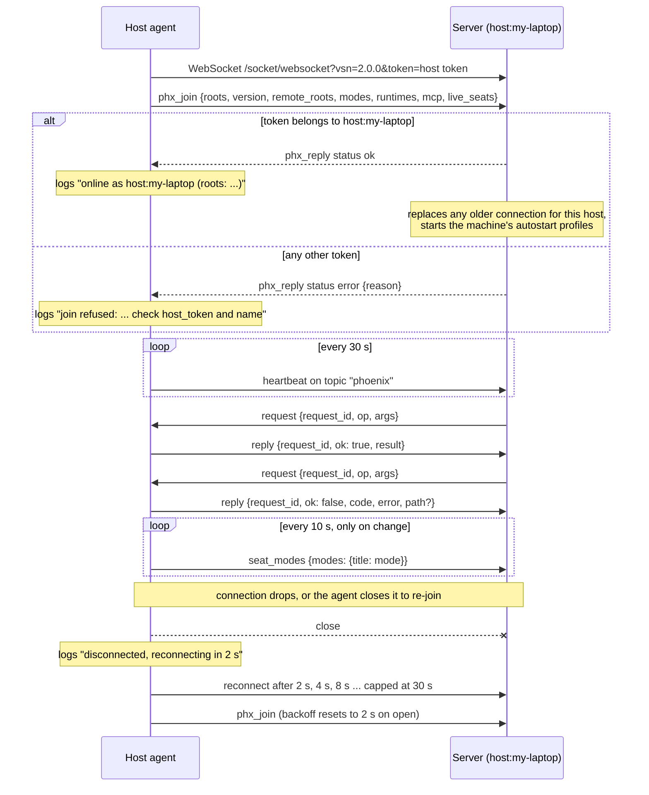

# The host channel

The host agent never listens for inbound connections. It connects out to the Claudiverse server over a WebSocket, joins a Phoenix channel named `host:<name>`, and answers the requests the server pushes down it. The channel is the only path by which the apps (web panel, Android, Mac) reach a machine: listing folders, starting and stopping seats, switching modes. This page describes that connection: how it is opened, what is said on it, which refusals the agent can send back, and how it recovers.

## How it works

The agent builds the WebSocket URL from the `server` config key by replacing a leading `http` with `ws` (so `https://` becomes `wss://`), stripping one trailing `/`, and appending `/socket/websocket?vsn=2.0.0&token=<host_token>`. For `server` = `https://claudiverse.example` that is `wss://claudiverse.example/socket/websocket?vsn=2.0.0&token=<host token>`.

Frames use the Phoenix V2 serializer: a JSON array `[join_ref, ref, topic, event, payload]`.

On open, the agent sends `phx_join` on topic `host:<name>`. `<name>` is the config key `name`, or the machine's hostname when `name` is unset. It must be the name the host token was issued for: the server joins a connection only to the topic its token was made for. The same name is what the machine's seats report as their host.

After the join succeeds, the agent logs `online as host:<name> (roots: …)` and the server may send `request` events at any time. The server asks and the agent answers; the agent is the authority on what it allows (roots, modes, limits). Every `request` gets exactly one `reply` carrying the same `request_id`.

Separately, every 10 seconds the agent reads the permission mode of each of its running seats from the tmux footer and pushes any changes to the server as `seat_modes`, because a seat running the mod reports no mode itself.



### Join payload

The join payload is built fresh on every connect:

| Field | Meaning |
|---|---|
| `roots` | The resolved whitelist of folders the agent offers. See [Roots](roots.md). |
| `version` | The agent's version string. |
| `remote_roots` | `true` when the machine's config has `"allow_remote_roots": true`, read from the config file at join time. It only lets the app show the option; the agent enforces it. |
| `modes` | Permission modes this machine allows for profile starts: the config key `modes` filtered to `default`, `acceptEdits`, `plan`, `auto`, or all four when `modes` is unset. |
| `runtimes` | A list of `{name, version}` for each entry of the config key `runtimes` that has an absolute `bin`; `version` is `null` when not configured. |
| `mcp` | The names in the MCP catalog file (`mcp_catalog`, default `~/.config/claudiverse/mcp-catalog.json`, key `mcpServers`) that are valid names. |
| `live_seats` | 0.12.0+: the tmux sessions with a Claude Code process in their pane (the pane's process or its child has a session record in a configured config folder), read at this join. No tmux server, as after a reboot, is `[]`. Left out when tmux could not say (any other `list-sessions` failure), and the server then changes nothing. |

Example:

```json
["1","1","host:my-laptop","phx_join",{"roots":["/home/me/work"],"version":"0.11.1","remote_roots":false,"modes":["default","acceptEdits","plan","auto"],"runtimes":[{"name":"stock","version":null}],"mcp":[]}]
```

### Heartbeat

Every 30 seconds the agent sends `[null, ref, "phoenix", "heartbeat", {}]`.

### Reconnect and re-join

The agent reconnects whenever the socket closes, and also closes the socket itself to force a fresh join. Backoff starts at 2 s, doubles after each close (2, 4, 8, 16, 30, 30 ... s, capped at 30 s) and is reset to 2 s when a connection opens. A `phx_close` or `phx_error` from the server also makes the agent close and reconnect.

The agent closes its own socket (and so re-joins with a fresh payload) when:

- The config file changed (it is polled every 2 s) and the `roots` list or the `allow_remote_roots` flag is different. Log: `whitelist changed: …; remote folders allowed|not allowed; re-joining`.
- The MCP catalog file changed (polled every 2 s). Log: `MCP catalog changed: …; re-joining`.
- An `add_root` or `remove_root` request changed the whitelist (about 200 ms after the reply is sent).

An unreadable config file does not drop the connection: the agent logs `config unreadable, keeping the current whitelist: …` and keeps the current list. `cv-host-agent.mjs add-root <folder>` edits the config file, and the running agent picks it up through the same watcher.

### What the server does

Confirmed in `HostChannel` and `Hosts` on the server:

- Only that host's own token may join. A seat's shared token, the app token or another host's token gets `{"reason": "this token may not join host:<name>"}` in the `phx_reply` error.
- A newer connection for the same user and host name replaces an older one: the older channel is told to stop. If it has not let go within about 2 s, it is killed.
- Once the join completes, the server starts the machine's autostart profiles in the background. Already-running profiles are left alone, unless `live_seats` says otherwise: a profile whose rows read running, all on this machine, with no live seat of its name here (the machine rebooted, its process died) has its rows ended and is started. Before 0.12.0 such a profile was skipped until its rows read stopped and the agent was restarted. a profile whose last start was refused or failed within 10 minutes is skipped, and starts are spaced out (the per-machine spawn interval, 10 s by default, plus 0.5 s). A reconnect is therefore harmless.
- The server also records the connection's source address and may use it to place seats that did not report their host.
- The server relays a request to an online host and waits for the reply. The default wait is 10 s; spawns, resumes and profile starts wait up to 120 s and run asynchronously, with the outcome broadcast to the apps. A request to an offline host fails at the server without reaching the agent.

## Configuration

These config keys (see [Configuration](configuration.md)) shape the channel:

| Key | Default | Effect |
|---|---|---|
| `server` | required | Base URL; `http` becomes `ws`, `https` becomes `wss`. |
| `host_token` | required | Sent as the `token` query parameter. |
| `name` | the hostname | The channel topic is `host:<name>`. Must match the name the host token was made for. |
| `roots` | `[]` | Sent in the join payload; changes cause a re-join. |
| `allow_remote_roots` | off | Sent as `remote_roots`; changes cause a re-join. Needed for `add_root`. |
| `modes`, `runtimes`, `mcp_catalog` | all four modes; none; `~/.config/claudiverse/mcp-catalog.json` | Source of `modes`, `runtimes`, `mcp` in the join payload. |

The config file path is `~/.config/claudiverse/host-agent.json`, or the file named by the `CLAUDIVERSE_HOST_AGENT_CONFIG` environment variable.

Fixed timings: heartbeat 30 s, config and catalog polling 2 s, reconnect backoff 2 s to 30 s, mode sweep 10 s.

## Interface

### Requests (server to agent)

```json
[null,"7","host:my-laptop","request",{"request_id":"<id>","op":"ls","args":{"path":"/home/me/work"}}]
```

The agent answers with `reply` on the same topic:

```json
["1","8","host:my-laptop","reply",{"request_id":"<id>","ok":true,"result":{ }}]
```

or, for a refusal or error:

```json
["1","8","host:my-laptop","reply",{"request_id":"<id>","ok":false,"code":"outside_roots","error":"/tmp is outside this machine's allowed folders","path":"/tmp"}]
```

`path` is present only when the refusal is about a folder (currently `outside_roots`). An unknown `op` is answered with `bad_request` and `unknown op <op>`. An exception that is not a refusal is answered with code `error` and logged as `error in <op>:`.

### Ops

| Op | What it does | Details |
|---|---|---|
| `ls` | Lists the subfolders of a folder inside the roots. | [Roots](roots.md) |
| `spawn` | Starts a seat in a folder with `cv-spawn.sh`. | [Starting seats](starting-seats.md) |
| `resume` | Starts a stopped seat again, continuing its Claude Code conversation. | [Starting seats](starting-seats.md) |
| `start_profile` | Starts a seat from a server-side profile, checked against this machine's modes, runtimes and MCP catalog. | [Starting seats](starting-seats.md) |
| `stop` | Closes a seat's tmux session. | [Seat control](seat-control.md) |
| `interrupt` | Presses Escape once in a seat's tmux session. | [Seat control](seat-control.md) |
| `set_mode` | Switches a running seat's permission mode with Shift+Tab. | [Seat control](seat-control.md) |
| `locate_seat` | Finds the running process an adopting profile would stop. | [Adopting a running seat](adopt.md) |
| `release_seat` | Stops that process so the profile can start. | [Adopting a running seat](adopt.md) |
| `add_root` | Adds a folder to the whitelist, only if `allow_remote_roots` is true. | [Roots](roots.md) |
| `remove_root` | Removes a folder from the whitelist; always accepted. | [Roots](roots.md) |

### Unsolicited push: `seat_modes`

```json
["1","12","host:my-laptop","seat_modes",{"modes":{"lorem-w1":"plan","lorem-w2":"default"}}]
```

Keys are tmux session names (seat titles); values are the mode read from the pane footer. Only changes since the last report are sent. The agent skips a pane that has no Claude Code session, an empty capture, or an open dialog. It forgets what it has reported on each successful join, so the server gets a full report after every (re)connect. The server accepts only the modes `default`, `acceptEdits`, `plan`, `auto`, and applies them to that host's running, non-proxy seats by exact title.

### Refusal codes

Every code the agent throws as a `Refusal` in `cv-host-agent.mjs` and `lib/rules.mjs`, plus the fallback:

| Code | Meaning |
|---|---|
| `outside_roots` | The folder is not inside the whitelist. Carries `path`. |
| `not_found` | A folder, seat, conversation, transcript or session record does not exist (or cannot be found). |
| `bad_request` | Malformed arguments: bad title, mode, path, uuid, name, effort and so on; a seat of that name already runs; unknown `op`. |
| `not_allowed` | The machine's config forbids it: `add_root` without `allow_remote_roots`, a mode or runtime or MCP server not offered here, a mode outside a seat's Shift+Tab cycle, a runtime not configured for `release_seat`. |
| `not_permitted` | The operating system did not let the agent read a folder within the timeout (on macOS, an unanswered privacy prompt). |
| `limit` | Spawn rate or seat cap reached: at most one spawn per `min_interval_s` (default 10 s), at most `max_seats` (default 10) app-started seats. |
| `spawn_failed` | `cv-spawn.sh` failed, or the new seat exited within 5 s of starting. |
| `busy` | The seat is mid-turn or has a dialog open (`set_mode`), or did not exit after SIGTERM within 10 s without `force` (`release_seat`). |
| `several` | More than one running session matches the seat to adopt. |
| `process_changed` | The process behind a session record is no longer the one the preview showed. |
| `runner` | The seat is a worker of a `cv-runner` slot; its runner manages it. |
| `error` | Anything else: an unexpected exception, an unreadable trust file, a failed `tmux` command, a pid that survived SIGKILL. |

## Failure modes and troubleshooting

| What you see | Cause and action |
|---|---|
| `join refused: {"reason":"this token may not join host:<name>"} — check host_token and name` | The token is not the one made for this host name. Check that `host_token` is the host token (not a seat or app token) and that `name` (or the hostname, when `name` is unset) is the name the token was created for. |
| `disconnected; reconnecting in 2 s`, repeating with 4, 8, 16, 30 | The server is unreachable or the URL is wrong. Check `server`, the network and TLS. The agent retries forever; the delay stays at 30 s. |
| Machine shows offline in the app but the agent runs | Check for `online as host:<name> (roots: …)` in the log. If it never appears, see the lines above. A second agent started with the same name and token replaces the first, so check that only one runs. |
| The agent logs `warning: root … does not exist or cannot be read yet; ignored` or `the whitelist is empty …` | The roots in the join payload are the resolved, readable ones. See [Roots](roots.md). |
| Edits to the config do not appear in the app | The watcher polls every 2 s and re-joins only if `roots` or `allow_remote_roots` changed. Other keys are read at startup; restart the agent (see [Install and service](install-and-service.md)). |
| `config unreadable, keeping the current whitelist: …` | The config file is invalid JSON or was being written. Fix it; the agent stays connected. |
| A request gets no answer in the app | The server times out a request after 10 s by default. It waits 15 s for `set_mode` and `locate_seat`, 30 s for `release_seat`, and 120 s for spawn, resume and profile start. The agent may still finish the work. |

## Related pages

- [Host agent README](README.md)
- [Starting seats](starting-seats.md)
- [Roots](roots.md)
- [Trust and setup](trust-and-setup.md)
- [Seat control](seat-control.md)
- [Adopting a running seat](adopt.md)
- [Local relay](relay.md)
- [Install and service](install-and-service.md)
- [Configuration](configuration.md)
- Server: [Profiles and the host channel](../server/profiles-and-hosts.md)

## Source

- `cv-host-agent.mjs` (connect, join, heartbeat, request handling, `seat_modes` sweep, config watchers)
- `lib/rules.mjs` (`Refusal`, `machineChoices`, request validation)
- Server: `server/api/lib/claudiverse_server_web/channels/host_channel.ex`
- Server: `server/api/lib/claudiverse_server/hosts.ex`
