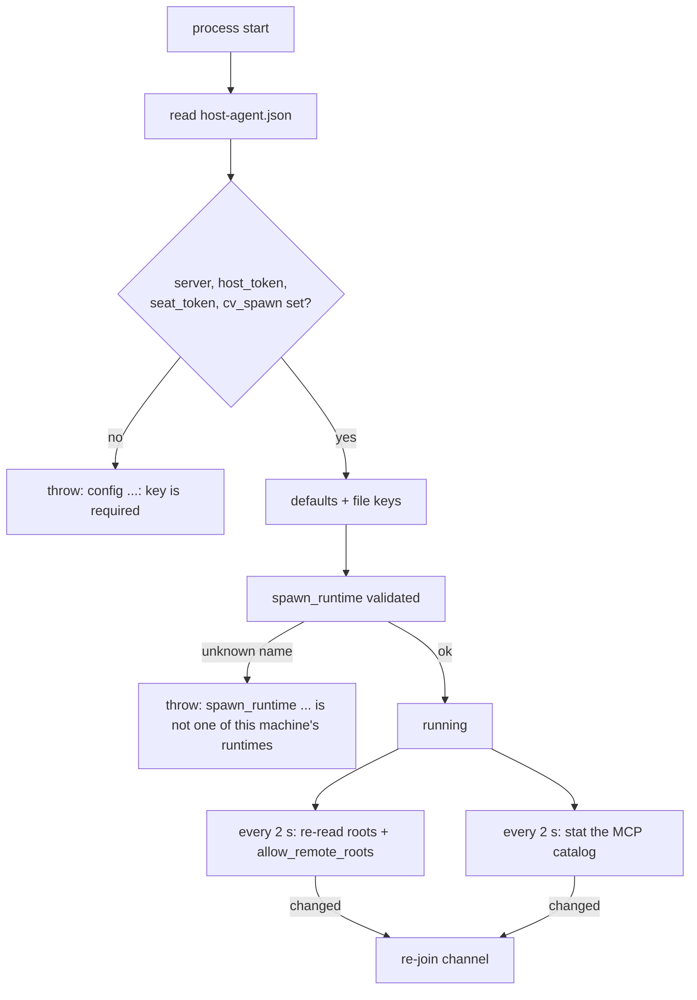

# Configuration reference

This page lists every setting the host agent reads: each config-file key, each environment variable, and each fixed limit or timing built into the code. For each it gives the type, the default, whether it is required, whether a running agent notices a change or only reads it at start, and a link to the page that explains what it does.

## How it works

The agent reads one JSON file. The path is `~/.config/claudiverse/host-agent.json`, or the value of the environment variable `CLAUDIVERSE_HOST_AGENT_CONFIG` if that is set. The file is parsed by `loadConfig` when the process starts. It starts from a set of defaults and then spreads the file's contents over them (`...c`), so a key in the file overrides every default, including the ones that are derived from the environment (`claude_config_dir`, `claude_json`). Keys the agent does not know are carried along and ignored, which is why the `_`-prefixed keys in the shipped example (`_doc`, `_relay`, `_profiles`) are harmless: they are comments by convention only, not a feature.

Almost everything is read once at start. After editing the file, restart the service (see [Installing and running the host agent as a service](install-and-service.md)). Three things are the exception:

- The config file is polled every 2 seconds (`fs.watchFile`, interval 2000 ms). On each change the agent re-reads only `roots` and `allow_remote_roots`. If either changed, it re-joins the channel so the server and apps get the new values.
- `allow_remote_roots` is also read fresh from the file every time an `add_root` request arrives and every time the agent joins the channel.
- The MCP catalog file (`mcp_catalog`) is polled every 2 seconds, and read fresh on each join and each `start_profile`. A change makes the agent re-join so the apps' menus update.

The agent writes the config file back only when `add-root` is run or when the desktop adds or removes a root. It re-serialises the whole parsed object with two-space indentation, so unknown keys (including `_` comments) survive but the original formatting does not. The file is written with mode `0600`, and `chmod`ed to `0600` afterwards.



## Configuration

### Environment variables the agent reads

| Variable | Type | Default | Required | Read | Effect |
| --- | --- | --- | --- | --- | --- |
| `CLAUDIVERSE_HOST_AGENT_CONFIG` | path | `~/.config/claudiverse/host-agent.json` | no | at start | Which config file to use. Also used by `add-root` and `list-roots`. See [Roots](roots.md). |
| `CLAUDE_CONFIG_DIR` | path | unset | no | at start | If set, the default for `claude_config_dir` is this path, and the default for `claude_json` is `$CLAUDE_CONFIG_DIR/.claude.json`. Otherwise they are `~/.claude` and `~/.claude.json`. See [Folder trust and first-run setup](trust-and-setup.md). |

### Environment the agent sets for a seat

When it runs `cv_spawn`, the agent passes its own environment with these changes. See [Starting seats](starting-seats.md).

| Variable | Action | Value |
| --- | --- | --- |
| `CLAUDIVERSE_URL` | set | the `server` key |
| `CLAUDIVERSE_TOKEN` | set | the `seat_token` key (never anything the server sent) |
| `CLAUDIVERSE_NOTIFY` | removed | |
| `CLAUDIVERSE_FLEET` | removed | |
| `CLAUDIVERSE_ORIGIN` | removed | |
| `CLAUDIVERSE_HOST_AGENT_CONFIG` | removed | |

### Environment for `claude-relay.sh`

These are read by the shell function in `claude-relay.sh` when you source it, not by the agent. See [Local relay](relay.md).

| Variable | Default | Effect |
| --- | --- | --- |
| `CLAUDIVERSE_RELAY_PORT` | `4097` | Port the function probes (`http://127.0.0.1:<port>/_relay`) and sets in `ANTHROPIC_BASE_URL`. Must equal the agent's `relay_port`. |
| `CLAUDIVERSE_CLAUDE_BIN` | `$HOME/.local/bin/claude` | The `claude` binary the function runs. |

The function only routes through the relay when `ANTHROPIC_BASE_URL` is empty and the probe answers within 1 second.

### Config file keys

"Live" means a running agent notices an edit. "Start" means it is read once at start and needs a restart.

| Key | Type | Default | Required | Read | Explained on |
| --- | --- | --- | --- | --- | --- |
| `server` | string (URL) | none | yes | start | [The host channel](channel.md) |
| `host_token` | string | none | yes | start | [The host channel](channel.md) |
| `seat_token` | string | none | yes | start | [Starting seats](starting-seats.md), [Local relay](relay.md) |
| `cv_spawn` | string (path to `cv-spawn.sh`) | none | yes | start | [Starting seats](starting-seats.md) |
| `name` | string | `os.hostname()` | no | start | [The host channel](channel.md) |
| `roots` | array of absolute paths | `[]` | no | live (2 s poll) | [Roots and folder browsing](roots.md) |
| `allow_remote_roots` | boolean | `false` (only `true` enables it) | no | live (poll and per request) | [Roots and folder browsing](roots.md) |
| `bin` | string (path) | unset (cv-spawn's own default) | no | start | [Starting seats](starting-seats.md) |
| `mcp` | string (path to an MCP config) | unset | no | start | [Starting seats](starting-seats.md) |
| `spawn_runtime` | string (a key of `runtimes`) | unset | no | start, validated at start | [Starting seats](starting-seats.md) |
| `runtimes` | object, name to runtime object | `{}` | no | start | [Starting seats](starting-seats.md) |
| `modes` | array of strings | all four modes | no | start | [Starting seats](starting-seats.md) |
| `mcp_catalog` | string (path) | `~/.config/claudiverse/mcp-catalog.json` | no | path at start, file live | [Starting seats](starting-seats.md) |
| `profile_dir` | string (path) | `~/.config/claudiverse/profiles` | no | start | [Starting seats](starting-seats.md) |
| `claude_config_dir` | string (path) | `$CLAUDE_CONFIG_DIR`, else `~/.claude` | no | start | [Folder trust and first-run setup](trust-and-setup.md), [Starting seats](starting-seats.md), [Adopting a hand-started seat](adopt.md) |
| `claude_json` | string (path) | `$CLAUDE_CONFIG_DIR/.claude.json`, else `~/.claude.json` | no | start | [Folder trust and first-run setup](trust-and-setup.md) |
| `max_seats` | number | `10` | no | start | [Starting seats](starting-seats.md) |
| `min_interval_s` | number (seconds) | `10` | no | start | [Starting seats](starting-seats.md) |
| `relay_port` | integer | unset (relay off) | no | start | [Local relay](relay.md) |

Notes on individual keys:

- **Required keys.** If any of `server`, `host_token`, `seat_token`, `cv_spawn` is missing or falsy, the agent stops at start with `config <config path>: "<key>" is required`. A file that is not valid JSON also stops it (the parse error is not caught).
- **`name`.** Selects the channel topic `host:<name>`. It must equal the `CLAUDIVERSE_HOST` that this machine's seats report. Also used as `--host` for profile seats and in the relay's fallback seat title `plain-<name>`.
- **`roots`.** If the value is not an array, it is treated as `[]`. A root that does not exist or cannot be read within 5 seconds is skipped with a warning; an empty list means no folders are offered.
- **`allow_remote_roots`.** Only the boolean `true` allows the desktop to add a root. Removing a root from the desktop is always allowed. If the file cannot be read when the flag is checked, the flag counts as `false`.
- **`bin`, `mcp`.** The legacy way to configure plain `spawn` and `resume`. They apply only when `spawn_runtime` is unset; with `spawn_runtime`, the binary comes from the runtime, and `mcp` is still passed as `--mcp`.
- **`spawn_runtime`.** Must be a name that matches the runtime-name pattern and whose `runtimes` entry has an absolute `bin`. Otherwise the agent stops at start with `spawn_runtime "<name>" is not one of this machine's runtimes`. There is no silent fallback.
- **`modes`.** Filters the permission modes a profile may choose. Entries that are not one of `default`, `acceptEdits`, `plan`, `auto` are dropped. It applies to `start_profile` only; plain `spawn` and `resume` validate against the full list of four. `bypassPermissions` and `dontAsk` are never allowed. The result is reported to the server when the agent joins.
- **`mcp_catalog`.** A JSON file of the form `{"mcpServers": {"<name>": <entry>}}`. A profile may only name servers from it, and a name must match `[A-Za-z0-9._-]{1,64}` to be offered. A missing or unreadable file, or one without an `mcpServers` object, offers no servers. The entry for a name is written to the profile's MCP config as it is, with no changes.
- **`profile_dir`.** Created (mode `0700`) when a profile with MCP servers starts. The per-seat file is `<profile_dir>/<profile name>.mcp.json`, written mode `0600`.
- **`claude_config_dir`, `claude_json`.** Because the file is spread over the defaults, setting either key replaces the value derived from `CLAUDE_CONFIG_DIR`. A runtime's own `config_dir` takes precedence for seats on that runtime.
- **`max_seats`.** Counts only seats this agent started and that still have a tmux session. Refusal text: `this machine already runs <n> app-started seats (max <max_seats>)`.
- **`min_interval_s`.** Minimum time between starts. Refusal text: `at most one spawn per <min_interval_s> s`.
- **`relay_port`.** Enables the relay only when it is an integer greater than 0. The relay listens on `127.0.0.1` only.

### `runtimes.<name>` keys

A runtime maps a name to a Claude Code binary on this machine. Profiles and `spawn_runtime` choose runtimes by name; they never send a path.

The `<name>` must match `^[A-Za-z0-9.+_-]{1,64}$` (for example `stock+mod`). A runtime is offered to profiles only if its name matches and its `bin` is an absolute path string. Runtimes that fail this are silently left out of the list the agent reports.

| Key | Type | Default | Required | Effect |
| --- | --- | --- | --- | --- |
| `bin` | string, absolute path | none | yes, to be offered | The binary passed to `cv-spawn.sh` as `--bin`. |
| `version` | string | `null` | no | Shown in the desktop. Not otherwise used. A non-string value counts as unset. |
| `config_dir` | string, absolute path | none | no | Passed as `--config-dir`; the runtime's conversations, trust and first-run setup live there instead of in `claude_config_dir`. A relative path counts as unset. Also searched when matching a hand-started seat for [adopt](adopt.md). |
| `oauth_token_file` | string, absolute path | none | no | Passed as `--oauth-token-file`, to log the runtime's seats in with a long-lived token file. A relative path counts as unset. |
| `pool_only` | boolean | `false` | no | Only `true` counts. Passed as `--pool-only`; the runtime's seats run on the server's account pool. For a profile it overrides the profile's own `pooled` setting. |

Runtimes are read at start; adding or changing one requires a restart.

### Limits and constants

These are fixed in the code and cannot be configured.

| Constant | Value | Where it matters |
| --- | --- | --- |
| `MAX_PROMPT` | 20000 characters | Longest `prompt` accepted by `spawn`. [Starting seats](starting-seats.md) |
| `MAX_DIRS` | 500 | Folders returned by one `ls`; more sets `truncated`. [Roots](roots.md) |
| `FS_TIMEOUT_MS` | 5000 ms | Every filesystem call on a root or requested folder. On timeout the request is refused with code `not_permitted`. [Roots](roots.md) |
| `SURVIVE_MS` | 5000 ms | How long the agent waits after `cv_spawn` returns before checking the seat's tmux pane still runs `claude`. [Starting seats](starting-seats.md) |
| `MODE_SWEEP_MS` | 10000 ms | Interval of the sweep that reads each seat's footer and reports mode changes. [Seat control](seat-control.md) |
| `set_mode` key delay | 400 ms | Wait after each Shift+Tab before reading the pane again; at most one full cycle (4 presses). [Seat control](seat-control.md) |
| heartbeat | 30 s | Phoenix `heartbeat` sent on the open socket. [The host channel](channel.md) |
| reconnect backoff | 2 s, doubling to 30 s | Reset to 2 s on each successful open. [The host channel](channel.md) |
| config and catalog poll | 2 s | `fs.watchFile` interval, as described above. |
| `execFile` timeout | 110 s | Applies to every command the agent runs (`cv_spawn`, `tmux`, `git`, `ps`, `pgrep`); output buffer 1 MiB. |
| release SIGTERM wait | 10 s | `release_seat`: wait for the process to exit before refusing (or, with `force`, sending SIGKILL). [Adopting a hand-started seat](adopt.md) |
| release SIGKILL wait | 5 s | Wait after SIGKILL before reporting `pid <pid> survived SIGKILL`. |
| release record wait | 2 s | Wait for Claude Code to remove the seat's session record; then the agent removes it. |
| relay server skip | 30 s | After a connection failure the relay goes direct to Anthropic for this long. [Local relay](relay.md) |
| relay connect timeout | 3 s | Connect timeout, and timeout of the `whoami` lookup. |
| relay title cache | 60 s | How long a session's seat title is cached. Only successful lookups are cached. |
| seat title pattern | `^[A-Za-z0-9._-]{1,64}$` | Titles, profile names, fleet names, MCP server names. |
| runtime name pattern | `^[A-Za-z0-9.+_-]{1,64}$` | Runtime names. |
| model pattern | `^[A-Za-z0-9._:\[\]-]{1,100}$` | A profile's `model`. |
| efforts | `low`, `medium`, `high`, `xhigh`, `max` | A profile's `effort`. |
| modes | `default`, `acceptEdits`, `plan`, `auto` | The permission modes. |

## Example configuration

A full config using only public example values. Delete the keys you do not need; only the first four are required.

```json
{
  "server": "https://claudiverse.example",
  "host_token": "<host token>",
  "seat_token": "<seat token>",
  "cv_spawn": "/home/me/claudiverse/agent/tools/cv-spawn.sh",
  "name": "my-laptop",
  "roots": ["/home/me/projects"],
  "allow_remote_roots": false,
  "spawn_runtime": "stock+mod",
  "runtimes": {
    "stock+mod": {
      "bin": "/home/me/.local/bin/claude",
      "version": "2.1.289",
      "config_dir": "/home/me/.claude-seats",
      "oauth_token_file": "/home/me/.config/claudiverse/seat-oauth-token"
    },
    "patched": {
      "bin": "/home/me/claudiverse/patch-ref/claude-rel",
      "version": "2.1.289",
      "pool_only": true
    }
  },
  "modes": ["default", "acceptEdits", "plan", "auto"],
  "mcp": "/home/me/.config/claudiverse/seat-mcp.json",
  "mcp_catalog": "/home/me/.config/claudiverse/mcp-catalog.json",
  "profile_dir": "/home/me/.config/claudiverse/profiles",
  "max_seats": 10,
  "min_interval_s": 10,
  "relay_port": 4097
}
```

The matching catalog file:

```json
{
  "mcpServers": {
    "docs": { "command": "npx", "args": ["-y", "example-docs-mcp"] }
  }
}
```

The config holds the host token and the seat token. Keep it at mode `0600` and out of any repository.

## Interface

The only command-line interface is two subcommands that read the same config file:

- `cv-host-agent.mjs add-root <folder>` appends a root and writes the file back (mode `0600`). Prints `whitelisted <path> (the running agent picks it up within a few seconds)` or `already whitelisted`; exits 1 with `add-root: <message>` on error.
- `cv-host-agent.mjs list-roots` prints the `roots` array, one per line.

Both honour `CLAUDIVERSE_HOST_AGENT_CONFIG`. See [Roots and folder browsing](roots.md). Run with no argument, the script is the agent itself.

## Failure modes and troubleshooting

| What you see | Cause and fix |
| --- | --- |
| `config <path>: "server" is required` (or `host_token`, `seat_token`, `cv_spawn`) | The key is missing or empty. Add it and restart. |
| `spawn_runtime "<name>" is not one of this machine's runtimes` | `spawn_runtime` names no entry in `runtimes`, or the entry's `bin` is not an absolute path, or the name breaks the pattern. Fix it and restart. |
| A JSON parse error at start | The file is not valid JSON. |
| `config unreadable, keeping the current whitelist: <message>` | The running agent could not parse the file on a poll. It keeps the roots it has; fix the file. |
| `join refused: ... — check host_token and name` | The server rejected the join. `host_token` or `name` is wrong. |
| `warning: root <path> does not exist or cannot be read yet; ignored` | A root is missing or the system held the read for 5 s. |
| A runtime is missing from the apps' menus | Its name breaks the pattern or its `bin` is relative. Nothing is logged. |
| `mode <m> is not allowed here (...)` | The profile's mode is not in `modes`. |
| `not in this machine's MCP catalog: <names>` | The profile names a server the catalog does not offer. |
| An edit to `max_seats`, `bin`, `runtimes`, or any non-roots key has no effect | These are read at start only. Restart the service. |
| `relay: cannot listen on 127.0.0.1:<port>: <message>` | `relay_port` is in use. |

## Related pages

- [The host channel](channel.md)
- [Starting seats](starting-seats.md)
- [Roots and folder browsing](roots.md)
- [Folder trust and first-run setup](trust-and-setup.md)
- [Seat control](seat-control.md)
- [Adopting a hand-started seat](adopt.md)
- [Local relay](relay.md)
- [Installing and running the host agent as a service](install-and-service.md)
- Server: [Configuration](../server/configuration.md)
- Mod: [Configuration reference](../services/mod/configuration.md)

## Source

- `cv-host-agent.mjs` (`loadConfig`, the watchers, `startSeat`, `releaseSeat`)
- `lib/rules.mjs` (`machineChoices`, `spawnRuntime`, `checkProfile`, constants)
- `lib/relay.mjs`
- `claude-relay.sh`
- `host-agent.example.json`
