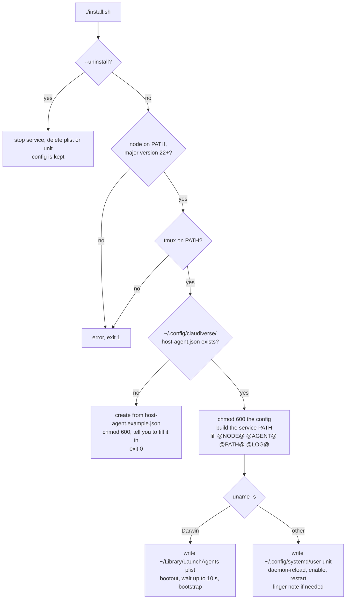

# Installing and running the host agent as a service

`install.sh` installs the host agent as a per-user service on the machine that runs your seats: a launchd agent on macOS, a systemd user unit on Linux. It checks the prerequisites, creates the config file on first run, fills in a service definition, and (re)starts the service. The same script updates and removes it. The service keeps the agent running across crashes and reboots, so the machine's seats can always be started from the apps.

## How it works

`install.sh` is meant to be run where it lies, in a clone. It works out its own directory (`HERE`), uses `cv-host-agent.mjs` in that directory as the program to run, and uses the config at `~/.config/claudiverse/host-agent.json`. The config lives outside the repository on purpose.



### Prerequisites the script checks

In this order, each failure prints a message on stderr and exits 1:

1. `node` is found on `PATH`.
2. Node's major version is 22 or higher. Node 22 is required for the built-in `WebSocket`.
3. `tmux` is found on `PATH`.

The script does not check for Claude Code, the mod, or `cv-spawn.sh`.

### First run and later runs

If `~/.config/claudiverse/host-agent.json` does not exist, the script creates the directory, copies `host-agent.example.json` to the config path, runs `chmod 600` on it, prints a message, and exits 0 without installing anything. Edit the file (see [configuration.md](configuration.md)), then run `./install.sh` again.

On every later run the script runs `chmod 600` on the config again, then installs the service.

### The service PATH

Services start with a minimal environment, and the agent needs `tmux` and the tools `cv-spawn.sh` uses. The script builds the service `PATH` as:

```
<dir of node>:<dir of tmux>:/opt/homebrew/bin:/usr/local/bin:/usr/bin:/bin:/usr/sbin:/sbin
```

It substitutes four placeholders in the files under `service/`: `@NODE@` (the absolute path of `node`), `@AGENT@` (the absolute path of `cv-host-agent.mjs`), `@PATH@` (the string above) and `@LOG@` (the log file, macOS only; empty on Linux). The paths are fixed when you install. If you move the clone, or install a different Node, run `./install.sh` again.

### macOS: launchd

| Item | Value |
|---|---|
| Label | `no.claudiverse.host-agent` |
| Definition | `~/Library/LaunchAgents/no.claudiverse.host-agent.plist` |
| Domain | `gui/<your uid>` |
| `RunAtLoad` | true |
| `KeepAlive` | true |
| `ThrottleInterval` | 10 |
| Log (stdout and stderr) | `~/Library/Logs/claudiverse-host-agent.log` |

The script writes the plist, runs `launchctl bootout` on the label (errors ignored), then waits for the job to disappear before it runs `launchctl bootstrap`. `bootout` returns before the job is actually gone, and bootstrapping too early fails with `Bootstrap failed: 5: Input/output error`. The script therefore polls `launchctl print` every 0.5 s, up to 20 times (10 s), and bootstraps when the job is gone or the wait runs out.

### Linux: systemd user unit

| Item | Value |
|---|---|
| Unit | `claudiverse-host-agent.service` |
| Location | `~/.config/systemd/user/claudiverse-host-agent.service` |
| `After` / `Wants` | `network-online.target` |
| `Restart` / `RestartSec` | `always` / `10` |
| `KillMode` | `process` |
| `WantedBy` | `default.target` |
| Log | the journal: `journalctl --user -u claudiverse-host-agent.service -f` |

The script writes the unit, runs `systemctl --user daemon-reload`, then `systemctl --user enable` followed by `systemctl --user restart`. It does not use `enable --now`: `restart` alone starts a stopped service and restarts a running one on an update. The script's comment records that `enable --now` followed by `restart` started the agent twice.

A user unit stops when your last login session ends unless lingering is on. After installing, the script checks `loginctl show-user "$USER" -p Linger` and, if it does not say `yes`, prints a note to run `loginctl enable-linger $USER`. Do that on a machine you do not stay logged in to.

### Why `KillMode=process`

The agent starts seats in a tmux server, and that tmux server is the agent's child process. Inside a systemd unit, a child belongs to the unit's cgroup. With the default `KillMode=control-group`, stopping or restarting the unit killed every process in the cgroup, so every seat on the machine died at each restart. `install.sh` restarts the unit on every update, so every update killed every seat (the unit file records this as measured on Debian 12, systemd 252). `KillMode=process` makes systemd stop only the agent's main process. Seats keep running in tmux and the new agent finds them again by their tmux sessions. macOS needs no equivalent setting in the plist.

### Updating

```sh
cd claudiverse/agent/host
git pull && ./install.sh
```

The service definition is rewritten and the agent restarted. Running seats are not touched.

### Uninstalling

```sh
./install.sh --uninstall
```

On macOS this runs `launchctl bootout` and deletes the plist. On Linux it runs `systemctl --user disable --now`, deletes the unit, and runs `daemon-reload`. It then prints `removed the service (config kept at <path>)`. The config, and the log file on macOS, are not deleted. The prerequisite checks are skipped for `--uninstall`.

### Running in the foreground

For a first test or for debugging, run the agent directly and read its output in the terminal:

```sh
node cv-host-agent.mjs
```

Stop the service first, or two agents will compete for the same host channel. To use a different config file, set `CLAUDIVERSE_HOST_AGENT_CONFIG`:

```sh
CLAUDIVERSE_HOST_AGENT_CONFIG=~/test-agent.json node cv-host-agent.mjs
```

On start, after the config loads, the agent logs one line, prefixed with an ISO timestamp:

```
2026-01-01T12:00:00.000Z claudiverse host agent 0.11.1: my-laptop -> https://claudiverse.example
```

The two names are the configured `name` (default: the machine's hostname) and the configured `server`. Seeing this line means the config loaded and `spawn_runtime` (if set) was valid.

### Tests

```sh
node --test
```

There is no `package.json` and no dependency to install.

## Configuration

`install.sh` takes one optional argument and reads no environment variables of its own.

| Item | Default | Meaning |
|---|---|---|
| `--uninstall` | not set | Remove the service; keep the config. |
| Config path | `~/.config/claudiverse/host-agent.json` | Where `install.sh` creates and checks the config. |
| `CLAUDIVERSE_HOST_AGENT_CONFIG` | unset | Read by the agent (not by `install.sh`): use this config path instead of the default. A service installed by `install.sh` does not set it. |

Config keys are described in [configuration.md](configuration.md). The agent requires four: `server`, `host_token`, `seat_token`, `cv_spawn`.

## Interface

Commands, all from the clone directory:

| Command | Effect |
|---|---|
| `./install.sh` | Install or update, then (re)start. On the first run, only creates the config. |
| `./install.sh --uninstall` | Stop and remove the service. |
| `node cv-host-agent.mjs` | Run in the foreground. |
| `./cv-host-agent.mjs add-root <folder>` / `list-roots` | Edit or print the folder whitelist, then exit. See [roots.md](roots.md). |
| `node --test` | Run the tests. |

Viewing logs:

```sh
# macOS
tail -f ~/Library/Logs/claudiverse-host-agent.log

# Linux
journalctl --user -u claudiverse-host-agent.service -f
```

Checking the service:

```sh
# macOS
launchctl print gui/$(id -u)/no.claudiverse.host-agent

# Linux
systemctl --user status claudiverse-host-agent.service
```

## Failure modes and troubleshooting

`install.sh` messages, printed to stderr with exit status 1:

| Message | Cause and fix |
|---|---|
| `node not found on PATH` | Install Node.js 22 or newer, or fix `PATH` in the shell that runs the script. |
| `node <N> is too old: need 22+ (built-in WebSocket)` | Upgrade Node. The agent relies on the built-in `WebSocket`. |
| `tmux not found on PATH` | Install tmux. |

Other outputs of `install.sh`:

- `created <path> from the example — fill it in, then run ./install.sh again` (exit 0): normal first run. Nothing is installed yet.
- `note: run 'loginctl enable-linger <user>' so it keeps running without a login session` (Linux): the service stops when you log out until you run that command.
- `Bootstrap failed: 5: Input/output error` (macOS, from `launchctl`): the old job had not finished going away. The script waits up to 10 s to avoid this; run `./install.sh` again.

Agent start-up failures, visible in the log (the process exits non-zero, and the service manager restarts it: `ThrottleInterval` and `RestartSec` are 10 s, so the error repeats about every 10 s):

- `config <path>: "<key>" is required`, for `<key>` one of `server`, `host_token`, `seat_token`, `cv_spawn`. A key is missing or empty in the config. Fill it in and run `./install.sh` again (or restart the service).
- `spawn_runtime "<name>" is not one of this machine's runtimes`. `spawn_runtime` is set, but the name is not a key under `runtimes`, does not match the allowed name pattern, or that runtime's `bin` is not an absolute path. The agent checks this at start so that New seat does not fail later. Fix the name or the `bin` path.
- A missing or invalid JSON config also stops the agent at start, with the file system or JSON parse error.

If the install succeeded but the agent never logs the `claudiverse host agent <version>: ...` line, read the log for one of the errors above. If seats were running before an update they should still be running after it; list them with `tmux ls`.

## Related pages

- [Host agent reference](README.md)
- [Configuration reference](configuration.md)
- [The host channel](channel.md)
- [Local relay](relay.md)
- [Starting seats](starting-seats.md)
- Server: [Accounts, sign-up and tokens](../server/auth.md)
- Mac: [Settings](https://github.com/Promises/claudiverse-apps/blob/main/docs/mac/settings.md)

## Source

- `install.sh`
- `service/claudiverse-host-agent.service`
- `service/no.claudiverse.host-agent.plist`
- `host-agent.example.json`
- `cv-host-agent.mjs` (`VERSION`, `loadConfig`, start-up log line)
- `lib/rules.mjs` (`spawnRuntime`)
- `README.md`
