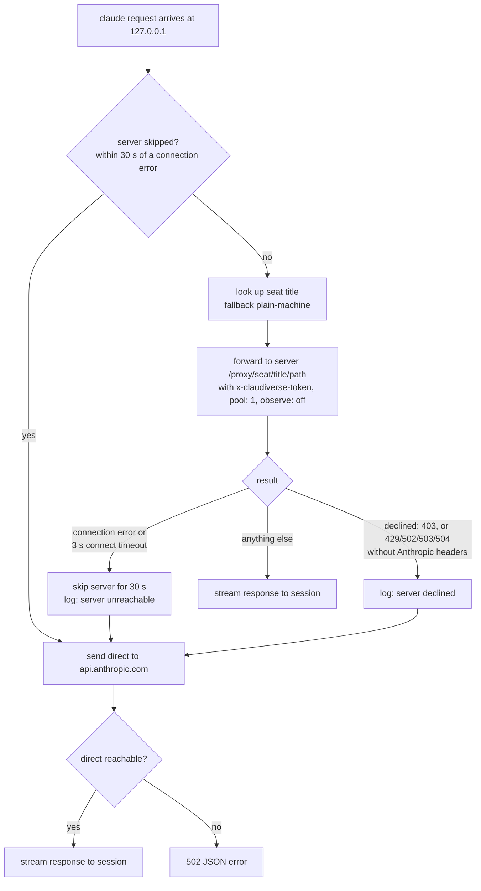

# Local relay

The local relay is a small HTTP listener inside the host agent. It lets a plain `claude` that you start in a shell on this machine send its API requests through the Claudiverse server's proxy, so they run on the server's account pool with its failover. A plain `claude` must keep working with no server, so every request the server cannot serve goes straight to `https://api.anthropic.com` using the session's own login.

## How it works

The relay is opt-in. It starts only when the host agent config sets an integer `relay_port` greater than 0. It listens on `127.0.0.1` only, so nothing on the network can reach it.

A shell function from `claude-relay.sh` points `claude` at the relay. You source the file from `~/.zshrc` or `~/.bashrc`:

```sh
source /path/to/claudiverse/agent/host/claude-relay.sh
```

The function `claude()` does this on each call:

1. If `ANTHROPIC_BASE_URL` is already set, it runs the binary unchanged.
2. Otherwise it probes `http://127.0.0.1:$CLAUDIVERSE_RELAY_PORT/_relay` with `curl --max-time 1`. If the probe succeeds, it runs the binary with `ANTHROPIC_BASE_URL=http://127.0.0.1:$CLAUDIVERSE_RELAY_PORT`.
3. If the probe fails (relay not running), it runs the binary unchanged.

The relay answers `/_relay` itself and never forwards it. The body is `pool` normally, or `direct` while the server is being skipped (see below).

The binary is `CLAUDIVERSE_CLAUDE_BIN`, not whatever `claude` PATH resolves to, because an older `claude` can sit earlier on PATH.

### Why not settings.json `env`

Do not set `ANTHROPIC_BASE_URL` in Claude Code's `settings.json`. A settings `env` value overrides the environment a session was started with, so it would also redirect seats that have their own routing. The shell function affects only a `claude` typed in a shell.

Seats started by `cv-spawn` or by profiles use an absolute binary path with their own routing and never pass through the relay.

### How a request flows

The relay buffers the whole request body (a request may be sent twice: to the server, then direct). Responses are streamed back untouched.

1. Strip hop-by-hop headers (`connection`, `keep-alive`, `proxy-connection`, `transfer-encoding`, `upgrade`, `te`, `trailer`, `host`, `content-length`) and any `x-claudiverse-*` header the session sent itself.
2. If the server is not currently being skipped, work out the seat title. Read the `x-claude-code-session-id` request header. With no such header the title is the fallback `plain-<machine>`. Otherwise call `GET <server>/api/seats/whoami?claude_session_id=<id>` with `Authorization: Bearer <seat token>` (timeout 3 s) and use the returned `title` if it matches `^[A-Za-z0-9._-]{1,64}$`. Any failure or invalid title gives the fallback. The fallback is `plain-<machine>` with characters outside `[A-Za-z0-9._-]` replaced by `-`, cut to 64 characters.
3. Only real answers are cached, per session id, for 60 s. A miss is never cached: Claude Code's first requests arrive before the mod has registered the seat, and caching that miss would label a new session `plain-<machine>` for a minute.
4. Forward to `<server>/proxy/seat/<title><original path>` with the session's own headers (including its own login, which the proxy replaces on the way out) plus:
   - `x-claudiverse-token: <seat token>`
   - `x-claudiverse-pool: 1`
   - `x-claudiverse-observe: off`
5. If the server answered and did not decline, the response goes back to the session.
6. Otherwise the request is sent to `https://api.anthropic.com<original path>` with the session's own headers.



### When the request goes direct

The server counts as having declined, and the request goes direct, when it answers:

- `403` (the proxy refused the claudiverse token).
- `429` with no header whose name starts with `anthropic-ratelimit`. This is the proxy's own "no pool account" answer. An ordinary Anthropic `429` carries `anthropic-ratelimit` headers and is passed to the session unchanged.
- `502`, `503` or `504` with no header whose name starts with `anthropic-`.

A connection error to the server (any error from the request, including the 3 s connect timeout) is handled differently: the relay marks the server as skipped for 30 s, and every request in that window goes direct without trying the server. A dead server therefore costs one connect timeout, not one per request. While the server is skipped, `/_relay` answers `direct`.

A decline (403, 429, 502/503/504 as above) affects only that request. The server is tried again for the next one.

### When direct also fails

If the direct request fails with a connection error before any response headers were sent, the relay answers the session with status `502` and:

```json
{ "type": "error", "error": { "type": "api_error", "message": "cv-relay: <error message>" } }
```

## Configuration

| Setting | Where | Default | Meaning |
|---|---|---|---|
| `relay_port` | host agent config (`~/.config/claudiverse/host-agent.json`) | unset (relay off) | Integer > 0 turns the relay on, listening on `127.0.0.1:<relay_port>`. |
| `server` | host agent config | none | Where the proxy and `whoami` calls go (trailing `/` removed). |
| `seat_token` | host agent config | none | Sent as `Authorization: Bearer` to `whoami` and as `x-claudiverse-token` to the proxy. |
| `name` | host agent config | the hostname | The `<machine>` in the fallback title `plain-<machine>`. |
| `CLAUDIVERSE_RELAY_PORT` | shell, read by `claude-relay.sh` | `4097` | Port the shell function probes and points `ANTHROPIC_BASE_URL` at. Must equal `relay_port`. |
| `CLAUDIVERSE_CLAUDE_BIN` | shell, read by `claude-relay.sh` | `~/.local/bin/claude` | The binary the function runs. |

Fixed values in `lib/relay.mjs`: skip window 30 s, connect timeout 3 s, title cache 60 s, direct target `https://api.anthropic.com`. The host agent does not expose them as config.

See [configuration.md](configuration.md) for the rest of the config file.

## Interface

The relay exposes one endpoint of its own:

```
GET http://127.0.0.1:4097/_relay
200 text/plain
pool        (server in use)
direct      (server currently skipped)
```

Every other path is proxied as described above, with method, query string and body preserved.

## Failure modes and troubleshooting

Log lines go through the host agent's logger (ISO timestamp prefix).

| Log line | Meaning and action |
|---|---|
| `relay: listening on 127.0.0.1:<port>` | Relay is up. |
| `relay: cannot listen on 127.0.0.1:<port>: <message>` | The port is taken or not allowed. Pick another `relay_port` and set `CLAUDIVERSE_RELAY_PORT` to match. The rest of the host agent keeps running. |
| `relay: server unreachable (<code or message>); direct for 30 s` | Connection to the server failed. Requests go direct for 30 s. Check `server` and the network. |
| `relay: server declined <METHOD> <path>; this request goes direct` | The server answered 403, a bare 429 or a bare 502/503/504. 403 usually means a wrong `seat_token`; a bare 429 means the pool has no account. |
| `relay: <message>` | An unexpected error inside the handler; the relay answers `502` if headers were not yet sent. |

Other symptoms:

- `claude` does not use the relay: `ANTHROPIC_BASE_URL` is already set in that shell, or the function is not sourced, or the `/_relay` probe failed (relay not running, or `CLAUDIVERSE_RELAY_PORT` differs from `relay_port`).
- Sessions labelled `plain-<machine>` in the proxy: the session id was missing, the seat was not registered yet, or `whoami` failed. The label corrects itself once a real answer is returned and cached.
- `502` with `cv-relay: ...` in the session: neither the server nor Anthropic could be reached.

## Related pages

- [Host agent reference](README.md)
- [Configuration reference](configuration.md)
- [Installing and running the host agent as a service](install-and-service.md)
- [Starting seats](starting-seats.md)
- Server: [The Anthropic account pool](../server/account-pool.md), [The API proxy](../server/api-proxy.md)
- Runners and tools: [cv-spawn.sh: starting a seat](../runners/cv-spawn.md)

## Source

- `lib/relay.mjs`
- `claude-relay.sh`
- `cv-host-agent.mjs` (creates the relay when `relay_port` is set)
- `test/relay.test.mjs`
- `host-agent.example.json`
