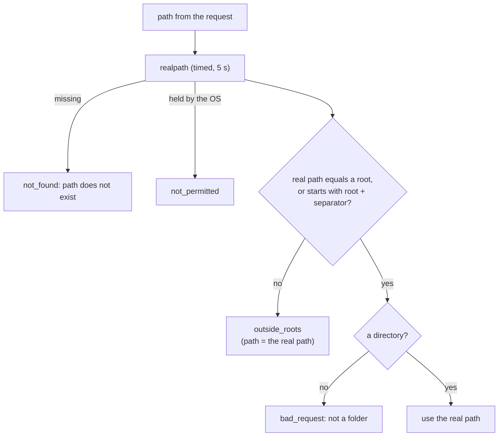
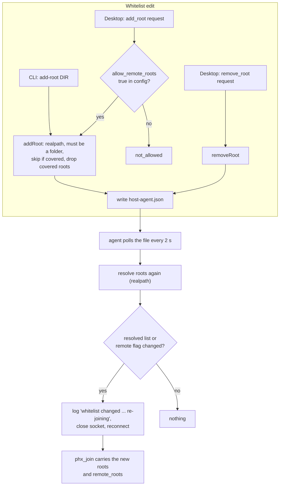

# Roots and folder browsing

The roots are the host agent's folder whitelist: the list of folders on this machine in which it will browse, start seats, and act on running seats. The `ls` request is how the apps' folder picker walks that list. The whitelist exists because the agent, not the server, is the authority on what a machine exposes: even a compromised server cannot make the agent list, spawn in, or stop a seat in a folder that is not inside a root.

## How it works

### The whitelist is the config's `roots`

The roots live in the `roots` array of the machine's config file (`~/.config/claudiverse/host-agent.json` by default, or the path in `CLAUDIVERSE_HOST_AGENT_CONFIG`). If `roots` is missing or not an array, the agent treats it as empty.

The configured strings are never trusted as they are. The agent resolves each one with `realpath` and keeps the result as its working list. This happens at start and again on every change to the list (a config edit, or a remote `add_root` / `remove_root`). A root that does not exist, or that the machine will not let the agent resolve within 5 seconds (see "Every filesystem call is timed" below), is skipped. The agent logs one line per skipped root:

```
warning: root /home/me/gone does not exist or cannot be read yet; ignored
```

If no root survives, it logs:

```
the whitelist is empty: no folders are offered until one is added (add-root)
```

The agent still comes online with an empty list; it just offers nothing.

### Checking a path: `resolveInRoots`

Every operation that takes a folder from outside (`ls`, `spawn`, `resume`, `start_profile`, and the working-directory checks behind `stop`, `interrupt`, `set_mode` and the adopt ops) goes through one function, `resolveInRoots`. It does this, in order:

1. `realpath` of the given path. `..` segments and symlinks are resolved first, so they cannot be used to walk out of a root. If the path does not exist: refusal `not_found`, `<path> does not exist`.
2. The real path must equal a (resolved) root, or start with that root followed by a path separator. The check is on whole segments: `/home/me/projects-old` is not inside `/home/me/projects`. If it fails: refusal `outside_roots`, `<path> is outside this machine's allowed folders`. The refusal carries `path`, set to the real path that was refused, so a client can offer to allow exactly that folder.
3. The real path must be a directory. If not: refusal `bad_request`, `<path> is not a folder`.
4. It returns the real path, and the caller uses only that.



### Listing folders: `ls`

`ls` takes one argument, `path`.

- An empty or missing `path` lists the roots themselves, as full real paths. `parent` is `null`.
- Otherwise the path goes through `resolveInRoots`, and the reply lists the visible subfolders of the real path: entries that are directories and whose names do not start with `.`. Names are sorted with `localeCompare`. At most 500 are returned (`MAX_DIRS`); if there were more, `truncated` is `true`. Only names are returned, not paths. Entries are classified from the directory listing itself, so a symlink to a folder is not listed as a folder.
- `parent` is `""` when the listed folder is a root (the client goes back to the root list by asking for `""`), otherwise the real path's parent folder (`path.dirname`). For a root the parent is deliberately not its real parent folder, which is outside the whitelist.

### Editing the whitelist

There are three ways in, and all of them end in the same config file.

**On the machine.** `cv-host-agent.mjs add-root DIR` and `list-roots` (see Interface). Running agents notice the file change on their own.

**Remotely, from the desktop app.** The server sends the agent a request with op `add_root` or `remove_root` and `args.path`:

- `add_root` is accepted only if the machine's own config has `"allow_remote_roots": true`. The flag is read from the file fresh on every request (and, if the file cannot be read, counts as `false`), so editing it takes effect at once, with no restart. Without it the request is refused with `not_allowed`, and nothing the server or app sends can add a root.
- `remove_root` is always accepted, since it only narrows what the machine offers.
- `args.path` must be a string and absolute; otherwise refusal `bad_request`, `path must be an absolute folder path`.
- If the edit changed anything, the agent writes the config (mode `0600`), logs `add_root <path> (from the desktop)` or `remove_root <path> (from the desktop)`, re-resolves its roots, and schedules a re-join 200 ms later, after the reply has been sent. The reply is `{"roots": [...]}`: the agent's resolved roots after the change. If nothing changed, the config is not rewritten and no re-join happens.

**By hand.** Edit `roots` in the file. This is the only way to remove a root locally; there is no `remove-root` command.

### What `addRoot` and `removeRoot` do to the list

Both work on the parsed config and return `{config, changed, roots}`; the caller writes the file.

- `addRoot(dir)`: `dir` is resolved with `realpath` and must be an existing directory (else `not_found`, `<dir> is not an existing folder`). The real path is what gets stored, not the string given. If an existing root already covers it (equal, or the folder is inside it, compared by real path and whole segments), nothing is added and `changed` is `false`. Otherwise the new real path is appended, and any existing roots that it covers are dropped, so the list never holds nested or duplicate entries however it was edited. An existing root that no longer resolves is compared by its stored string.
- `removeRoot(dir)`: drops every entry that is equal to `dir` as written, or that resolves to the same real path as `dir`. A folder that has since been deleted can still be removed by the string stored. `changed` is `true` only if the list got shorter.



### Polling and re-joining

The server learns the roots from the agent's join payload (`roots` and `remote_roots`; see [channel.md](channel.md)), so after any change the agent must re-join. The agent polls the config file with `fs.watchFile` every 2000 ms. It polls rather than using `fs.watch` because an editor that saves by writing a new file and renaming it over the old one would silently end an `fs.watch` watcher.

On each change to the file the agent re-reads `roots`, resolves them, and compares the resolved list and the `allow_remote_roots` flag with what it had when it last joined. Only if one of them differs does it log

```
whitelist changed: /home/me/projects; remote folders allowed; re-joining
```

(`(empty)` replaces the list when there are no roots; `not allowed` replaces `allowed` when the flag is false) and close the socket. The close handler reconnects after the backoff and the new join carries the new list. If the file is unreadable or not valid JSON, the agent logs `config unreadable, keeping the current whitelist: <error>` and changes nothing. The remote edit path does not wait for the poll: it re-joins itself.

The apps see the change as soon as the join arrives. A config edit that changes neither the resolved list nor the flag, such as a root that cannot be resolved being added, does not cause a re-join.

### Every filesystem call is timed

On macOS, reading a protected folder (Documents, Desktop, Downloads) from a launchd-run process waits for a privacy consent prompt on the machine's screen, for as long as nobody answers. If the agent waited synchronously, it would stop answering everything, including requests that read nothing, while still looking online. So every filesystem call in the roots code (`realpath`, `stat`, `readdir`) is asynchronous and raced against a timer of `FS_TIMEOUT_MS` = 5000 ms. When the timer wins, the request is refused with `not_permitted`:

```
this machine did not let the agent read /home/me/Documents within 5 s — on macOS, answer the privacy prompt on its screen, or give node access in System Settings → Privacy & Security → Files and Folders (or Full Disk Access)
```

The held call itself stays pending in the background; only the reply moves on. While resolving roots, the same timer makes a held root a skipped root rather than a hang.

## Configuration

| Key / variable | Meaning | Default |
|---|---|---|
| `roots` | Array of absolute folder paths the agent may work in. | `[]` (nothing offered) |
| `allow_remote_roots` | Whether a remote `add_root` is accepted. Must be exactly `true`. Read from the file on every request. | not set, so `false` |
| `CLAUDIVERSE_HOST_AGENT_CONFIG` | Path of the config file. | `~/.config/claudiverse/host-agent.json` |
| `FS_TIMEOUT_MS` | Time limit on each filesystem call (constant in `lib/rules.mjs`, not configurable). | 5000 ms |
| `MAX_DIRS` | Folders returned by one `ls` (constant, not configurable). | 500 |
| Config poll interval | How often the file is checked for changes (constant, not configurable). | 2000 ms |

## Interface

### CLI

Both commands read the config file, act, and exit. They do not need the agent to be running.

```sh
cv-host-agent.mjs add-root DIR
cv-host-agent.mjs list-roots
```

`list-roots` prints each entry of `roots` as stored, one per line.

`add-root` prints one of:

```
whitelisted /home/me/projects (the running agent picks it up within a few seconds)
already whitelisted
```

The first is printed after the file was rewritten (it names the stored real path, which is the last entry of the list); the second when an existing root already covers `DIR`. On failure it prints to stderr and exits 1:

```
add-root: /home/me/nope is not an existing folder
```

With no `DIR`, the folder shows as `(none)`: `add-root: (none) is not an existing folder`. The local command does not check `allow_remote_roots`; that flag only governs requests from the desktop. A relative `DIR` is resolved against the shell's working directory and stored as a real path.

### Channel requests

Requests arrive as `request` events on `host:<name>` and are answered with `reply` (see [channel.md](channel.md)).

`ls` of the root list:

```json
{ "request_id": "…", "op": "ls", "args": { "path": "" } }
```

```json
{ "request_id": "…", "ok": true, "result": { "path": "", "parent": null, "dirs": ["/home/me/projects", "/home/me/notes"], "truncated": false } }
```

`ls` of a folder:

```json
{ "request_id": "…", "op": "ls", "args": { "path": "/home/me/projects" } }
```

```json
{ "request_id": "…", "ok": true, "result": { "path": "/home/me/projects", "parent": "", "dirs": ["api", "web"], "truncated": false } }
```

For `/home/me/projects/web` the same reply has `"parent": "/home/me/projects"`.

A refusal outside the roots:

```json
{ "request_id": "…", "ok": false, "code": "outside_roots", "error": "/home/me/other is outside this machine's allowed folders", "path": "/home/me/other" }
```

`add_root` and `remove_root`:

```json
{ "request_id": "…", "op": "add_root", "args": { "path": "/home/me/other" } }
```

```json
{ "request_id": "…", "ok": true, "result": { "roots": ["/home/me/projects", "/home/me/other"] } }
```

Refusals when the machine has not opted in:

```json
{ "request_id": "…", "ok": false, "code": "not_allowed", "error": "my-laptop does not accept folders from the desktop (set \"allow_remote_roots\": true in its config)" }
```

### Server endpoints the apps use

Confirmed in the server's router and `host_controller.ex`, all under `/api` with a Bearer token:

- `GET /api/hosts/:host/ls?path=<folder>` sends `ls`. A missing or non-string `path` is sent as `""` (the root list). The reply body is the agent's result. An offline host or no answer gives 504; an agent refusal gives `{"error": …, "code": …}` with 403 for `outside_roots` and `not_allowed`, 404 `not_found`, 400 `bad_request`, 429 `limit`, and 502 otherwise. This endpoint does not forward the refusal's `path` field to the app.
- `POST /api/hosts/:host/roots` with `{"path": "/abs/folder"}` sends `add_root`.
- `DELETE /api/hosts/:host/roots` with `{"path": "/abs/folder"}` sends `remove_root`.

Both roots endpoints need the super (desktop) token (403 otherwise), require a `path` string starting with `/` (400 `path must be an absolute folder path` otherwise), and answer `{"roots": [...]}` as the agent now has them. `GET /api/hosts` lists each online machine's `roots` and `remote_roots`.

## Failure modes and troubleshooting

| What you see | Cause | What to do |
|---|---|---|
| Log: `warning: root <path> does not exist or cannot be read yet; ignored` | The folder is missing, unmounted, or the OS held the `realpath` for 5 s. | Create or mount the folder, or on macOS answer the privacy prompt. The entry stays in the config; the next change to the file resolves it again. |
| Log: `the whitelist is empty: no folders are offered until one is added (add-root)` | No root survived resolution. | `cv-host-agent.mjs add-root DIR`. |
| `ls` of `""` shows fewer folders than the config lists | Skipped roots (see above). | Check the agent log. `list-roots` shows the stored strings; `ls` shows real paths. |
| `outside_roots`: `<path> is outside this machine's allowed folders` | The real path (after symlinks and `..`) is not inside any root. | Add the folder with `add-root`, or from the desktop if `allow_remote_roots` is true. A symlink inside a root that points elsewhere is outside as well. |
| `not_permitted`: `this machine did not let the agent read … within 5 s` | macOS privacy prompt unanswered, or node lacks access to that folder. | Answer the prompt on the machine's screen, or grant node access under System Settings, Privacy & Security, Files and Folders (or Full Disk Access). |
| `not_allowed`: `<name> does not accept folders from the desktop …` | A remote `add_root` on a machine without `"allow_remote_roots": true`. | Set the flag in that machine's config, or use `add-root` on the machine. |
| `bad_request`: `path must be an absolute folder path` | A remote edit with a relative or non-string path. | Send an absolute path. |
| `not_found`: `<dir> is not an existing folder` | `add_root` / `add-root` of a path that does not exist or is a file. | Fix the path. |
| `bad_request`: `<path> is not a folder` | `ls` or a spawn on a file. | Pick a folder. |
| Log: `config unreadable, keeping the current whitelist: …` | The config is being saved, or the JSON is invalid. | Fix the file; the next poll picks it up. |
| Edited a root but the app still shows the old list | The change has not reached the agent's 2 s poll, or the resolved list and flag did not change. | Wait a few seconds and look for the `whitelist changed … re-joining` log line. |

## Related pages

- [Host agent reference](README.md) for the host agent overall.
- [The host channel](channel.md) for the `host:<name>` channel, the join payload and the request/reply format.
- [Starting seats](starting-seats.md) for `spawn`, `resume` and `start_profile`, which use `resolveInRoots`.
- [Seat control](seat-control.md) for `stop`, `interrupt` and `set_mode`, which check the seat's folder against the roots.
- [Folder trust and first-run setup](trust-and-setup.md) for the other things a machine decides.
- [Configuration reference](configuration.md) for the whole config file.
- Server: [Profiles and the host channel](../server/profiles-and-hosts.md)
- Android: [New seat (spawning a seat)](https://github.com/Promises/claudiverse-apps/blob/main/docs/android/new-seat.md)
- Mac: [New seat](https://github.com/Promises/claudiverse-apps/blob/main/docs/mac/new-seat.md), [Settings](https://github.com/Promises/claudiverse-apps/blob/main/docs/mac/settings.md)

## Source

- `cv-host-agent.mjs` (config loading, `applyRoots`, `remoteRoots`, the `add-root` / `list-roots` commands, the config poll and re-join)
- `lib/rules.mjs` (`timed`, `realRoots`, `resolveInRoots`, `listDirs`, `addRoot`, `removeRoot`, `Refusal`)
- `test/rules.test.mjs`
- `host-agent.example.json`
- Server: `server/api/lib/claudiverse_server_web/router.ex` and `controllers/host_controller.ex`
