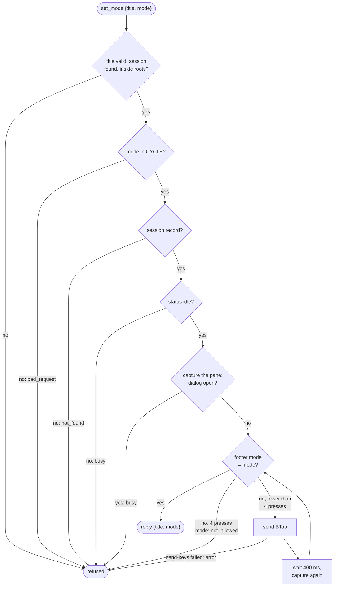

# Seat control

Seat control is the part of the host agent that acts on a seat that is already running on this machine: it can close the seat (`stop`), press Escape in it (`interrupt`), and switch its permission mode (`set_mode`). A background mode sweep also reads every Claude Code seat's permission mode and reports changes to the server. All of this works through tmux: the agent addresses a seat's tmux session by name, sends it keys, and reads its screen. It exists so the apps can steer seats whose Claude Code process offers no remote handler for these actions.

## How it works

The server sends a `request` on the agent's `host:<name>` channel (see [channel.md](channel.md)) with an `op` of `stop`, `interrupt` or `set_mode`. The agent answers with a `reply` carrying either `ok: true` and a result, or `ok: false` with a `code` and an `error` sentence.

### The shared check: `seatInRoots`

All three ops start with the same check, so the app can never reach a seat the agent could not have started:

1. The `title` must match `^[A-Za-z0-9._-]{1,64}$`. Otherwise the request is refused with `bad_request`.
2. A tmux session named exactly `title` must exist (`tmux has-session -t =<title>`; the `=` makes the name match exactly, not as a prefix). Otherwise `not_found`.
3. The agent reads the pane's current path (`#{pane_current_path}`). If tmux fails or returns nothing, the request is refused with `error`.
4. That path is resolved with `realpath` and must be a configured root or inside one (see [roots.md](roots.md)). Symlinks and `..` cannot walk out of a root. Otherwise `outside_roots`, with the resolved folder in the reply's `path` field.

The agent targets the pane as `=<title>:`, the exact session's active pane.

### stop

`stop` runs `tmux kill-session -t =<title>`. The conversation stays on disk, so the seat can be resumed later (see [starting-seats.md](starting-seats.md)). The title is also removed from the agent's set of app-started seats, which is what the `max_seats` limit counts, so a stopped seat frees a slot.

### interrupt

`interrupt` sends exactly one `Escape` with `tmux send-keys`. In Claude Code one Escape stops the running turn, or dismisses a permission prompt. The agent never sends two: a second quick Escape opens Claude Code's rewind menu. The agent does not check whether the seat is mid-turn; it presses the key whenever the shared check passes.

### set_mode

`set_mode` switches the permission mode the way a person at the terminal does, with Shift+Tab (tmux key `BTab`). Claude Code cycles `default`, `acceptEdits`, `plan`, `auto`, then back to `default`. The accepted values are exactly the entries of that cycle (`CYCLE` in `lib/mode.mjs`); `bypassPermissions` and `dontAsk` are not accepted.

After the shared check, the agent:

1. Refuses a `mode` not in the cycle with `bad_request`.
2. Finds the seat's Claude Code session record (`<config dir>/sessions/<pid>.json`; see [adopt.md](adopt.md)) by taking the pane's process and its direct children and looking for a record with one of those pids. No record: `not_found`.
3. Refuses unless the record's `status` is exactly `"idle"` (`busy` otherwise).
4. Captures the pane. If a dialog is open, refuses with `busy`.
5. Repeats: if the footer already shows the wanted mode, done; otherwise press `BTab`, wait 400 ms, capture the pane again. At most 4 presses (one full cycle). If the mode is still not reached, refuse with `not_allowed`: the mode is not in that seat's cycle.



### Reading the footer

Claude Code's footer names the mode in force, for example `auto mode on (shift+tab to cycle)`. `footerMode` in `lib/mode.mjs` reads only the last 6 lines of the capture (trailing blank space removed) and matches:

| Footer text | Mode |
| --- | --- |
| `accept edits on (shift+tab to cycle)` | `acceptEdits` |
| `plan mode on (shift+tab to cycle)` | `plan` |
| `auto mode on (shift+tab to cycle)` | `auto` |
| no match | `default` |

Reading only the tail means a transcript line that quotes those words is not mistaken for the footer.

`dialogOpen` looks at the last 25 lines of the capture for any of `Do you want to proceed?`, `Enter to select` or `Esc to cancel`. When one is present, Shift+Tab would act on the dialog, so the mode is not changed, and the dialog also hides the footer, so the sweep skips the pane.

### The mode sweep

Every 10 seconds (`MODE_SWEEP_MS`) the agent reads the mode of every seat and reports changes. A seat that runs the stock Claude Code with the mod does not report its own mode, so this is how the apps learn it.

For each tmux session on the machine (`tmux list-sessions`), the sweep:

- takes the pane's process and its direct children, and keeps the session only if one of those pids has a Claude Code session record, in the machine's `claude_config_dir` or any runtime's `config_dir` (see [configuration.md](configuration.md));
- captures the pane and skips it if the capture failed, is empty, or has a dialog open (an empty capture would otherwise read as `default`);
- compares the footer mode with the last mode it reported for that title.

Only titles whose mode differs from the last report are sent, in one message, and nothing is sent when nothing changed. The memory of reported modes is cleared on every join of the channel, because the server forgets modes when it restarts, so the first sweep after a (re)join reports every seat. Only one sweep runs at a time: if tmux is slow, the next timer tick is skipped rather than stacked. The sweep does nothing while the socket is not open.

The sweep does not apply the roots check: it reports any tmux session on the machine that runs a Claude Code process.

## Configuration

Seat control has no settings of its own. Related values:

| Setting | Default | Effect |
| --- | --- | --- |
| `roots` | none | The whitelist the shared check uses; see [roots.md](roots.md). |
| `max_seats` | `10` | Counts app-started seats; `stop` frees a slot. |
| `claude_config_dir` | `$CLAUDE_CONFIG_DIR`, else `~/.claude` | Where the session records are read from. Each runtime's `config_dir` is read too. |

Fixed in code: mode sweep interval 10 s, 400 ms between Shift+Tab presses, at most 4 presses, footer read from the last 6 lines, dialog read from the last 25 lines.

Requires `tmux` on the machine; `pgrep` is used to find a pane's child processes.

## Interface

Requests arrive as `request` events on `host:<name>` with payload `{request_id, op, args}`.

### stop

```json
{"request_id": "r1", "op": "stop", "args": {"title": "lorem-w1"}}
```

Reply: `{"request_id": "r1", "ok": true, "result": {"title": "lorem-w1"}}`

### interrupt

```json
{"request_id": "r2", "op": "interrupt", "args": {"title": "lorem-w1"}}
```

Reply: `{"request_id": "r2", "ok": true, "result": {"title": "lorem-w1"}}`

### set_mode

```json
{"request_id": "r3", "op": "set_mode", "args": {"title": "lorem-w1", "mode": "plan"}}
```

Reply: `{"request_id": "r3", "ok": true, "result": {"title": "lorem-w1", "mode": "plan"}}`

### Refusals

A refusal is a reply `{"request_id": "...", "ok": false, "code": "<code>", "error": "<message>"}`; `outside_roots` adds `"path"`. The log line is `error in <op>:` only for failures that are not refusals.

| Code | Message | Ops | When |
| --- | --- | --- | --- |
| `bad_request` | `title must be 1-64 of A-Z a-z 0-9 . _ -` | all | Title missing or malformed. |
| `not_found` | `no seat named <title> runs here` | all | No tmux session of that exact name. |
| `error` | `could not read <title>'s folder` | all | tmux gave no pane path. |
| `outside_roots` | `<path> is outside this machine's allowed folders` | all | Pane folder not inside a root. |
| `not_found` | `<path> does not exist` | all | Pane folder cannot be resolved. |
| `bad_request` | `<path> is not a folder` | all | Resolved path is not a directory. |
| `not_permitted` | `this machine did not let the agent read <path> within 5 s ...` | all | The OS holds the folder read (on macOS, a privacy prompt). |
| `error` | `tmux kill-session failed: <stderr>` | stop | tmux refused. |
| `error` | `tmux send-keys failed: <stderr>` | interrupt, set_mode | tmux refused. |
| `bad_request` | `mode must be one of default, acceptEdits, plan, auto` | set_mode | Unknown mode. |
| `not_found` | `cannot find the Claude Code session running in <title>` | set_mode | No session record for the pane's process. |
| `busy` | `<title> is mid-turn; switch its mode when it is idle` | set_mode | Record status is not `idle`. |
| `busy` | `<title> has a dialog open; answer it first` | set_mode | Dialog text in the last 25 lines. |
| `not_allowed` | `<mode> is not in <title>'s Shift+Tab cycle (it stays <current>)` | set_mode | Four presses did not reach the mode. |

### seat_modes (agent to server)

Sent on the channel when the sweep sees a change:

```json
{"modes": {"lorem-w1": "plan", "lorem-w2": "default"}}
```

## Failure modes and troubleshooting

- `no seat named <title> runs here`: the tmux session does not exist on this machine, or its name differs. Titles are matched exactly. `tmux list-sessions` on the machine shows what runs.
- `<path> is outside this machine's allowed folders`: the seat's pane has moved (for example by `cd`) outside every root. Add the folder with the agent's `add-root` command or fix `roots`; see [roots.md](roots.md).
- `cannot find the Claude Code session running in <title>`: no session record belongs to the pane's process or its direct children. Typical causes: Claude Code is not running in that pane, runs deeper than a direct child, or its config directory is not `claude_config_dir` or a runtime `config_dir`.
- `<title> is mid-turn`: wait for the turn to end, or use `interrupt` first and retry.
- `<title> has a dialog open`: answer the permission prompt or menu in the seat, then retry. While a dialog is open the sweep also keeps the last reported mode.
- `<mode> is not in <title>'s Shift+Tab cycle`: the seat's Claude Code does not offer that mode in its cycle, or the footer did not change. The message names the mode it ended in.
- `interrupt` did not stop the turn: the agent sends the key and does not verify its effect. Do not send further Escapes in quick succession; two open the rewind menu.
- A mode shown in the app lags: the sweep runs every 10 s. After the agent rejoins, all modes are reported again.
- `mode sweep failed: <message>` in the agent log: a sweep threw; the next tick runs normally.

## Related pages

- [Host agent reference](README.md)
- [The host channel](channel.md)
- [Starting seats](starting-seats.md)
- [Roots and folder browsing](roots.md)
- [Adopting a hand-started seat](adopt.md)
- [Configuration reference](configuration.md)
- Server: [Sessions and Rooms](../server/sessions-and-rooms.md)
- Web panel: [The seat view](../services/web/seat-view.md)
- Android: [Seat controls](https://github.com/Promises/claudiverse-apps/blob/main/docs/android/seat-controls.md)
- Mac: [Seat view](https://github.com/Promises/claudiverse-apps/blob/main/docs/mac/seat-view.md)

## Source

- `cv-host-agent.mjs` (`seatInRoots`, `interruptSeat`, `paneSession`, `sweepModes`, `setMode`, `stopSeat`, the sweep timer)
- `lib/mode.mjs`
- `lib/rules.mjs` (`checkStopTitle`, `resolveInRoots`, `Refusal`)
- `lib/adopt.mjs` (`sessionRecords`)
- `test/mode.test.mjs`
