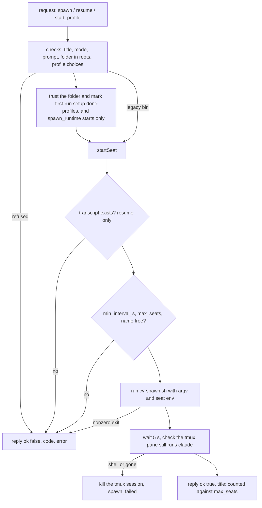

# Starting seats

The host agent starts Claude Code seats on its machine when the server asks it to. It answers three requests, `spawn`, `resume` and `start_profile`, and starts each seat by running the claudiverse repo's `cv-spawn.sh` (the canonical launcher: one detached tmux session per seat, mirrored to the server). The agent is the authority on what may start: it validates every request against its own config, so a compromised or mistaken server cannot start a seat outside the machine's whitelisted folders, with a binary or MCP server the machine does not offer, or faster than the limits allow.

## How it works

The server sends a request over the agent's `host:<name>` channel (see [channel.md](channel.md)). `spawn` and `resume` are what the app's New seat and resume actions send. `start_profile` is sent when a seat profile (kept on the server) is started.



For `start_profile`, and for `spawn` and `resume` when `spawn_runtime` is set, the agent first trusts the folder and marks Claude Code's first-run setup done, so no dialog waits for an answer; see [trust-and-setup.md](trust-and-setup.md). A plain `spawn` or `resume` on the legacy `bin` (no `spawn_runtime`) skips this step.

### The three requests

- `spawn` starts a new seat in a folder inside the roots (see [roots.md](roots.md)). Defaults: `mode` `auto`; `title` derived from the folder name.
- `resume` starts a stopped seat again, continuing a Claude Code conversation (`session_id`). It is a spawn with the same folder, mode and title rules, but takes no prompt: a resumed seat waits for its next message.
- `start_profile` starts a seat from a server-side seat profile. The profile may only choose among what this machine's config offers: permission modes, runtime names, and MCP server names. It never supplies a path to run, a command line or an environment variable.

### Runtimes and `spawn_runtime`

`runtimes` in the config maps a runtime name to a Claude Code binary on this machine. A profile names its runtime; the agent resolves the name to the binary and the settings below. Runtime names must match `^[A-Za-z0-9.+_-]{1,64}$` (for example `stock+mod`), and an entry is offered only if its `bin` is an absolute path.

`spawn_runtime` names one entry of `runtimes` that the app's plain New seat and `resume` start on. The seat is then launched the way a profile on that runtime is: the runtime's binary, its `config_dir`, its `oauth_token_file`, its `pool_only` flag, and the folder trusted in that runtime's own `.claude.json`. Without `spawn_runtime`, New seat and resume run on the legacy `bin` (or cv-spawn's default binary). A profile is never affected by `spawn_runtime`; it names its own runtime.

`spawn_runtime` is validated when the agent starts. A name that is not a valid runtime name, or is not in `runtimes`, or whose `bin` is not an absolute path, stops the agent at startup with:

```
spawn_runtime "<name>" is not one of this machine's runtimes
```

so a typo fails once, loudly, instead of every New seat failing later.

### The MCP catalog

Profiles name MCP servers; the servers themselves come from the machine's catalog, a JSON file (default `~/.config/claudiverse/mcp-catalog.json`, named by the config key `mcp_catalog`; the JSON key inside the file is `mcpServers`):

```json
{ "mcpServers": { "claudiverse": { "command": "...", "args": [] } } }
```

The catalog is read fresh on each start, so an edit applies to the next seat. Only names matching the title rule (`^[A-Za-z0-9._-]{1,64}$`) are offered. A missing or unreadable catalog offers no servers. When a profile asks for MCP servers, the agent writes `{"mcpServers": {...}}` holding exactly the named entries, unchanged, to `<profile_dir>/<name>.mcp.json` (mode `0600`, folder mode `0700`, replaced atomically) and passes it with `--mcp`. A profile with no MCP servers passes no `--mcp`. The agent also watches the catalog file: when it changes it logs `MCP catalog changed: <names>; re-joining` and re-joins the channel so the server and the app see the new list.

### Profile fields

`start_profile` arguments, as validated by the agent:

| Field | Required | Rule |
|---|---|---|
| `name` | yes | Becomes the seat's title. 1-64 of `A-Z a-z 0-9 . _ -` |
| `profile_id` | yes | Positive integer |
| `revision` | yes | Positive integer |
| `folder` | yes | Must resolve to a folder inside the roots |
| `mode` | yes | One of the machine's `modes` (see below) |
| `runtime` | yes | A name in the machine's `runtimes` |
| `model` | no | `^[A-Za-z0-9._:\[\]-]{1,100}$` |
| `effort` | no | `low`, `medium`, `high`, `xhigh`, `max` |
| `fleet` | no | 1-64 of `A-Z a-z 0-9 . _ -` |
| `mcp` | no | List of names, each in the catalog. Default `[]` |
| `resume` | no | A Claude Code session uuid |
| `resume_policy` | no | `latest` or anything else, which counts as `fixed` |
| `debug` | no | `true` adds `--debug`; anything else is off |
| `pooled` | no | `true` adds `--pooled`; anything else is off |

`resume_policy`: `fixed` (the default) means the named conversation must exist on this machine, or the start is refused with `not_found`. `latest` is the server's guess from any machine's seats; if the conversation is not on this machine the agent logs `profile <name>: conversation <id> is not on this machine; starting a new one` and starts a new one instead.

### What cv-spawn does with the flags

`cv-spawn.sh <working_dir> [options]` creates a detached tmux session named by the title, waits for its shell, and types the launch line into it. The flags the agent uses:

- `--title`, `--mode`, `--model`, `--effort`, `--fleet`, `--resume`, `--prompt`: the seat's title, permission mode, model, reasoning effort, fleet, Claude Code conversation to continue, and initial prompt. The prompt is written to a file and the seat is told to read it, so it never sits on the command line.
- `--mcp CFG`: an extra `--mcp-config` file for the seat; repeatable.
- `--bin PATH`: the Claude Code binary.
- `--origin O`: how the seat was started (`spawn`, `runner`, `manual`, `profile`); it is the seat's `CLAUDIVERSE_ORIGIN`.
- `--profile ID` with `--revision N`: the profile and revision the seat is started from; the seat registers them (`CLAUDIVERSE_PROFILE`, `CLAUDIVERSE_PROFILE_REVISION`) and the server fills the seat's fleet, notify and origin from the profile. Integers only.
- `--host NAME`: the machine name the seat reports (`CLAUDIVERSE_HOST`).
- `--debug`: sets `CLAUDIVERSE_DEBUG=1` in the seat.
- `--config-dir D`: Claude Code's config folder for this seat (`CLAUDE_CONFIG_DIR`), and `DISABLE_AUTOUPDATER=1` (auto-updater off). For a seat that must not share `~/.claude`. The folder must exist (exit 2 otherwise).
- `--oauth-token-file F`: the seat logs in with the long-lived token in `F` (from `claude setup-token`) as `CLAUDE_CODE_OAUTH_TOKEN`, instead of the config dir's refreshing login. The token is read by the seat's shell at launch and never appears on a command line. The file must exist and be non-empty (exit 2 otherwise).
- `--pooled`: the seat's model requests go through the server's proxy (`ANTHROPIC_BASE_URL` pointing at `/proxy/seat/<title>`), which sends them with a pool account and fails over on a spent one. The seat keeps its own login. Model calls stop while the server is down.
- `--pool-only`: for a machine with no Claude Code login of its own. The seat logs in with the placeholder `CLAUDE_CODE_OAUTH_TOKEN=cv-pool`, which the proxy swaps for a pool account, and it is implicitly `--pooled`. Nothing works while the server is down. `--pool-only` and `--oauth-token-file` are two different logins; giving both is an error (exit 2).

cv-spawn refuses to start if a tmux session with the exact same title already exists.

### The argv built for each case

All cases start with `<dir> --title <title> --mode <mode>`, then `--resume <session id>` if resuming, and `--prompt <prompt>` if the spawn has one. Then:

**spawn / resume, no `spawn_runtime` (legacy):**

```
--origin spawn  [--mcp <mcp>]  [--bin <bin>]
```

`--mcp` is added when the config has `mcp`, `--bin` when it has `bin`. With neither, cv-spawn uses `$CLAUDIVERSE_BIN` or its own default binary.

**spawn / resume, with `spawn_runtime`:**

```
--origin spawn  [--mcp <mcp>]  [--config-dir <config_dir>]  [--oauth-token-file <oauth_token_file>]  [--pool-only]  --bin <runtime bin>
```

The config `bin` is ignored; `mcp` still applies. `--config-dir`, `--oauth-token-file` and `--pool-only` appear only when the runtime sets them (`config_dir` and `oauth_token_file` only if absolute paths; `pool_only` only if `true`).

**start_profile:**

```
--origin profile --profile <profile_id> --revision <revision> --host <agent name>
[--model <model>] [--effort <effort>] [--fleet <fleet>] [--debug]
[--pool-only | --pooled]
[--config-dir <config_dir>] [--oauth-token-file <oauth_token_file>]
[--mcp <profile_dir>/<name>.mcp.json]
--bin <runtime bin>
```

`--pool-only` is passed when the runtime has `pool_only: true`, whatever the profile's `pooled` says, since nothing else can serve that seat; otherwise `--pooled` is passed when the profile has `pooled: true`. The config `bin` and `mcp` are not used for profiles.

### The environment the seat gets

The seat runs with the agent's own environment, plus:

- `CLAUDIVERSE_URL` set to the config's `server`
- `CLAUDIVERSE_TOKEN` set to the config's `seat_token`, this machine's ordinary seat token; never anything the server sent

and with these variables removed: `CLAUDIVERSE_NOTIFY`, `CLAUDIVERSE_FLEET`, `CLAUDIVERSE_ORIGIN`, `CLAUDIVERSE_HOST_AGENT_CONFIG`. Fleet and origin are set only through the cv-spawn flags above.

### Checks and limits

In this order for a `spawn`:

1. `mode` is one of `default`, `acceptEdits`, `plan`, `auto` (`bypassPermissions` is never allowed). Default `auto`.
2. `path` is present and resolves, through symlinks and `..`, to a folder inside the roots.
3. `title`, if given, matches `^[A-Za-z0-9._-]{1,64}$`. If absent, it is the folder name with other characters turned into `-`, cut to 64 (or `seat`).
4. `prompt`, if given, is text of at most 20000 characters.

A `resume` additionally needs `session_id`, a UUID, which is lowercased. Then, for every seat start:

5. For a resume (or a profile with `resume`): the conversation's transcript `<config dir>/projects/<folder slug>/<id>.jsonl` must exist, looked up first in the folder's own slug, then in every project folder. The config dir is the runtime's `config_dir` when it has one, otherwise `claude_config_dir`. A seat that never had a turn has no transcript.
6. At most one start per `min_interval_s` seconds (default `10`), counted from the previous start attempt, including one that failed.
7. Fewer than `max_seats` (default `10`) running seats that this agent started. The count holds only the titles this agent process started and that still have a tmux session; seats started by hand, by a runner, or before the agent restarted are not counted.
8. No tmux session with the same title already exists.

After cv-spawn exits successfully, the agent waits 5 seconds and looks at the tmux pane's command. If the session is gone or the pane is back at a shell (`sh`, `bash`, `zsh`, `fish`), `claude` has exited; the agent kills the tmux session and refuses with `spawn_failed`. Only then is the seat counted and `{ "title": "<title>" }` returned.

For a profile the `mode` must be in the machine's `modes` (config `modes`, a subset of the four above; default all four). Plain `spawn` and `resume` check only the four-value list, not the config `modes`.

## Configuration

Keys in the host agent config (`~/.config/claudiverse/host-agent.json`; see [configuration.md](configuration.md)):

| Key | Default | Meaning |
|---|---|---|
| `cv_spawn` | required | Path to `cv-spawn.sh` |
| `server` | required | Becomes the seat's `CLAUDIVERSE_URL` |
| `seat_token` | required | Becomes the seat's `CLAUDIVERSE_TOKEN` |
| `name` | hostname | Passed to profile seats as `--host` |
| `roots` | `[]` | Folders a seat may start in |
| `bin` | none | Legacy: Claude Code binary for `spawn`/`resume`, used only when `spawn_runtime` is not set |
| `mcp` | none | Legacy: an MCP config file added to `spawn`/`resume` seats |
| `spawn_runtime` | none | Runtime name in `runtimes` for `spawn`/`resume`; validated at startup |
| `runtimes` | none | Map of name to `{ bin, version, config_dir, oauth_token_file, pool_only }` |
| `runtimes.<n>.bin` | | Absolute path of the binary; required for the runtime to be offered |
| `runtimes.<n>.version` | `null` | Shown in the desktop; informational |
| `runtimes.<n>.config_dir` | none | Absolute path; the seat's `CLAUDE_CONFIG_DIR`; where its conversations and trust live |
| `runtimes.<n>.oauth_token_file` | none | Absolute path of a long-lived login token file |
| `runtimes.<n>.pool_only` | `false` | `true`: no login on this machine; seats run on the server's account pool |
| `modes` | all four | Modes a profile may choose |
| `mcp_catalog` | `~/.config/claudiverse/mcp-catalog.json` | The catalog of MCP servers a profile may name |
| `profile_dir` | `~/.config/claudiverse/profiles` | Where `<name>.mcp.json` files are written |
| `claude_config_dir` | `$CLAUDE_CONFIG_DIR`, else `~/.claude` | Where conversations are looked up for seats with no runtime `config_dir` |
| `claude_json` | `$CLAUDE_CONFIG_DIR/.claude.json`, else `~/.claude.json` | The Claude Code global config trusted folders are written to |
| `max_seats` | `10` | Cap on app-started seats |
| `min_interval_s` | `10` | Minimum seconds between starts |

Example, with `ipsum-box` running seats on the stock binary plus the mod:

```json
{
  "server": "https://claudiverse.example",
  "host_token": "<host token>",
  "seat_token": "<seat token>",
  "name": "ipsum-box",
  "roots": ["/home/me/projects"],
  "cv_spawn": "/home/me/claudiverse/agent/tools/cv-spawn.sh",
  "spawn_runtime": "stock+mod",
  "runtimes": {
    "stock+mod": { "bin": "/home/me/.local/bin/claude", "version": "2.1.296", "pool_only": true }
  },
  "modes": ["default", "acceptEdits", "plan", "auto"],
  "max_seats": 10,
  "min_interval_s": 10
}
```

## Interface

Requests arrive as `request` events with `{ request_id, op, args }`; the agent answers with a `reply`. Success is `{ "request_id": ..., "ok": true, "result": { "title": "lorem-w1" } }`. A refusal is:

```json
{ "request_id": "...", "ok": false, "code": "limit", "error": "at most one spawn per 10 s" }
```

plus `"path"` for `outside_roots`, so a client can offer to allow that folder.

`spawn`:

```json
{ "op": "spawn", "args": { "path": "/home/me/projects/app", "title": "lorem-w1", "mode": "auto", "prompt": "Fix the failing test." } }
```

`resume`:

```json
{ "op": "resume", "args": { "path": "/home/me/projects/app", "title": "lorem-w1", "mode": "auto", "session_id": "0b8f6c1e-2a4d-4e7a-9d53-1c2e5f7a9b01" } }
```

`start_profile`:

```json
{
  "op": "start_profile",
  "args": {
    "name": "lorem-w2", "profile_id": 7, "revision": 3,
    "folder": "/home/me/projects/app", "mode": "acceptEdits",
    "runtime": "stock+mod", "model": "sonnet", "effort": "high",
    "fleet": "lorem-fleet", "mcp": ["claudiverse"],
    "resume": "0b8f6c1e-2a4d-4e7a-9d53-1c2e5f7a9b01", "resume_policy": "latest",
    "debug": false, "pooled": false
  }
}
```

The agent logs `spawn <title> in <dir> (mode <mode>)` or `resume <id> as <title> in <dir> (mode <mode>)`, and for profiles `profile <name> r<revision>: <runtime>[, pool only | , pooled], mcp [<names>]`.

### Refusal codes

| Code | When | Message |
|---|---|---|
| `bad_request` | Bad mode | `mode must be one of default, acceptEdits, plan, auto` |
| `bad_request` | No path | `path is required` |
| `bad_request` | Bad title, or profile `name`, or `fleet` | `title must be 1-64 of A-Z a-z 0-9 . _ -` (profile: `name must ...`, `fleet must ...`) |
| `bad_request` | Prompt too long or not text | `prompt must be text of at most 20000 characters` |
| `bad_request` | Resume session id invalid | `session_id must be a Claude Code session uuid` |
| `bad_request` | Profile ids | `profile_id and revision must be positive integers` |
| `bad_request` | Profile model / effort | `model must be a model name`; `effort must be one of low, medium, high, xhigh, max` |
| `bad_request` | Profile `mcp` shape | `mcp must be a list of names` |
| `bad_request` | Profile `resume` invalid | `resume must be a Claude Code session uuid` |
| `bad_request` | Path is a file | `<path> is not a folder` |
| `bad_request` | Title in use | `a seat named <title> already runs here` |
| `bad_request` | Unknown op | `unknown op <op>` |
| `not_allowed` | Profile mode not offered | `mode <mode> is not allowed here (<modes>)` |
| `not_allowed` | Profile runtime not offered | `runtime <runtime> is not configured here (<names> or none)` |
| `not_allowed` | Profile MCP name not in catalog | `not in this machine's MCP catalog: <names>` |
| `outside_roots` | Folder not under a root (reply carries `path`) | `<path> is outside this machine's allowed folders` |
| `not_found` | Folder missing | `<path> does not exist` |
| `not_found` | No transcript for resume | `nothing to resume: conversation <id> does not exist here (a seat that never had a turn has none)` |
| `not_permitted` | The OS holds the folder (macOS privacy prompt), no answer in 5 s | `this machine did not let the agent read <path> within 5 s ...` |
| `limit` | Too soon | `at most one spawn per <min_interval_s> s` |
| `limit` | Cap reached | `would exceed max_seats (<max_seats>): this machine already runs <n> app-started seats` |
| `spawn_failed` | cv-spawn exited nonzero | The last 3 lines of its stderr (or stdout), up to 500 characters |
| `spawn_failed` | claude exited quickly | `<title> exited within 5 s of starting` |
| `error` | Anything else unexpected, e.g. `.claude.json` unreadable | `cannot read <file> to trust <dir>: <reason>` for that case; also logged as `error in <op>:` |

## Failure modes and troubleshooting

- **The agent exits at startup with `spawn_runtime "<name>" is not one of this machine's runtimes`.** Add the runtime to `runtimes` with an absolute `bin`, or fix the name.
- **A profile is refused with `runtime ... is not configured here`.** The profile names a runtime this machine's `runtimes` lacks, or its `bin` is not absolute. The app lists what the machine offers from the join payload; fix the config and the agent re-joins.
- **`not in this machine's MCP catalog`.** Add the server to the catalog file. The agent notices the change and re-joins; no restart needed.
- **`at most one spawn per 10 s`.** Wait, or lower `min_interval_s`. Failed attempts count too.
- **`would exceed max_seats (N)`.** Stop a seat or raise `max_seats`. Seats you started by hand are not counted. A restart (`restart_seat`) counts the seat it replaces out; one the agent did not start (by hand, or before the agent's own restart) needs a free place, and a restart that has none is refused before anything is stopped.
- **`nothing to resume`.** The conversation is not in the config dir the seat would use. A seat that never took a turn has none. For a runtime with its own `config_dir`, the conversation must be in that folder, not `~/.claude`. For a profile that should tolerate this, use `resume_policy` `latest`.
- **`<title> exited within 5 s of starting`.** The binary started and stopped: a conversation it cannot load, a bad flag, a login problem. Run the cv-spawn command by hand from a terminal to see the error. The tmux session has already been removed.
- **`spawn_failed` with a cv-spawn message.** Examples from the script: `tmux session '<title>' already exists`, `--config-dir is not a folder: <D>`, `--oauth-token-file is missing or empty: <F>`, `--pool-only and --oauth-token-file are two different logins; give one`, `no token` (neither `$CLAUDIVERSE_TOKEN`, `--token` nor a token in `--mcp`), or `shell in '<title>' never became ready (20s)`.
- **`not_permitted` on macOS.** A privacy prompt (Documents, Desktop, Downloads) is waiting on the machine's screen. Answer it, or give node access in System Settings, Privacy and Security (Files and Folders or Full Disk Access). Running the agent as a service makes this likelier; see [install-and-service.md](install-and-service.md).
- **A profile with `resume_policy` `latest` starts a fresh conversation.** Expected when the conversation lives on another machine; the log says so.

## Related pages

- [Host agent reference](README.md)
- [The host channel](channel.md): the `host:<name>` channel the requests arrive on
- [Roots and folder browsing](roots.md): the folder whitelist every start is checked against
- [Folder trust and first-run setup](trust-and-setup.md): folder trust and first-run setup done before a start
- [Seat control](seat-control.md): stop, interrupt and mode changes for running seats
- [Adopting a hand-started seat](adopt.md): taking over a seat that was not started by the agent
- [Local relay](relay.md): the local relay for a plain `claude`
- [Installing and running the host agent as a service](install-and-service.md)
- [Configuration reference](configuration.md)
- Server: [Profiles and the host channel](../server/profiles-and-hosts.md), [Sessions and Rooms](../server/sessions-and-rooms.md)
- Mod: [Registration](../services/mod/registration.md), [Server API used by the mod](../services/mod/server-api.md)
- Runners and tools: [cv-spawn.sh: starting a seat](../runners/cv-spawn.md), [cv-mcp: lifecycle tools](../runners/mcp-lifecycle.md)
- Android: [New seat (spawning a seat)](https://github.com/Promises/claudiverse-apps/blob/main/docs/android/new-seat.md), [Seat profiles](https://github.com/Promises/claudiverse-apps/blob/main/docs/android/profiles.md)
- Mac: [New seat](https://github.com/Promises/claudiverse-apps/blob/main/docs/mac/new-seat.md), [Profiles](https://github.com/Promises/claudiverse-apps/blob/main/docs/mac/profiles.md)

## Source

- `cv-host-agent.mjs` (`startPlain`, `startProfile`, `startSeat`, `handle`)
- `lib/rules.mjs` (`checkSpawn`, `checkResume`, `checkProfile`, `spawnRuntime`, `machineChoices`, `mcpConfigFor`, `findTranscript`)
- `host-agent.example.json`
- `agent/tools/cv-spawn.sh` (claudiverse repo)
