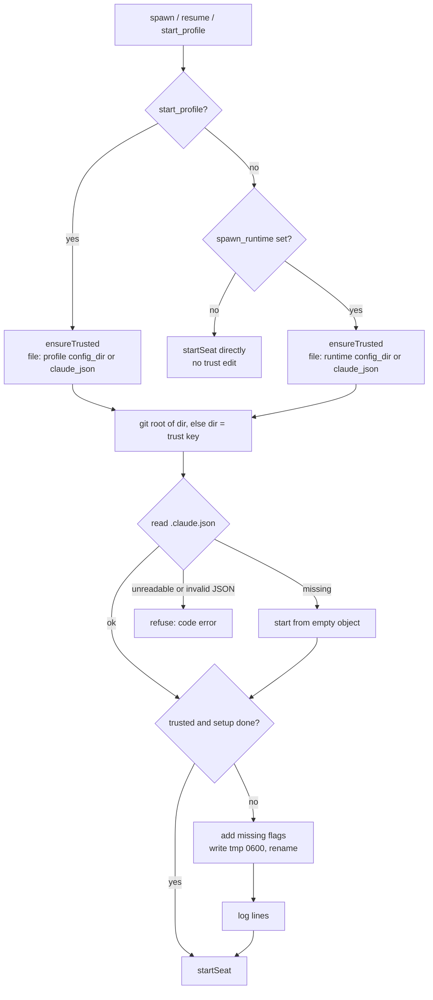

# Folder trust and first-run setup

Before the host agent starts a seat it edits Claude Code's global config file (`.claude.json`) so that Claude Code does not stop at a dialog nobody can answer. A seat runs in a detached tmux session with no one at the keyboard; if Claude Code opened its "trust this folder" prompt or its first-run theme and security screens, the seat would sit there forever. The function that prevents this is `ensureTrusted`. It marks the folder as trusted and marks Claude Code's first-run setup as done, and it only ever adds those flags.

## How it works

`ensureTrusted(dir, claudeJson)` runs in these places:

- `start_profile`, always, with the profile's runtime config dir.
- `spawn` and `resume` (the app's New seat and resume), **only when `spawn_runtime` is set** in the agent config. These go through `startPlain`, which calls `ensureTrusted` and then `startSeat` with the runtime's binary and flags.

When `spawn_runtime` is **not** set, `startPlain` returns `startSeat(seat)` directly. `ensureTrusted` is not called, nothing in `.claude.json` is read or written, and a plain spawn or resume in a folder Claude Code does not yet trust can stop at the trust dialog. Set `spawn_runtime` (see [Starting seats](starting-seats.md)) to get trust handling for the app's New seat and resume.

`ensureTrusted` runs before `startSeat`, so before the spawn rate limit, the seat cap and the "already runs here" checks. A start that is refused by one of those checks may therefore already have written the trust entry.

### Which file is edited

`ensureTrusted` is given the path of the `.claude.json` the seat will read:

| Seat is started on | File edited |
| --- | --- |
| A runtime (profile or `spawn_runtime`) with an absolute `config_dir` | `<config_dir>/.claude.json` |
| A runtime without a `config_dir` | the config key `claude_json` |

The config key `claude_json` has a derived default: `$CLAUDE_CONFIG_DIR/.claude.json` when the `CLAUDE_CONFIG_DIR` environment variable is set in the agent's environment, else `~/.claude.json`. It is spread into the config before your own keys, so setting `claude_json` in the agent config overrides the default. Claude Code moves its `.claude.json` into `CLAUDE_CONFIG_DIR` when that variable is set, which is why a runtime with its own config dir has its own file.

### The trust key

Claude Code records trust per folder under `projects[<folder>].hasTrustDialogAccepted`. The agent computes the key the same way Claude Code's own dialog does:

1. Run `git -C <dir> rev-parse --show-toplevel` and take the real path (`fs.realpathSync`) of the result. That is the key.
2. If the folder is not inside a git repository (the command fails or prints nothing, or the real path cannot be resolved), the key is the folder `dir` itself.

### Why inherited trust is not relied on

Claude Code may treat a folder as trusted because a parent folder is trusted, but the agent does not depend on that. A seat is considered trusted only if the exact entry `projects[<key>].hasTrustDialogAccepted` is `true`. The code comment records two cases, observed on a Claude Code release, that show why:

- A seat in a subfolder of a git repository got the trust dialog even though a parent of the repository was trusted. Inside a repository the lookup stops at the repository root, so only the root's entry counts.
- A folder that was not a repository got the trust dialog even though a parent was trusted, because its own entry said `hasTrustDialogAccepted: false`. With that entry set to `true`, there was no dialog. A probe folder with no entry at all inherited trust fine, which is why this case was easy to miss.

So `isTrusted(claudeJson, dir, root)` looks at one entry only, and an explicit `false`, a missing entry and a trusted parent all count as "not trusted". When that entry is not `true`, the agent sets it.

### First-run setup

Claude Code opens its first-run setup (choose a theme, read the security notes) whenever the global config has no `theme` or no `hasCompletedOnboarding`, and it does so before any folder trust prompt. On a machine where nobody ever ran `claude` by hand this would block the first seat. `setupDone` is true only when `theme` is present (not null or undefined) and `hasCompletedOnboarding` is exactly `true`. If not, the agent sets `hasCompletedOnboarding: true` and sets `theme` to `"dark"`, **keeping an existing theme**.

### What it writes

- It reads the file immediately before deciding, because Claude Code rewrites the same file itself.
- If the folder is already trusted and setup is already done, it returns without writing.
- Otherwise it adds only what is missing (the trust flag, the setup flags) and leaves every other key as it was. Other fields of the folder's entry, such as `allowedTools`, are kept.
- The write is atomic: the full JSON (2-space indent) goes to `<file>.<pid>.tmp` with mode `0600`, then `rename` replaces the real file. A reader never sees half a file.
- The file is written with mode `0600`.
- A missing file (`ENOENT`) is treated as `{}` and created.



### Before and after

A machine where `claude` was never run (no file), folder `~/work/app` inside a repository whose root is `/home/me/work/app`:

```json
{
  "theme": "dark",
  "hasCompletedOnboarding": true,
  "projects": {
    "/home/me/work/app": {
      "hasTrustDialogAccepted": true
    }
  }
}
```

An existing file with a chosen theme and an explicit refusal on the folder:

```json
{
  "theme": "light-daltonized",
  "projects": {
    "/home/me/work/app": { "allowedTools": ["Read"], "hasTrustDialogAccepted": false },
    "/home/me": { "hasTrustDialogAccepted": true }
  }
}
```

becomes (theme kept; the parent's trust is not counted; unrelated fields kept):

```json
{
  "theme": "light-daltonized",
  "projects": {
    "/home/me/work/app": { "allowedTools": ["Read"], "hasTrustDialogAccepted": true },
    "/home/me": { "hasTrustDialogAccepted": true }
  },
  "hasCompletedOnboarding": true
}
```

## Configuration

| Key or variable | Default | Effect |
| --- | --- | --- |
| `claude_json` | `$CLAUDE_CONFIG_DIR/.claude.json` if `CLAUDE_CONFIG_DIR` is set in the agent's environment, else `~/.claude.json` | The `.claude.json` edited for seats that have no runtime `config_dir`. |
| `runtimes.<name>.config_dir` | none | If an absolute path, the file edited for that runtime is `<config_dir>/.claude.json`. |
| `spawn_runtime` | unset | Name of a runtime. Without it, plain spawn and resume skip `ensureTrusted`. |

There is no switch to turn trust handling off for profiles or for `spawn_runtime` starts.

## Interface

There is no request of its own. The behavior is a side effect of the `spawn`, `resume` and `start_profile` operations. Its one visible output is the log, and its one refusal reply.

Log lines (written to the agent's log; both can appear for one start, setup first):

```
marked Claude Code's first-run setup done in <file>
trusted <key> (the git root of <dir>) in <file>
```

The parenthesised part appears only when the key is a git root. For a folder outside a repository the line is `trusted <dir> in <file>`. If nothing needed changing, nothing is logged.

Refusal reply when the file exists but cannot be read or parsed:

```json
{
  "request_id": "<id>",
  "ok": false,
  "code": "error",
  "error": "cannot read /home/me/.claude.json to trust /home/me/work/app: Unexpected end of JSON input"
}
```

The message has the form `cannot read <file> to trust <dir>: <reason>`. The seat is not started.

## Failure modes and troubleshooting

- **`cannot read <file> to trust <dir>: ...`** (code `error`). The file exists but is unreadable (permissions) or is not valid JSON. Only a missing file is tolerated. The agent will not overwrite a file it could not parse, so that an unreadable config of the user is never replaced. Fix the permissions or repair or remove the file, then retry.
- **A plain New seat or resume stops at the trust dialog or the theme screen.** `spawn_runtime` is probably not set, so `ensureTrusted` did not run. Set `spawn_runtime`, or start the folder once by hand.
- **The seat still shows a dialog although the log says it was trusted.** Check that the seat reads the file that was edited. A seat started with a different `CLAUDE_CONFIG_DIR` than the one the agent used for `claude_json` reads a different `.claude.json`; use a runtime with a `config_dir`, or set `claude_json` explicitly.
- **Claude Code rewrote the file and the flag is gone.** The check runs again on the next start, so the flag is re-added then.
- **Trust entry appeared for a start that was refused.** `ensureTrusted` runs before the rate-limit, seat-cap and duplicate-name checks. The entry is harmless and is reused by the next start.

## Related pages

- [Host agent README](README.md)
- [Starting seats](starting-seats.md)
- [Configuration](configuration.md)
- [Roots](roots.md)
- Server: [Profiles and the host channel](../server/profiles-and-hosts.md)

## Source

- `cv-host-agent.mjs` (`ensureTrusted`, `gitRoot`, `writeAtomic`, `startProfile`, `startPlain`, `startSeat`, `loadConfig`)
- `lib/rules.mjs` (`isTrusted`, `trustKey`, `withTrust`, `setupDone`, `withSetupDone`, `spawnRuntime`)
- `test/rules.test.mjs`
