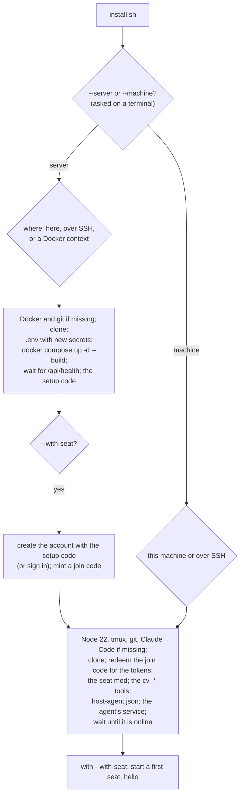

# The installer

`install/install.sh` sets up a Claudiverse server, connects a machine that runs seats to a server, or both in one run. It is one POSIX `sh` script with no dependencies of its own, meant to be piped from the network:

```sh
curl -fsSL https://raw.githubusercontent.com/Promises/claudiverse/main/install/install.sh | sh
```

A pinned version is the same path under a tag, for example `https://raw.githubusercontent.com/Promises/claudiverse/v1.0.0/install/install.sh`, with `--ref v1.0.0` so the code it installs is that tag too. (A short address, such as `https://claudiverse.dev/install.sh` redirecting there, is a later option; the script does not depend on one.)

Run it again to update what it installed: it pulls the code, rebuilds and restarts, and keeps your settings, tokens and data.

## How it works



- **Two modes.** With a terminal it asks each question in plain words with a default, shows a summary of what it will do, and asks before acting. Without one (Claude, CI, `docker exec` without `-t`) every answer comes from a flag, `--yes` is needed to act, and a missing answer is an error that names its flag: it never waits on a terminal that is not there. The questions are read from `/dev/tty`, so they work under `curl | sh`, where standard input is the script itself. Prompts are plain text; gum and whiptail are not used.
- **Secrets.** Passwords (sudo, SSH, the account) are typed with no echo, or read from the environment when there is no terminal: `CV_SUDO_PASSWORD`, `CV_SSH_PASSWORD`, `CV_LOGIN_PASSWORD`. Never flags, never logged, never on a command line. Tokens reach `curl` on its standard input, and `node` in its environment. Files that hold them (`.env`, `host-agent.json`, `mcp-catalog.json`) are mode 600. Temporary files are private and wiped on exit. Every prompt says what it is for and where: `sudo password for dev@build-box (to install Docker and git):`.
- **SSH.** `--target ssh` streams the script to the other machine over one SSH connection, runs it there, and removes it afterwards. A password the host wants is typed once: ssh asks on the terminal, or reads `CV_SSH_PASSWORD` through a private askpass helper. Without a terminal, sudo's and the account's passwords go to the remote on its standard input. A host key seen for the first time is accepted without a terminal (`StrictHostKeyChecking=accept-new`); with one, ssh asks.
- **Join codes.** A machine joins with a one-time code from the web panel's **Add a machine** (valid 15 minutes). The installer redeems it once for the machine's seat token and host token, so no token is ever copied. `--login EMAIL` is the fallback: it signs in, mints a code for itself and signs out.
- **Updates.** A second run updates a clean clone to `--ref` (a clone with local edits is refused), keeps `.env` and the database, rebuilds and restarts. On a machine it keeps the tokens and folders in `host-agent.json`, updates the mod and the tools, and restarts the agent.

## Platform support

| | Server (`--server`) | Machine (`--machine`) | Host agent service |
|---|---|---|---|
| Debian 12, Ubuntu 22.04/24.04 | Docker from Docker's repository (get.docker.com) | Node 22 from NodeSource when the distribution's is older | systemd user unit, with linger |
| Fedora | Docker from Docker's repository (dnf) | Node from dnf | systemd user unit, with linger |
| RHEL 9, Rocky 9, Alma 9 | Docker from Docker's repository (dnf; replaces podman-docker) | Node 22 from the nodejs:22 module, else NodeSource | systemd user unit, with linger |
| Arch | docker, docker-compose, docker-buildx (pacman) | nodejs, npm (pacman) | systemd user unit, with linger |
| Alpine 3.21+ | docker, docker-cli-compose (apk), started with OpenRC | nodejs, npm (apk); Claude Code's needs: bash, libgcc, libstdc++, ripgrep | OpenRC service that runs as the user |
| macOS 13+ | An existing Docker Desktop or OrbStack (never installed by the script; colima is refused) | Node, tmux from Homebrew (Homebrew itself on a terminal only) | launchd agent |

Anything else (other Linux distributions, Windows, BSD) is refused with exit code 3. The production Compose stack has no bind mounts, so SELinux on Fedora and RHEL needs no `:Z` labels.

## Configuration

Flags. Every question has one; secrets are environment variables.

| Flag | For | Default | Meaning |
|---|---|---|---|
| `--server` / `--machine` | both | asked | What to do. Also `--mode server\|machine`. |
| `--with-seat` | server | asked (yes) | Then make a machine a seat machine of the new server, and start a first seat. |
| `--target local\|ssh\|context` | both | asked (local); local with `--join` | Where it runs. `context` is for `--server` only. A join code is made for the machine that runs the command, so with `--join` it is not asked. |
| `--ssh USER@HOST` | both | | The remote machine for `--target ssh`, or the seat machine for `--seat-target ssh`. |
| `--port N` | both | 22 | Its SSH port. |
| `--identity FILE` | both | your ssh config | The SSH key. |
| `--context NAME` | server | | The Docker context for `--target context`. A colima context is refused. |
| `--seat-target local\|ssh` | server | asked (local) | With `--with-seat`: this machine, or the one `--ssh` names. |
| `--dir DIR` | both | `~/claudiverse` | Where the code is cloned. |
| `--host NAME` | server | this machine's address | The address browsers and machines reach the server at. |
| `--api-port N` | server | 4000 | The API port. |
| `--web-port N` | server | 8080 | The web panel's port. |
| `--project NAME` | server | `claudiverse` | The Compose project name. |
| `--email EMAIL` | server | asked | With `--with-seat`: the account to create with the setup code (or to sign in with, when the server has one). |
| `--url URL` | machine | asked | The server's API address, `http://host:4000`. |
| `--join CODE` | machine | asked | A join code from **Add a machine**. |
| `--login EMAIL` | machine | | Instead of a join code: sign in for one. |
| `--name NAME` | machine | the hostname | This machine's name. |
| `--roots DIRS` | machine | `~/projects` | Folders seats may work in, comma-separated. |
| `--pool-only yes\|no` | machine | yes | Seats use the server's account pool rather than this machine's own `claude` login. |
| `--service-label NAME` | machine | `no.claudiverse.host-agent` (launchd), `claudiverse-host-agent` (systemd, OpenRC) | The service's name. A second agent on one machine needs its own. |
| `--ref REF` | both | `main` | The branch or tag to install. |
| `--repo URL` | both | the public repository | The git repository to clone. |
| `--no-install` | both | | Install no packages; fail if one is missing. |
| `--yes` | both | | Act without asking. Needed without a terminal. |
| `--dry-run` | both | | Print the plan and change nothing. |
| `--json` | both | | Write one JSON object to standard output at the end; messages go to standard error. |

| Environment | Meaning |
|---|---|
| `CV_SUDO_PASSWORD` | sudo's password, when sudo needs one and there is no terminal. |
| `CV_SSH_PASSWORD` | The SSH password, when the host wants one and there is no terminal. |
| `CV_LOGIN_PASSWORD` | The account's password: for `--with-seat` (the new account's, or yours) and `--login`. |
| `CLAUDIVERSE_HOST_AGENT_CONFIG` | Where a machine's host agent config goes (default `~/.config/claudiverse/host-agent.json`). The service is pinned to this path and to the `HOME` it was installed from. |

## Interface

### Exit codes

| Code | Meaning |
|---|---|
| 0 | Done (or the dry run's plan printed). |
| 1 | A step failed. The message names it. |
| 2 | A missing or bad flag, including a missing answer without a terminal. |
| 3 | An unsupported system, or a missing prerequisite the script does not install (Docker on macOS, or anything with `--no-install`). |
| 4 | Declined or refused: the answer at the summary was no, or a colima Docker context. |
| 5 | The server refused the join code or the sign-in. |

### `--json`

One object on standard output. Fields appear when the run got that far:

```json
{
  "ok": true, "script": "install", "exit_code": 0,
  "mode": "server", "target": "local", "os": "Debian GNU/Linux 12 (bookworm)",
  "dir": "/home/me/claudiverse",
  "api_url": "http://claudiverse.example:4000", "web_url": "http://claudiverse.example:8080",
  "setup_code": "ABCD-EFGH-…", "already_set_up": false, "updated": false, "ref": "main",
  "machine": "build-box", "server": "http://claudiverse.example:4000", "machine_dir": "/home/me/claudiverse",
  "service": "systemd", "agent_online": true, "machine_updated": false,
  "seat": "hello", "seat_registered": true
}
```

| Field | Meaning |
|---|---|
| `ok`, `exit_code` | The result. |
| `error`, `failed_step` | On failure: the message and the step it failed in. |
| `dry_run`, `plan` | With `--dry-run`: `true`, and the plan's lines. |
| `mode`, `target`, `os` | What ran where. |
| `dir`, `api_url`, `web_url`, `ref`, `updated` | The server: its clone, its addresses, the ref, and whether it was an update. |
| `setup_code`, `already_set_up` | The code to create the first account with; null once the server has one. |
| `machine`, `server`, `machine_dir`, `service`, `agent_online`, `machine_updated` | The machine: its name, its server, its clone, its service (`systemd`, `launchd`, `openrc`), and whether the agent came online. |
| `seat`, `seat_registered` | With `--with-seat`: the first seat, and whether it registered with the server. |

## Examples

A server and this machine as its first seat machine, asking every question:

```sh
curl -fsSL https://raw.githubusercontent.com/Promises/claudiverse/main/install/install.sh | sh
```

The same without a terminal:

```sh
export CV_LOGIN_PASSWORD='a password for the new account'
curl -fsSL https://raw.githubusercontent.com/Promises/claudiverse/main/install/install.sh \
  | sh -s -- --server --with-seat --email you@example.com --host claudiverse.example --yes --json
```

A server on another machine, over SSH with a password:

```sh
export CV_SSH_PASSWORD='…' CV_SUDO_PASSWORD='…'
curl -fsSL https://raw.githubusercontent.com/Promises/claudiverse/main/install/install.sh \
  | sh -s -- --server --target ssh --ssh me@example.com --yes
```

Another machine, with the command **Add a machine** shows:

```sh
curl -fsSL https://raw.githubusercontent.com/Promises/claudiverse/main/install/install.sh | sh -s -- --machine --url http://claudiverse.example:4000 --join ABCD-EFGH
```

## Failure modes and troubleshooting

| Symptom | Cause and fix |
|---|---|
| `missing --url (without a terminal, …)`, exit 2 | No terminal and no flag: pass it, or run it in a terminal. |
| `pass --yes to go ahead without a terminal` | Without a terminal the script never acts unasked. |
| `sudo needs a password … set CV_SUDO_PASSWORD` | No terminal to ask on: set it, or run as root. |
| `the server refused the join code: this join code is unknown, used or expired`, exit 5 | Codes work once, for 15 minutes. Make a new one with **Add a machine**. |
| `Docker is not running here` on macOS, exit 3 | Install and start Docker Desktop or OrbStack. |
| `… is a colima context`, exit 4 | Claudiverse is not deployed into colima VMs. Switch the Docker context. |
| `<dir> has local changes` | An update never overwrites edits: commit or stash them. |
| The agent did not come online | Its log: `journalctl --user -u claudiverse-host-agent`, `~/Library/Logs/claudiverse-host-agent.log`, or `/var/log/claudiverse-host-agent-<user>.log` (OpenRC). |
| `added <user> to the docker group` | Log out and in again, or `newgrp docker`, to use docker without sudo. |
| `docker compose up failed; its whole log is …/build.log` | The build's output is kept in `~/.local/state/claudiverse/build.log` (or under `$XDG_STATE_HOME`), not shown while it runs; the failure shows its last lines. |

## Related pages

- [Setup guide](../guide/README.md): every step by hand.
- [Profiles and hosts](server/profiles-and-hosts.md): join codes (`/api/join_codes`, `/api/join`).
- [Host agent install and service](host-agent/install-and-service.md).

## Source

- `install/install.sh`
- `server/api/lib/claudiverse_server/join_codes.ex`, `server/api/lib/claudiverse_server_web/controllers/join_controller.ex`
- Tests: `server/api/test/claudiverse_server_web/join_code_test.exs`
