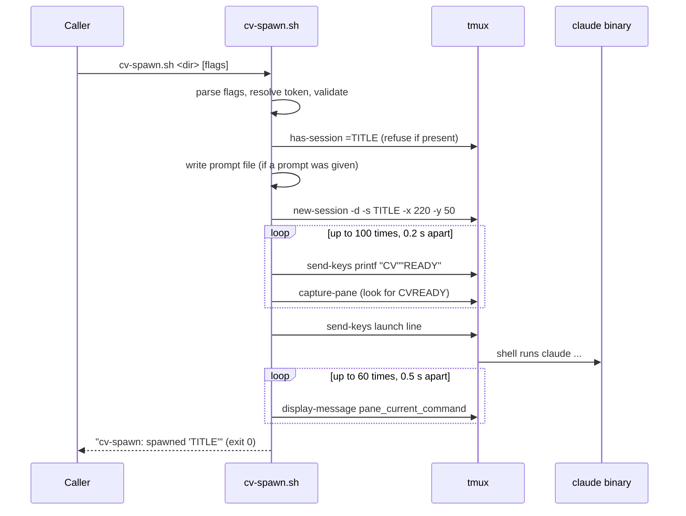

# cv-spawn.sh: starting a seat

`cv-spawn.sh` starts one Claude Code instance (a seat) in a detached tmux session, mirrored to the Claudiverse server. It is the single spawn primitive: `cv-runner`, `cv-mcp`'s `cv_spawn` tool and each machine's host agent all run this script, so there is one definition of how a seat launches. The script allocates the tmux terminal and the process lifecycle; the seat's own Claudiverse client (the claudiverse-seat mod) does the mirroring and takes input. The script also sets `CLAUDIVERSE_SKIP_TRUST=1`, which a patched Claude Code binary reads to skip the "trust this folder?" gate without editing `~/.claude.json`; the claudiverse-seat mod does not read it.

## How it works

The tmux session is named exactly after the seat title and is created 220 columns by 50 rows. The script builds one shell line, types it into the session, and checks that a process started.



### The token

The bearer token is resolved in this order:

1. `--token`
2. `$CLAUDIVERSE_TOKEN`
3. `CLAUDIVERSE_TOKEN` extracted with `jq` from the first `--mcp` file (any depth of the JSON). This needs `jq` on the PATH; without it, step 3 is skipped.

If none yields a token the script exits 1. The token is placed on the launch line as `CLAUDIVERSE_TOKEN=...`, so it is visible in `ps` and in the tmux pane. That is accepted for a trusted host.

The script does not lease a pool account. The seat leases its own account at start-up whenever `CLAUDIVERSE_TOKEN` is set, so every seat is covered however it was launched. A `CLAUDE_CODE_OAUTH_TOKEN` already set is still honoured by the binary.

### The environment the seat gets

The launch line is `cd <dir> && VAR=... VAR=... <claude> <flags>`. The variables, in order, are set only when the condition holds:

| Variable | Set when | Value |
|---|---|---|
| `CLAUDIVERSE_TITLE` | always | the title |
| `CLAUDIVERSE_ORIGIN` | always | the origin (`spawn` by default) |
| `CLAUDIVERSE_FLEET` | `--fleet` | the fleet |
| `CLAUDIVERSE_PROFILE` and `CLAUDIVERSE_TMUX` | `--profile` | the profile id, and the title (as the tmux session name) |
| `CLAUDIVERSE_PROFILE_REVISION` | `--revision` | the revision number |
| `CLAUDIVERSE_HOST` | `--host` | the machine name |
| `CLAUDIVERSE_DEBUG` | `--debug` | `1` |
| `ANTHROPIC_BASE_URL` and `ANTHROPIC_CUSTOM_HEADERS` | pooled (`--pooled`, `--pool-only`, `CV_SPAWN_POOLED`) | see [Pooled seats](#pooled-seats) |
| `CLAUDE_CONFIG_DIR` and `DISABLE_AUTOUPDATER` | `--config-dir` | the folder, and `1` |
| `CLAUDE_CODE_OAUTH_TOKEN` | `--oauth-token-file` | `"$(cat <file>)"`, expanded by the seat's shell |
| `CLAUDE_CODE_OAUTH_TOKEN` | `--pool-only` | `cv-pool` |
| `CLAUDIVERSE_SKIP_TRUST` | always | `1` |
| `CLAUDIVERSE_URL` | always | the server URL |
| `CLAUDIVERSE_TOKEN` | always | the token |

After the binary path, these flags are appended in this order: one `--mcp-config <file>` per `--mcp`; `--add-dir <prompt folder>` (only with a prompt); `--permission-mode <mode>`; `--name <title>` (only if the binary's `--help` output contains `--name <name>`, so Claude Code's own session name matches the seat title); `--model` and `--effort` (only if given); `--resume <uuid>` (only if given); and finally the prompt argument.

### Pooled seats

`--pooled` sends the seat's model requests through the server's proxy, which uses a pool account and fails over when one is spent. The launch line sets:

- `ANTHROPIC_BASE_URL=<url without trailing slash>/proxy/seat/<title>`
- `ANTHROPIC_CUSTOM_HEADERS` with three newline-separated headers: `X-Claudiverse-Token: <token>`, `X-Claudiverse-Pool: 1`, `X-Claudiverse-Observe: off`.

`X-Claudiverse-Pool: 1` makes the proxy replace the seat's own login on model calls; the seat keeps its login for everything else (feature flags, so mods load). `X-Claudiverse-Observe: off` makes the proxy relay without recording the calls, because the seat mirrors itself. The proxy is documented elsewhere. A pooled seat's model calls stop while the server is down.

`--pool-only` is for a machine with no Claude Code login. It sets `CLAUDE_CODE_OAUTH_TOKEN=cv-pool`, a placeholder that the proxy swaps for a pool account, and implies `--pooled`. Nothing in the seat works while the server is down. It cannot be combined with `--oauth-token-file` (two different logins).

`--oauth-token-file F` logs the seat in with the long-lived token in `F` (as produced by `claude setup-token`) instead of the config folder's refreshing login. The file is read by the seat's own shell at launch (`$(cat F)`), so the token is never on a command line. It suits several slots sharing one config folder, where one rejected refresh would blank the shared login for all of them.

### Resuming

`--resume ID` continues an existing Claude Code conversation. `ID` must match a session UUID (`8-4-4-4-12` hex digits), because it reaches the shell line and nothing else is let through. Run the spawn in the conversation's original working directory: Claude Code keeps transcripts per project folder.

### The prompt

A prompt is never put on the command line. With `--prompt` or `--prompt-file` the script:

1. Creates `${TMPDIR:-/tmp}/cv-prompts/` and writes the prompt to `cv-prompt-XXXXXX` (from `mktemp`) in it. `--prompt-file` is copied, so the caller may delete its own file once the script returns.
2. Gives the seat a short prompt: `Your instructions are in @<file> - read all of it and follow it.`
3. Adds `--add-dir` for the prompt folder, so the seat may read the file without a permission prompt. It is placed before `--permission-mode` because `--add-dir` takes several folders and would otherwise swallow the prompt as one more.
4. Appends `; rm -f <file>` to the launch line, so the file is removed after claude exits.

The reasons, briefly: the line typed into the pane must stay short, because a tty in canonical mode truncates a line at about 1024 characters; one argument cannot exceed 128 KiB on Linux; and a prompt in the process arguments is matched by `pkill -f`, so one seat's `pkill` could kill other seats whose briefs mentioned the same text.

`--prompt` and `--prompt-file` are mutually exclusive.

### Readiness gate and launch check

`tmux new-session` returns when the terminal exists, not when a shell reads input. The script therefore sends `printf "CV""READY\n"` (split so that the echo of the command cannot match) up to 100 times, 0.2 s apart, and looks for `CVREADY` in the pane. If it never appears (about 20 s), it kills the session and exits 1. It deliberately sends nothing else (no `clear`) before the launch line.

After sending the launch line, it polls `pane_current_command` up to 60 times, 0.5 s apart. Any value other than empty, `sh`, `bash`, `zsh` or `fish` counts as launched. If the pane is still at a shell after about 30 s, the script exits 1 and leaves the session alive for inspection.

## Configuration

### Usage

```
cv-spawn.sh <working_dir> [options]
```

The working directory is the first argument and is required. It is resolved to an absolute path.

### Flags

| Flag | Default | Meaning |
|---|---|---|
| `--title T` | basename of the working directory | Seat title. Also the tmux session name, and part of the proxy URL when pooled, so keep it to URL-safe characters. |
| `--mcp CFG` | none | Path to an extra MCP config; repeatable. Each becomes `--mcp-config CFG`. The first one is also searched for a token. |
| `--mode MODE` | `auto` | Passed as `--permission-mode`. The header lists `auto`, `acceptEdits`, `plan`, `default`; the script does not validate the value. |
| `--effort L` | the binary's own | Reasoning effort (`low`, `medium`, `high`, `xhigh`, `max`). Omitted from the line if empty. |
| `--model M` | the binary's own | Model for this seat. Omitted if empty. Not the same as `--mode`. |
| `--prompt "..."` | none | Initial prompt, delivered through a file (see above). |
| `--prompt-file F` | none | The same, read from file `F`, which must exist and be non-empty. |
| `--token TOK` | `$CLAUDIVERSE_TOKEN`, else extracted from the first `--mcp` | Bearer token. |
| `--url URL` | `$CLAUDIVERSE_URL`, else `http://localhost:4010` | Server base URL. |
| `--bin PATH` | `$CLAUDIVERSE_BIN`, else `$HOME/.local/bin/claude` | The claude binary; must be executable. |
| `--fleet F` | none | Fleet the seat belongs to; shown and grouped by in the app. |
| `--resume ID` | none | Resume a conversation by session UUID. |
| `--origin O` | `spawn` (or `$CV_SPAWN_ORIGIN`) | How the seat was started: `spawn`, `runner`, `manual` or `profile`. Worker seats (origin `runner`) may not request a human (`cv_request_human`). The script does not validate the value. |
| `--profile ID` | none | Seat profile the seat starts from; integers only. The seat registers it and the server fills fleet, notify and origin from the profile. |
| `--revision N` | none | Profile revision; integers only. |
| `--host NAME` | the runtime's own hostname | Machine name the seat reports. |
| `--debug` | off | Sets `CLAUDIVERSE_DEBUG=1` in the seat. |
| `--config-dir D` | none | Claude Code config folder (`CLAUDE_CONFIG_DIR`), with the auto-updater off. For a seat that must not share `~/.claude`. Must be an existing folder. |
| `--pooled` | off | Route model calls through the server proxy. |
| `--pool-only` | off | Log in with the pool placeholder; implies `--pooled`. |
| `--oauth-token-file F` | none | Log in with the token in `F`. Must exist and be non-empty. |

Any other argument prints `cv-spawn: unknown arg: <arg>` and exits 2. A flag that takes a value but is last on the line fails with the shell's unbound-variable error (the script runs under `set -euo pipefail`).

### Environment defaults

For callers that cannot pass flags (a runner slot whose launcher exports them). Flags win.

| Variable | Effect |
|---|---|
| `CV_SPAWN_ORIGIN` | default for `--origin` |
| `CV_SPAWN_POOLED=1` | same as `--pooled`; any other non-empty value exits 2 |
| `CV_SPAWN_POOL_ONLY=1` | same as `--pool-only`; any other non-empty value exits 2 |
| `CV_SPAWN_CONFIG_DIR` | default for `--config-dir` |
| `CV_SPAWN_OAUTH_TOKEN_FILE` | default for `--oauth-token-file` |
| `CLAUDIVERSE_BIN` | default for `--bin` |
| `CLAUDIVERSE_URL` | default for `--url` |
| `CLAUDIVERSE_TOKEN` | default for `--token` |

## Interface

### Examples

A plain seat, with token and server from the environment:

```bash
export CLAUDIVERSE_URL=http://claudiverse.example:4000
export CLAUDIVERSE_TOKEN=...
cv-spawn.sh ~/work/app --title lorem-w1
```

A pooled seat on `lorem-fleet` with an MCP config, model and effort:

```bash
cv-spawn.sh ~/work/app --title lorem-w2 --fleet lorem-fleet \
  --mcp ~/work/worker.mcp.json --pooled --model sonnet --effort high
```

A resumed seat, run from the conversation's original folder:

```bash
cd ~/work/app && cv-spawn.sh . --title lorem-w1 \
  --resume 0b1f3c2e-5d4a-4e7b-9c10-2a3b4c5d6e7f
```

A runner-style call with a brief in a file:

```bash
cv-spawn.sh ~/work/app --title lorem-w4 --fleet lorem-fleet --origin runner \
  --mcp ~/work/worker.mcp.json --prompt-file ~/work/briefs/task.md
```

### Output

On success the script prints, and exits 0:

```
cv-spawn: spawned '<title>'
  dir:    <absolute working dir>
  mode:   <mode>
  verify: cv_status <title>   |   attach: tmux attach -t <title>   |   kill: tmux kill-session -t <title>
```

### Exit codes

| Code | Cause |
|---|---|
| 0 | the seat's process started |
| 1 | runtime failure (the table below) |
| 2 | usage or argument error |

## Failure modes and troubleshooting

| Message (stderr) | Exit | Cause and action |
|---|---|---|
| `usage: cv-spawn.sh <working_dir> [...]` | 2 | No arguments. |
| `cv-spawn: unknown arg: X` | 2 | Misspelt or unsupported flag. |
| `cv-spawn: no such dir: D` | 1 | The working directory does not exist. |
| `cv-spawn: claude binary not executable: P` | 1 | Fix `--bin` / `CLAUDIVERSE_BIN`. |
| `cv-spawn: no token — set $CLAUDIVERSE_TOKEN, pass --token, or pass --mcp with a token` | 1 | No token found; if you rely on extraction from `--mcp`, check that `jq` is installed. |
| `cv-spawn: tmux session 'T' already exists (kill it first: tmux kill-session -t T)` | 1 | A tmux session with exactly that title exists (exact match, so seat `lorem` is not blocked by `lorem-w1`). Kill it or pick another title. |
| `cv-spawn: --config-dir is not a folder: D` | 2 | Create the folder first. |
| `cv-spawn: --oauth-token-file is missing or empty: F` | 2 | Check the file. |
| `cv-spawn: CV_SPAWN_POOLED must be 1 or unset` (same for `CV_SPAWN_POOL_ONLY`) | 2 | Use `1` or unset. |
| `cv-spawn: --pool-only and --oauth-token-file are two different logins; give one` | 2 | Drop one of them (also when set through the environment). |
| `cv-spawn: --profile/--revision must be integers, got: V` | 2 | Pass digits only. |
| `cv-spawn: --resume needs a session uuid, got: V` | 2 | Pass the conversation's session UUID. |
| `cv-spawn: --prompt-file F is missing or empty` | 2 | Check the file. |
| `cv-spawn: give --prompt or --prompt-file, not both` | 2 | Use one. |
| `cv-spawn: cannot create <dir>` / `cannot create prompt file` / `cannot copy F` | 1 | The prompt folder under `${TMPDIR:-/tmp}` is not writable. |
| `cv-spawn: shell in 'T' never became ready (20s)` | 1 | The session's shell did not answer; the session is killed. Check the machine's login shell start-up. |
| `cv-spawn: 'T' still at a shell prompt 30s after launch — the command did not start.` | 1 | The launch line did not run. The pane is left alive: `tmux attach -t T` and read the shell's error. |

All validation errors occur before the tmux session is created, except the last two.

## Related pages

- [cv-runner: the worker brief, the charter, and spawning](runner-brief-and-spawn.md): how `cv-runner` calls this script
- [cv-mcp: lifecycle tools](mcp-lifecycle.md): the `cv_spawn` tool
- [cv-mcp: the claudiverse MCP server (overview)](mcp.md): MCP configuration and token
- [Testing the orchestrator](testing.md)
- [Orchestrator reference: runners and fleet tooling](README.md)
- Server: [The Anthropic account pool](../server/account-pool.md), [The API proxy](../server/api-proxy.md), [Sessions and Rooms](../server/sessions-and-rooms.md)
- Mod: [Registration](../services/mod/registration.md), [Server API used by the mod](../services/mod/server-api.md)
- Host agent: [Local relay](https://github.com/Promises/claudiverse-host-agent-oss/blob/main/docs/reference/relay.md), [Starting seats](https://github.com/Promises/claudiverse-host-agent-oss/blob/main/docs/reference/starting-seats.md)

## Source

- `orchestrator/cv-spawn.sh`
- `orchestrator/test/spawn.test.mjs`
