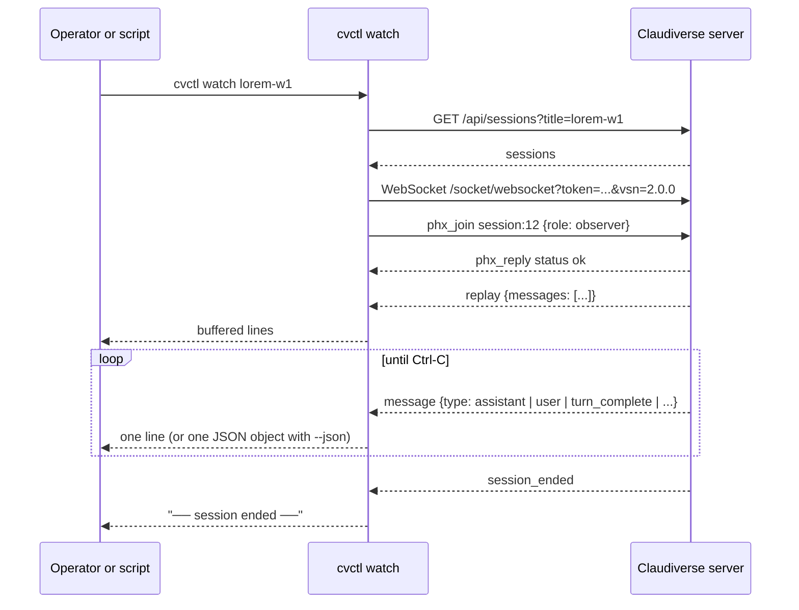

# cvctl: the orchestrator CLI

`cvctl` is a small command-line client for the Claudiverse server's observer protocol. From a shell, a script or a Claude seat that runs Bash, it lists sessions, watches a seat's mirrored message stream, injects prompts into a seat, answers a seat's `AskUserQuestion`, and manages ping subscriptions. It is the shell counterpart of the `cv_*` MCP tools ([mcp.md](mcp.md)).

It has zero dependencies. It needs a Node with global `fetch` and global `WebSocket`. The file header says "Node 24 ships global fetch + global WebSocket"; `orchestrator/README.md` says "Node 22+". Use Node 24 or newer, the stricter of the two; the code does not check the version.

It is a single file, `orchestrator/cvctl.mjs`, run as:

```bash
node orchestrator/cvctl.mjs <command> …
```

The package exposes it as the bin `cvctl`, so after a package-level install `cvctl <command> …` is equivalent.

## How it works

`cvctl` does not import [cv-core](cv-core.md). It contains its own REST helpers and its own Phoenix v2 channel client. Differences from cv-core that matter in practice:

- It does not retry transport errors. A failed `fetch` throws and Node exits with a stack trace.
- It exits on any non-2xx HTTP response, printing `GET <path> → <status> <statusText>` (or `POST …`) to stderr and exiting 1.
- The WebSocket is never reconnected.

REST calls send `Authorization: Bearer <token>`. Channel commands open `ws(s)://<host>/socket/websocket?token=<token>&vsn=2.0.0` (the base URL with `http` replaced by `ws`) and join the topic `session:<id>` with `{role: "observer"}`. Frames are Phoenix v2 JSON arrays `[join_ref, ref, topic, event, payload]`. A heartbeat is sent every 30 seconds. Frames for other topics, and non-JSON frames, are ignored.

Right after a successful join the server pushes a `replay` event whose `payload.messages` is the session's buffered mirror messages. Afterwards each new mirrored message arrives as a `message` event. Writing is done by pushing an observer event on the same channel (`send_message`, `answer`, `decline`); these are fire-and-forget.

### Name resolution

Every command that takes `<name|#id>` resolves it first:

1. A leading `#` is stripped. If the rest is all digits, it is the session id, used as is. No request is made and the id is not checked.
2. Otherwise `GET /api/sessions?title=<name>` is called. No matches: `No session titled "<name>".` on stderr, exit 1.
3. Among the matches, the first one with `status` `running` wins. If none is running, the first match of any status is used. The code takes the server's order as "newest first".

### Watch



### What counts as a meaningful frame

Without `--json`, each mirrored message is rendered by its `type`; anything not listed is dropped:

| `type` | Output |
|---|---|
| `turn_complete` | `── turn complete ──` |
| `assistant` | `assistant> <text>`: text blocks, plus `[tool <name> <input JSON cut to 120 chars>]`, `[tool_result]` and `[thinking]` placeholders for those blocks. Dropped if the text is empty. |
| `user` | `user> <text>`, same block rendering. Dropped if empty. |
| `system` | `system> <subtype>` |
| `result` | `result> <subtype>` |
| `control_request` | `permission?> <tool_name>` when `request.subtype` is `can_use_tool`, else `control_request> <subtype>` |
| anything else | dropped: `stream_event`, `stream_request_start`, `*_in_progress` and similar per-token or bookkeeping frames |

With `--json`, every message is printed unfiltered as one JSON object per line (NDJSON), including `stream_event`.

## Configuration

| Variable | Default | Meaning |
|---|---|---|
| `CLAUDIVERSE_URL` | `http://localhost:4000` | Server base URL. One trailing `/` is removed. |
| `CLAUDIVERSE_TOKEN` | none, required | Bearer token. If empty, `cvctl` prints `CLAUDIVERSE_TOKEN is not set.` to stderr and exits 1, before parsing the command. |

## Interface

`cvctl` with no command prints the usage text to stderr and exits 0. An unknown command prints the same text and exits 1.

| Command | Usage |
|---|---|
| `list` | `cvctl list` |
| `resolve` | `cvctl resolve <name\|#id>` |
| `watch` | `cvctl watch <name\|#id> [--json]` |
| `tail` | `cvctl tail <name\|#id> [--limit N] [--json]` |
| `send` | `cvctl send <name\|#id> <text...>` |
| `questions` | `cvctl questions <name\|#id> [--json]` |
| `answer` | `cvctl answer <name\|#id> <text...>` |
| `decline` | `cvctl decline <name\|#id>` |
| `subscribe` | `cvctl subscribe <self> --watch a,b,c` |
| `ack` | `cvctl ack <self> [--session X\|--all]` |
| `pending` | `cvctl pending <self>` |

A missing positional argument prints `usage: cvctl <command> …` for that command and exits 1.

### list

`GET /api/sessions`. One line per session: id right-aligned to 4 characters, status padded to 8 (`?` if missing), title (`(untitled)` if missing). With no sessions it prints `(no sessions)`.

### resolve

Prints the numeric session id (see name resolution above).

### watch

Resolves the name, prints `watching session <id> (<name>) — Ctrl-C to stop` to stderr, joins as observer and streams to stdout. It handles these channel events:

- `replay`: each buffered message is emitted first (rendered, or raw with `--json`).
- `message`: the message is emitted.
- `permission_request`: with `--json`, prints `{"type":"permission_request", …payload}`; otherwise `permission?> <tool_name> (request_id <id>)`.
- `session_ended`: prints `── session ended ──` without `--json`; prints nothing with `--json`. The process is not terminated by this event.

`watch` has no timeout and no reconnect. It runs until you press Ctrl-C. If the socket closes (server restart, network loss, session end), the heartbeat timer is cleared and, with nothing left to keep the process alive, Node exits with code 0, without any message. A WebSocket `error` event prints `WebSocket error: <message>` and exits 1. A rejected join prints `Join rejected for session:<id>: <payload JSON>` and exits 1. For unattended use, wrap it in a loop that restarts it.

### tail

Joins, waits for the `replay` event, prints the recent part and exits 0.

- Without `--json`, `--limit` counts rendered lines: the buffer is rendered, dropped frames are removed, and the last N lines are printed. Noise frames do not use up the budget.
- With `--json`, the last N raw messages are printed, noise frames included.
- `--limit` defaults to 20. The value is read with `Number()`; a non-numeric value or a missing one gives `NaN`, and `slice(-NaN)` returns the whole buffer.

If no `replay` arrives within 5 seconds: `Timed out waiting for replay buffer.`, exit 1.

### send

Joins and pushes `send_message` with `{content: "<text>"}`, where the text is all remaining arguments joined with single spaces. After the join succeeds it waits 600 ms to flush and exits 0. The server does not acknowledge the event, so a 0 exit means the frame was written, not that the seat accepted it. The seat receives the text as a user turn, and it comes back through the mirror as `type: "user"`. If the join does not complete within 5 seconds: `Timed out joining channel.`, exit 1. `--json` is not parsed here, so it would be sent as part of the text.

### questions

Joins, reads the `replay` buffer, takes the last `AskUserQuestion` tool call in an `assistant` message, prints it and exits 0. It does not check whether the question was already answered.

- Without `--json`, one line per question: `Q [<tool_use_id>]: <question or header>  (multiSelect=<bool>)`, then one line per option: `   <n>. <label> — <description>`.
- With `--json`: `{"tool_use_id": …, …input}` on one line.
- With none in the buffer: `(no AskUserQuestion in recent buffer)`.
- Same 5-second replay timeout as `tail`.

### answer and decline

`answer` pushes `answer` with `{response: "<text>"}`. The model sees the text as the user's freeform answer. `decline` pushes `decline` with `{}`. Both target the most recently opened question, behave like `send` (600 ms flush, exit 0, 5-second join timeout), and print nothing on success.

### subscribe, ack, pending

These manage the server's ping queue for an orchestrator whose title is `<self>`; see [mcp-seats.md](mcp-seats.md) for the equivalent `cv_subscribe`, `cv_ack` and `cv_pending` tools.

- `subscribe <self> --watch a,b,c`: `POST /api/notify/subscribe` with `{self, watch: [..]}`. The list is split on commas, trimmed, and empty items removed; an empty list is a usage error. Prints the server's JSON reply. The titles are sent as given, not resolved.
- `ack <self> [--session X | --all]`: `POST /api/notify/ack` with `{self, target}`. `target` is the `--session` value, or `all` when it is absent. `--all` is not parsed; it is accepted only because every ack without `--session` clears all. Prints `acked <target>`.
- `pending <self>`: `GET /api/notify/pending?self=<self>`. Prints `(no pending pings)` or one line per queued ping: `<kind>  <title>` plus ` (<tool_use_id>)` when present. Do not run it in a loop; pings are delivered to a seat as an injected turn.

### Exit codes

| Code | When |
|---|---|
| 0 | Success. `tail`, `questions`, `send`, `answer` and `decline` exit 0 explicitly. `watch` exits 0 when the socket closes. No command given: usage, exit 0. |
| 1 | Missing token, missing argument, unknown command, unknown session title, any HTTP error, WebSocket error, rejected join, timeout. |

### Examples

```bash
export CLAUDIVERSE_URL=http://claudiverse.example:4000
export CLAUDIVERSE_TOKEN=<seat token>

node orchestrator/cvctl.mjs list
#   12  running   lorem-w1
#   13  stopped   lorem-w2

node orchestrator/cvctl.mjs resolve lorem-w1              # 12
node orchestrator/cvctl.mjs tail '#12' --limit 30
node orchestrator/cvctl.mjs watch lorem-w1 --json
node orchestrator/cvctl.mjs send lorem-w1 "read handoff/GUIDELINES.md and start"
node orchestrator/cvctl.mjs questions lorem-w1
node orchestrator/cvctl.mjs answer lorem-w1 "go with option 2"
node orchestrator/cvctl.mjs subscribe lorem-orchestrator --watch lorem-w1,lorem-w2
node orchestrator/cvctl.mjs pending lorem-orchestrator
node orchestrator/cvctl.mjs ack lorem-orchestrator --session lorem-w1
```

### Orchestration conventions

A prompt you inject comes back through the mirror as `type: "user"`. React only to `assistant` and `turn_complete`, and ignore `user` and `system`; otherwise the orchestrator reacts to its own input. `turn_complete` is emitted once when a top-level turn finishes (subagent turns do not emit it). A file the seat writes is the most robust done signal; use it together with `turn_complete`. Relay example:

```bash
node orchestrator/cvctl.mjs watch lorem-w2 --json | while read -r line; do
  case "$line" in
    *'"type":"turn_complete"'*)
      if [ -f handoff/GUIDELINES.md ]; then
        node orchestrator/cvctl.mjs send lorem-w1 "lorem-w2 posted handoff/GUIDELINES.md — read it and begin."
        break
      fi ;;
  esac
done
```

Because `watch` replays the buffer first, an old `turn_complete` in the replay can trigger the branch immediately; the file check in the example is what keeps it correct.

## Failure modes and troubleshooting

| Symptom | Cause | What to do |
|---|---|---|
| `CLAUDIVERSE_TOKEN is not set.` | Env var empty. | Export a seat token. |
| `GET /api/sessions?title=… → 401 Unauthorized` | Wrong or expired token. | Use a current token. |
| `No session titled "lorem-w9".` | No session has that title on this account. | Run `cvctl list`; names are exact titles. |
| `watch` or `send` targets the wrong session | Several sessions share a title; the first running match wins. | Use `#<id>`. |
| `Timed out waiting for replay buffer.` | Session id does not exist, is not yours, or the server did not push `replay`. | Check the id with `list`. |
| `Join rejected for session:<id>: …` | The server refused the join. | Read the payload; check the id and token. |
| `watch` ends silently with exit 0 | Socket closed. | Re-run it, or loop it. |
| Raw `fetch failed` stack trace | Server unreachable. `cvctl` does not retry. | Check `CLAUDIVERSE_URL`; retry. |
| `send` exits 0 but nothing happens | The event is fire-and-forget. | Confirm with `tail` or `watch`. |

## Related pages

- [cv-core: the shared client library](cv-core.md): the shared client used by the MCP server and runner (with retries).
- [cv-mcp: the claudiverse MCP server (overview)](mcp.md), [cv-mcp: seat, ping and question tools](mcp-seats.md): the `cv_*` tool equivalents.
- [cv-subs: bulk subscription management](cv-subs.md): bulk forum subscription management.
- [cv-runner: slots](runner.md): the slots that start worker seats.
- [Orchestrator reference: runners and fleet tooling](README.md): index.
- Server: [HTTP mirror, inbox long-poll and liveness](../server/mirror-inbox-liveness.md)
- Mod: [The inbox: remote input and inbox commands](../services/mod/inbox.md)
- Web panel: [The seat view](../services/web/seat-view.md)
- Android: [Seat controls](https://github.com/Promises/claudiverse-apps/blob/main/docs/android/seat-controls.md)
- Mac: [Seat view](https://github.com/Promises/claudiverse-apps/blob/main/docs/mac/seat-view.md)

## Source

- `orchestrator/cvctl.mjs`
- `orchestrator/README.md` (sections 3, 4 and Protocol notes)
