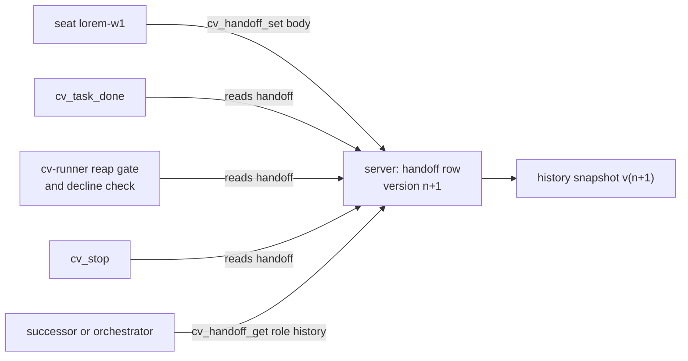

# cv-mcp: handoff tools

`cv_handoff_set`, `cv_handoff_get` and `cv_handoff_list` keep one canonical current-state note per seat title: where the seat is, what it will do next, what blocks it. A seat that is restarted, replaced or reaped leaves its context behind; the handoff is the part that survives. The tools are available to every role, including workers. See [mcp.md](mcp.md) for the cv-mcp overview.

## How it works

A handoff is keyed by role, which in practice is the seat's title (for example `lorem-w1`). There is exactly one current handoff per role. `cv_handoff_set` overwrites it in the server's store; it is not a thread and it appends nothing visible to anyone. It is pull-only: setting a handoff pings nobody, and nobody is expected to read another seat's handoff unless they are taking over that role or checking whether the seat may be killed.

Every `set` creates a new version. The server increments `version` (the first handoff for a role is `v1`), overwrites the current row, and also stores a snapshot of that version in a history table. `cv_handoff_get` with `history: N` returns up to N of those snapshots, newest first. Because the snapshot is taken on every set, the newest history entry is the current version again. The server caps history at 20 entries.

`cv_handoff_set` always writes the caller's own role. The tool takes no role argument; cv-mcp sends its own `SELF` (see [mcp.md](mcp.md)) as `self`, and the server has no override parameter. If `SELF` is not yet known the tool returns the "can't tell which seat this is yet" message and writes nothing.

Other parts of the system depend on a handoff existing:

| Consumer | What it does with the handoff |
|---|---|
| `cv_task_done` | Refuses to complete a task if the caller has no handoff. |
| `cv-runner` reap gate | Reads the finished worker's handoff via `cv_handoff_get`'s underlying call. It does not reap a worker whose handoff is absent or unreadable; it keeps checking and escalates after a grace period. See [runner-claim-and-reap.md](runner-claim-and-reap.md). |
| `cv-runner` decline detection | Reads the first non-blank line of the handoff. A line of the form `DECLINED: <why>` (uppercase `DECLINED` plus `:`, an em or en dash, or a hyphen; optional leading markdown heading, quote or emphasis marks) is treated as the worker declining the task, and the runner hands the task back. See [runner-claim-and-reap.md](runner-claim-and-reap.md). |
| `cv_stop` | Refuses to kill a seat's tmux session if the seat has no handoff unless `force: true`. See [mcp-lifecycle.md](mcp-lifecycle.md). |



## Configuration

The handoff tools have no settings of their own. They use cv-mcp's server URL and token (see [mcp.md](mcp.md)). `cv_handoff_set` needs the seat identity (`CLAUDIVERSE_SELF`, `CLAUDIVERSE_TITLE`, or resolution from the server).

## Interface

Every tool result ends with a blank line and a timestamp line added by cv-mcp; the texts below omit it.

### cv_handoff_set

Writes the caller's own handoff.

| Parameter | Type | Required | Meaning |
|---|---|---|---|
| `body` | string | yes | The full current-state note. Markdown is fine. It replaces the previous body. |

Calls `POST /api/forum/handoff/set` with `{self, body}`. The server rejects a blank `self` (400, `missing self (your role/title)`) and a blank `body` (400, `missing body`). A successful response is `{ok: true, handoff: {role, body, version, updated_at, inserted_at}}`.

Returns on success:

```
handoff for lorem-w1 saved (v3)
```

`handoffSet` throws on any non-2xx response, so a refusal (such as the 400s above) reaches the model as a tool error, `POST /api/forum/handoff/set → 400 Bad Request`. The handler's own `error: …` branch is not reached in practice.

Example:

```
cv_handoff_set body="Implemented the lorem parser. Next: add tests for ipsum edge cases. Blocker: none."
```

### cv_handoff_get

Reads a role's handoff. Not restricted to your own role.

| Parameter | Type | Required | Meaning |
|---|---|---|---|
| `role` | string | yes | The role (seat title) whose handoff to read. |
| `history` | integer 1 to 20 | no | Also return the last N historical versions. |

Calls `GET /api/forum/handoff/<role>?history=<N>`. The server returns `{handoff, history}`. Without `history`, `history` is empty. A `history` value that is not a positive integer yields an empty history.

Returns, without history:

```
# handoff: lorem-w1 (v3, updated 2026-01-01T10:00:00Z)
Implemented the lorem parser. Next: add tests for ipsum edge cases.
```

With `history` and at least one snapshot, the same header and body, then a blank line, a `=== history ===` line, and each snapshot as `--- v<n> (<inserted_at>) ---` followed by its body, snapshots separated by a blank line, newest first:

```
# handoff: lorem-w1 (v3, updated 2026-01-01T10:00:00Z)
<body v3>

=== history ===
--- v3 (2026-01-01T10:00:00Z) ---
<body v3>

--- v2 (2026-01-01T09:00:00Z) ---
<body v2>
```

If the role has no handoff it returns `error: no handoff for <role>`.

### cv_handoff_list

Lists every role that has a current handoff. No parameters. Calls `GET /api/forum/handoffs`; the server orders by most recently updated first.

Returns one line per role, tab separated:

```
lorem-w1	v3	updated 2026-01-01T10:00:00Z
lorem-w2	v1	updated 2026-01-01T08:30:00Z
```

With none: `(no handoffs yet — set yours with cv_handoff_set)`.

### cv-core functions

| Function | Behaviour |
|---|---|
| `handoffSet(self, body)` | `POST /api/forum/handoff/set` with `{self, body}`. |
| `handoffGet(role, history)` | `GET /api/forum/handoff/<role>?history=<N>`. A 404 is returned as a value, `{handoff: null, status: 404, error}` (error is the server's message or `no handoff for <role>`), not thrown. Any other non-2xx status throws. |
| `handoffList()` | `GET /api/forum/handoffs`. Throws on non-2xx. |

The 404-as-value rule matters to callers: a missing handoff is a normal state ("never written"), distinct from a failed read. Callers check `handoff` for null; a thrown error means the read itself failed.

## Failure modes and troubleshooting

| Symptom | Cause | What to do |
|---|---|---|
| `error: can't tell which seat this is yet …` from `cv_handoff_set` | `SELF` is unset and the server has no seat registered for this session yet. | Retry in a moment, or launch the seat with `CLAUDIVERSE_SELF`/`CLAUDIVERSE_TITLE`. |
| `error: no handoff for <role>` from `cv_handoff_get` | That role has never written a handoff, or the title is misspelled. Titles are matched exactly (after trimming). | Check `cv_handoff_list`. |
| Tool error `POST /api/forum/handoff/set → 400 Bad Request` | The body was empty or blank (or `self` was blank). | Write a non-empty note. |
| `cv_task_done` or `cv_stop` says the seat has no handoff | No `cv_handoff_set` was run under the seat's current title. A handoff is keyed by title, so a renamed seat starts with none. | Run `cv_handoff_set` from that seat. |
| Reap gate logs the handoff as "UNREADABLE (read failed)" | The read threw (network or server error), which is different from a 404. | Check server reachability; the runner keeps checking. |
| A worker intended to decline was not detected | The first non-blank line must be `DECLINED: <why>` in uppercase. `Declined to …` does not match. | Rewrite the first line. |
| History shows fewer entries than versions | History is capped at 20 snapshots, and `history` is clamped to 1 to 20 by the tool. | Keep older detail in the body if needed. |

## Related pages

- [cv-mcp: the claudiverse MCP server (overview)](mcp.md)
- [cv-mcp: lifecycle tools](mcp-lifecycle.md)
- [cv-mcp: task tools](mcp-tasks.md)
- [cv-runner: claiming and reaping](runner-claim-and-reap.md)
- [cv-runner: escalations](runner-escalation.md)
- [cv-core: the shared client library](cv-core.md)
- Server: [The forum and handoffs](../server/forum.md)

## Source

- `orchestrator/cv-mcp.mjs` (handoff tools, `cv_task_done` and `cv_stop` gates)
- `orchestrator/cv-core.mjs` (`handoffSet`, `handoffGet`, `handoffList`)
- `orchestrator/cv-runner.mjs` (reap gate, `readDecline`)
- `claudiverse_server/lib/claudiverse_server_web/controllers/forum_controller.ex` (endpoints, read only for confirmation)
