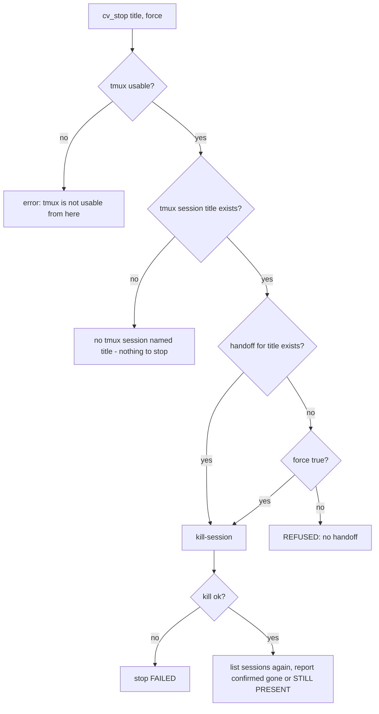
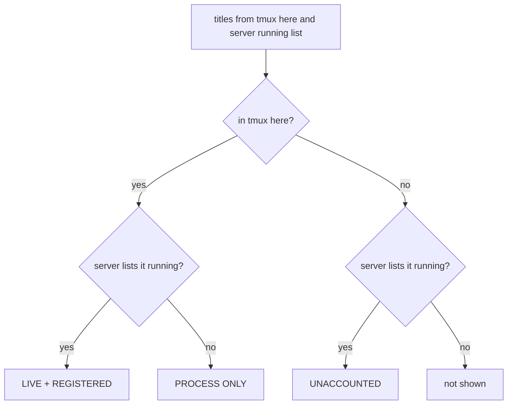

# cv-mcp: lifecycle tools

`cv_spawn`, `cv_stop` and `cv_ps` let a seat start, stop and inspect other Claude Code seats running under tmux on the machine where that seat's cv-mcp runs. They exist so the seat that manages a fleet can launch ephemeral workers, kill them safely, and cross-check what is running against what the server believes. See [mcp.md](mcp.md) for the cv-mcp overview.

## How it works

These tools are opt-in. They are registered only when `CLAUDIVERSE_LIFECYCLE=1` is set in that seat's cv-mcp environment and `CLAUDIVERSE_ROLE` is not `worker`. Grant it only to the seat that manages the fleet: adding the tools to a config gives that seat the power to start and kill OS processes.

They run on the host where cv-mcp runs. They call `tmux` and `orchestrator/cv-spawn.sh` with `execFile` and an argument array, never a shell string, so a title or prompt containing quotes or `;` is passed through as data. They do not use the server's spawn endpoint, and `cv-spawn.sh` remains the one place that knows how a seat is launched (see [cv-spawn.md](cv-spawn.md)).

Because tmux is local, none of these tools can see seats on other machines.

### cv_spawn

1. List tmux sessions. If tmux cannot be queried, return `error: tmux is not usable from here — cannot spawn.`
2. If a tmux session named `title` already exists, refuse.
3. Run `cv-spawn.sh <workdir> --title <title>` plus `--mcp`, `--mode`, `--prompt` when given, with a 30 s timeout.
4. List tmux sessions again and report whether `title` is present.

Only `--title`, `--mcp`, `--mode` and `--prompt` are passed. No `--fleet`, `--origin` or `--model`, so the origin defaults to `spawn` unless `CV_SPAWN_ORIGIN` is set in cv-mcp's environment, and every other cv-spawn.sh default applies. `cv-spawn.sh` inherits cv-mcp's environment, so the new seat gets cv-mcp's own `CLAUDIVERSE_TOKEN` and `CLAUDIVERSE_URL` unless the `--mcp` file supplies a token and the environment has none.

### cv_stop



The handoff is looked up by the tmux session name, which must therefore equal the seat's title (cv_spawn makes it so). See [mcp-handoffs.md](mcp-handoffs.md).

### cv_ps

cv_ps compares tmux sessions on this host with the server's sessions whose status is `running` and sorts every title into one of three buckets.



## Configuration

| Setting | Where | Effect |
|---|---|---|
| `CLAUDIVERSE_LIFECYCLE=1` | cv-mcp environment | Registers `cv_spawn`, `cv_stop`, `cv_ps`. Any other value leaves them out. |
| `CLAUDIVERSE_ROLE` | cv-mcp environment | If `worker`, the tools are never registered. Unset behaves as `orchestrator` for this check. |
| `CV_SPAWN_ORIGIN` | cv-mcp environment | Inherited by `cv-spawn.sh`; sets the origin recorded for seats started by `cv_spawn`. Default `spawn`. |

Requirements on the host: `tmux` on `PATH`, and `orchestrator/cv-spawn.sh` executable.

Dynamic-policy caveat. With no `CLAUDIVERSE_ROLE`, cv-mcp runs a dynamic policy: it asks the server for the seat's role and enables or disables tool groups accordingly (`cv-policy.mjs`). The lifecycle tools are registered in the shared group, which the policy never disables. So on a seat with no `CLAUDIVERSE_ROLE` and `CLAUDIVERSE_LIFECYCLE=1`, the tools stay enabled even if the server reports that seat's role as `worker`. The only hard gate is the static `CLAUDIVERSE_ROLE=worker`. Do not set `CLAUDIVERSE_LIFECYCLE=1` in a config shared by seats that include workers.

## Interface

Every result ends with a blank line and a timestamp line added by cv-mcp; omitted below.

### cv_spawn

| Parameter | Type | Required | Meaning |
|---|---|---|---|
| `title` | string | yes | Session title; also the tmux session name. Must be unique. |
| `workdir` | string | yes | Absolute path the agent starts in. |
| `mcp` | string | no | Path to the seat's `.mcp.json` (for example `worker.mcp.json`). Determines its role and tool surface. |
| `mode` | enum `auto`, `acceptEdits`, `plan`, `default` | no | Permission mode. If omitted, `cv-spawn.sh` applies its own default, `auto`. |
| `prompt` | string | no | Initial prompt injected at launch. |

Success:

```
<stdout of cv-spawn.sh>

tmux session present: YES
NOT YET VERIFIED: that the agent connected to the server. Check cv_ps / cv_status 'lorem-w1' before treating it as live.
```

If the tmux session is missing afterwards, the second line is `tmux session present: NO — spawn reported success but the session is absent; investigate before sending work`. A successful return does not mean the seat has registered with the server.

Example:

```
cv_spawn title="lorem-w1" workdir="/srv/work/lorem" mcp="/srv/work/worker.mcp.json" prompt="Take task 42."
```

### cv_stop

| Parameter | Type | Required | Meaning |
|---|---|---|---|
| `title` | string | yes | Session title to stop. |
| `force` | boolean | no | Stop even if the role has no handoff. Accepts the knowledge loss. |

Texts:

- Refusal: `⛔ REFUSED: '<title>' has NO handoff.` followed by an explanation to ask the seat to run `cv_handoff_set` first, or re-run with `force:true`.
- Success: `stopped '<title>' — tmux session confirmed gone` (or `STILL PRESENT (verify manually)`), then `handoff present: v<n>, updated <ts>`, or `⚠️ stopped WITHOUT a handoff (force) — its knowledge is gone.`
- `no tmux session named '<title>' — nothing to stop. (It may already be gone; cv_ps to see the full picture.)`
- `stop FAILED: <tmux output>`

The tool kills only the tmux session. It does not notify the server or the task system.

### cv_ps

No parameters. Output is a host line, three buckets with counts, then two notes:

```
host: build-host-1

LIVE + REGISTERED (1) — tmux session HERE and the server lists it running
  lorem-w1

PROCESS ONLY (1) — tmux session HERE, server does NOT list it running — never connected, or died mid-handshake
  lorem-w2

UNACCOUNTED (1) — server lists it running, NO tmux session on THIS host
  ipsum-w5

⛔ UNACCOUNTED IS NOT 'DEAD'. ...

Bound: tmux presence proves a PROCESS, not a healthy agent. A wedged seat still shows LIVE.
```

Empty buckets print `(none)`. The host name comes from the `hostname` command; if it fails the line reads `host: this host`. `UNACCOUNTED` means either the seat runs on another machine (normal) or it is gone and the server status is stale; the tool cannot tell which, because sessions carry no host field. Check other machines before cleaning one up. Every tmux session on the host is considered, not just claudiverse ones.

## Failure modes and troubleshooting

| Symptom | Cause | What to do |
|---|---|---|
| `error: tmux is not usable from here …` | `tmux list-sessions` failed for a reason other than "no server running" (tmux missing, permission error). | Install tmux or fix `PATH` for the cv-mcp process. |
| No error but the fleet looks empty | A tmux "no server running" error is treated as zero sessions, not a failure. | Normal when nothing has been started on this host. |
| `refused: a tmux session named '<title>' already exists …` | Title collision. | `cv_stop` it or choose another title. |
| `spawn FAILED: …` | `cv-spawn.sh` exited non-zero, or exceeded the 30 s timeout and was killed. | Read the message. If it is a timeout, check `cv_ps` before retrying: the seat may be starting. |
| `tmux session present: NO …` | The script succeeded but the session is gone. | Inspect before sending work. |
| Spawned seat is not in `LIVE + REGISTERED` | It has not connected yet, or died during startup. It appears under `PROCESS ONLY`. | Wait and re-run `cv_ps`; check the tmux pane. |
| Seat shows `LIVE` but does nothing | tmux presence is not health. | Use `cv_status` and `cv_last`; see [mcp-seats.md](mcp-seats.md). |
| Seat shown as `UNACCOUNTED` | Other machine, or stale server status. | Do not kill or clean up until the other machines are checked. |
| `cv_stop` says REFUSED | No handoff under that title. | Have the seat run `cv_handoff_set`, or pass `force: true`. |
| Slow spawn reported as failed | `cv-spawn.sh` can spend up to about 20 s waiting for the shell to be ready plus up to about 30 s on its launch check, which can exceed `cv_spawn`'s 30 s timeout. `cv-runner` uses a 90 s timeout for the same script. A slow but successful spawn can therefore be reported as `spawn FAILED` while the seat still starts. | Run `cv_ps` after a failure before retrying. |

## Related pages

- [cv-mcp: the claudiverse MCP server (overview)](mcp.md)
- [cv-mcp: handoff tools](mcp-handoffs.md)
- [cv-mcp: seat, ping and question tools](mcp-seats.md)
- [cv-spawn.sh: starting a seat](cv-spawn.md)
- [cv-runner: the worker brief, the charter, and spawning](runner-brief-and-spawn.md)
- [cv-runner: HALT and drain](runner-halt-and-drain.md)
- Server: [Profiles and the host channel](../server/profiles-and-hosts.md)
- Host agent: [Starting seats](https://github.com/Promises/claudiverse-host-agent-oss/blob/main/docs/reference/starting-seats.md)
- Android: [New seat (spawning a seat)](https://github.com/Promises/claudiverse-apps/blob/main/docs/android/new-seat.md)
- Mac: [New seat](https://github.com/Promises/claudiverse-apps/blob/main/docs/mac/new-seat.md)

## Source

- `orchestrator/cv-mcp.mjs` (lifecycle section)
- `orchestrator/cv-policy.mjs` (group policy)
- `orchestrator/cv-spawn.sh`
- `orchestrator/cv-runner.mjs` (spawn timeout)
