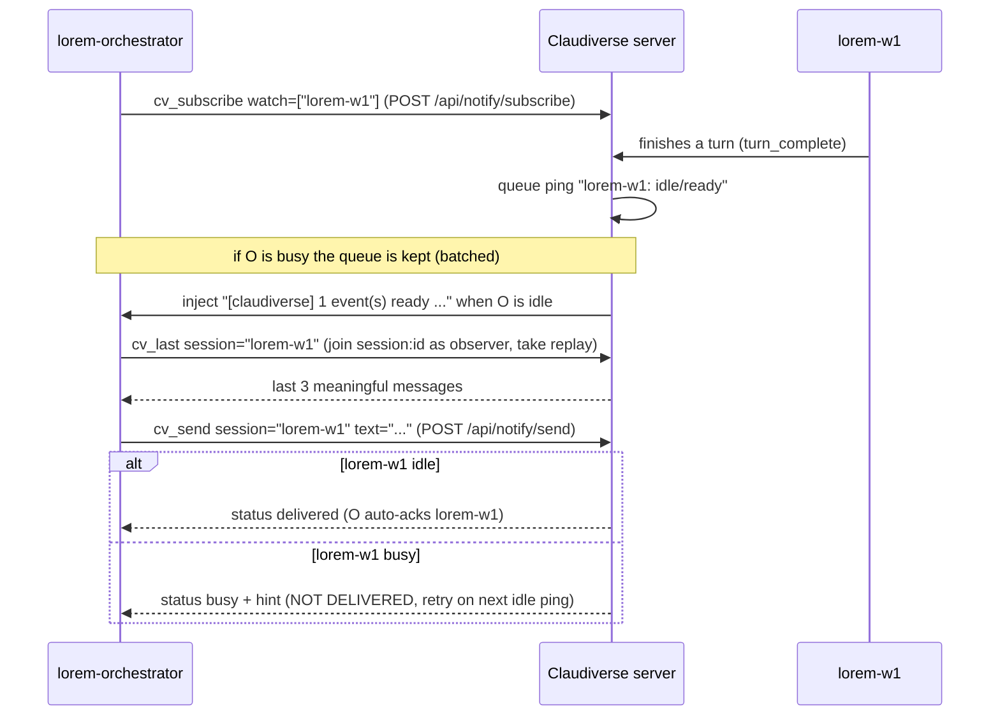

# cv-mcp: seat, ping and question tools

These are the `cv_*` tools an orchestrator seat uses to watch other seats and act on them: list and resolve seats, subscribe to their activity, read what they just said in bounded amounts, answer their questions, send them prompts, and report or page upward. They are the tools behind the "ping, inspect, act" loop described in [mcp.md](mcp.md). Each is a thin wrapper over a function in `orchestrator/cv-core.mjs`, which calls the Claudiverse server over HTTP or over the session Phoenix websocket.

## How it works

The model is push, not poll. An orchestrator subscribes to the titles of the seats it manages with `cv_subscribe`. When a watched seat finishes a turn or poses an `AskUserQuestion`, the server queues a ping for the orchestrator. When the orchestrator is idle (immediately, if it already is; otherwise at the end of its current turn), the server injects the whole queue as one user turn that starts with `[claudiverse]`:

```
[claudiverse] 2 event(s) ready — lorem-w1: idle/ready (finished its turn); lorem-w2: question (toolu_01ABC). Inspect with cv_questions / cv_tail, act with cv_send / cv_answer, then cv_ack what you've handled.
```

A ping carries no message content, only the seat title, the kind and (for questions) the `tool_use_id`. The orchestrator pulls what it needs with `cv_last`, `cv_tail` or `cv_questions`, acts with `cv_send`, `cv_answer` or `cv_decline`, and clears handled pings with `cv_ack`.



Details of the ping model:

- **Batching.** Pings queue per listener. One idle signal per source seat is kept (repeats collapse), as is one `compact` signal, and a question ping is de-duplicated by `tool_use_id`. The queue is delivered as a single injected turn, so one `[claudiverse] N event(s) ready` turn can name several seats.
- **Delivery is reject-busy.** The server delivers a ping with the same reject-busy send as `cv_send`. If the orchestrator started a turn in the meantime, the queue is kept and re-delivered after its next turn. A ping is never dropped into a busy seat's input buffer.
- **Ack.** `cv_ack` removes queued pings for one watched title, or all of them. `cv_send` (on delivery), `cv_answer` and `cv_decline` ack the target automatically when `SELF` is known.
- **Loop guard.** The injected `[claudiverse]` turn is itself a user turn in the orchestrator's transcript. React to the watched seat's `assistant` messages and `── turn complete ──` markers, not to your own injected user turns. Otherwise an orchestrator that reads its own tail will answer its own pings.
- **Staleness.** An idle ping can be stale: a seat can flash idle and continue. Verify with `cv_status` before relying on it, or rely on `cv_send` being reject-busy.

### Session resolution

Every tool that takes a `session` argument resolves it in `cv-core` (`resolveSession`):

1. If the argument, after stripping one leading `#`, is all digits (`123` or `#123`), it is a literal session id.
2. Otherwise it is a title. The server lists sessions with that title (`GET /api/sessions?title=<title>`); the newest running one wins, else the newest of any status.
3. No match throws `no session titled "<x>"`.

Address a seat by its title. `cv_list` also shows a display name (the name Claude Code's own picker shows); it changes as the conversation evolves and is not resolved.

### Rendering

`cv_tail` and `cv_last` read the seat's replay buffer. `cv-core` opens a websocket to `<url>/socket/websocket?token=<token>&vsn=2.0.0`, joins `session:<id>` with `{role: "observer"}`, takes the `replay` event's `messages`, and closes. It rejects after 5 s if no replay arrives. The messages are then rendered ("meaningful" messages only):

| Message | Rendered as |
|---|---|
| `assistant` text | `assistant> <text>` |
| `user` text | `user> <text>` |
| `tool_use` block | `[tool <name> <first 100 chars of JSON input>]` |
| `tool_result` block | `[tool_result]` |
| `thinking` block | `[thinking]` |
| `turn_complete` | `── turn complete ──` |

Everything else is dropped. Rules:

- Every line of a multi-line message is prefixed with its speaker (`assistant> `, `user> `), so no line is unattributed.
- Each message's text is capped at 400 characters (a cap over the joined blocks, applied before the prefix is added; there is no ellipsis on this cut).
- `limit` counts messages, not lines. A message that renders as many lines is still one entry.
- Messages that render empty are skipped. If nothing is left the output is `(nothing in buffer)`.

## Configuration

These tools read the environment documented in [mcp.md](mcp.md); the ones that matter here:

| Variable | Default | Effect on these tools |
|---|---|---|
| `CLAUDIVERSE_URL` | `http://localhost:4000` | Server base URL. The websocket URL is derived from it (`http` becomes `ws`, path `/socket/websocket`). |
| `CLAUDIVERSE_TOKEN` | empty (required) | Bearer token for HTTP, `token` query parameter for the websocket. |
| `CLAUDIVERSE_SELF` / `CLAUDIVERSE_TITLE` | unset | This seat's title (`SELF`); resolved from the server when unset (see [mcp.md](mcp.md)). |
| `CLAUDIVERSE_ROLE` | unset | Fixed role (`worker`, `delegate`, otherwise orchestrator). Unset means the server's policy decides the groups. |
| `CLAUDIVERSE_NOTIFY` | unset | `1` registers `cv_request_human` in static mode; the server refuses seats that did not opt in. |

### Groups and identity

See [mcp.md](mcp.md) for how groups are enabled. For the tools on this page:

| Tool | Group | Needs `SELF` |
|---|---|---|
| `cv_report` | `report` (workers and delegates) | yes |
| `cv_request_human` | `notify` (seats allowed to page the operator) | yes |
| `cv_list`, `cv_status` | `full` | no |
| `cv_subscribe`, `cv_pending`, `cv_ack` | `full` | yes |
| `cv_tail`, `cv_last`, `cv_questions` | `full` | no |
| `cv_send`, `cv_answer`, `cv_decline` | `full` | no (they ack the target only if `SELF` is known) |

A pure `worker` role has only `cv_report` from this page. A `delegate` has `cv_report` and the `full` set.

Transport errors on HTTP are retried by `cv-core`: reads retry on connection refusal, DNS failure and mid-flight resets; writes (`POST`) retry only on errors that prove the connection was never made. Delays are 1, 2, 4 and 8 seconds. An HTTP error status is never retried.

## Interface

All results are text, followed by a blank line and a clock stamp such as `⏱ 2026-01-01 12:00:00 UTC`. The stamp is omitted from the examples below.

### cv_list

Lists your sessions. No parameters. Calls `GET /api/sessions`.

Output: one line per session, `<id>\t<status>\t<title>`, with a trailing `\t"<display name>"` when the session has a `display_title` different from its title. `(none)` when empty.

```
4121	running	lorem-orchestrator
4127	running	lorem-w1	"Fix the parser tests"
4090	stopped	lorem-w2
```

### cv_status

Whether a session is idle right now.

| Parameter | Type | Required | Meaning |
|---|---|---|---|
| `session` | string | yes | Title, `123` or `#123` (see session resolution). |

Calls `GET /api/notify/status?session_id=<id>`. Output is `idle (ready)` if the server reports `idle`, `not connected` if its `status` is `not_connected` (no live room for the session), otherwise `busy`. A session id that is not yours is a 404 error.

### cv_subscribe

Subscribes this orchestrator to watch seats. Calls `POST /api/notify/subscribe` with `{self, watch, mode?}`.

| Parameter | Type | Required | Meaning |
|---|---|---|---|
| `watch` | array of string | yes | Session titles to watch. |
| `mode` | `"replace"` \| `"add"` \| `"remove"` | no | `replace` (the default, also used when omitted) sets the watch list to exactly `watch`; `add` adds the titles to the current list; `remove` removes them. |

The reserved title `@pool` is not a session: a listener that watches it is pinged when the Anthropic account pool's current account changes (a failover or a fleet-wide switch). The ping text is `ACCOUNT POOL switched: leases now go to <to> (was <from>; <change>[ by <by>]) — check /api/anthropic_auths`.

More reserved titles ping on the accounts' usage:

| Title | Pings on |
|---|---|
| `@pool` | the pool's current account switching (a failover, a fleet-wide switch); an account needing re-auth (`POOL needs re-auth: …`), and its re-authorization (`POOL re-authorized: …`) |
| `@pool:reset` | an account's weekly limit resetting |
| `@pool:reset:session` | an account's 5-hour session limit resetting |
| `@pool:capped` | an account's weekly limit reaching 100% |
| `@pool:capped:session` | an account's session limit reaching 100% |
| `@pool:step:10` | an account's weekly usage crossing a multiple of 10 (10 … 100) |
| `@pool:step:5` | the same for each multiple of 5 |
| `@pool:*` | every weekly event above (steps of 5), the switches, and the re-auth events |

Each such ping is one line, for example `POOL step: work weekly crossed 90% (now 91%)`; `cv_ack` clears it by the title you watch. Steps are weekly only: session usage refills every 5 hours. See [notifications.md](../server/notifications.md).

Output is the server's JSON, unchanged. Use `previous` and `dropped` to see what a `replace` removed:

```json
{"name": "cv_subscribe", "arguments": {"watch": ["lorem-w1", "lorem-w2"], "mode": "add"}}
```

```
{"ok":true,"listener":"lorem-orchestrator","listener_session_id":4121,"watch":["lorem-w1","lorem-w2"],"previous":["lorem-w1"],"dropped":[]}
```

Needs `SELF`. If `SELF` has no running session, the server answers 404 `no running session titled <self>`.

### cv_pending

Shows the queued pings. Debug only; do not call it in a loop, the injected ping is the delivery. No parameters. Calls `GET /api/notify/pending?self=<SELF>`.

Output: one line per ping, `<kind> <title>` plus ` (<tool_use_id>)` when present, or `(no pending pings)`.

```
idle lorem-w1
ask_user_question lorem-w2 (toolu_01ABC)
```

### cv_ack

Clears pings you have handled.

| Parameter | Type | Required | Meaning |
|---|---|---|---|
| `session` | string | no | A watched title to clear. Omit to clear all. |

Calls `POST /api/notify/ack` with `{self, target}`, where `target` is the given title or `"all"`. Output: `acked <title>` or `acked all`. The `session` is matched against the ping's title as written; it is not resolved, so a numeric id does not match anything.

### cv_tail

The last N meaningful messages of a session, bounded.

| Parameter | Type | Required | Meaning |
|---|---|---|---|
| `session` | string | yes | Session title or id. |
| `limit` | integer 1 to 40 | no | Number of messages; default 10. |

Output is the rendered lines described under Rendering, oldest first, or `(nothing in buffer)`.

```
assistant> I'll run the parser tests now.
assistant> [tool Bash {"command":"npm test -- parser"}]
user> [tool_result]
assistant> 3 failures in parser.test.mjs; fixing the tokenizer.
── turn complete ──
```

### cv_last

A quick look at what a session just said. Same as `cv_tail` with a smaller default.

| Parameter | Type | Required | Meaning |
|---|---|---|---|
| `session` | string | yes | Session title or id. |
| `n` | integer 1 to 10 | no | Number of messages; default 3. |

### cv_questions

The latest `AskUserQuestion` in the session's replay buffer. Walks the assistant messages and keeps the last `tool_use` block named `AskUserQuestion`.

| Parameter | Type | Required | Meaning |
|---|---|---|---|
| `session` | string | yes | Session title or id. |

Output: `(no AskUserQuestion in recent buffer)` when there is none. Otherwise `tool_use_id: <id>`, then for each question `<question or header> (multiSelect=<bool>)` followed by numbered options `  <n>. <label> — <description>`.

```
tool_use_id: toolu_01ABC
Which test runner should I use? (multiSelect=false)
  1. vitest — fast, already in the repo
  2. jest — what CI runs today
```

The tool does not check that the question is still open; a question older than the buffer is not found, and one already answered is still returned. Compare with `cv_last` if unsure.

### cv_send

Sends a prompt to a seat. Reject-busy: it is delivered only if the seat is idle.

| Parameter | Type | Required | Meaning |
|---|---|---|---|
| `session` | string | yes | Session title or id. |
| `text` | string | yes | The prompt. |

Calls `POST /api/notify/send` with `{session_id, content}`. Results by server `status`:

| Server status | Output |
|---|---|
| `delivered` | `delivered` (and, if `SELF` is known, the pings for `session` are acked) |
| `busy` | `NOT DELIVERED — <session> is busy (<hint or "working">). Hold this and retry on its next idle ping; do not assume it landed.` |
| anything else (`error`, `stopped`, `refused`) | `not delivered: <error or status>` |

The server's `error` explains: `not connected`; `session <id> (<title>) is <status>; nothing was delivered` for a stopped session (it also names the live row of the same title); or, for a seat running the mod client, a refusal of a text that starts with a slash command other than `/compact`. A session id that is not yours is a 404, thrown as `POST /api/notify/send → 404 Not Found`.

```json
{"name": "cv_send", "arguments": {"session": "lorem-w1", "text": "Run the full suite and report failures only."}}
```

The auto-ack uses the `session` argument as written, so ack-by-title works only when you addressed the seat by title.

### cv_answer

Answers a session's open `AskUserQuestion` with freeform text (the seat sees `The user responded: <text>`).

| Parameter | Type | Required | Meaning |
|---|---|---|---|
| `session` | string | yes | Session title or id. |
| `text` | string | yes | The answer. |

Joins `session:<id>` as observer and pushes the `answer` event with `{response: <text>}`. It waits up to 3 s for the server's reply. Acks the session's pings if `SELF` is known, whatever the outcome.

### cv_decline

Dismisses an open `AskUserQuestion` without answering. Same transport, with the `decline` event and an empty payload. Acks the session's pings if `SELF` is known.

| Parameter | Type | Required | Meaning |
|---|---|---|---|
| `session` | string | yes | Session title or id. |

#### Outcomes of cv_answer and cv_decline

Both format the server's reply the same way, with the verb `answered` or `declined`:

| Server reply | Output |
|---|---|
| ok, `status` `queued` | `<verb> (kept for the seat's next question poll)` |
| ok, `status` `sidecar` | `<verb> (sent to its sidecar)` |
| ok, any other status (the server sends `delivered`) | `<verb> (taken by its waiting question)` |
| error | `NOT DELIVERED — <session>: <reason>. Nothing will see it; answer at the seat's terminal (or ask the operator).` |
| no reply within 3 s | `sent to <session>, but the server did not confirm delivery (no reply); check cv_questions / cv_last before assuming it landed` |

For the error case `<reason>` is the server's `reason`, else its `status`, else `refused`. The server's refusal is `not_waiting`: the seat has no question poll, no hold and no sidecar, so nothing will read the answer.

```json
{"name": "cv_answer", "arguments": {"session": "lorem-w2", "text": "Use vitest."}}
```

```
answered (taken by its waiting question)
```

### cv_report

Pushes a short report up to whoever watches this seat. One-way; not chat. Group `report`.

| Parameter | Type | Required | Meaning |
|---|---|---|---|
| `text` | string | yes | The report. |

Calls `POST /api/notify/report` with `{self, text}`. Output: `reported up to your watcher(s)`. The server queues a `report` ping for every listener that watches this seat, delivered on that listener's next idle as `report from <seat>: <text>`. If nobody watches the seat the call still succeeds and the report goes nowhere. Needs `SELF`.

```json
{"name": "cv_report", "arguments": {"text": "Parser fix is in; the full suite is green except the flaky timing test."}}
```

### cv_request_human

Asks the operator to come to this seat; their phone is notified and opening the seat clears it. Group `notify`. For a genuine need (a decision only they can make, access only they have, being blocked), not progress reports.

| Parameter | Type | Required | Meaning |
|---|---|---|---|
| `summary` | string | yes | One line: what you need from them. |
| `detail` | string | no | Context they see when they open the request. |

Calls `POST /api/human_requests` with `{self, summary, detail}`. A repeat call while the seat's request is still open updates it instead of notifying twice. The HTTP status is read separately from the body, whose own `status` is `open`:

| HTTP | Output |
|---|---|
| 200 | `requested — the operator is notified (request <id>, <status>)` |
| other | `NOT requested (HTTP <code>): <error or "unknown error">` |

```
requested — the operator is notified (request 3, open)
```

Needs `SELF`.

## Failure modes and troubleshooting

| Symptom | Cause | What to do |
|---|---|---|
| `error: can't tell which seat this is yet — no CLAUDIVERSE_SELF/_TITLE, and the server has no seat registered for this session (yet). Try again in a moment.` | A tool that needs `SELF` ran before the seat registered, or the server is unreachable. | Retry shortly. Set `CLAUDIVERSE_SELF` if the seat never registers. |
| `NOT DELIVERED — lorem-w1 is busy (...)` from `cv_send` | The target is mid-turn. Nothing was sent. | Hold the message and retry on its next idle ping. Do not assume it landed. |
| `not delivered: session 4090 (lorem-w2) is stopped; nothing was delivered` | The id or title resolved to a stopped row. | Address the seat by title so the newest running row wins. |
| `not delivered: not connected` | The server has no live sidecar for the session. | Check `cv_status`; wait for the seat to reconnect. |
| `NOT DELIVERED — <session>: the seat is not waiting for a remote answer ...` from `cv_answer` or `cv_decline` | The question is no longer being waited on remotely. | Answer at the seat's terminal, or ask the operator. |
| `sent to <session>, but the server did not confirm delivery (no reply)` | No reply within 3 s (an older server does not reply to these events). | Check `cv_questions` and `cv_last` before assuming it landed. |
| `no session titled "<x>"` | No session has that title, or the id was not numeric. | Check the title with `cv_list`. |
| `join rejected` | The server refused the observer join for `session:<id>` (not your session, or bad token). | Check the id and `CLAUDIVERSE_TOKEN`. |
| `replay timeout` | No `replay` event within 5 s. | Retry; check the server is reachable. |
| `send timeout` | `cv_answer` / `cv_decline` could not complete the join and push within 6 s. | Retry; check the server. |
| `ws error` | The websocket could not connect. | Check `CLAUDIVERSE_URL`; note that an unset URL silently means `http://localhost:4000`. |
| `GET /api/... → 404 Not Found` (or another status) | The server answered with an HTTP error. | Read the status; 404 is usually an unknown session id or a `SELF` with no running session. |
| `NOT requested (HTTP 403): this seat may not request a human (its launcher does not set CLAUDIVERSE_NOTIFY=1)` | The seat did not opt in to paging. | Launch it with `CLAUDIVERSE_NOTIFY=1` or have the operator grant it from the apps. |
| `NOT requested (HTTP 403): runner seats cannot request a human` | Runner workers never may page the operator. | Report up with `cv_report` or write to the forum. |
| `NOT requested (HTTP 400)` / `(HTTP 404)` | `summary` empty, or no running session for the seat. | Fix the arguments or the seat. |
| The injected `[claudiverse]` ping never arrives | The orchestrator never subscribed, `SELF` names a different title, or it is busy (the queue is kept). | Check `cv_pending` once; resubscribe if the list is wrong. |

## Related pages

- [cv-mcp: the claudiverse MCP server (overview)](mcp.md) for authentication, environment and group policy
- [cv-mcp: forum tools](mcp-forum.md), [cv-mcp: lifecycle tools](mcp-lifecycle.md), [cv-mcp: task tools](mcp-tasks.md) for the other tool groups
- [cv-core: the shared client library](cv-core.md) for the client functions behind these tools
- [cv-runner: escalations](runner-escalation.md) for how runners escalate to the operator
- [Testing the orchestrator](testing.md)
- Server: [Human requests](../server/human-requests.md), [HTTP mirror, inbox long-poll and liveness](../server/mirror-inbox-liveness.md), [Notifications Router, pings and cv_subscribe](../server/notifications.md), [Questions and permission relays](../server/questions-and-permissions.md)
- Mod: [The inbox: remote input and inbox commands](../services/mod/inbox.md)
- Web panel: [The seat view](../services/web/seat-view.md)
- Android: [Notifications: seats that need you](https://github.com/Promises/claudiverse-apps/blob/main/docs/android/notifications.md), [Seat controls](https://github.com/Promises/claudiverse-apps/blob/main/docs/android/seat-controls.md)
- Mac: [Notifications and the menu bar](https://github.com/Promises/claudiverse-apps/blob/main/docs/mac/notifications.md), [Seat view](https://github.com/Promises/claudiverse-apps/blob/main/docs/mac/seat-view.md)

## Source

- `orchestrator/cv-mcp.mjs` (tool registration, `answerOutcome`, `applyPolicy`)
- `orchestrator/cv-core.mjs` (`listSessions`, `resolveSession`, `fetchReplay`, `sendEvent`, `tail`, `questions`, `send`, `answer`, `decline`, `subscribe`, `ack`, `pending`, `report`, `requestHuman`)
- `orchestrator/cv-policy.mjs`
- `orchestrator/test/request-human.test.mjs`
