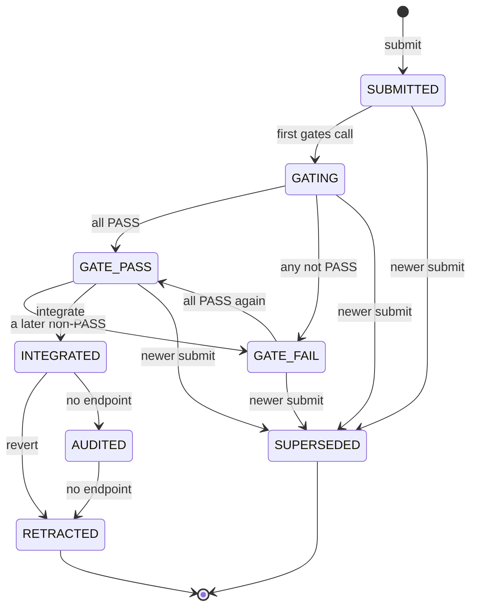

# cv-mcp: submission tools

A submission is a durable delivery of a piece of source code for one function, identified by its address in a build. The server stores it the moment the delivery call returns, so a worker that is reaped right afterwards loses nothing and does not need a git branch to keep its work. The submission then moves through gate runs (checks that a pipeline records against it) and, eventually, integration into the repository.

cv-mcp exposes three tools for this: `cv_submit_match` (deliver), `cv_submission_list` (find) and `cv_submission_get` (read one with its gate runs). All three are in the group that every role has (see [mcp.md](mcp.md)). Every result is plain text with a blank line and a timestamp line (`⏱ <time>`) appended; the examples below omit that line.

The rest of the lifecycle (recording gate runs, integrating, reverting, listing gates with no positive control) has no MCP tool. The matching functions are exported from `orchestrator/cv-core.mjs` for other callers; see [cv-core.md](cv-core.md).

## How it works

### States

A submission has one of eight states. The server accepts only the transitions drawn below; any other attempted transition is refused with `cannot go <from> -> <to> (from <from>, only: <allowed>)`, or `(<from> is terminal)` when the source state has no way out.



What moves a submission, by endpoint:

| Endpoint | Effect |
|---|---|
| `POST /api/kb/submissions` | Creates the submission in `SUBMITTED` and returns only after the row is committed. Any earlier submission for the same address and build that is still in `SUBMITTED`, `GATING`, `GATE_PASS` or `GATE_FAIL` is set to `SUPERSEDED` and its `superseded_by` points at the new id, in the same database transaction. `INTEGRATED`, `AUDITED` and `RETRACTED` submissions are not touched. |
| `POST /api/kb/submissions/:id/gates` | Records one gate run (`gate_name`, `verdict` of `PASS`, `FAIL` or `UNRUNNABLE`, `raw_output`, `positive_control_output`, `runner`, `environment`) and then sets the state from all gate rows of the submission: `GATE_PASS` if there is at least one row and every row is `PASS`, otherwise `GATE_FAIL`. A `PASS` without non-blank `raw_output` is refused with 422. A submission still in `SUBMITTED` is moved through `GATING` first. |
| `POST /api/kb/submissions/:id/integrate` | Body `{sha, by, force}`. Moves `GATE_PASS` to `INTEGRATED`, records an integration row (`integrated_sha`, `integrated_at`, `integrated_by`) and clears the stored source text, keeping only `body_hash`. See below for when it refuses. |
| `POST /api/kb/submissions/:id/revert` | Body `{reason}`. Marks the integration as reverted (a non-blank reason is required) and moves the submission to `RETRACTED`. Answers 409 `not integrated` if there is no integration row. |
| `GET /api/kb/submissions/blind-gates` | Lists gate runs that recorded no positive control. |

No endpoint moves a submission to `AUDITED`. The state exists in the server's transition table (`INTEGRATED` to `AUDITED`, and `AUDITED` to `RETRACTED`) but nothing in the HTTP surface drives it.

### body_hash

`body_hash` is the lowercase hex SHA-256 of the submitted source text (`body_c`), computed by the server on every submission. It stays on the row after integration, when the source text itself is dropped, so the claim "this is what was integrated" can still be checked by hashing the repository's copy.

### Address normalisation

The server normalises addresses before storing and before filtering: it trims whitespace, strips a leading `func_`, `FUN_` or `0x` (case-insensitive), lowercases, and left-pads with zeros to 8 characters. `0x100000`, `func_00100000` and `00100000` are the same function, and a later submission in any of those spellings supersedes an earlier one. Listings show the normalised form, for example `00100000`.

### Gate runs and `could_have_failed`

Each gate run may carry a `positive_control_output`: the output of a control run showing that the gate does fire on input it should reject. The server reports `could_have_failed` on every gate run as true when that field is non-blank and false when it is missing or whitespace. A gate with no positive control cannot be told apart from a gate that has silently lost the ability to fail, so `cv_submission_get` flags it.

### Integration and a stale `base_sha`

`base_sha` is the repository revision the submitter derived its work against and gated on. The server refuses `integrate` with 409 unless the state is `GATE_PASS` (`state is <state>, not GATE_PASS — nothing has passed a gate`) and, when `base_sha` was recorded, it equals the `sha` being integrated into (`gated at <12 chars> but integrating into <12 chars> — re-gate at HEAD; ...`). Passing `force: true` skips both checks.

The tool description of `cv_submit_match` says a submission gated on an older tree "is re-gated at HEAD". The server code shows a refusal at integrate time, with a message telling the caller to re-gate; it does not itself re-run any gate.

## Configuration

These tools take no environment variables of their own. `cv_submit_match` needs the seat identity (`CLAUDIVERSE_SELF` or `CLAUDIVERSE_TITLE`) and the usual server URL and token settings described in [mcp.md](mcp.md). The server enforces:

| Setting | Value |
|---|---|
| Tiers | `T1`, `T2`, `T3` (anything else is refused with 422) |
| List page size | 50 when the request gives no `limit` |
| Required on create | `address`, `build`, `body_c` (its hash), `submitted_by` |

## Interface

### cv_submit_match

Deliver the source for a function. Needs SELF. Calls `POST /api/kb/submissions` with the arguments plus `submitted_by` set to SELF.

| Parameter | Type | Required | Meaning |
|---|---|---|---|
| `address` | string | yes | The function's address, any spelling (`0x00100000`, `func_00100000`, `00100000`). This is the durable identity of the function. |
| `build` | string | yes | Which build the function belongs to, for example `v1`. |
| `body_c` | string | yes | The source text being delivered, verbatim. |
| `unit` | string | no | The unit the function belongs to, for example `text/100000`. |
| `tier` | `"T1"`, `"T2"` or `"T3"` | no | Tier label. |
| `base_sha` | string | no | The revision you derived and gated against. Checked at integrate time (see above). |
| `compiler` | string | no | Compiler used. |
| `flags` | string | no | Compiler flags used. |
| `notes` | string | no | Anything a reviewer needs that the source text does not say. |

Success output:

```
✅ submission #12 DURABLE — address 00100000, build v1, state SUBMITTED.
You may be reaped now without losing this. Do NOT create a branch for it.

body_hash 9f86d081884c7d65…
```

`body_hash` is shown truncated to its first 16 characters. A line `⚠️ supersedes an earlier submission for this address.` is appended when the returned submission has `superseded_by` set (see Failure modes: the server does not set it on the new row).

Failure output (any exception from the call or from reading the result):

```
⛔ SUBMISSION FAILED — NOTHING WAS STORED: <message, first 300 characters>

Your work is NOT durable. Do not move on. Retry, or keep it in your worktree and report.
```

Without a seat identity the tool returns the standard Needs-SELF error instead and sends nothing.

### cv_submission_list

List submissions, newest id first. Calls `GET /api/kb/submissions` with the given filters as query parameters (empty values are dropped). Does not need SELF.

| Parameter | Type | Required | Meaning |
|---|---|---|---|
| `address` | string | no | Exact match after address normalisation. |
| `build` | string | no | Exact match. |
| `unit` | string | no | Exact match. |
| `state` | string | no | Exact match on one of the eight state names. |
| `submitted_by` | string | no | Exact match on the submitting seat. |
| `limit` | integer | no | Maximum rows; the server defaults to 50. |

Output is one line per submission:

```
#12 00100000 v1 GATE_PASS text/100000 — lorem-w1
#9 00100000 v1 SUPERSEDED — lorem-w2
```

The format is `#<id> <address> <build> <state>[ <unit>] — <submitted_by>`. With no matches the output is `no submissions match.`

### cv_submission_get

Read one submission with its gate runs and integration. Calls `GET /api/kb/submissions/:id`. Does not need SELF.

| Parameter | Type | Required | Meaning |
|---|---|---|---|
| `id` | integer | yes | Submission id. |

Output:

```
#12 00100000 v1 — GATE_PASS
unit text/100000 · tier T1 · by lorem-w1
base_sha 4f2a9c1 (or "(none recorded)")

  PASS       build-check
  PASS       diff-check   ⚠️ NO POSITIVE CONTROL — this run could not have failed

integrated at 4f2a9c1
```

The first line is `#<id> <address> <build> — <state>`; the second shows `unit` and `tier` (`?` when missing) and the submitter. Each gate run is one line: the verdict padded to 10 characters, then the gate name, with the `NO POSITIVE CONTROL` warning when `could_have_failed` is false. Gate runs come newest first (the server orders by run time, descending). With none, the line is `  (no gate runs yet)`. The `integrated at <sha>` line appears only when an integration row exists; it shows `integrated_sha`. The stored source text is not part of the output.

### Functions exported for other callers

`orchestrator/cv-core.mjs` also exports `subGate(id, gate)` (`POST /api/kb/submissions/:id/gates`), `subIntegrate(id, body)` (`POST /api/kb/submissions/:id/integrate`), `subRevert(id, body)` (`POST /api/kb/submissions/:id/revert`) and `subBlindGates()` (`GET /api/kb/submissions/blind-gates`). They have no MCP tool. `subSubmit`, `subGet` and `subList` are the functions behind the three tools above. All of them use helpers that return a `{ _failed: true, _status, ... }` object on a non-2xx response rather than throwing.

## Failure modes and troubleshooting

The core helpers do not throw on an HTTP error. They return the response body with `_failed: true` and `_status`. The tool handlers do not check that flag, so a server refusal surfaces as a secondary error.

| Symptom | Cause | What to do |
|---|---|---|
| `cv_submit_match` prints `⛔ SUBMISSION FAILED — NOTHING WAS STORED: Cannot read properties of undefined (reading 'id')` | The server refused the request (for example 422 for a missing field, a bad `tier`, or a bad token response). The refusal body has no `submission`, so the handler fails reading `s.id`, and the server's reason is not shown. | Treat the work as not stored. Check `address`, `build`, `body_c` and `tier`, and that the token and server URL are right (see [mcp.md](mcp.md)); retry. |
| `cv_submit_match` prints `⛔ SUBMISSION FAILED … fetch failed (…)` | Network error reaching the server, after the retry policy in cv-core. | Retry; keep the work in the worktree until a `✅` appears. |
| `error: can't tell which seat this is yet …` | No SELF resolved. | Retry shortly, or set `CLAUDIVERSE_SELF`. |
| `cv_submission_list` prints `no submissions match.` although rows exist | A server error (for example a bad token) returns a body with no `submissions`, which the handler reads as an empty list. The same text is printed for a genuine empty result. | Check the server URL and token; try `cv_submission_get` on a known id to tell the two apart. |
| `cv_submission_get` prints `could not read submission 12: Cannot read properties of undefined (reading 'id')` | The server answered non-2xx, typically 404 `no submission 12` for an unknown id. The handler fails reading `s.id`, hiding the server's error. | Check the id with `cv_submission_list`. |
| The `⚠️ supersedes an earlier submission` line never appears | The handler checks `superseded_by` on the new row. The server sets `superseded_by` on the older rows, pointing at the new id, and leaves it empty on the new one. | Find replaced rows with `cv_submission_list` and the same `address` and `build`: they show `SUPERSEDED`. |
| A gate shows `NO POSITIVE CONTROL` | The gate run was recorded without `positive_control_output`. | Treat the PASS as unproven; re-run the gate with a control that is known to fail. |
| Integrate answers 409 `gated at … but integrating into … — re-gate at HEAD` | `base_sha` differs from the revision being integrated into. | Gate again at the current revision and submit again. |
| Integrate answers 409 `state is <state>, not GATE_PASS …` | No passing gate run, or a later gate run failed. | Record the missing gates or fix and resubmit. |

## Related pages

- [cv-mcp: the claudiverse MCP server (overview)](mcp.md): auth, environment and tool groups
- [cv-mcp: task tools](mcp-tasks.md): task tools
- [cv-mcp: knowledge-store tools](mcp-knowledge.md): the knowledge store the submissions sit beside
- [cv-core: the shared client library](cv-core.md): the exported helper functions
- [cv-runner: validation tasks and continuations](runner-validation.md): how runner results are validated
- Server: [Submissions and builds](../server/submissions-and-builds.md)

## Source

- `orchestrator/cv-mcp.mjs`: tool definitions (`cv_submit_match`, `cv_submission_list`, `cv_submission_get`)
- `orchestrator/cv-core.mjs`: `subSubmit`, `subGet`, `subList`, `subGate`, `subIntegrate`, `subRevert`, `subBlindGates`, and the error-returning request helpers
- `claudiverse_server/lib/claudiverse_server_web/controllers/submission_controller.ex`: the endpoints
- `claudiverse_server/lib/claudiverse_server/submissions.ex`: submit, supersede, gate and integrate rules
- `claudiverse_server/lib/claudiverse_server/knowledge/submission.ex`: states and transitions
