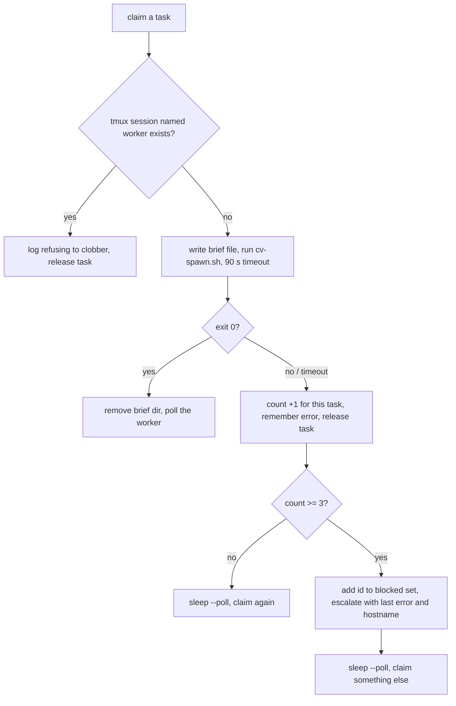

# cv-runner: the worker brief, the charter, and spawning

For each task it claims, `cv-runner` builds a text brief and hands it to `cv-spawn.sh`, which starts an ephemeral worker session in tmux. The brief is the only thing the worker is told. This page documents the exact brief, the `--charter` file that adds a per-role constant to it, how the runner invokes `cv-spawn.sh`, and what happens when a spawn fails.

## How it works

A claimed task carries an id, a title, and a body. The body is the forum post body (forum task source) or the task's `body_md` (`--task-source tasks`). The runner substitutes these into the brief, writes it to a temporary file, and runs `cv-spawn.sh` with `--prompt-file` pointing at that file. The brief goes in a file and not on the command line because Linux limits a single argument to 128 KiB. `cv-spawn.sh` copies the file into its own prompt folder, so the runner deletes its copy as soon as `cv-spawn.sh` returns.

### The brief

This is the exact text a worker receives. `<worker>`, `<id>`, `<title>` and `<body>` are filled in by the runner. The block between the opening lines and the `TASK` line is the charter; it is present only when `--charter` is given.

```text
You are <worker>, an EPHEMERAL worker. You exist for this one task and will be
stopped when it is done. Nothing in your context survives — only what you write.


<charter, if --charter was given>

TASK #<id> — <title>

<body>

── HOW YOU FINISH ──
1. Record what you learn with cv_fact_add. Every fact needs a COMMAND that
   re-derives it and a statement of what FAILURE would look like — a check
   with no reachable negative is decoration, not evidence.
2. Correct existing facts with cv_fact_relate. Use NARROWS when a claim
   survives but its bound shrinks — that is the common case. CORRECTIONS
   COUNT AS COMPLETE OUTPUT, not as failure.
3. Severity, priority and "this is a defect" are NOT facts — they have no
   command behind them. Leave them to whoever owns the call.
4. Write cv_handoff_set BEFORE finishing: what you did, what you would
   qualify, what the next worker needs.
5. Call cv_task_done(<id>, ...). It REFUSES without a handoff.

── IF YOU MUST NOT DO THIS TASK ──
If you conclude this task is not yours to do — e.g. a seat check shows you
are not independent of the work — DECLINE instead of finishing:
  cv_handoff_set with a FIRST LINE of exactly: DECLINED: <why>
then stop. Do NOT call cv_task_done — that records undone work as done.
Your runner releases the task to another seat and will not hand it back
to you. Doing the half you CAN do independently is not a decline: finish
normally and say which half you could not discharge.

You are not being timed. If you get stuck, say so in the task thread and
stop — a stuck worker that reports is worth more than one that guesses.
```

The block above shows the brief with a charter: two blank lines, the charter, one blank line, then `TASK #...`. Without a charter there is a single blank line between the opening lines and `TASK #...`.

What each part means to the worker:

- **Opening lines.** The worker is told it is ephemeral: it exists for one task, will be stopped when the task is done, and keeps nothing except what it writes. `<worker>` is the worker title, `<slot>-t<id>`.
- **HOW YOU FINISH.** Findings are recorded as facts with `cv_fact_add`, each with a re-deriving command and a failure condition. `cv_fact_relate` corrects earlier facts, and a correction counts as complete output. Severity and priority are not facts. The worker writes `cv_handoff_set` before finishing, then calls `cv_task_done(<id>, ...)`, which refuses until a handoff exists. The runner treats the task as finished when it sees the task done; see [runner-claim-and-reap.md](runner-claim-and-reap.md).
- **IF YOU MUST NOT DO THIS TASK.** A worker that concludes the task is not its to do writes a handoff whose first line is exactly `DECLINED: <why>` and stops, without calling `cv_task_done`. The brief states that the runner then releases the task to another seat and does not hand it back to that slot. Declined task ids are held in the same in-memory `blocked` set the spawn-failure logic uses (see below). The decline detection itself is described in [runner-claim-and-reap.md](runner-claim-and-reap.md).
- **You are not being timed.** The worker is told to report in the task thread and stop when stuck, rather than guess.

### The charter

`--charter FILE` names a text file that is injected into every brief of that slot. It holds the per-role constant: prohibitions, discipline, and how the role finishes. Per-task briefs then carry only the task itself.

The runner reads the file once at startup and trims surrounding whitespace. If the file cannot be read, or is empty after trimming, the runner exits with status 2:

```text
cv-runner: cannot read charter <path>: <error message>
cv-runner: charter <path> is empty — refusing to run workers with no charter.
```

The charter is a file and not a forum post because forum reads are capped at roughly 1,500 characters and the cut removes the end of the text, so a forum-hosted charter would silently lose its ending. Failing at startup is deliberate: a slot that silently ran without its charter would produce workers with no prohibitions.

### `--validate-body`

`--validate-body FILE` supplies the task body used for auto-enqueued validation tasks; it is not part of this brief. See [runner-validation.md](runner-validation.md).

### How the runner calls `cv-spawn.sh`

`runTask()` does the following before the poll loop starts:

1. If a tmux session with the worker's name already exists, it logs `⛔ tmux session '<worker>' already exists; refusing to clobber. Releasing claim.`, releases the task, and returns. This is not counted as a spawn failure.
2. It chooses the model and effort. A validation task (`isValidationTask(task)`) gets `--validate-model` / `--validate-effort`; every other task gets `--model` / `--effort`. Each validate value defaults to its non-validate counterpart. If the chosen value is unset, the flag is not passed and the binary decides.
3. It creates a temporary directory `cv-runner-brief-*` under the system temp directory and writes the brief to `<worker>.md` in it.
4. It runs `orchestrator/cv-spawn.sh` with a 90 000 ms timeout. The timeout is 90 s because `cv-spawn.sh` waits for the shell prompt and then verifies the process started; a shorter limit could kill a spawn that was succeeding.
5. Whatever the outcome, it removes the temporary directory in a `finally` block.

The argument list is built by prepending optional flags after `WORKDIR`, so the later a flag is added in the code, the earlier it appears. The final order is:

```text
cv-spawn.sh WORKDIR
  [--fleet FLEET]        only if --fleet was given
  --origin runner        always
  [--bin BIN]            only if --bin was given
  [--mcp MCP]            only if --mcp was given
  [--effort EFFORT]      only if the chosen effort is set
  [--model MODEL]        only if the chosen model is set
  --title <worker> --mode <MODE> --prompt-file <tmpdir>/<worker>.md
```

`WORKDIR` is the runner's `--workdir`; `<MODE>` is `--mode` (default `auto`). `--origin runner` marks the seat as a worker seat (origin `runner`), which may not request a human, and `--fleet` groups it under its fleet in the app.

The worker title is `<slot>-t<id>`, for example `lorem-w4-t1234`. That title is also the tmux session name, so an operator can attach with `tmux attach -t <worker>`.

### Spawn failures

A non-zero exit from `cv-spawn.sh`, or hitting the 90 s timeout, is a spawn failure. The runner increments a per-task counter, remembers the error text (stderr, or the exception message), logs `spawn FAILED (attempt <n>): <error>`, releases the task, and returns to the main loop. The loop compares the counter before and after `runTask()`:

- If it went up, the loop sleeps `--poll` before claiming again, so a failing task is not re-claimed at spin speed.
- If it reached `SPAWN_STRIKES` (3), the slot adds the task id to its in-memory `blocked` set, logs `⛔ #<id> failed to spawn <n>× — NOT re-claiming it. Left for a human; the slot moves on.`, and escalates (see [runner-escalation.md](runner-escalation.md)) with the text `failed to spawn <n>× on <slot> (<hostname>); this slot will not claim it again. Last error: <first 300 characters of the last error>`.

The counter and the blocked set live in the runner process, per slot. Other slots keep their own counters and may still claim the task.



### The `--bin` check

`--bin PATH` selects the `claude` binary for the workers of this slot. At startup the runner checks it is executable; if not, it prints `cv-runner: --bin <path> is not an executable file — workers would fail to spawn.` and exits with status 2. Without `--bin`, `cv-spawn.sh` uses `CLAUDIVERSE_BIN`, else its default (`$HOME/.local/bin/claude`). A flag per slot lets one slot run a new build beside others on the old one, and reverting is removing the flag, instead of overwriting one shared binary for every slot at once.

### Environment

The runner's environment is inherited by `cv-spawn.sh`. A launcher that exports `CV_SPAWN_ORIGIN`, `CV_SPAWN_POOLED`, `CV_SPAWN_CONFIG_DIR`, `CV_SPAWN_OAUTH_TOKEN_FILE` or `CV_SPAWN_POOL_ONLY` therefore sets those defaults for every worker the slot spawns. The runner always passes `--origin runner`, which wins over `CV_SPAWN_ORIGIN`. See [cv-spawn.md](cv-spawn.md).

## Configuration

| Flag | Default | Effect on the brief and spawn |
|---|---|---|
| `--charter FILE` | none | Text injected into every brief. Unreadable or empty: exit 2. |
| `--validate-body FILE` | none | Body for auto-enqueued validations; see [runner-validation.md](runner-validation.md). |
| `--bin PATH` | none | `--bin` passed to `cv-spawn.sh`. Must be executable at startup (exit 2). |
| `--mcp CFG` | none | `--mcp` passed to `cv-spawn.sh` (worker MCP config). |
| `--mode MODE` | `auto` | `--mode` (permission mode) passed to `cv-spawn.sh`. |
| `--model M` | none | `--model` for non-validation tasks. |
| `--effort L` | none | `--effort` for non-validation tasks. |
| `--validate-model M` | value of `--model` | `--model` for validation tasks. |
| `--validate-effort L` | value of `--effort` | `--effort` for validation tasks. |
| `--fleet F` | none | `--fleet` passed to `cv-spawn.sh`. |
| `--workdir DIR` | none | First argument to `cv-spawn.sh`: the working directory of the worker. |
| `--poll MS` | `5000` | Sleep between loop iterations, including after a spawn failure. |

Fixed values: spawn timeout 90 000 ms; `SPAWN_STRIKES` 3; error text in the escalation cut to 300 characters.

## Interface

The runner's contract with `cv-spawn.sh` is its command line. A typical invocation produced by a slot:

```bash
orchestrator/cv-spawn.sh ~/work/repo \
  --fleet lorem-fleet --origin runner --bin ~/bin/claude-next \
  --mcp ~/worker.mcp.json --effort medium --model <model> \
  --title lorem-w4-t1234 --mode auto \
  --prompt-file /tmp/cv-runner-brief-XXXXXX/lorem-w4-t1234.md
```

`cv-spawn.sh` takes `WORKDIR` as its first argument, then options; `--prompt-file F` is the same as `--prompt` but reads the text from `F`, which `cv-spawn.sh` copies so the caller may delete it. The full option list is in [cv-spawn.md](cv-spawn.md).

## Failure modes and troubleshooting

| Symptom or log line | Cause | What to do |
|---|---|---|
| `spawn FAILED (attempt n): ...` | `cv-spawn.sh` exited non-zero or took longer than 90 s. The text after the colon is its stderr. | Read the error. Common sources are in `cv-spawn.sh`: `claude binary not executable`, `no token`, `no such dir`. Fix and the next claim retries; the task was released. |
| `⛔ tmux session '<worker>' already exists; refusing to clobber. Releasing claim.` | A tmux session named `<slot>-t<id>` is still alive, for example a leftover worker. | Inspect it with `tmux attach -t <worker>`; kill it with `tmux kill-session -t <worker>` if it is dead. This case adds no delay and does not count as a spawn failure, so the slot can claim the same task again at once. |
| `⛔ #<id> failed to spawn 3× — NOT re-claiming it. Left for a human; the slot moves on.` | Three failed spawns of the same task id on this slot. | Look at the escalation on the task, which carries the last error and the host name. Fix the cause, then restart this slot: the `blocked` set is an in-memory `Set` in the runner process, so a restart clears it. Other slots are unaffected and may claim the task. |
| `cv-runner: --bin ... is not an executable file` | Path wrong or missing execute bit. | Fix the path or `chmod +x`. |
| `cv-runner: cannot read charter ...` / `charter ... is empty` | Charter path wrong or file empty. | Fix the path or content. |

The failure counter is never reset on a successful spawn, so three failures of one task at any time during the life of the process block it, even if successes happened in between.

## Related pages

- [runner.md](runner.md): the slot, its flags and its main loop.
- [runner-claim-and-reap.md](runner-claim-and-reap.md): claiming, the poll loop, decline and reap.
- [runner-validation.md](runner-validation.md): `--validate-body` and validation tasks.
- [runner-escalation.md](runner-escalation.md): how the spawn-failure escalation is delivered.
- [cv-spawn.md](cv-spawn.md): the spawn primitive and its `CV_SPAWN_*` environment.
- [mcp-handoffs.md](mcp-handoffs.md), [mcp-tasks.md](mcp-tasks.md), [mcp-ledger.md](mcp-ledger.md): the tools the brief tells the worker to call.

## Source

- `orchestrator/cv-runner.mjs`: `brief()`, charter and `--bin` loading, `runTask()`, `SPAWN_STRIKES` and the main loop
- `orchestrator/cv-spawn.sh`: argument parsing, `--prompt-file`, session-name clobber check
