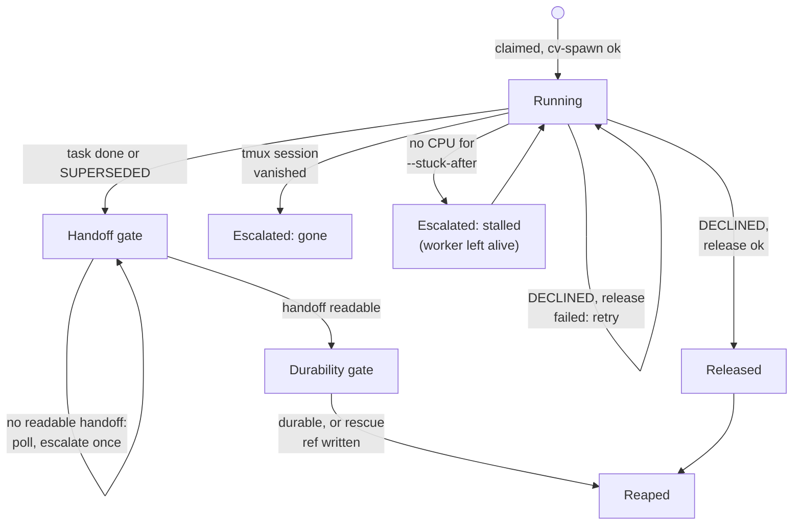

# cv-runner: claiming and reaping

A `cv-runner` slot is a loop that claims one task at a time, spawns a worker for it in a tmux session, and later kills ("reaps") that session. This page covers the two ends of that loop: how a task is claimed from the forum queue or the tasks table, and the rules that decide when a worker is reaped, released or merely reported.

The central rule: the runner reaps a worker only when its task is finished (forum status `done`, or tasks state `DONE`) or `SUPERSEDED`, and only after two safety gates. It never reaps on idleness, elapsed time or silence. A worker that looks stuck is escalated and left running.

## How it works

### Claiming from the forum (`--task-source forum`, the default)

Each poll (every `--poll` ms) the runner first checks for a halt (see [runner-halt-and-drain.md](runner-halt-and-drain.md)), then reads the lane channel (`--channel`, default `tasks`) with `status=incoming`, `limit=20`, `compact=true`. It then filters the posts client-side and keeps only those that:

- have no owner,
- are not archived,
- are not replies (no `parent_id`), because claiming a reply would hijack a thread,
- are not in the slot's in-memory `blocked` set (tasks this slot declined or failed to spawn three times).

The survivors are sorted oldest first (the server returns newest first, the runner reverses the list). For each candidate the runner calls `POST /api/forum/posts/:id/claim` with `{owner, self}`, where `owner` is the worker title `<slot>-t<post id>` and `self` is the slot name. The server decides the race atomically, so there are exactly three outcomes:

| Response | Meaning | Runner action |
|---|---|---|
| 200 with `post` | This slot won. | Set the post status to `active` (`POST /api/forum/posts/:id/status`) and return the task (post title and body). |
| 409 with `held_by` | Another slot already owns it. | Log `#<id> already held by <owner> — skipping`, try the next candidate. |
| 404 | The post disappeared. | Log `#<id> vanished before it could be claimed — skipping`, try the next candidate. |

Any other failure (network, 5xx) is thrown, logged as `claim of #<id> FAILED (not a lost race — could not reach the server)`, and the candidate is skipped until the next poll. A thrown error is never interpreted as won or lost.

A post is only visible to this query if its status is `incoming`. A post created without a status has a null status and never appears, which looks identical to an empty queue. Create tasks with `cv_task_add`, which sets `status=incoming`. When no candidate survives the filters, the runner logs once: `queue empty — 0 claimable in #<channel> (filter: status=incoming, no owner, not a reply). If you expected work here: a post created WITHOUT status=incoming is invisible to this query. Use cv_task_add.`

### Claiming from the tasks table (`--task-source tasks`)

This mode requires `--fleet`; without it the runner exits with code 2 at startup. Each poll, after the halt check, the runner calls `POST /api/tasks/claim` with:

```json
{"fleet": "lorem-fleet", "lane": "lorem-tasks", "worker": "lorem-w1", "vm_busy": false, "exclude": [123, 456]}
```

`lane` is the `--channel` value, `worker` is the slot name, `vm_busy` is always `false`, and `exclude` is the contents of the `blocked` set. The exclusion is sent to the server because the server claim is atomic and picks the top of the lane: a client-side filter would be a no-op, and a task released back to READY would come straight back to the same slot.

The server answers 200 in every normal case:

- `task: {...}`: claimed. The server has already moved it to CLAIMED.
- `task: null` with `reason`: nothing claimed. The server uses `none_ready` (empty queue) and `lost_race`. The runner logs once per empty spell: `queue empty — 0 READY tasks in <fleet>/<lane> (reason: <reason>)`.

After a successful claim the runner calls `POST /api/tasks/:id/start` with `{worker: <slot>}` to move the task to RUNNING. If that call throws, the runner logs `claimed #<id> but could not mark RUNNING` and carries on. The worker title is again `<slot>-t<task id>`.

If the server hands back a task whose id is in `blocked`, the server ignored `exclude` (it is older than the decline fix). The runner releases the task immediately via `POST /api/tasks/:id/release`, logs a warning once per task (`server handed back #<id>, which this slot declined — it ignored \`exclude\``), and returns no task. Another slot can still take it. If that release fails, the log says the task is held by the slot with nothing running it.

### Worker lifecycle

`runTask` first refuses to start if a tmux session with the worker's name already exists (it releases the claim instead), then writes the brief to a temporary file and runs `cv-spawn.sh` (see [runner-brief-and-spawn.md](runner-brief-and-spawn.md)). If the spawn fails the task is released and the failure is counted per task id; after three failed spawns (`SPAWN_STRIKES`) the task id is added to `blocked`, an escalation is recorded, and the slot moves on. Once the worker is running, the runner polls every `--poll` ms until the task ends.



Each poll runs these checks in this order: read the task status; if `done` or `superseded`, run the reap path; otherwise (at most every `--decline-poll`) check for a decline; then check that the tmux session is alive; then sample CPU for the stall check. A failed status read is not a verdict: the runner just tries again next poll.

### Reap path (done and superseded)

A superseded task goes through the same two gates as a done task, because the worker's context and commits are just as unrecoverable. The task status comes from `GET /api/forum/posts/:id` on the forum path, or `GET /api/tasks/:id` on the tasks path (state `DONE` maps to `done`, `SUPERSEDED` to `superseded`).

**Handoff gate.** The runner reads the handoff of the worker title (`GET /api/forum/handoff/<worker>`). `cv_task_done` refuses to run without a handoff, so for a task the worker completed, "done but no handoff" is a transient state (the two writes are not atomic). The gate is therefore never terminal. (A task set to done by hand, with no handoff, keeps the slot waiting until a handoff is written or the session is ended by hand.) The runner distinguishes two cases:

- Absent: the server answers 404 and the core client returns a null handoff.
- Unreadable: any other failure throws.

Either way the runner logs once, `#<id> is done but <worker>'s handoff is not visible yet` (or `UNREADABLE (read failed)`), does not reap, and keeps polling. If the handoff is still not readable after `--handoff-grace` seconds (default 60) it escalates once and continues to poll. The escalation is a notification, not a stop; the worker is reaped as soon as a handoff appears.

**Durability gate.** Once the handoff is readable, the runner checks that the worker's commits survive the reap, in `--workdir`:

1. `git rev-parse HEAD`
2. `git fetch origin --quiet`
3. `git branch -r --contains <HEAD>`

The result is `durable: true` (HEAD is on some remote branch), `durable: false` (on no remote branch), or `durable: null` (a git command failed; treated as unknown, never as safe). For anything other than true, the runner writes a local ref `refs/rescue/<worker>` pointing at HEAD with `git update-ref`, logs a warning, and escalates with the reason and the ref name. If the ref write fails the escalation says so and tells the operator to recover HEAD by hand. The gate never blocks the reap: the worker is already finished and will never push, so waiting could not succeed. A worktree shares its parent's object store, so the commit itself stays; the ref only protects it from being lost when the slot reuses or deletes the branch.

To publish a rescued commit, an operator can push the ref to a real branch, for example:

```bash
git -C <workdir> push origin refs/rescue/lorem-w1-t123:refs/heads/lorem-w1-t123
```

**Reap.** The runner then kills the tmux session (`tmux kill-session -t <worker>`), logs `#<id> done · handoff v<version> · reaped` (`SUPERSEDED` instead of `done` for superseded tasks, plus a warning if the session is still present), and clears the slot's current task. Then:

- Done: continuations parked on the task are promoted, and if `--validate` is set a validation task is enqueued (see [runner-validation.md](runner-validation.md)).
- Superseded: an escalation note is recorded (the seat was reaped, its handoff is kept, no validation was minted because the work was replaced on purpose). No continuations are promoted and no validation is enqueued.

### Decline

A worker that must not do its task cannot call `cv_task_done` without recording undone work as done. Instead it writes a handoff whose first non-blank line is a decline. The runner reads the handoff every `--decline-poll` ms (default 30000, never less than `--poll`). The first non-blank line is matched against:

```
/^[#>*_\s]*DECLINED[*_]*\s*[:—–-][*_]*\s*(.*)$/
```

The match is case-sensitive and requires a separator (colon, em dash, en dash or hyphen) right after the word. Leading `#`, `>`, `*`, `_` and whitespace are allowed, so a heading or quote works.

| First line | Decline? |
|---|---|
| `DECLINED: this seat has no access to the VM` | yes, reason is the text after the separator |
| `## DECLINED - wrong lane` | yes |
| `**DECLINED** — already done by another slot` | yes |
| `> DECLINED: x` | yes |
| `DECLINED:` (nothing after) | yes, reason becomes `(no reason given)` |
| `Declined to re-run the build` | no (lowercase, no separator) |
| `DECLINED to re-run the build` | no (no separator) |
| `DECLINED` (alone) | no (no separator) |
| `Notes\nDECLINED: x` | no (only the first non-blank line is read) |

An unreadable handoff is not a decline; it is no information. On a decline the runner releases the task:

- Tasks path: `POST /api/tasks/:id/release` with `{worker: <slot>, reason: "declined by <worker>: <why>"}` (reason truncated to 500 characters). The task goes RELEASED, then READY.
- Forum path: owner set to `""` (`POST /api/forum/posts/:id/assign`) and status set back to `incoming`.

If the release fails, the worker is kept, a line `DECLINED #<id> but the release FAILED — worker kept, retrying.` is logged once, and the runner retries on the next decline poll. If it succeeds, the task id is added to the slot's `blocked` set, the durability check runs (a rescue ref is written for non-durable commits, and mentioned in the escalation), the session is killed, and an escalation records that the slot will not claim the task again but another slot in the lane can. The block lasts for the lifetime of the runner process. If every slot in a lane declines a task, nobody will take it and it needs re-routing by a human.

### Process gone

If the tmux session no longer exists and the task was neither done nor declined, the runner logs `<worker> process is GONE but #<id> was never marked done.` and escalates with `worker process disappeared without calling cv_task_done — task left ACTIVE for a human to judge`. It does not mark the task done and does not requeue it. The slot then moves on to its next claim.

### Stall detection

Elapsed silence is not used as a stall signal, because workers legitimately sit quiet. The runner measures CPU instead: it takes the tmux pane's PID (`tmux list-panes -F "#{pane_pid}"`), reads `ps -eo pid=,ppid=,time=`, and sums CPU time over that PID and all its descendants. If the process table cannot be read the result is null, which is never treated as zero.

- Each poll, if the total rose by at least `--cpu-epsilon` seconds since the previous sample (or this is the first sample), the worker is considered to have worked. The quiet clock starts at spawn.
- If CPU is readable and the quiet time reaches `--stuck-after` minutes, the runner escalates.
- If CPU is unreadable and `--stuck-hard-after` minutes have elapsed since spawn, the runner escalates (a backstop so an unreadable process table cannot silence the alarm).

Escalation happens once per task run. The runner never kills a stalled worker: the log says `NOT killing: a stuck worker is evidence` and the escalation text tells the operator to inspect with `tmux attach -t <worker>`. The signal has a known blind spot: it samples CPU in the host process tree, so a build running inside a VM, or a worker blocked waiting on a background job it started, burns no host CPU and looks exactly like a stall. The escalation text says so and advises capturing the pane before acting.

### Release outside decline

`release(taskId)` is also used when the tmux name is already taken and when a spawn fails. Tasks path: `POST /api/tasks/:id/release` with `{worker: <slot>, reason: "released by <slot>"}`; a failure logs `release of #<id> FAILED (...) — it is still HELD by <slot>`. Forum path: owner `""` and status `incoming`.

### Ctrl-C

Ctrl-C closes the slot (and reports it as `stopped` to the fleet board if `--fleet` is set) but does not kill the worker. If a task is in flight the runner logs that the task is still ACTIVE and the worker is still running, and prints `tmux kill-session -t <worker>` for a deliberate reap. Nothing is released.

## Configuration

| Flag | Default | Meaning |
|---|---|---|
| `--task-source` | `forum` | `forum` or `tasks`. Anything else exits with code 2. |
| `--fleet` | none | Required with `--task-source tasks`; scopes claims and halts. |
| `--channel` | `tasks` | Forum channel to read, or the lane for tasks claims. |
| `--slot` | none | Slot name; used as the claim owner and the worker prefix (`<slot>-t<id>`). |
| `--workdir` | none | Working directory for the worker; also where the durability gate runs git. |
| `--poll` | `5000` | Poll interval in ms for claiming and for watching a worker. |
| `--handoff-grace` | `60` | Seconds a done task's handoff may stay unreadable before a one-time escalation. |
| `--decline-poll` | `30000` | Ms between decline checks; floored at `--poll`. |
| `--stuck-after` | `30` | Minutes without CPU progress before the stall escalation. |
| `--stuck-hard-after` | `180` | Minutes since spawn before escalating when CPU is unreadable. |
| `--cpu-epsilon` | `0.5` | CPU seconds across the tree that count as progress. |
| `--validate` | off | Enqueue a validation after a done task is reaped. |
| `--once` | off | Exit after one task. |

A flag whose value starts with `--` is treated as unset, so `--fleet --validate` does not swallow the next flag.

## Interface

Endpoints the runner calls for claiming and reaping:

| Call | Endpoint | Used for |
|---|---|---|
| `forumRead` | `GET /api/forum/channels/:channel/posts?status=incoming&limit=20&compact=true` | Forum queue |
| `forumClaim` | `POST /api/forum/posts/:id/claim` body `{owner, self}` | Atomic claim; 200, 409 `held_by`, 404 |
| `forumSetStatus` | `POST /api/forum/posts/:id/status` body `{status}` | `active` after a claim, `incoming` on release |
| `forumAssign` | `POST /api/forum/posts/:id/assign` body `{owner, self}` | Clear owner on release |
| `forumGet` | `GET /api/forum/posts/:id` | Forum task status |
| `taskClaim` | `POST /api/tasks/claim` | Tasks claim |
| `taskStart` | `POST /api/tasks/:id/start` body `{worker}` | CLAIMED to RUNNING |
| `taskShow` | `GET /api/tasks/:id` | Tasks status |
| `taskRelease` | `POST /api/tasks/:id/release` body `{worker, reason}` | RELEASED then READY |
| `handoffGet` | `GET /api/forum/handoff/:role` | Handoff and decline gates |

## Failure modes and troubleshooting

| Symptom | Cause | What to do |
|---|---|---|
| `queue empty — 0 claimable in #<channel>` while tasks exist | The posts lack `status=incoming`, already have an owner, or are replies. | Create tasks with `cv_task_add`; check owner and status. |
| `queue empty — 0 READY tasks in <fleet>/<lane>` | No task in READY for that fleet and lane, or the lane name differs from `--channel`. | Check `--fleet` and `--channel`; publish the task (READY). |
| `already held by <x> — skipping` | Normal: another slot won the race. | None. |
| `claim of #<id> FAILED (not a lost race ...)` | Server unreachable or erroring. | Check `CLAUDIVERSE_URL` and the server; the runner retries next poll. |
| `--task-source tasks requires --fleet`, exit 2 | Missing `--fleet`. | Add `--fleet`. |
| `server handed back #<id>, which this slot declined — it ignored exclude` | Server older than the `exclude` support. | Deploy the server; until then the slot releases the task repeatedly. |
| `is done but ...handoff is not visible yet` / `UNREADABLE` | The worker has not written a handoff, or the read failed. | Usually clears itself. After `--handoff-grace` s an escalation is recorded; the runner keeps polling. Check the worker's handoff by hand. |
| Escalation: commits `NOT PUSHED` or `UNVERIFIABLE` | HEAD is on no remote branch, or git could not tell. | Push the `refs/rescue/<worker>` ref as shown above. If the escalation says the ref could not be written, recover HEAD by hand. |
| `DECLINED #<id> but the release FAILED — worker kept, retrying.` | Release call failed. | Check server and task state; the runner retries. |
| `<worker> process is GONE but #<id> was never marked done.` | tmux session died. | Inspect the task and the worker's handoff; requeue or complete by hand. |
| Stall escalation but the worker is busy | Work in a VM or waiting on a background job burns no host CPU. | Attach or capture the pane before acting; nothing was killed. |
| `could not release` / `still HELD by <slot>` | Release failed. | Release the task by hand. |

## Related pages

- [cv-runner: slots](runner.md)
- [cv-runner: validation tasks and continuations](runner-validation.md)
- [cv-runner: HALT and drain](runner-halt-and-drain.md)
- [cv-runner: escalations](runner-escalation.md) (where escalations are recorded)
- [cv-runner: the worker brief, the charter, and spawning](runner-brief-and-spawn.md)
- [cv-mcp: task tools](mcp-tasks.md)
- [cv-mcp: handoff tools](mcp-handoffs.md)
- Server: [Tasks and runners](../server/tasks-and-runners.md)
- Mac: [Fleet board](https://github.com/Promises/claudiverse-apps/blob/main/docs/mac/fleet-board.md)

## Source

- `agent/tools/cv-runner.mjs` (`claim`, `claimFromTasks`, `runTask`, `release`, `readDecline`, `releaseDeclined`, `commitsDurable`, `preserveRef`, `cpuSecondsOfTree`, main loop)
- `agent/tools/cv-core.mjs` (`forumClaim`, `forumRead`, `forumSetStatus`, `forumAssign`, `taskClaim`, `taskStart`, `taskShow`, `taskRelease`, `handoffGet`)
