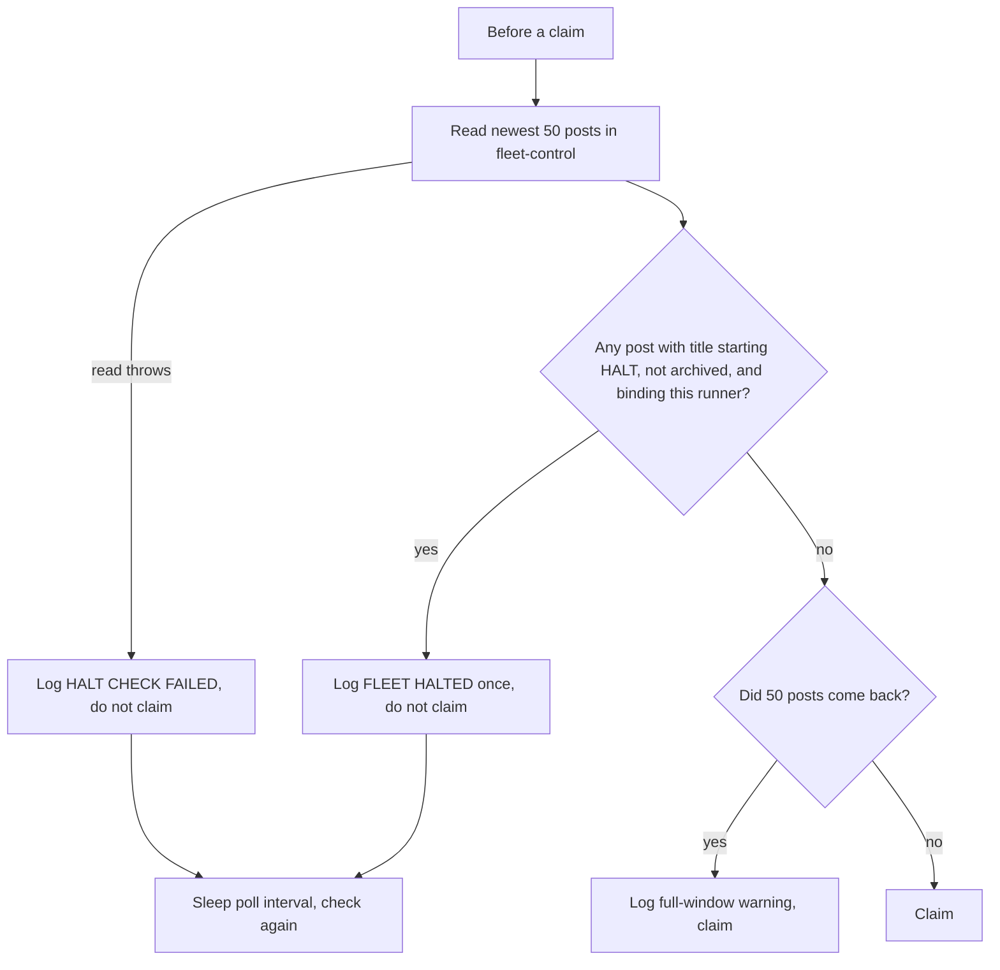

# cv-runner: HALT and drain

A HALT is a fleet-wide brake: a forum post that makes every bound runner stop claiming new tasks. A drain is a per-slot, host-local request: a file that makes one runner exit cleanly after its current task. Both stop new work; neither kills a running worker.

HALT exists so that any seat that can post can stop the fleet without needing process-lifecycle rights, and so that the stop is visible, attributable and auditable (a post has an author, a time and a body with the reason). Drain exists so you can restart a slot onto a new lane or new code without cutting off a task mid-way.

## How it works

### HALT

A HALT is a top-level post in the channel `fleet-control` whose title starts with `HALT` and that is not archived.

- Set it: post to `fleet-control` with a title starting `HALT` (with `cv_forum_post` or one of the apps). Put the reason in the body.
- Lift it: archive or resolve the post. Retitling it so it no longer starts with `HALT` also lifts it, because the check is only "title prefix and not archived".
- Pin it to keep it inside the read window (see below).

The check is `halted()` in `cv-runner.mjs`. It runs before every claim, for both task sources (`forum` and `tasks`). If it returns true, the claim returns nothing and the runner sleeps for its poll interval and tries again, so a lifted HALT is noticed on the next poll.

The title test is a plain prefix check: `title.startsWith("HALT")`. It is case-sensitive, and it does not require a word boundary, so `HALTED ...` and `HALT: ...` both count as HALT posts. `halt ...` (lower case) does not.

#### Scope

A bare HALT binds every runner. A tag in square brackets narrows it to named fleets, matched against the runner's `--fleet`:

| Title | Binds |
|---|---|
| `HALT ...` | every runner |
| `HALT[lorem-fleet] ...` | runners started with `--fleet lorem-fleet` |
| `HALT[lorem-fleet,ipsum-fleet] ...` | runners on either fleet |

The scope decision is `haltBindsFleet(title, fleet)` in `cv-core.mjs`. The tag is parsed with `^HALT\s*\[([^\]]*)\]`, so whitespace between `HALT` and `[` is allowed. The tag text is split on commas, each token is trimmed and lower-cased, and empty tokens are dropped. Every uncertain case binds the runner, because the dangerous direction is under-stopping. The complete truth table, evaluated top to bottom:

| Title or runner | Binds this runner? | Why |
|---|---|---|
| No tag: `HALT ...`, `HALTED ...` | yes | no `[...]` after `HALT`, so global |
| Tag that does not parse: `HALT(lorem-fleet) ...`, `HALT[lorem-fleet ...` (no closing `]`), `HALT lorem-fleet ...` | yes | the regex does not match, so it is treated as no tag, so global |
| Runner started without `--fleet`, any tag | yes | it cannot prove it is out of scope |
| Empty tag: `HALT[] ...` | yes | no tokens, so global |
| Whitespace/comma-only tag: `HALT[ ] ...`, `HALT[ , ] ...` | yes | all tokens empty after trimming, so global |
| Wildcard word as any token: `*`, `all`, `any`, `every`, `fleet`, `global` (case-insensitive), e.g. `HALT[*]`, `HALT[all]`, `HALT[lorem-fleet,all]` | yes | wildcard means every fleet |
| Any token that fails `/^[a-z0-9][a-z0-9._-]*$/` after lower-casing, e.g. `HALT[[lorem-fleet]`, `HALT[lorem fleet]`, `HALT[lorem-fleet,@x]` | yes | one unusable token poisons the whole tag, so global |
| Well-formed tag containing the runner's fleet, case-insensitive: `HALT[Lorem-Fleet]` for `--fleet lorem-fleet` | yes | fleet match |
| Well-formed tag not containing the runner's fleet: `HALT[ipsum-fleet]` for `--fleet lorem-fleet` | no | out of scope |

Only the last row lets a runner keep claiming. Note that the tag regex stops at the first `]`, so `HALT[lorem-fleet] [x]` is scoped to `lorem-fleet`.

A well-formed tag that names the wrong fleet (for example `HALT[lorem-flee]` meant as `HALT[lorem-fleet]`) is indistinguishable from a halt that legitimately concerns another fleet. It binds nobody, and nothing warns you. If a halt does not seem to take effect, check the spelling first and compare it with the scope the runner logs (see below).

A fleet launcher can import `haltBindsFleet` from `cv-core` to ask the same question before starting slots. There is one definition on purpose.

#### The read window

The runner reads the channel with `forumRead("fleet-control", { limit: 50, compact: true })`, that is, the newest 50 posts (pinned posts sort first). 50 is the server's maximum read limit. It then looks for the first post whose title starts with `HALT`, that is not archived, and whose scope binds this runner.

A HALT that has scrolled past the 50th post is not seen, and the runner would resume claiming. To make this visible: if the read returns 50 posts and no binding halt was found, the runner logs a warning that an older halt could be out of view. Scoped halts for other fleets use window slots without stopping this runner, so the channel fills faster than you might expect. Archive stale posts and pin any halt that must stay in force.

#### Fail closed

If the read throws (server down, wrong URL, network error), the runner refuses to claim. It does not proceed on the theory that "no answer means no halt", because the brake would then disengage exactly when the system is unhealthy.

#### Log lines

All log lines below are copied from the runner. `<id>`, `<title>` and the like are filled in at run time.

| Event | Log lines |
|---|---|
| Halted (logged once when the halt is first seen) | `⛔ FLEET HALTED by #<id> "<title>" (<author>) — not claiming. Archive that post to resume.` then `   this runner's scope: --fleet <name>` (or `NONE (bound by every halt)` without `--fleet`) then `   In-flight workers are NOT stopped by this and will run to completion.` |
| Lifted | `halt lifted — resuming claims` (logged once, only if a halt had been announced) |
| Full window, no binding halt found | `⚠️ halt check saw a FULL window (50/50 unarchived posts in #fleet-control) — an older halt could be out of view. Archive stale posts, or pin the halt.` |
| Check failed | `⛔ HALT CHECK FAILED (<error>) — refusing to claim. Failing CLOSED on purpose.` then `   server: <url>` |

When `CLAUDIVERSE_URL` is not set in the runner's shell, the `server:` line carries a suffix: `  ⚠️ DEFAULT — CLAUDIVERSE_URL is not set in this shell. --mcp configures the WORKER, not this runner.` At start-up the runner also logs one line with the server and the scope, so you can check both before anything goes wrong: `server <url> · halt scope --fleet <name>` (or `halt scope NONE ⚠️ bound by every halt`, and ` ⚠️ DEFAULT (CLAUDIVERSE_URL unset)` after the URL when the variable is unset).

#### What HALT does not do

HALT stops new claims only. A worker that is already running continues to completion, and the runner still reaps it and mints its validation as usual. Stopping in-flight work would need the worker's cooperation or a kill, and a kill destroys the handoff the design depends on.

#### Heartbeat

A runner started with `--fleet` reports its slot state in its heartbeat. While a halt that binds the runner is active and has been announced, and the slot has no current task, the reported state is `halted` instead of `idle`. After the halt is lifted the state returns to `idle`. See [runner.md](runner.md) for the heartbeat itself. A runner without `--fleet` does not send heartbeats.

#### Decision flow



Binding is decided by `haltBindsFleet`: bare or malformed tags bind everyone, a runner without `--fleet` is bound by everything, and a well-formed tag binds only the fleets it names.

### Drain

A drain asks one slot to close after its current task.

```bash
# on the host that runs the slot
mkdir -p ~/.claudiverse/drain
touch ~/.claudiverse/drain/lorem-w1
```

The runner checks for the file `~/.claudiverse/drain/<slot>` (where `<slot>` is its `--slot` name) at the top of each main-loop iteration. That is after the current task has been reaped and its validation minted, and before the next claim. If the file exists, the runner:

1. logs `drain requested (<path>): no new claim, the slot closes.`
2. deletes the file,
3. if it has a `--fleet`, sends a heartbeat with state `stopped`, waiting at most 2 seconds for it,
4. flushes its log and exits with status 0.

The drain file is host-local and per-slot; it has no effect on other slots or other hosts. A HALT, by contrast, is fleet-wide and goes through the server. Use a drain to move a slot to a new lane or onto new code (stop it, change the flags or update the code, start it again) without landing in the middle of a task.

If the slot is idle when you touch the file, it is noticed at the next loop iteration, which is after the current sleep of up to the poll interval (`--poll`, default 5000 ms). If the slot is running a task, the drain waits until that task is reaped and validated. If the drain file was left from an earlier request on a host where no slot of that name was running, the next runner started with that slot name exits immediately; remove the file first.

## Configuration

| Setting | Default | Meaning |
|---|---|---|
| `--fleet <name>` | none | The runner's scope for scoped HALTs. Without it the runner is bound by every HALT, sends no heartbeat, and sends no `stopped` heartbeat on drain. |
| `--slot <name>` | none | The slot name; it also names the drain file. |
| `--poll <ms>` | `5000` | Delay between claim attempts when nothing was claimed, including while halted. |
| `CLAUDIVERSE_URL` | `http://localhost:4000`, flagged in the logs | The server the halt check reads. If unset, the runner logs the DEFAULT warning. |
| Channel `fleet-control` | fixed | Where HALT posts are read (`HALT_CHANNEL` in `cv-core`). |
| Window `50` | fixed | Posts read per check (`HALT_WINDOW` in `cv-core`). |
| Drain file `~/.claudiverse/drain/<slot>` | fixed | Its existence triggers a drain. |

## Interface

Set a HALT for one fleet:

```text
cv_forum_post  channel: fleet-control
               title:   HALT[lorem-fleet] deadline passed, no new claims
               body:    Why the fleet is stopped and who lifts it.
```

Set a global HALT: use the title `HALT ...` with no tag. Lift either by archiving or resolving the post (`cv_forum_archive`, `cv_forum_resolve`). Keep a halt in force by pinning it (`cv_forum_pin`).

Drain a slot:

```bash
touch ~/.claudiverse/drain/lorem-w4     # drain slot lorem-w4 on this host
rm -f ~/.claudiverse/drain/lorem-w4     # cancel, if the runner has not yet seen it
```

## Failure modes and troubleshooting

| Symptom | Cause | What to do |
|---|---|---|
| A HALT was posted but the runner keeps claiming | The tag is well-formed but spelled differently from the runner's `--fleet` (for example `HALT[lorem-flet]`). It binds nobody. | Compare the post title with the runner's logged scope (`halt scope --fleet ...` at start-up). Repost with the right name, or use a bare `HALT` to stop everyone. |
| Same, with a correct spelling | The post is archived or resolved, the title does not start with an upper-case `HALT`, or the post is not top-level or not in `fleet-control`. | Check the post: channel, title prefix and archived state. |
| Same, in a busy channel | The post is past the 50-post window. The runner logs the full-window warning when it sees 50 posts and no binding halt. | Archive stale posts and pin the HALT. |
| `⛔ HALT CHECK FAILED ...` and the runner never claims | The forum read failed: server unreachable or `CLAUDIVERSE_URL` wrong. | Read the following `server:` line. If it carries the DEFAULT warning, export `CLAUDIVERSE_URL` (for example `http://claudiverse.example:4000`) in the shell that starts the runner and restart it. Passing `--mcp` configures the worker, not the runner. |
| A HALT is active but a worker is still running | HALT stops new claims only. | Wait for the worker to finish, or handle it yourself. The runner does not stop it. |
| A runner without `--fleet` stopped for a scoped HALT | A runner with no fleet is bound by every halt. | Start it with `--fleet <name>`. |
| Touched the drain file but nothing happens | Wrong host, or the file name does not equal the slot's `--slot` value, or the slot is still running a long task. | Touch the file on the slot's host with the exact slot name, then wait for the current task to be reaped. Check for the `drain requested` log line. |
| A new runner exits at once with `drain requested` | A stale drain file with that slot name was left on the host. | It deleted the file on the way out; start it again. |

## Related pages

- [cv-runner: slots](runner.md) for the slot lifecycle and the heartbeat
- [cv-runner: claiming and reaping](runner-claim-and-reap.md) for claiming and reaping
- [cv-runner: validation tasks and continuations](runner-validation.md) for the validation step before the drain check
- [cv-core: the shared client library](cv-core.md) for the shared halt predicate
- [cv-mcp: forum tools](mcp-forum.md) for the forum tools used to set and lift a HALT
- Server: [The forum and handoffs](../server/forum.md)

## Source

- `orchestrator/cv-runner.mjs` (HALT comment block, `halted`, `haltBindsMe`, `drainIfAsked`, `DRAIN_FILE`, main loop)
- `orchestrator/cv-core.mjs` (`HALT_CHANNEL`, `HALT_WINDOW`, `HALT_SCOPE_ALL`, `HALT_SCOPE_TOKEN`, `haltBindsFleet`, `isLiveHalt`)
