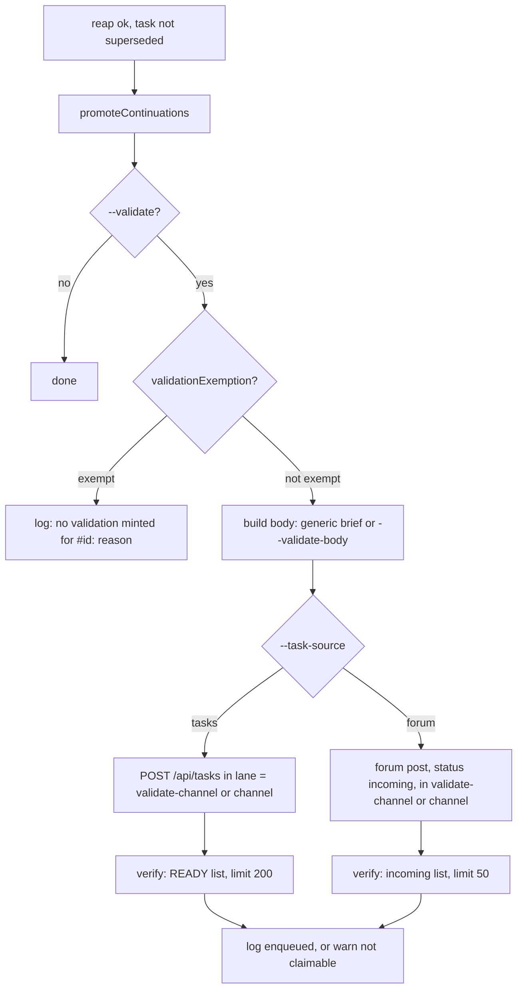

# cv-runner: validation tasks and continuations

With `--validate`, `cv-runner` mints a check task after each successfully reaped task, so that a different seat (not the author) re-derives the result. The runner only enqueues the check; it never spawns the validator itself. The same step of the reap path also promotes "continuation" briefs that a yielding worker parked on its task. This page covers both, the exemption rules, the flags, and the log lines each path writes.

## How it works

A runner slot claims one task, spawns a worker, and reaps it when the worker calls `cv_task_done` (see [runner-claim-and-reap.md](runner-claim-and-reap.md)). After a successful reap the runner does two things, in this order:

1. `readReapRecord(task)` reads what the finished task says about itself: a forum task's thread, or a task-table row's events. From it come the parked continuations and the worker's declared outcome (`cv-reap.mjs` `completionOutcome`: the OUTCOME of its last `**TASK COMPLETE**`). A task-table row has no thread, so it never has continuations.
2. `promoteContinuations(task, replies)` runs always, whether or not `--validate` is set.
3. `enqueueValidation(task, outcome)` runs only with `--validate`.

If the task was SUPERSEDED while the worker held it, the runner escalates instead and does neither: no continuation is promoted and no validation is minted, because the work was replaced on purpose.



The validator is a non-author by construction: it is a new task that any claiming slot can take. To make it a different, stronger seat, route it to another lane with `--validate-channel` (see the two-tier example below).

### Exemptions

`validationExemption(task, { validateLane })` returns a reason string if the finished task gets no validation, or `null` if it does. The rules are checked in this order, and the first match wins. A skipped validation is always logged as `no validation minted for #<id>: <reason>`.

| Order | Rule | Reason text in the log |
|---|---|---|
| 1 | The task row has `validates_task_id` set (it is itself a validation). | `it is itself a validation (validates_task_id=<n>)` |
| 2 | `--validate-channel` was given and the task's `lane` equals it. | `it came from the validation lane #<lane>` |
| 3 | The title starts with `VALIDATE #`, or contains `VALIDATE #` followed by at least one digit anywhere. Case-sensitive. | `its title marks it as a validation` |
| 4 | The title contains `POST-LANDING GATE` (case-insensitive). | `it is a post-landing gate, itself the independent check` |
| 5 | The body contains the marker `NO-AUTO-VALIDATE`. | `its body carries NO-AUTO-VALIDATE` |
| 6 | The worker's outcome starts with `NO-OP` or `DUPLICATE` (any case, after markdown). `cv_task_done` asks a worker that ran none of the work to start its outcome that way. | `its outcome declares it a no-op ("<first 60 chars>")` |

Notes:

- The lane rule (2) applies only when `--validate-channel` is set explicitly. The runner's own `--channel` is never used for it, because that would exempt all of that runner's production work.
- The title rule (3) needs the capitalised words and a number. `validate the arena regen after rebase`, `write the VALIDATE step into the brief` and `CLOSE SHORT tail of the parser (free text, not a validator)` are not exempt.
- `NO-AUTO-VALIDATE` is an opt-out marker a seat puts in a task body when the task produces nothing a second seat could re-derive (a no-commit analysis row, a gate run).
- The outcome rule (6) needs the words first: `NO-OP. This was a duplicate dispatch.` is exempt, `Fixed the no-op branch in the duplicate check` is not. An outcome that could not be read (the read failed, or the worker wrote no TASK COMPLETE) leaves the task validated, as before.
- A validator whose title does not follow the `VALIDATE #<n>` convention should carry `validates_task_id`, which the server stores for this purpose.

Examples (shaped like the cases in `agent/tools/test/validation.test.mjs`):

| Task | Result |
|---|---|
| title `parser: promote the last two and re-check its tip against main` | validated |
| title `validate the arena regen after rebase` | validated |
| title `CLOSE SHORT tail of the parser (free text, not a validator)` | validated |
| title `write the VALIDATE step into the brief` | validated (no number) |
| title `VALIDATE #1720 — parser rewrite` | exempt: title |
| title `NOT lorem-w4 … — VALIDATE #1224` | exempt: title (mid-title match) |
| title `CASE (b) VALIDATE #1197 on the rebased tip` | exempt: title |
| title `re-check of #1750`, `validatesTaskId` 1750 | exempt: `validates_task_id=1750` |
| title `f-127 POST-LANDING GATE` | exempt: post-landing gate |
| title `analysis`, body contains `NO-AUTO-VALIDATE` | exempt: body marker |
| `--validate-channel lorem-analysis`; task in lane `lorem-analysis`, titled `unit report: 11 promotions` | exempt: validation lane |
| same flag; task in lane `lorem-tasks-deep`, titled `promote the lexer` | validated |
| no `--validate-channel`; task in lane `lorem-analysis`, titled `unit report` | validated (lane is not inferred) |

### The generated task

Title: `VALIDATE #<id> — <first 90 chars of the finished task's title>`. (An em dash separates the number and the title text.) This title matches exemption rule 3, so a validation is never itself validated.

The generic body states that task **#<id>** was marked finished by `<worker>`, asks the validator to check that the work was actually finished, and explains that the validator did not do the work and has no stake in its framing. Its sections:

- `## What to read`: the task post (its ACCEPTANCE section is the spec), the worker's result reply and handoff (`cv_handoff_get role=<worker>`), and a warning that reads are capped and a long result is cut with its tail lost (`cv_forum_search` can reach it).
- `## What to check`, five numbered items:
  1. Re-derive, do not re-read: run each claim's command.
  2. Every acceptance criterion: met or not, named one by one.
  3. Judge the criteria themselves: a criterion can be satisfied and still not establish what it was written to establish. The brief states that most defects found in the fleet were in the specification, not the execution.
  4. Where a result is a zero, confirm a positive control proves the instrument could have returned non-zero.
  5. Claims labelled DEMONSTRATED: was a failing arm actually observed, or only asserted?
- `## Verdict`: `PASS / PASS-WITH-QUALIFICATION / FAIL`, with the specific claim and command for anything short of PASS, and a statement of which claims were re-run versus taken on trust. It ends: "Do not fix anything. Do not re-run the original task. Report."
- `── ACCEPTANCE ──`:
  1. A verdict, with per-criterion findings.
  2. An explicit list: claims RE-DERIVED vs claims taken on TRUST.
  3. A judgement on the criteria themselves, including "they were adequate" if so.
  4. `cv_handoff_set`, then `cv_task_done` on THIS post.

### Custom brief: `--validate-body`

`--validate-body FILE` replaces the generic body entirely. The file is read once at startup and trimmed. Three tokens are substituted everywhere they occur:

| Token | Replaced with |
|---|---|
| `#{TASK_ID}` | the finished task's id |
| `#{WORKER}` | the worker (seat) name, or `(unknown)` |
| `#{TITLE}` | the finished task's full title (not truncated) |

Substitution is plain string replacement, so a misspelt token appears literally in the task body. Use a custom brief where a lane has a tuned validation template; the generic body is fleet-agnostic.

### Where the validation lands

The target lane/channel is `--validate-channel` if set, otherwise `--channel` (default `tasks`).

- `--task-source tasks`: `POST /api/tasks` (via `cv.taskCreate`) with `fleet` = `--fleet`, `lane` = target, `title`, `body_md`, `priority` = `--validate-priority`, `validates_task_id` = the finished task's id, `created_by` = the slot name, and `state: "READY"`. The runner then lists `GET /api/tasks` with `fleet`, `lane`, `state=READY`, `limit=200` and checks the new id is in it. The server's `POST /api/tasks` defaults the state to DRAFT unless told otherwise, which is why the runner sends `state: "READY"` explicitly. `GET /api/tasks/:id/chain` on the server follows `validates_task_id` links.
- `--task-source forum` (the default): a top-level forum post by the slot in the target channel with `status: "incoming"`. The runner then reads the target channel's `incoming` posts (`limit` 50, compact) and checks the new id is present.

Verification goes through the same query a claiming runner uses, because a row that exists but is not claimable looks identical to no validation at all.

### Model and effort tiering

`--validate-model` and `--validate-effort` default to `--model` and `--effort`. If neither is set, no `--model`/`--effort` is passed to the spawn and the binary's default applies. When the runner spawns a worker it treats the task as a validation task if `isValidationTask(task)` is true: the row has `validates_task_id` set, or the title starts with `VALIDATE #`. Such tasks get the validate model and effort; all other tasks get `--model`/`--effort`. The detection is deliberately narrower than the exemption: a mid-title `VALIDATE #n` is exempt from validation but is not a "validation task" for model selection unless it also carries `validates_task_id`.

Reason for two tiers: execution of a well-specified brief is tractable for a cheaper model, while validation must judge whether the criteria themselves were sufficient. A stronger model does not make the check automatic; it only puts capability where the check happens.

### Recommended two-tier setup

Cheap slots execute from `lorem-tasks` and send their validations to the deep lane, where stronger slots claim them. Without `--validate-channel`, a cheap slot would enqueue the validation in its own lane and validate its own cheap work.

```bash
# Cheap executors: claim lorem-tasks, enqueue validations into lorem-tasks-deep
node agent/tools/cv-runner.mjs --slot lorem-w1 --workdir ~/work/lorem-w1 \
  --task-source tasks --fleet lorem-fleet --channel lorem-tasks \
  --validate --validate-channel lorem-tasks-deep --model sonnet --effort medium

# Deep slots: claim lorem-tasks-deep (the validations), stronger model
node agent/tools/cv-runner.mjs --slot lorem-w4 --workdir ~/work/lorem-w4 \
  --task-source tasks --fleet lorem-fleet --channel lorem-tasks-deep \
  --model opus --effort high
```

The validation tasks the deep slots run carry `validates_task_id`, so they are exempt (rule 1) even if a deep slot runs with `--validate`. Without `--validate` on the deep slot, nothing it finishes gets a validation. Model names above are examples; any value your binary accepts works.

### Continuations

A worker that must yield before its goal is finished parks its successor's brief as a reply on the task it is working, titled `CONTINUE #<goal>`, as its last post before `cv_task_done`. A reply is never claimable. After a successful (non-superseded) reap of a forum task, `promoteContinuations` takes the thread's replies whose title starts with `CONTINUE #`, and for each that still stands:

1. Re-posts it as a top-level forum post by the slot in the runner's own `--channel`, with the same title and body and `status: "incoming"` (`cv.forumPost`).
2. Reads the channel's `incoming` posts (`limit` 50, compact) and checks the new id is visible.
3. Archives the parked reply, so a second reap of the task cannot promote it again.

A continuation does not stand (`cv-reap.mjs` `staleContinuation`) when:

- it is archived: withdrawn, or promoted already;
- its author posted another reply on the task after it, other than its TASK COMPLETE or another `CONTINUE #`: the seat went on working after parking it, so the handover no longer says where the work stopped. Measured 2026-10-12: a seat parked `CONTINUE #31132` while blocked, went on when the hold was lifted, posted its result and completed; the reply was promoted six seconds later into a duplicate task.

A TASK COMPLETE after the continuation does not make it stale: `cv_task_done` always posts one, after a real yield too.

Because promotion happens only after a successful reap, a task that fails is never reaped successfully and its successor is never promoted. This runs regardless of `--validate`, and only for forum tasks: a task-table row's number is not a forum post id, so a `--task-source tasks` runner has no thread to read.

## Configuration

| Flag | Default | Meaning |
|---|---|---|
| `--validate` | off | Enqueue a validation after each completed, non-exempt task. |
| `--validate-channel C` | none (uses `--channel`) | Lane/channel validations are posted to. Also activates exemption rule 2. |
| `--validate-priority N` | `8` | Priority of auto-minted validation tasks (tasks source only). Must be an integer; otherwise startup exits with code 2: `--validate-priority must be an integer, got "<value>"`. The default is meant to sit above production so unvalidated work cannot pile up. |
| `--validate-body FILE` | generic brief | Replacement brief; tokens `#{TASK_ID}`, `#{WORKER}`, `#{TITLE}`. |
| `--validate-model M` | value of `--model` | Model for validation tasks. |
| `--validate-effort L` | value of `--effort` | Effort for validation tasks. |
| `--channel` | `tasks` | The runner's own channel/lane; fallback target for validations and the target for continuations. |
| `--task-source` | `forum` | `forum` or `tasks`; selects where validations land. `tasks` requires `--fleet`. |

Flag values may not begin with `--`; such a value is treated as absent (and the next flag is parsed normally).

At startup the runner logs `model … · validate-model …`, `effort … · validate-effort …`, and, if `--validate-channel` is set, `validations POST to #<channel> (not this slot's own #<channel>)`.

## Interface

The runner calls these `cv-core` functions; there is no separate command.

| Call | Endpoint | Used for |
|---|---|---|
| `taskCreate(t)` | `POST /api/tasks` | Create the validation task (tasks source). |
| `taskList(f)` | `GET /api/tasks?fleet&lane&state&limit` | Verify the validation is READY. |
| `forumPost(self, channel, body, parent_id, extra)` | `POST /api/forum/posts` | Post a validation (forum source) or promote a continuation. |
| `forumRead(channel, opts)` | `GET /api/forum/channels/<channel>/posts` | Verify the post is in the `incoming` list. |
| `forumGet(id, thread)` | `GET /api/forum/posts/<id>` (`thread=1`) | Fetch the finished task with replies. |

Task create payload (tasks source):

```json
{
  "fleet": "lorem-fleet",
  "lane": "lorem-tasks-deep",
  "title": "VALIDATE #1224 — <first 90 chars of title>",
  "body_md": "...",
  "priority": 8,
  "validates_task_id": 1224,
  "created_by": "lorem-w1",
  "state": "READY"
}
```

## Failure modes and troubleshooting

| Log line | Cause | Action |
|---|---|---|
| `no validation minted for #<id>: <reason>` | An exemption matched. Intended. | Check the reason against the table above if you expected a validation. |
| `validation task #<n> enqueued for #<id> in #<target> (prio <p>, validates_task_id=<id>)` | Success (tasks source). | None. |
| `⚠️ validation task #<n> created but NOT in the READY claim query for <fleet>/<target> — no runner will take it.` | Row created but not in the first 200 READY tasks of that fleet/lane. Either it is not READY, or the lane has more than 200 READY tasks. | Inspect the task; confirm a runner claims from that fleet and lane. |
| `⛔ could not enqueue validation TASK for #<id>: <error>. This log line is the only record.` | `POST /api/tasks` or the verify read failed. | Create the validation by hand (with `validates_task_id`); nothing retries. |
| `validation #<n> enqueued for #<id>` (with ` → #<target>` when `--validate-channel` is set) | Success (forum source). | None. |
| `⚠️ validation #<n> created in #<target> but NOT visible to a claim query — no runner will take it.` | Post not in the first 50 `incoming` posts of the target channel. | Check the channel and that it is not buried; claim by hand. |
| `⛔ could not enqueue validation for #<id>: <error>. This log line is the only record.` | Forum post or read failed. | Create the validation by hand. |
| `promoted continuation #<n> (parked on #<id>)` | Success. | None. |
| `⚠️ continuation #<n> promoted but NOT visible to a claim query — the chain is stalled.` | New post not in the first 50 `incoming` posts of `--channel`. | Check the channel; no runner will pick it up until it is visible. |
| `not promoting continuation #<n> parked on #<id>: <reason>.` | The continuation is archived, or its seat went on working after parking it. | None; if it should run after all, unarchive it, or post it as a top-level `incoming` post by hand. |
| `⚠️ promoted #<n> as #<m> but could not archive it (<error>): a second reap of #<id> would promote it again.` | Archiving the parked reply failed. | Archive it by hand. |
| `⚠️ could not read #<id>'s thread (<error>): no continuation is promoted, and its outcome is unknown.` (or `events`, on a tasks source) | The read failed. | Promote any `CONTINUE #` reply by hand; the validation is minted as usual. |
| `⛔ failed to promote a continuation parked on #<id>: <error>. This log line is the only record.` | Posting or verifying failed. | Promote by hand. |
| `cv-runner: cannot read validate body <path>: <error>` (exit 2) | `--validate-body` file unreadable. | Fix the path. |
| `cv-runner: validate body <path> is empty — refusing to enqueue validations with no brief.` (exit 2) | File empty after trimming. | Put a brief in the file. |
| `--validate-priority must be an integer, got …` (exit 2) | Non-integer value (including `8.5`). | Pass a whole number. |
| `--task-source tasks requires --fleet (claims are scoped by fleet)` (exit 2) | Tasks source without `--fleet`. | Add `--fleet`. |

Other symptoms:

- Cheap slots validate their own lane's work: `--validate-channel` was not set, so validations land in the producing slot's own lane, where the same tier claims them. Set it to the validator lane.
- A validator's own work gets a new validation: the validator task lacks `validates_task_id` and its title lacks `VALIDATE #<n>`, and the runner has no `--validate-channel` matching its lane. Fix the title, or start the validator slot with `--validate-channel` set to its own lane.
- Continuation never runs on a tasks-source fleet: a task-table row has no thread. (Before 2026-10-12 the runner read the forum post with the task's number, an unrelated thread.)
- A finished task that did nothing got a validator: its outcome did not start with `NO-OP` or `DUPLICATE`, or the runner could not read it.

## Related pages

- [runner.md](runner.md)
- [runner-claim-and-reap.md](runner-claim-and-reap.md)
- [runner-escalation.md](runner-escalation.md)
- [runner-brief-and-spawn.md](runner-brief-and-spawn.md)
- [mcp-tasks.md](mcp-tasks.md)
- [cv-core.md](cv-core.md)
- [testing.md](testing.md)

## Source

- `agent/tools/cv-validation.mjs`
- `agent/tools/cv-reap.mjs` (`completionOutcome`, `staleContinuation`)
- `agent/tools/test/validation.test.mjs`
- `agent/tools/cv-runner.mjs` (`enqueueValidation`, `promoteContinuations`, flag parsing, `isValidationTask` use in `runTask`)
- `agent/tools/cv-core.mjs` (`taskCreate`, `taskList`, `forumPost`, `forumRead`, `forumGet`)
