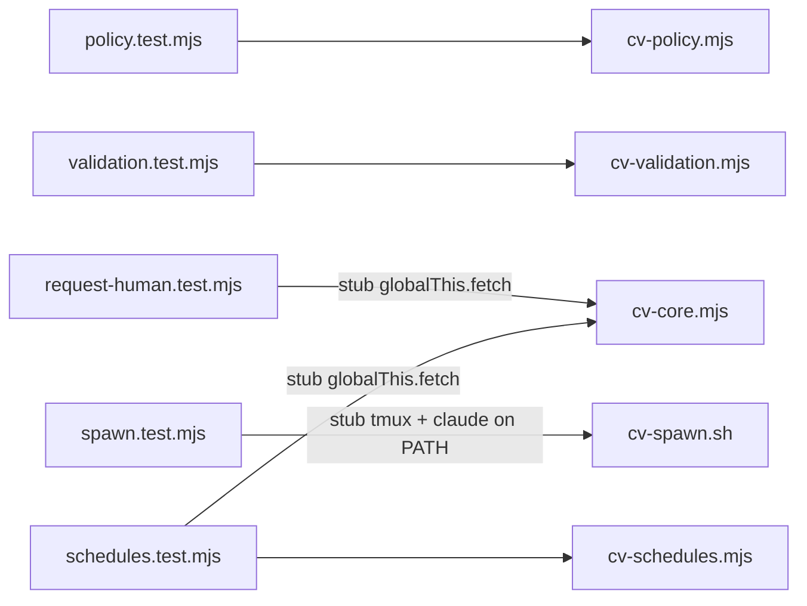

# Testing the orchestrator

The orchestrator has a small set of local tests in `orchestrator/test/`. They cover the pure decision logic (tool-group policy, validation exemption), one HTTP-status detail in `cv-core.mjs`, and the launch line that `cv-spawn.sh` hands to a seat's shell. They exist to pin behaviours that were wrong once and are cheap to check. They are not a full suite: the runner loop and most of the MCP surface have no automated tests here.

## How it works

Every test runs on the local machine and needs no server, no Docker, no real `tmux` and no real `claude`. Isolation is done per file:



There are five test files, in two styles: three use the `node:test` runner (`test(...)` blocks), and `request-human.test.mjs` and `schedules.test.mjs` are plain scripts that use `node:assert/strict` and exit non-zero on a failed assertion.

### policy.test.mjs

Module under test: `allowedGroup(group, role, canNotify)` from `cv-policy.mjs`, which decides which of cv-mcp's tool groups (`report`, `notify`, `full`, anything else) a seat may use. See [mcp.md](mcp.md). No isolation is needed because the function is pure.

| Test | Intent |
|---|---|
| a basic seat (worker) gets reporting and shared tools, not the orchestrator set | For role `worker` without notify rights: `report` allowed, `full` refused, `notify` refused, any other group allowed. |
| notify follows the right to page, whatever the role (a basic seat granted notify) | `notify` is allowed exactly when `canNotify` is true: yes for a worker and an orchestrator with it; no for an orchestrator or a delegate without it. |
| orchestrator and delegate unchanged | `full` is allowed for orchestrator and delegate; `report` is refused for an orchestrator and allowed for a delegate. |

### validation.test.mjs

Module under test: `validationExemption(task, { validateLane })` and `isValidationTask(task)` from `cv-validation.mjs`, which decide whether the runner should auto-create a validator for a finished task or skip it. See [runner-validation.md](runner-validation.md). Pure functions, no isolation needed. Task rows are plain object literals; fixture titles are generic strings.

| Test | Intent |
|---|---|
| a production row that merely uses the words gets its validator | Titles that only contain words like "re-check", "validate" or "CLOSE SHORT" in free text return `null` (not exempt), so the task still gets a validator. |
| real validations are exempt | A title beginning with `VALIDATE #<n>` (also after a prefix such as a warning marker, or after "CASE (b)") is exempt with a reason matching `title`; a row with `validatesTaskId` is exempt with a reason matching `validates_task_id=<n>`. |
| gates and opted-out rows are exempt; the number is required in a mid-title match | A title with `POST-LANDING GATE` is exempt (reason matches `gate`); a body containing `NO-AUTO-VALIDATE` is exempt; a mid-title "VALIDATE" with no task number is not exempt. |
| isValidationTask is unchanged: the row field or the prefix | `isValidationTask` is true for a `VALIDATE #5` title or a `validatesTaskId`, false for a title that only says "re-check". |
| a task from the runner's explicit validation lane gets none; production still does | With `{ validateLane: "<lane>" }`, a task in that lane is exempt (reason matches `validation lane #<lane>`), a task in another lane is not, and without a `validateLane` option nothing is inferred from the lane. |

### request-human.test.mjs

Module under test: `requestHuman(self, summary, detail)` in `cv-core.mjs`, which POSTs to `/api/human_requests`. The code returns the response body merged with the HTTP status as `http`, so the body's own `status` field (for example `"open"`) is never confused with the HTTP status.

Isolation: the script sets `process.env.CLAUDIVERSE_URL = "http://stub"`, replaces `globalThis.fetch` with a function that pops canned replies from a queue, and only then does a dynamic `await import("../cv-core.mjs")`. The order matters: stubbing must happen before the import. Two replies are queued:

1. HTTP 200 with body `{ id: 3, status: "open" }`: expects `http` 200, `status` `"open"`, `id` 3.
2. HTTP 403 with an `error` body saying the seat may not request a human: expects `http` 403 and `error` matching `/may not request/`.

On success it prints one line: `requestHuman: success reads as 200/open, refusal as 403 with its error`.

### schedules.test.mjs

Modules under test: the `schedule*` functions in `cv-core.mjs` and the answer wording in `cv-schedules.mjs`, which the `cv_schedule_*` tools use. See [mcp-schedules.md](mcp-schedules.md). Isolation as in `request-human.test.mjs`: `fetch` is stubbed with a queue of canned replies (and records each request) before `cv-core.mjs` is imported.

| Check | Intent |
|---|---|
| Refusals | 403, 422 (over the limit, a bad cron), 400 and 404 replies to `scheduleAdd`, and a 403 to each of update, remove, runs, get and list, all read as `REFUSED (HTTP <status>)` with the server's reason. A success is no refusal. |
| Requests | Pause sends `PATCH` with `{enabled: false, self}`; remove sends `DELETE /api/schedules/7?self=s`. |
| Stored exactly | `added` reports `stored exactly` when the server's sha256 and length match the 20,000-character multi-byte prompt sent, and `STORED TEXT DIFFERS` when the server kept only 1,500 characters. |
| No cut | `fullPrompt` prints the 20,000-character prompt verbatim between its markers (same text, same sha256); the list line shows the length, sha256 and a JSON-quoted 120-character preview on one line. |

On success it prints one line: `cv_schedule_*: refusals read as REFUSED with the server's reason; prompts round-trip whole`.

### spawn.test.mjs

Module under test: `cv-spawn.sh`, specifically the launch line it sends to the seat's shell for the three login/pool modes and one refused combination. See [cv-spawn.md](cv-spawn.md).

Isolation: each case creates a temp directory (`cvspawn-*` under the OS temp dir) containing:

- a stub `tmux` (a bash script) that appends its arguments to `tmux.log`, exits 1 for `has-session` (no existing session), prints `CVREADY` for `capture-pane` (the shell is ready) and `claude` for `display-message` (the process started), and exits 0 otherwise;
- a stub `claude` that exits 0;
- an empty `work` directory used as the seat's working directory.

The temp directory is put first on `PATH` and `cv-spawn.sh` is run with `bash`, passing `--title t1 --token tok --url http://srv:4000 --bin <stub claude>` plus the per-case flags. The environment variables `CV_SPAWN_POOLED`, `CV_SPAWN_POOL_ONLY` and `CV_SPAWN_OAUTH_TOKEN_FILE` are set to empty so the developer's own environment cannot leak in. The test then reads `tmux.log` and keeps the `send-keys` lines that do not contain `CV` (the readiness marker lines); what remains is the launch line.

| Test | Intent |
|---|---|
| --pool-only logs the seat in with the pool placeholder and routes it through the proxy | Exit 0; launch line contains `CLAUDE_CODE_OAUTH_TOKEN=cv-pool `, `ANTHROPIC_BASE_URL=http://srv:4000/proxy/seat/t1 ` and `X-Claudiverse-Pool: 1`. |
| --pooled alone keeps the machine's own login | Exit 0; launch line contains `ANTHROPIC_BASE_URL=` but no `CLAUDE_CODE_OAUTH_TOKEN`. |
| neither: no pool, no login override | Exit 0; launch line contains neither `ANTHROPIC_BASE_URL` nor `CLAUDE_CODE_OAUTH_TOKEN`. |
| --pool-only with --oauth-token-file is refused: two logins | Exit status 2 and stderr matching `two different logins`. |

## Configuration

There is no `test` script in `orchestrator/package.json` (it has only `bin` and `dependencies`), and no test configuration. The test files import only Node built-ins and the modules under test.

| Item | Detail |
|---|---|
| Node | A current Node (22 or later). The tests use `node:test` and `import.meta.dirname`; both are recent additions. |
| Shell | `bash` must be on `PATH` (spawn tests run `cv-spawn.sh` through it and the stub `tmux` and `claude` are bash scripts). |
| Server | None. No test calls a real server; `request-human.test.mjs` and `schedules.test.mjs` stub `fetch`. |
| Environment | `spawn.test.mjs` blanks the three `CV_SPAWN_*` variables above itself. |

## Interface

Run from the repository (worktree) root:

```bash
# node:test files
node --test orchestrator/test/policy.test.mjs orchestrator/test/validation.test.mjs orchestrator/test/spawn.test.mjs

# plain assert scripts
node orchestrator/test/request-human.test.mjs
node orchestrator/test/schedules.test.mjs
```

At the time of writing, the `node --test` run reports 12 tests, 12 pass, 0 fail (3 policy, 5 validation, 4 spawn), and the plain script prints its one success line and exits 0. The spawn tests dominate the run time (well under a few seconds in total).

The plain script has no summary output: success is the printed line and exit status 0; failure is an uncaught `AssertionError` and a non-zero exit. Do not pass `request-human.test.mjs` to `node --test` expecting counted results; it has no `test()` blocks.

## Failure modes and troubleshooting

| Symptom | Cause | What to do |
|---|---|---|
| `spawn.test.mjs` fails with a non-zero status and a stderr message from `cv-spawn.sh` | A flag or precondition check in the script rejected the stubbed invocation, or `bash` is missing. | The assertion message includes `stderr`. Read it; the flags and their checks are listed in [cv-spawn.md](cv-spawn.md). |
| Launch-line assertions fail but exit status is 0 | `cv-spawn.sh` changed how it builds the launch line (variable names, header text, the proxy path `/proxy/seat/<title>`). | Update the script or the test to match the intended behaviour; the test reads the line from the stub tmux log, so print `tmux.log` to see what was sent. |
| A spawn test hangs or is slow | The script polls the pane for the `CVREADY` marker; the stub `capture-pane` prints it, so a hang means the stub is not first on `PATH` or `tmux` resolved to a real binary. | Check that the temp directory is prepended to `PATH` and that the stub has mode 755. |
| `request-human.test.mjs` fails with a network error | `fetch` was not stubbed before `cv-core.mjs` was imported, so the real `fetch` was bound. | Keep the stub assignment above the dynamic `import`. |
| `import.meta.dirname` is `undefined` | Node is too old. | Use Node 22 or later. |
| Nothing happens with `npm test` | There is no `test` script. | Use the commands above. |

## What is not covered

These parts have no automated tests here: the `cv-runner.mjs` loop (claiming, reaping, HALT and drain, validation creation end to end), the `cv-mcp.mjs` tool handlers, `cvctl.mjs`, `cv-subs.mjs`, and `cv-escalations.mjs`. Only `allowedGroup`, the validation exemption helpers, `requestHuman`, the `schedule*` client functions with their answer wording, and the `cv-spawn.sh` launch line are exercised. Changes to the other modules need manual verification against a running server and tmux.

## Related pages

- [Runner overview](runner.md)
- [Runner validation](runner-validation.md)
- [cv-spawn.sh](cv-spawn.md)
- [cv-mcp overview](mcp.md)
- [cv-core](cv-core.md)
- [Index](README.md)

## Source

- `orchestrator/test/policy.test.mjs`
- `orchestrator/test/validation.test.mjs`
- `orchestrator/test/request-human.test.mjs`
- `orchestrator/test/spawn.test.mjs`
- `orchestrator/cv-policy.mjs`
- `orchestrator/cv-validation.mjs`
- `orchestrator/cv-core.mjs`
- `orchestrator/cv-spawn.sh`
- `orchestrator/package.json`
