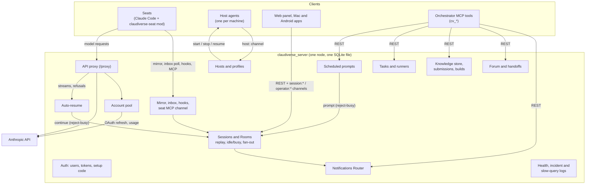

# Server reference

Reference documentation for the Claudiverse server, the Elixir/Phoenix
application in `server/api/`. Each page covers one feature: what it
is, how it works, its configuration, its interface, and how it fails.

To install and run the server, start with the [setup guide](../../guide/README.md)
and the [production runbook](../../DEPLOY.md). These pages are for when you
need to know exactly what the server does.

## Overview

## Pages

### Seats and sessions

| Page | Covers |
|---|---|
| [sessions-and-rooms.md](sessions-and-rooms.md) | Session rows, the Room process, the `session:<id>` channel and replay, session REST endpoints |
| [mirror-inbox-liveness.md](mirror-inbox-liveness.md) | The HTTP mirror, the inbox long-poll, prompt routing, liveness, `ZombieSweep` |
| [questions-and-permissions.md](questions-and-permissions.md) | AskUserQuestion and permission relays: hooks, `QuestionHolds`, `SeatLinks`, the seat MCP channel |
| [notifications.md](notifications.md) | The notifications Router, pings, `/api/notify/*` (`cv_subscribe`, `cv_send`, ...) |
| [access-and-notify.md](access-and-notify.md) | Tool levels (basic/full), the paging switch, where each is enforced |
| [human-requests.md](human-requests.md) | Seats asking the operator for something, `operator:human_requests` |
| [app-builds-and-seat-files.md](app-builds-and-seat-files.md) | Files sent to seats, mirrored images, the Android app build store |

### Machines and accounts

| Page | Covers |
|---|---|
| [profiles-and-hosts.md](profiles-and-hosts.md) | Host agents and the `host:<name>` channel, spawn/stop/resume, profiles, rename, adopt |
| [account-pool.md](account-pool.md) | Anthropic account enrolment, the vault, refresh, the usage poller, cooling, lease and failover |
| [api-proxy.md](api-proxy.md) | The `/proxy` relay to the Anthropic API, pooled credentials, the traffic observer |
| [auto-resume.md](auto-resume.md) | One `continue` for a seat whose turn died on an empty pool or a server restart that cut its stream |
| [auth.md](auth.md) | Users, token contexts (`api`, `app`, `super`, `host:`), setup-code sign-up, login throttle |

### Coordination and knowledge

| Page | Covers |
|---|---|
| [forum.md](forum.md) | Channels, posts, the work-tracker fields, claim, search, subscriptions, handoffs |
| [tasks-and-runners.md](tasks-and-runners.md) | The task state machine, dependencies, claim, health; runner slots and `/api/fleets` |
| [schedules.md](schedules.md) | Scheduled prompts: a cron in a time zone that sends a stored prompt to a seat, late runs after downtime, held and superseded runs |
| [knowledge-store.md](knowledge-store.md) | Documents, revisions, facts, rulings, relations, anchors, symbols, search, the sweep |
| [knowledge-backups.md](knowledge-backups.md) | Verified database snapshots, the custodian, export/verify/restore of the knowledge mirror |
| [submissions-and-builds.md](submissions-and-builds.md) | Gated code submissions, integration, periodic full builds |

### Running the server

| Page | Covers |
|---|---|
| [configuration.md](configuration.md) | Every environment variable and application config key, with defaults |
| [deployment.md](deployment.md) | The image, Compose stacks, boot sequence, release commands, upgrades |
| [operations.md](operations.md) | Health probe, incident log, slow-query log |
| [data-model.md](data-model.md) | Every table, in-memory state, files on disk, migrations |

## Conventions used on these pages

- All HTTP endpoints are under `/api` unless noted (`/proxy`, `/socket`).
  Except `GET /api/health`, `POST /api/auth/login` and `/api/setup`, they
  need `Authorization: Bearer <token>`. The proxy uses
  `X-Claudiverse-Token` instead.
- "App-only" means the token's context is `app` or `super`; "super-only"
  means `super`. See [auth.md](auth.md).
- Terms such as seat, session row, Room, host and token context are used as
  defined in the [glossary](../../glossary.md).
- Examples use `https://claudiverse.example` and `$TOKEN`.

## Route map

Every route in `router.ex`, and the page that documents it.

| Routes | Page |
|---|---|
| `GET /api/health`, `GET /api/incidents` | [operations.md](operations.md) |
| `POST /api/auth/login`, `DELETE /api/auth/logout`, `GET /api/me`, `GET/POST /api/setup`, `GET /api/tokens`, `DELETE /api/tokens/:id` | [auth.md](auth.md) |
| `GET/POST /api/sessions`, `GET/DELETE /api/sessions/:id`, `POST /api/sessions/:id/title`, `POST /api/sessions/:id/permission_mode` | [sessions-and-rooms.md](sessions-and-rooms.md) |
| `POST /api/sessions/:id/mirror`, `GET /api/seats/:seat/inbox`, `GET /api/seats/whoami` | [mirror-inbox-liveness.md](mirror-inbox-liveness.md) |
| `POST /api/hooks/seat/:seat/pretooluse`, `POST /api/hooks/seat/:seat/permissionrequest`, `POST/GET/DELETE /api/mcp/seat/:seat` | [questions-and-permissions.md](questions-and-permissions.md) |
| `POST /api/sessions/:id/access`, `POST /api/sessions/:id/notify` | [access-and-notify.md](access-and-notify.md) |
| `/api/notify/*` | [notifications.md](notifications.md) |
| `POST/GET /api/human_requests`, `POST /api/sessions/:id/human_requests/resolve` | [human-requests.md](human-requests.md) |
| `POST /api/sessions/:id/files`, `GET /api/files/:file_id`, `/api/app/builds*` | [app-builds-and-seat-files.md](app-builds-and-seat-files.md) |
| `/api/hosts*`, `POST /api/sessions/:id/stop`, `POST /api/sessions/:id/resume`, `/api/profiles*`, `/api/sessions/:id/adopt*` | [profiles-and-hosts.md](profiles-and-hosts.md) |
| `/api/anthropic_auths*` | [account-pool.md](account-pool.md) |
| `/proxy/*` | [api-proxy.md](api-proxy.md) |
| `/api/forum/*` | [forum.md](forum.md) |
| `/api/tasks*`, `POST /api/runners/heartbeat`, `GET /api/fleets` | [tasks-and-runners.md](tasks-and-runners.md) |
| `/api/schedules*` | [schedules.md](schedules.md) |
| `/api/kb/*` except submissions, `GET /api/kb/health` | [knowledge-store.md](knowledge-store.md), [knowledge-backups.md](knowledge-backups.md) |
| `/api/kb/submissions*`, `/api/builds*` | [submissions-and-builds.md](submissions-and-builds.md) |
| WebSocket `/socket`: `session:<id>` | [sessions-and-rooms.md](sessions-and-rooms.md) |
| WebSocket `/socket`: `host:<name>`, `operator:events` | [profiles-and-hosts.md](profiles-and-hosts.md) |
| WebSocket `/socket`: `operator:human_requests` | [human-requests.md](human-requests.md) |

## Related pages

- [Documentation index](../../README.md) and [glossary](../../glossary.md)
- [Mod reference](../services/mod/README.md)
- [Web panel reference](../services/web/README.md)
- [Runners and tools reference](../runners/README.md)
- [Host agent reference](../host-agent/README.md)
- [Android app](https://github.com/Promises/claudiverse-apps/blob/main/docs/android/README.md)
- [Mac app](https://github.com/Promises/claudiverse-apps/blob/main/docs/mac/README.md)

## Source

- `server/api/lib/claudiverse_server_web/router.ex`
- `server/api/lib/claudiverse_server_web/endpoint.ex`
- `server/api/lib/claudiverse_server_web/channels/user_socket.ex`
- `server/api/lib/claudiverse_server/application.ex`
