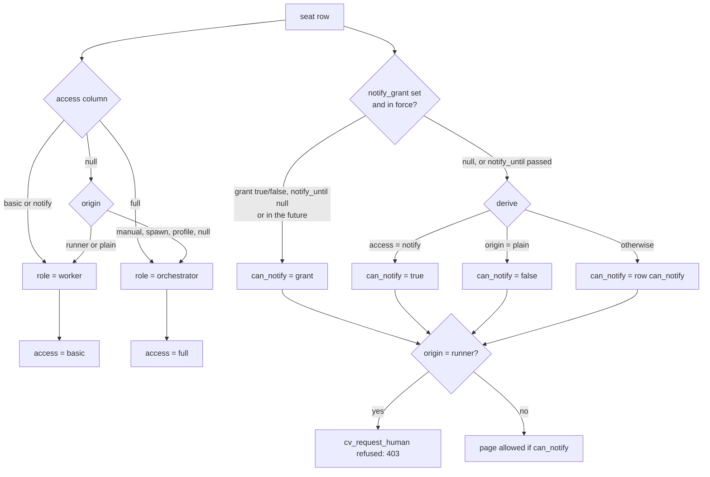

# Tool levels and paging

A seat's *tool level* (stored as `access`) decides which claudiverse tools its MCP server offers it (reporting only, or the whole orchestrator set). Its *paging* setting (stored as `can_notify` and `notify_grant`) decides whether it may page the operator (`cv_request_human`). The two are independent settings, both derived by one module, `ClaudiverseServer.Sessions.Access`, from fields on the seat's `sessions` row. The operator's apps override the derived values through two app-only endpoints.

The server is the policy source. A seat's `cv-mcp` asks `GET /api/seats/whoami` and enables or disables its tool groups accordingly. The only check the server itself performs is on paging (`HumanRequests.request/3`). Tool access is not enforced server-side (see "Where it is enforced").

## How it works

### Inputs (columns on `sessions`)

| Column | Type | Set by | Meaning |
|---|---|---|---|
| `origin` | string | seat registration, inbox poll, profile | one of `manual`, `spawn`, `runner`, `profile`, `plain`, or null |
| `can_notify` | boolean, not null, default `false` | seat registration (`notify`), inbox poll (`notify`), profile | the seat's own paging opt-in (its launcher's choice) |
| `access` | string, nullable | `POST /api/sessions/:id/access` only | explicit tool level: `basic`, `notify`, `full`; null = derived |
| `notify_grant` | boolean, nullable | `POST /api/sessions/:id/notify` only | operator's paging switch: true, false, or null = derived |
| `notify_until` | utc datetime (seconds), nullable | `POST /api/sessions/:id/notify` only | when the switch lapses; null = never |

`access`, `notify_grant` and `notify_until` are not in the registration changeset's cast list, so a seat cannot set them itself; only the two app-only endpoints write them. Migrations: `add_can_notify_to_sessions` (2026-10-03), `add_access_to_sessions` and `add_notify_grant_to_sessions` (2026-10-06). The changeset also validates `access` against `Access.levels/0` (`basic`, `notify`, `full`).

### Levels

| Level | Stored value | Role | Meaning |
|---|---|---|---|
| basic | `access = "basic"` | `worker` | reporting tools and the shared tools. Paging is separate. |
| full | `access = "full"` | `orchestrator` | the whole tool set. Paging is separate. |
| notify (legacy) | `access = "notify"` | `worker` | accepted for the first version of the API. Equivalent to basic tools with paging on (by derivation, see below). Reads back as `access: "basic"`. |
| derived | `access = null` | by origin | see the diagram |

Tool level (`role/1`):

1. `access` is `basic` or `notify`: role `worker`.
2. `access` is `full`: role `orchestrator`.
3. `access` is null: origin `runner` or `plain` gives `worker`; anything else (`manual`, `spawn`, `profile`, null) gives `orchestrator`. A profile's own role (the board role a profile carries) plays no part. A profile seat is an orchestrator unless its `access` is set.

`level/1` is what the API reports as `access`: `"basic"` if the role is `worker`, else `"full"`. The legacy `notify` level therefore never appears in responses; `access_explicit` tells whether a value is stored.

Paging (`can_notify?/2`):

1. `grant/2` returns the operator's switch if it is in force: `notify_grant` null gives nil; `notify_until` null gives the grant forever; `notify_until` later than now gives the grant; otherwise (lapsed) nil. A lapsed row keeps its stored values, but the API reports `notify_grant` and `notify_until` as null.
2. If the grant is non-nil, it is the answer (true or false).
3. Otherwise derive: `access = "notify"` gives true; origin `plain` gives false (a clean `claude` typed in a terminal does not page until the operator switches it on); anything else gives the row's own `can_notify`.

Tool level never changes paging: setting `basic` or `full` leaves paging as derived. Only the switch overrides it (the exception is the legacy `notify` level, which feeds step 3).

A runner's worker (origin `runner`) never pages, whatever is set: `HumanRequests.request/3` returns `{:error, :runner}` before looking at `can_notify`.

### Decision diagram



### Where `can_notify` on the row comes from

- `POST /api/sessions` (seat registration): body field `notify` of `true`, `"1"` or `"true"` sets it true; `false`, `"0"` or `"false"` sets it false; absent (an older runtime) leaves it untouched. Current runtimes send it explicitly, so a seat relaunched without the opt-in (`CLAUDIVERSE_NOTIFY=1`) loses it.
- `GET /api/inbox` poll: query param `notify=1` or `notify=0` is written to the row when it differs (absent leaves it). This is for seats without a sidecar. Other values are ignored.
- Profile-started seats: when the registration carries a valid `profile_id` of the same user, `Profiles.registration_attrs/2` overwrites `origin` with `profile`, `fleet` with the profile's fleet, and `can_notify` with the profile's `can_notify`. The profile wins over what the seat reported.

### Where it is enforced

Server side, every use of the `Access` module in `lib/`:

| Place | Use |
|---|---|
| `HumanRequests.request/3` | the only enforcement: origin `runner` gives `{:error, :runner}`; else `Access.can_notify?/1` false gives `{:error, :not_allowed}`. Reached from `POST /api/human_requests` (`HumanRequestController.create`): 403 `runner seats cannot request a human` or 403 `this seat may not request a human (its launcher does not set CLAUDIVERSE_NOTIFY=1)`. The second message names the launcher flag but also applies when the operator switched paging off. |
| `SeatController.whoami` | reports `Access.effective/1` and `Access.level/1` |
| `SessionController.serialize_session` | reports `can_notify`, `access`, `access_explicit`, `notify_grant`, `notify_until` |
| `Adopt` | the suggested profile for an adopted running seat gets `can_notify` from `Access.can_notify?/1` |

Not enforced on the server: tool access (`role`/`access`) is not checked by any endpoint. In particular `/api/notify/*` (`NotifyController`: subscribe, send, status, report and so on) checks neither role, access, nor `can_notify`. Its only token-context check is `force: true` on `POST /api/notify/send`, which needs an app or super token (403 `force is app-only`); that is unrelated to seat access. The same goes for the forum, handoff, knowledge and task endpoints. A worker-level seat with the shared token could call them directly; the level only controls which tools its MCP exposes.

Client side (`orchestrator/cv-mcp.mjs`, `orchestrator/cv-policy.mjs`): every tool is registered under a group, and `applyPolicy(role, canNotify)` enables or disables each tool by `allowedGroup(group, role, canNotify)`:

| Group | Enabled when | Contents (briefly) |
|---|---|---|
| `report` | role is `worker` or `delegate` | worker-side reporting (`cv_report`) |
| `notify` | `canNotify === true`, whatever the role | `cv_request_human` |
| `full` | role is not `worker` | the orchestrator set (driving, messaging, spawning/stopping agents, and so on) |
| `all` (anything else) | always | shared tools: forum, handoff, knowledge/ledger |

Policy is dynamic unless the launcher set `CLAUDIVERSE_ROLE`; then the fixed set from the environment stays (and `CLAUDIVERSE_NOTIFY=1` gives `cv_request_human` to non-workers). A dynamic seat starts from the env values, then resolves itself via `whoami` (by title if `CLAUDIVERSE_SELF` or `CLAUDIVERSE_TITLE` is set, else by `CLAUDE_CODE_SESSION_ID`), retrying every 2 s for 30 tries, then every 30 s. After that it re-reads `whoami` every 60 s (`POLICY_REFRESH_MS`). A failed refresh keeps the last policy. So a change from the apps takes effect within about a minute, with no restart and no push; the endpoints below broadcast nothing.

## Configuration

No server env vars or `config :claudiverse_server` keys. Seat-side environment (read by `cv-mcp`/launchers, not by the server): `CLAUDIVERSE_NOTIFY=1` (the opt-in reported as `notify`), `CLAUDIVERSE_ROLE` (pins the tool set, disables dynamic policy), `CLAUDIVERSE_SELF` / `CLAUDIVERSE_TITLE`, `CLAUDE_CODE_SESSION_ID`. Timeout constants in code: `minutes` limit 1 to 10080 (7 days); policy refresh 60 s.

## Interface

All endpoints are under `/api` and need `Authorization: Bearer $TOKEN`. Sessions are looked up for the token's user only; another user's session is a 404.

### `POST /api/sessions/:id/access`

App-only: the token context must be `app` or `super` (`Accounts.app_powers?/1`). Every seat carries the shared `api` token, which gets 403.

| Body field | Values |
|---|---|
| `level` | `"basic"`, `"full"`, `"notify"` (legacy), or `null`. Omitting `level` is the same as `null` (resets to derived). |

Check order: token context (403), level validity (400), session lookup (404).

```bash
curl -X POST https://claudiverse.example/api/sessions/42/access \
  -H "Authorization: Bearer $TOKEN" -H 'Content-Type: application/json' \
  -d '{"level":"full"}'
```

Response 200: `{"session": {...}}`, the full session object (`serialize_session`), including these access fields:

```json
{"session": {"id": 42, "title": "lorem-w1", "origin": "plain",
  "can_notify": false, "access": "full", "access_explicit": true,
  "notify_grant": null, "notify_until": null}}
```

(other session fields omitted). Errors:

| Status | Body |
|---|---|
| 403 | `{"error": "seat access is app-only"}` |
| 400 | `{"error": "level must be basic, notify, full or null"}` |
| 404 | `{"error": "session not found"}` |

### `POST /api/sessions/:id/notify`

App-only, same rule. Sets the operator's paging switch.

| Body field | Values |
|---|---|
| `allow` | JSON `true`, `false` or `null` (omitted = null = clear the switch). Strings such as `"yes"` or `"true"` are rejected. |
| `minutes` | optional integer 1 to 10080: the switch lapses to the derived value that many minutes from now (`notify_until`, truncated to seconds). Ignored when `allow` is null (the row is then cleared). Without `minutes` the switch has no end. |

Each call replaces both `notify_grant` and `notify_until`, so a call without `minutes` removes a previous expiry.

```bash
curl -X POST https://claudiverse.example/api/sessions/42/notify \
  -H "Authorization: Bearer $TOKEN" -H 'Content-Type: application/json' \
  -d '{"allow":true,"minutes":120}'
```

Response 200: `{"session": {...}}` with, for example, `"can_notify": true, "notify_grant": true, "notify_until": "2026-10-10T14:00:00Z"`.

| Status | Body |
|---|---|
| 403 | `{"error": "seat paging is app-only"}` |
| 400 | `{"error": "allow must be true, false or null"}` |
| 400 | `{"error": "minutes must be 1 to 10080"}` |
| 404 | `{"error": "session not found"}` |

Check order: token context, `allow`, `minutes`, session lookup. Neither endpoint talks to the seat's Room or broadcasts a PubSub or channel event.

### `GET /api/seats/whoami`

Any authenticated token. Query: `claude_session_id=<id>` or `title=<title>` (the first wins when both are given). Picks the user's non-proxy row, preferring a running one, then newest. 400 `{"error":"claude_session_id or title is required"}` when neither is given; 404 `{"error":"no seat registered under that id yet"}` until the seat has registered (callers retry).

```json
{"session_id": 42, "title": "lorem-orchestrator", "role": "orchestrator",
 "can_notify": true, "access": "full", "fleet": "lorem-fleet",
 "origin": "manual", "profile_id": null}
```

`role` and `can_notify` come from `Access.effective/1`; `access` from `Access.level/1`. Note that `whoami` does not return `access_explicit`, `notify_grant` or `notify_until`; those are on the session object (`GET /api/sessions`, `GET /api/sessions/:id`).

### Registration and poll parameters

| Endpoint | Param | Effect |
|---|---|---|
| `POST /api/sessions` | `notify`: `true`/`"1"`/`"true"` or `false`/`"0"`/`"false"` | sets `sessions.can_notify`; absent = unchanged |
| `GET /api/inbox` | `notify=1` or `notify=0` | same, written when changed |

## Failure modes and troubleshooting

| Symptom | Cause | Fix |
|---|---|---|
| 403 `seat access is app-only` / `seat paging is app-only` | called with a seat's shared `api` token | use an `app` or `super` token |
| `cv_request_human` missing from a seat's tools | `can_notify` is false (a plain session, an unset opt-in, a switch off or lapsed) or the seat has not resolved yet | read `whoami`; switch paging on with `/notify`; wait up to 60 s |
| `cv_request_human` visible but server answers 403 `this seat may not request a human ...` | the server's `can_notify?` is false while the client still holds an older policy, or `CLAUDIVERSE_ROLE` pinned a static set. The message blames the launcher flag even when the cause is an operator switch. | check `whoami`; fix the switch or the launcher flag |
| 403 `runner seats cannot request a human` | origin `runner`; no setting overrides it | by design |
| Seat set to `full` still cannot page | tool level does not change paging | use `/notify` with `allow: true` |
| A timed grant "disappeared" | `notify_until` passed; the seat fell back to the derived value (the stored row is kept, the API shows nulls) | grant again |
| Level change not visible on the seat | `cv-mcp` refreshes every 60 s, only when dynamic (no `CLAUDIVERSE_ROLE`) | wait, or restart the seat |
| Access did not follow a seat's restart | the settings live on the session row; a restarted seat registers a new row | set it again on the new row |
| `whoami` 404 | seat has not registered | retry |

## Related pages

- [Questions and permission relays](questions-and-permissions.md)
- [Notifications Router, pings and cv_subscribe](notifications.md)
- [Human requests](human-requests.md)
- [Profiles and the host channel](profiles-and-hosts.md)
- [Sessions and Rooms](sessions-and-rooms.md)
- [Accounts, sign-up and tokens](auth.md) for token contexts (`api`, `app`, `super`)
- [../../guide/4-first-seat.md](../../guide/4-first-seat.md), [../../guide/6-troubleshooting.md](../../guide/6-troubleshooting.md)
- Runners and tools: [cv-mcp: the claudiverse MCP server (overview)](../runners/mcp.md)
- Android: [Seat controls](https://github.com/Promises/claudiverse-apps/blob/main/docs/android/seat-controls.md)
- Mac: [Seat view](https://github.com/Promises/claudiverse-apps/blob/main/docs/mac/seat-view.md)

## Source

- `claudiverse_server/lib/claudiverse_server/sessions/access.ex`
- `claudiverse_server/lib/claudiverse_server/sessions/session.ex`
- `claudiverse_server/lib/claudiverse_server/human_requests.ex`
- `claudiverse_server/lib/claudiverse_server/profiles.ex` (`registration_attrs/2`)
- `claudiverse_server/lib/claudiverse_server_web/controllers/session_controller.ex` (`create`, `access`, `notify`, `serialize_session`)
- `claudiverse_server/lib/claudiverse_server_web/controllers/seat_controller.ex`
- `claudiverse_server/lib/claudiverse_server_web/controllers/inbox_controller.ex`
- `claudiverse_server/lib/claudiverse_server_web/controllers/human_request_controller.ex`
- `claudiverse_server/lib/claudiverse_server_web/controllers/notify_controller.ex`
- `claudiverse_server/priv/repo/migrations/20261003001000_add_can_notify_to_sessions.exs`
- `claudiverse_server/priv/repo/migrations/20261006010000_add_access_to_sessions.exs`
- `claudiverse_server/priv/repo/migrations/20261006020000_add_notify_grant_to_sessions.exs`
- orchestrator/cv-mcp.mjs (`applyPolicy`, `resolveSeat`, `refreshPolicy`)
- orchestrator/cv-policy.mjs
- `claudiverse_server/test/claudiverse_server_web/seat_access_test.exs`
- `claudiverse_server/test/claudiverse_server_web/controllers/seat_controller_test.exs`
