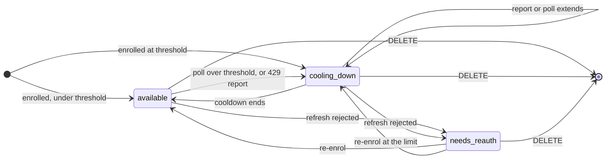
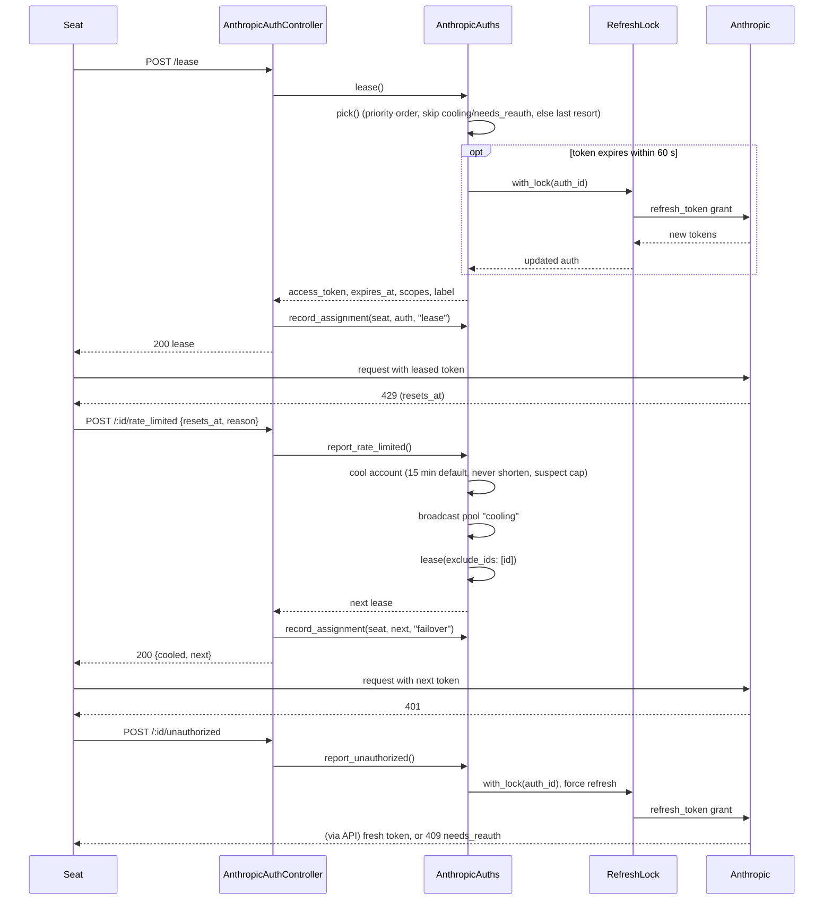

# The Anthropic account pool

The pool is the server's store of Anthropic subscription accounts (`ClaudiverseServer.AnthropicAuths`). An operator enrols each account once through an OAuth flow. The server keeps its tokens encrypted, refreshes them itself, watches each account's usage, and hands the best usable account to whoever asks for one. Seats never hold a refresh token and never call Anthropic's token endpoint.

The schema is called `AnthropicAuth` rather than "account" because `ClaudiverseServer.Accounts` is the web-panel login and means something else.

Two consumers lease from the pool:

- Seats and scripts that call `POST /api/anthropic_auths/lease` directly.
- The API proxy, for seats that send the placeholder bearer `cv-pool`. See [api-proxy.md](api-proxy.md); this page covers only how the proxy uses the pool.

For the operator's view (adding an account in the web panel) see [../../guide/2-accounts.md](../../guide/2-accounts.md).

## How it works

### Why the server is the only refresher

An Anthropic refresh response may carry a replacement refresh token. If a client refreshed and received one, the server's stored copy would be dead and the server could no longer refresh for anyone on that account, while the panel kept showing it `available`. If the response carries no replacement, a client refresh gains nothing the server could not do. So clients get access tokens only.

### Enrolment (OAuth PKCE, paste-the-code)

1. `POST /api/anthropic_auths/authorize` returns an authorize `url`, a PKCE `verifier` and a `state`. The server stores nothing: the caller (the web panel) must keep `verifier` and `state` and hand them back. The URL is `https://claude.com/cai/oauth/authorize?...` with `code=true`, the Claude Code OAuth client id, `response_type=code`, `redirect_uri=https://platform.claude.com/oauth/code/callback`, `code_challenge_method=S256`, and the scopes `org:create_api_key user:profile user:inference user:sessions:claude_code user:mcp_servers user:file_upload`. Anthropic may grant a subset; the granted scopes are stored and returned with every lease.
2. The operator opens the URL, signs in as the account to add, approves, and copies the code shown on Anthropic's callback page.
3. `POST /api/anthropic_auths/complete` with `label`, `code`, `verifier` (and `state`, `priority`). The pasted value normally looks like `code#state`; the server splits at the first `#`. If the paste carries a state and it differs from the `state` you send, the request fails with `state_mismatch`. A bare code with no `#` is accepted.
4. The server exchanges the code at `https://platform.claude.com/v1/oauth/token`, reads the profile (`https://api.anthropic.com/api/oauth/profile`) for the account email, and reads usage (`https://api.anthropic.com/api/oauth/usage`) before storing anything. A failed profile or usage read is not an error: the email is left empty and no snapshot is stored.
5. The account is stored in one write, upserted by `label`. Its status comes from the longer of (a) any cooldown the same label already has that has not expired and (b) the cooldown the fresh usage reading calls for. So an account enrolled at its limit is stored `cooling_down` and is never leasable, and re-enrolling a cooling account does not clear its cooldown.

Re-enrolling an existing label replaces its credentials in place. It is also how a `needs_reauth` account is recovered.

### Storage

Table `anthropic_auths` (`AnthropicAuth`):

| Field | Meaning |
|---|---|
| `label` | Unique, required. The operator's name for the account. |
| `account_email` | Display only. |
| `access_token`, `refresh_token` | Encrypted binaries (see below). Never rendered by any endpoint except the one fresh access token in a lease response. |
| `expires_at` | Access token expiry. |
| `scopes` | Space-separated granted scopes. |
| `status` | `available`, `cooling_down` or `needs_reauth`. A cache; see below. |
| `cooldown_until`, `cooldown_reason` | When the account becomes leasable again, and why. |
| `priority` | Integer, default `100`. Lower is preferred. Ties broken by `id`. |
| `last_refreshed_at`, `last_leased_at` | Timestamps. `last_leased_at` is stamped only by a real lease, not by a usage read. |
| `usage_snapshot`, `usage_checked_at` | The last usage response (a map) and when it was read. |

`cooldown_until` is authoritative and `status` is a cache of it. The changeset enforces the pairing: `cooling_down` requires `cooldown_until`, and any other status clears it. Everything that decides leasability reads the timestamp, and `GET /api/anthropic_auths` renders `status` from the timestamp, so a cooldown that has elapsed shows as `available` even if nothing has rewritten the row.

Encryption (`Vault`): AES-256-GCM through Erlang `:crypto`, with the key from `CV_VAULT_KEY` (base64 of exactly 32 bytes). Stored layout is `iv (12 bytes) || tag (16 bytes) || ciphertext`, with the fixed additional authenticated data `anthropic_auths.v1`. A missing or malformed key never falls back to plaintext. Decryption returns `nil` on any failure (wrong key, tampered row), which the pool treats as "no usable token". The vault protects against casual database or backup reads, not against a compromised host: the key lives in the same process environment as the database.

### Token refresh and `RefreshLock`

`valid_token/1` returns the account if its access token is valid, meaning it expires more than 60 seconds from now. Otherwise it refreshes under `RefreshLock`.

`RefreshLock` is a GenServer that runs refreshes one at a time per account id (other accounts are unaffected). Two seats leasing at the same expiry would otherwise both refresh; if Anthropic rotates the refresh token, the second refresh invalidates the first and one seat holds a superseded token. Both calls return HTTP 200, so the failure only shows up later as an unexplained 401. Inside the lock the account is re-read, so the second caller finds the token already refreshed and does nothing. Work runs in a monitored (not linked) process, so a crashing refresh fails only that call. The call timeout is 45 seconds (`{:error, :refresh_timeout}`). The lock only serialises within one BEAM node; the server is single-node (SQLite).

Refresh outcomes (`do_refresh`):

- Success: stores the new access token, `expires_at` (from `expires_in`, default 3600 s), `last_refreshed_at`. If the response has no `refresh_token`, the old one is kept. Refresh touches credentials only: an unexpired cooldown and its reason survive it, and a successful refresh is what moves `needs_reauth` back to `available` (or `cooling_down` if a cooldown is still running).
- HTTP 400, 401 or 403 from the token endpoint, or no readable refresh token: the account becomes `needs_reauth` with the reason in `cooldown_reason`, and the call returns `{:error, :needs_reauth}`. Retrying cannot help; a human must re-enrol.
- Any other error (transport, 5xx): returned as an error, the account's state is unchanged.

### The usage poller

`UsagePoller` is a GenServer started in the supervision tree. It exists so a rate limit is noticed without a client reporting it, and so an account is retired before it runs dry.

- First poll 30 seconds after boot, then every `CV_USAGE_POLL_MS`. Accounts are polled one after another, skipping `needs_reauth` ones.
- For each account it calls `refresh_usage/1`: get a valid token (refreshing if needed), `GET https://api.anthropic.com/api/oauth/usage` with header `anthropic-beta: oauth-2025-04-20`, store the response in `usage_snapshot`, set `usage_checked_at`, then apply the threshold immediately. The panel's "Check usage" (`POST /:id/usage`) goes through the same path.
- It reads the `limits` array of the response. Each entry has `percent`, `resets_at`, `kind`/`group`. Other keys in the response are ignored. An entry counts as over the threshold when `percent >= CV_USAGE_COOLDOWN_PCT` and it has a parseable `resets_at` (ISO 8601 or unix seconds). If several are over, the account cools until the latest of their resets. The cooldown is stored with reason `"<kind> at <pct>% >= <threshold>% (usage poll)"`.
- When no limit is over the threshold, a cooldown whose reason ends in `(usage poll)` is lifted (status `available`, reason `lifted: usage poll shows every limit under <n>% (peak <p>%)`), but only if at least one limit has a readable percent. A cooldown from a 429 report is never lifted by the poll, because a 429 can come from limits the usage response does not report.
- A failed poll changes nothing. The previous snapshot just ages; the panel shows `usage_checked_at`. Unknown is neither healthy nor exhausted.

After each poll (and after a preference change) the poller works out the best leasable account and compares it with the previous best:

| Situation | Effect |
|---|---|
| First evaluation after boot | Records the best, announces nothing. |
| Best unchanged | Nothing. |
| Nothing leasable | Records `:none`. The next account to come back counts as an improvement. |
| Best now sorts ahead of the previous one (or previous was `:none`) | `upgrade`: drops the proxy's cached lease (`Proxy.Credentials.reset/0`), casts `:anthropic_auth_upgrade` to every running session Room so each patched seat re-leases, and broadcasts a `pool` event with `change: "upgrade"`. |
| Best changed and is worse (the old best stopped being leasable) | Same nudge, `change: "degrade"`. |

Announcing every poll is deliberately avoided: a swap is not free.

### Account states



Notes on the diagram:

- "Threshold" is `CV_USAGE_COOLDOWN_PCT`. A poll that finds a limit at or over it cools the account until the latest reset among those limits. A 429 report is `POST /:id/rate_limited`; it can extend a cooldown but never shortens one.
- "Cooldown ends" is either `cooldown_until` passing, or a poll that sees every limit under the threshold. The second only ends cooldowns that a poll set.
- "Refresh rejected" is a refresh answered with 400, 401 or 403, or an account with no refresh token. "Re-enrol" means enrolling the same label again.
- "Cooldown passes" needs no write. The pool compares `cooldown_until` with the clock, so the account is leasable again immediately; the stored `status` string catches up on the next write.
- A needs-reauth account is never picked and never polled. A successful refresh would bring it back, but nothing refreshes it automatically, except a seat calling `POST /:id/unauthorized` for it. Re-enrolment is the normal route.
- When a 429 report names an account that has a longer existing cooldown, the longer one is kept and the reason becomes `<existing reason> (429 reported; kept the longer existing cooldown)`.

### Cooldown rules

`POST /:id/rate_limited` (also used by the proxy) calls `report_rate_limited/3`:

1. The requested end is the report's `resets_at`, or now + **15 minutes** when none is given or it cannot be parsed.
2. A client's 429 is treated as testimony, not measurement. If the account has a usage snapshot read within the last **180 seconds** whose highest limit percent is **under 80**, the report is "suspect": the cooldown is capped at **120 seconds** from now. This stops an in-flight 429 from the old account, arriving after a failover, from cooling the healthy account the seat just moved to. The next poll settles it.
3. A report may extend a cooldown but never shorten one: if the account already has a later `cooldown_until`, that one is kept (this also applies to the suspect cap, which limits only how far this report pushes the end out).
4. The account is written `cooling_down` with the reason (`reason` param, plus any note), a `pool` event `cooling` is broadcast, and the pool immediately leases again excluding that account. That lease is the response.

### Choosing an account (`pick`)

1. Candidates are accounts whose status is not `needs_reauth`, whose `cooldown_until` is null or in the past, and whose id is not in `exclude_ids`. The lowest `priority` wins, then the lowest `id`.
2. If there are none, the **last resort** applies. Among accounts that are not `needs_reauth`, not excluded and still cooling (`cooldown_until` in the future), in priority order, the first whose cooldown is "margin only" is leased anyway. Margin only means all of: `cooldown_reason` ends with `(usage poll)` (set by the poller, not a 429 report), at least one limit has a readable percent, and every readable limit is under 100. The idea: the poll's 95% margin is a preference for moving seats off an account before it runs dry, not a real limit, and when every account is cooling it is better to use one that still has room than to serve nothing. A 429-derived cooldown, or any limit at 100%, is never a last resort. Each last-resort lease is logged.
3. If still nothing, the lease fails with `no_available_auth`.

`current_id` is the id `pick` would return right now. It differs from the preferred (first-priority) account while that one is cooling or needs re-auth.

Having chosen, the pool makes sure the token is valid (refreshing under the lock if needed) and stamps `last_leased_at`. If the chosen account's refresh fails with a rejection, that one call fails with `needs_reauth` (the account is marked, and the next `pick` skips it); the pool does not retry another account within the same call.

### Lease and failover flow



### Per-seat assignments

Table `anthropic_auth_assignments` (`Assignment`) records which account each seat was last handed, written by the server at the moment it decides (not pushed by clients). The seat identifies itself with the `X-Claudiverse-Client` request header (`title=<urlencoded>; id=<urlencoded>; instance=<urlencoded>`), parsed once in the auth plug; a malformed or absent header means an unidentified seat and the assignment is simply skipped.

| Field | Meaning |
|---|---|
| `title` | The seat's title. Required. |
| `claude_session_id` | Claude's session id. Empty on the very first (startup) lease; filled in later. |
| `instance_id` | Minted by the sidecar at load; the stable upsert key when present. |
| `anthropic_auth_id` | The account. Rows are deleted with their account (`on_delete: :delete_all`). |
| `assigned_at` | When the account was handed over. This is not a liveness signal: nothing observes a seat dying, so a dead seat's row keeps looking current. Age it out. |
| `via` | Which call produced it: `lease`, `failover`, `upgrade`, `renewal`, `proxy-lease`, `proxy-failover`, `proxy-renewal`. An unknown value is stored as `other:<value>`. |

Rows are upserted on `instance_id` when the client sends one, otherwise on `title` (legacy clients). When a seat with an `instance_id` is recorded, other rows holding the same title but a different or null `instance_id` are deleted, since they describe processes that are gone. Session creation also calls `note_seat_title/2` to keep the row's title in step with the seat's current one. Recording never fails the caller: errors are logged and swallowed, because bookkeeping must not break the path every seat uses to get credentials.

### How the API proxy uses the pool

A pooled seat sends the bearer `cv-pool`. `ClaudiverseServer.Proxy.Credentials` holds one cached lease for all pooled seats and calls `AnthropicAuths.lease/0` to fill it. The cache is renewed when the token is within 120 seconds of expiry, every 5 minutes (so seats move back to a recovered preferred account), after `Credentials.reset/0` (preference change, upgrade/degrade), or after an upstream rejection. Upstream 429 and 401 go through `report_rate_limited/3` and `report_unauthorized/1` with an in-flight guard: a report naming an account that is no longer the current lease is dropped, so the burst of 429s from one exhausted account cools it only once. Assignments are written with the `proxy-*` `via` values, once per change of a seat's account. Details are in [api-proxy.md](api-proxy.md).

### `pool` events

Every change broadcasts on the PubSub topic `operator:pool`; each `operator:events` channel subscribes to it and pushes the `pool` event to the operator's app. Payload:

```json
{
  "change": "preferred",
  "by": "you@example.com",
  "at": "2026-10-10T12:00:00Z",
  "current_id": 2,
  "preferred_id": 2
}
```

| Field | Meaning |
|---|---|
| `change` | `preferred` (operator set the preferred account), `upgrade` or `degrade` (the poller's best account moved), `cooling` (a 429 report cooled an account). |
| `by` | The email of the user who made a manual change; `null` for the server's own. |
| `at` | UTC ISO 8601, seconds. |
| `current_id` | The account a lease gets now (`null` if none). |
| `preferred_id` | The id of the first account by priority (not necessarily leasable). |

The event carries no account data: clients refetch `GET /api/anthropic_auths`. Only a 429 report emits `cooling`; a poll-set cooldown is visible through `upgrade`/`degrade` only when it changes the best account. Joining `operator:events` is described in [notifications.md](notifications.md); the notification router also pings `@pool` watchers when `current_id` changes.

### Pool events

Every usage reading (the poller's, or **Check usage**) goes through `record_usage/2`, which compares it with the stored snapshot (`AnthropicAuths.PoolEvents`) and broadcasts what changed on the same topic, as `{"pool", event}`:

| `change` | When | Limits |
|---|---|---|
| `reset` | the limit's `resets_at` moved to a later period: more than an hour later, or gone once the old time has passed. A percent that only dropped (a manual reset) is not a reset. | `weekly`, `session` |
| `capped` | the percent went from below 100 to 100 or more | `weekly`, `session` |
| `step` | the weekly percent's highest multiple of `every` (5 or 10) rose; one event for the highest multiple `crossed`. A reset starts the count from 0. | `weekly` |

`weekly` is the `weekly_all` limit, `session` the 5-hour one; per-model weekly limits are not watched. Each event carries `change`, `auth_id`, `label`, `limit`, `percent`, `was` (the stored reading's percent), `resets_at`, `every` and `crossed` for a step, `text` (the one-line ping) and `at`. It has no `current_id`, so a client that refetches on every `pool` event still works.

The stored snapshot is the only state, so a crossing fires once, an unchanged reading fires nothing, and the first reading after a restart is compared with the last one before it. Seats subscribe with the `@pool:…` watch titles: see [notifications.md](notifications.md).

## Configuration

Environment variables (read at call time). The full list with other settings is in [configuration.md](configuration.md).

| Variable | Default | Effect |
|---|---|---|
| `CV_VAULT_KEY` | unset | Base64 of exactly 32 random bytes. Required to store or read credentials. Generate with `mix run -e 'IO.puts Base.encode64(:crypto.strong_rand_bytes(32))'`. Changing it makes every stored token undecryptable. |
| `CV_USAGE_POLL` | enabled | `0` disables the poller (also disables the `reconsider` and upgrade/degrade announcements). Anything else leaves it on. |
| `CV_USAGE_POLL_MS` | `300000` | Poll interval in ms. Values under `30000`, or non-numeric, fall back to the default. |
| `CV_USAGE_COOLDOWN_PCT` | `95` | A limit at or above this percent cools the account. Accepts 1 to 100; otherwise the default. |

No `config :claudiverse_server` keys. Fixed constants in code: default 429 cooldown 15 minutes, suspect-report cap 120 s, snapshot freshness 180 s, suspect threshold 80%, token validity skew 60 s, lock timeout 45 s, first poll delay 30 s.

## Interface

All routes are under `/api` and need a Bearer token (the `:authenticated` pipeline). Seat endpoints take any API token; the only role check is on `preferred`. Unknown ids return `404 {"error": "unknown auth"}`. Ids are integers.

| Method and path | Purpose |
|---|---|
| `POST /api/anthropic_auths/lease` | Lease the best account. |
| `POST /api/anthropic_auths/:id/rate_limited` | Report a 429; cool the account, get the next. |
| `POST /api/anthropic_auths/:id/unauthorized` | Report a 401; force a refresh. |
| `GET /api/anthropic_auths` | List accounts, current account and seat assignments. |
| `POST /api/anthropic_auths/authorize` | Start enrolment. |
| `POST /api/anthropic_auths/complete` | Finish enrolment. |
| `POST /api/anthropic_auths/:id/usage` | Read usage now. |
| `POST /api/anthropic_auths/:id/preferred` | Make this account the preferred one (app or super token). |
| `DELETE /api/anthropic_auths/:id` | Remove an account. |

### Lease

`POST /api/anthropic_auths/lease`, optional body `{"exclude_ids": [1, 2]}` (integers or numeric strings). A non-empty `exclude_ids` is recorded as a `failover` assignment, an empty one as `lease`.

```bash
curl -s -X POST https://claudiverse.example/api/anthropic_auths/lease \
  -H "Authorization: Bearer $TOKEN" -H 'X-Claudiverse-Client: title=lorem-w1; instance=abc123'
```

```json
{
  "auth_id": 1,
  "label": "account-a",
  "access_token": "<access token>",
  "expires_at": "2026-10-10T13:00:00Z",
  "scopes": "user:inference user:profile"
}
```

Pass `scopes` through to the client (`CLAUDE_CODE_OAUTH_SCOPES`); without it Claude Code assumes only `user:inference` and features gated on `user:profile` refuse.

| Status | Body |
|---|---|
| 200 | the lease above |
| 503 | `{"error": "no_available_auth", "next_available_at": "<earliest cooldown_until or null>"}` |
| 502 | `{"error": "<inspected reason>"}`, e.g. `":needs_reauth"` or a transport error from the refresh |

### Rate limited

`POST /api/anthropic_auths/:id/rate_limited` with `{"resets_at": "2026-10-10T17:00:00Z", "reason": "5-hour limit"}`. `resets_at` is ISO 8601 or unix seconds; both fields optional.

```bash
curl -s -X POST https://claudiverse.example/api/anthropic_auths/1/rate_limited \
  -H "Authorization: Bearer $TOKEN" -H 'Content-Type: application/json' \
  -d '{"resets_at":"2026-10-10T17:00:00Z","reason":"rate limited (429)"}'
```

200: `{"cooled": "account-a", "next": { ...lease object... }}`. 503: `{"cooled": "account-a", "error": "no_available_auth", "next_available_at": ...}` (the account is still cooled). 502 and 404 as above.

### Unauthorized

`POST /api/anthropic_auths/:id/unauthorized`, no body. Forces one refresh under the lock regardless of the stored `expires_at` and returns the lease object (200). If the refresh is rejected: `409 {"error": "needs_reauth", "label": "account-a"}`. Other failures: 502. This endpoint does not record an assignment.

### List

`GET /api/anthropic_auths`:

```json
{
  "vault_configured": true,
  "current_id": 1,
  "auths": [
    {
      "id": 1, "label": "account-a", "account_email": "you@example.com",
      "status": "available", "cooldown_until": null, "cooldown_reason": null,
      "priority": 10, "scopes": "user:inference user:profile",
      "token_valid": true, "expires_at": "2026-10-10T13:00:00Z",
      "last_refreshed_at": "2026-10-10T12:00:00Z", "last_leased_at": "2026-10-10T12:00:05Z",
      "usage": { "limits": [ { "kind": "session", "percent": 34, "resets_at": "2026-10-10T16:40:00Z" } ] },
      "usage_checked_at": "2026-10-10T12:05:00Z"
    }
  ],
  "seats": [
    { "title": "lorem-w1", "claude_session_id": "…", "auth_id": 1, "label": "account-a",
      "assigned_at": "2026-10-10T12:00:05Z", "via": "lease" }
  ]
}
```

`auths` is ordered by priority (first is the preferred account). `status` is derived from `cooldown_until`. Tokens are never included. `seats` is newest assignment first and is not a liveness list.

### Enrol

```bash
curl -s -X POST https://claudiverse.example/api/anthropic_auths/authorize -H "Authorization: Bearer $TOKEN"
# {"url":"https://claude.com/cai/oauth/authorize?...","verifier":"…","state":"…"}

curl -s -X POST https://claudiverse.example/api/anthropic_auths/complete \
  -H "Authorization: Bearer $TOKEN" -H 'Content-Type: application/json' \
  -d '{"label":"account-a","code":"<pasted code#state>","verifier":"<verifier>","state":"<state>","priority":100}'
```

`complete` needs `label`, `code` and `verifier`. `priority` defaults to `100`. Success returns the account in the list shape above. Errors (all 400 unless noted):

| Body | Meaning |
|---|---|
| `{"error":"state_mismatch","detail":"the pasted code did not match this attempt"}` | The pasted state differs from the one sent. Start over. |
| `{"error":"exchange_failed","detail":"Anthropic returned HTTP <n>"}` | Anthropic rejected the code or verifier (expired, already used, wrong). |
| `{"error":"<inspected reason>"}` | Transport or other failure. |
| 500 `{"error":"exchange_crashed","detail":"<message>"}` | An exception, for example the vault key is missing ("AnthropicAuths vault key is not set (CV_VAULT_KEY)"). |

### Usage, preferred, delete

- `POST /api/anthropic_auths/:id/usage` reads usage now, applies the threshold, and returns the account (list shape). Failure: `502 {"error": "<inspected reason>"}`.
- `POST /api/anthropic_auths/:id/preferred` requires an app or super token; a plain API token gets `403 {"error": "choosing the preferred account is app-only"}`. It renumbers priorities to 10, 20, 30, ... with this account first and the others in their current order, drops the proxy's cached lease, triggers a poller re-evaluation, and broadcasts a `pool` event `preferred` with `by` set to the caller's email. Returns `{"auths": [...], "current_id": n}`. Preferred means first choice, not forced: a cooling or `needs_reauth` account is still skipped and used again on recovery.
- `DELETE /api/anthropic_auths/:id` returns `{"deleted": "account-a"}` and removes the account and its seat assignments. It does not broadcast a `pool` event, and the proxy's cached lease is not dropped, so a pooled seat may keep using a deleted account's token until the lease renews.

## Failure modes and troubleshooting

| Symptom | Cause and action |
|---|---|
| `vault_configured: false` in the list; enrolment returns `exchange_crashed` mentioning the vault key | `CV_VAULT_KEY` is unset, not base64, or not 32 bytes after decoding. Set it and restart. The authorization code is single use, so redo the enrolment. |
| All accounts flip to `needs_reauth` after a redeploy | The key changed or went missing: tokens no longer decrypt, the refresh token reads as absent, and the account is marked `needs_reauth` ("no refresh token stored"). Restore the original key if you can; otherwise re-enrol every account. |
| Lease returns 503 `no_available_auth` | Every account is cooling, needs re-auth, excluded, or not a last-resort candidate. `next_available_at` is the earliest cooldown end among non-`needs_reauth` accounts. Check `cooldown_reason` in the list. Add an account, or wait. |
| Lease returns 502 `":needs_reauth"` | The chosen account's refresh was rejected. It is now marked `needs_reauth`; call lease again and another account is picked. Re-enrol the broken one. |
| `needs_reauth` with reason `refresh rejected with HTTP 400/401/403` | Refresh token revoked or expired (for example the user signed out everywhere). Re-enrol the same label. |
| `exchange_failed` / `state_mismatch` | Wrong, expired or reused code; or the verifier or state from a different `authorize` call. Start again from `authorize`. |
| An account stays `cooling_down` after its real limit reset | A 429-derived cooldown is not lifted by the poll; it runs to `cooldown_until`. Poll-set cooldowns are lifted when the next poll reads usage under the threshold. If the poller is disabled (`CV_USAGE_POLL=0`) nothing lifts them early. |
| An account is cooled for only about 2 minutes after a 429 report | The report was judged suspect: a usage reading under 3 minutes old showed it under 80%. Deliberate. |
| Usage never updates, `usage_checked_at` is old | The poll is failing (look for `usage poll failed for <label>` in the logs), the poller is disabled, or the account is `needs_reauth`. A failed poll never marks an account healthy or exhausted. |
| Seats don't move back to the preferred account | They move on `upgrade`/`degrade` events, on lease renewal, or on restart. Check the poller is enabled; pooled proxy seats re-check every 5 minutes. |
| The poll cooldown ignored a high limit | A limit with no parseable `resets_at` is not used for cooldown. |
| Two accounts, both cooling, fleet blocked | Should be rare: in-flight 429s are guarded against, and the last-resort rule leases an account cooled only by the 95% margin. Accounts with a real 429 cooldown or a limit at 100% stay blocked. |

## Related pages

- [The API proxy](api-proxy.md): how pooled seats' requests use leased credentials.
- [Notifications Router, pings and cv_subscribe](notifications.md): `operator:events` and the `@pool` watch title.
- [Configuration](configuration.md): all environment variables.
- [Accounts, sign-up and tokens](auth.md): token contexts (`api`, `app`, `super`).
- [Data model](data-model.md): tables.
- Guide: [../../guide/2-accounts.md](../../guide/2-accounts.md), [../../guide/6-troubleshooting.md](../../guide/6-troubleshooting.md).
- Web panel: [Accounts page](../services/web/accounts.md)
- Runners and tools: [cv-spawn.sh: starting a seat](../runners/cv-spawn.md)
- Host agent: [Local relay](https://github.com/Promises/claudiverse-host-agent-oss/blob/main/docs/reference/relay.md)
- Android: [Pool tab](https://github.com/Promises/claudiverse-apps/blob/main/docs/android/pool.md)
- Mac: [Account pool](https://github.com/Promises/claudiverse-apps/blob/main/docs/mac/account-pool.md)

## Source

- `claudiverse_server/lib/claudiverse_server/anthropic_auths.ex`
- `claudiverse_server/lib/claudiverse_server/anthropic_auths/anthropic_auth.ex`
- `claudiverse_server/lib/claudiverse_server/anthropic_auths/assignment.ex`
- `claudiverse_server/lib/claudiverse_server/anthropic_auths/oauth.ex`
- `claudiverse_server/lib/claudiverse_server/anthropic_auths/vault.ex`
- `claudiverse_server/lib/claudiverse_server/anthropic_auths/refresh_lock.ex`
- `claudiverse_server/lib/claudiverse_server/anthropic_auths/usage_poller.ex`
- `claudiverse_server/lib/claudiverse_server_web/controllers/anthropic_auth_controller.ex`
- `claudiverse_server/lib/claudiverse_server_web/channels/operator_channel.ex`
- `claudiverse_server/lib/claudiverse_server_web/plugs/auth.ex`
- `claudiverse_server/lib/claudiverse_server/proxy/credentials.ex`
- `claudiverse_server/priv/repo/migrations/20260911100000_create_anthropic_auths.exs`
- `claudiverse_server/priv/repo/migrations/20260914090000_create_anthropic_auth_assignments.exs`
- docs/ANTHROPIC_AUTHS_DESIGN.md (design notes; the code is authoritative)
