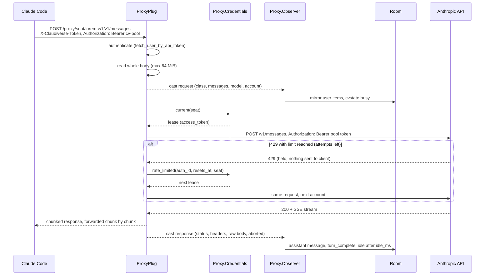
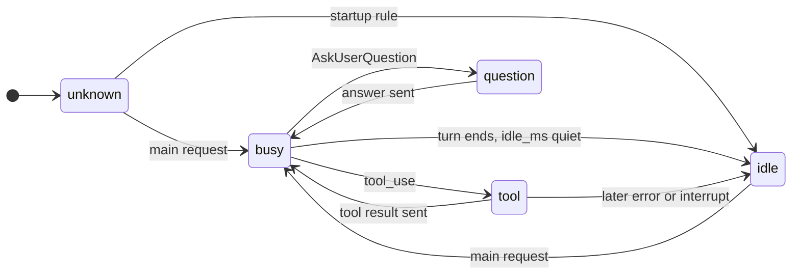

# The API proxy

The server can sit between Claude Code and the Anthropic API. Claude Code is pointed at `https://claudiverse.example/proxy/seat/<title>` instead of `https://api.anthropic.com`. The proxy relays every request byte for byte and streams the response back. On the side it does two things:

- **Observes** the traffic. It reconstructs the conversation (prompts, tool results, assistant replies) and the seat's readiness (busy, tool, question, idle) from the requests and responses alone, and feeds them into a Room, so the web panel, `idle` tracking and watcher pings work without a sidecar.
- **Supplies the credential** for pooled seats. A seat that sends the placeholder token `cv-pool` (or the header `X-Claudiverse-Pool: 1`) has its request sent upstream with a token leased from the [account pool](account-pool.md), and a 429/401 from the API is retried on another account before Claude Code ever sees it.

The proxy runs beside the patched-binary/sidecar system, not instead of it. A seat can feed both.

## How it works

`ClaudiverseServerWeb.ProxyPlug` is mounted in `ClaudiverseServerWeb.Endpoint` **before** `Plug.Parsers`. The body of a model request is the whole conversation (hundreds of KB, several MB late in a session) and must reach the API unmodified, so nothing may parse it first. The plug handles every request whose path starts with `/proxy` and halts it; every other request passes through to the rest of the endpoint untouched.

Invariants stated in the code:

- Observation never touches the traffic. Bytes are forwarded as they arrive; parsing and bookkeeping happen in `Proxy.Observer` by `GenServer.cast`, so neither a parse failure nor SQLite is on the path of a model call. Request observation is wrapped in `rescue`: whatever fails, the request still goes upstream.
- A seat's own `Authorization` header goes upstream untouched (non-pooled seats) and is never stored.
- Pool tokens never leave the server except towards the API.
- The claudiverse token is required. Without it the proxy would be an open relay to the Anthropic API.

### Request flow



Step by step:

1. **Routing.** `Request.route/2` takes the path after `/proxy`. `["seat", <seat>, ...rest]` gives seat `<seat>` (URI-decoded) and upstream path `/<rest>`. Without a `seat` segment the seat comes from the `x-claudiverse-seat` header, else `nil`, and the whole remainder is the upstream path. The query string is forwarded.
2. **Authentication.** See [Auth](#authentication) below.
3. **Body.** The plug reads the whole request body (`read_body` in 8,000,000-byte chunks, 60 s read timeout) and refuses anything over 64 MiB with 413.
4. **Observation hook.** Unless `X-Claudiverse-Observe: off` is present, `observe_request` runs. It only observes a request that is a `POST`, has a non-empty `x-claude-code-session-id` header, and whose upstream path starts with `/v1/messages`. The body is JSON-decoded; a failure is logged and the request is simply not observed. It casts `Observer.request/4` and returns a closure that casts the response later.
5. **Credential.** If the request is pooled (see below) the pool token is looked up; otherwise the request is forwarded as is.
6. **Forwarding.** Finch sends the request and streams the response back (see [Streaming](#streaming)).
7. **Response observation.** When the exchange ends the closure is called with the status (or `499` if none arrived), response headers, the full raw body and an `aborted` flag.

### Authentication

The claudiverse API token goes in the `X-Claudiverse-Token` header. A seat sets it with `ANTHROPIC_CUSTOM_HEADERS="X-Claudiverse-Token: <token>"`. The token is checked with `Accounts.fetch_user_by_api_token/1`: any API token for a user is accepted; a per-machine `host:<name>` token is rejected (it exists only to join that host's channel).

On failure the proxy answers **403** `permission_error` (`cv-proxy: missing or invalid X-Claudiverse-Token`). It is deliberately 403, not 401: a 401 tells Claude Code its OAuth token is bad and starts a refresh, which is not what went wrong.

One exception: Claude Code's reachability probe, `HEAD` or `GET` on a path ending in `api/hello`, carries none of `ANTHROPIC_CUSTOM_HEADERS`, so it could never authenticate. It is answered `200` with an empty body without contacting upstream and without a token. Any other unauthenticated request is refused.

### Pointing a seat at the proxy

The documented launch environment (from the `ProxyPlug` moduledoc):

| Variable | Value | Purpose |
|---|---|---|
| `ANTHROPIC_BASE_URL` | `https://claudiverse.example/proxy/seat/<title>` | Send API traffic through the proxy; `<title>` is the seat name. |
| `ANTHROPIC_CUSTOM_HEADERS` | `X-Claudiverse-Token: <claudiverse api token>` | Authenticates the seat to the proxy. |
| `CLAUDE_CODE_GATEWAY_HINT_HEADERS` | `1` | Makes Claude Code send `x-claude-code-request-class`, the authoritative request class (see [Request classes](#request-classes)). |
| `CLAUDE_CODE_OAUTH_TOKEN` | `cv-pool` | Optional. Makes the seat a pooled seat (see below). |

For how seats are set up in practice, see the [first seat guide](../../guide/4-first-seat.md) and the [machine guide](../../guide/3-machine.md). The proxy's own error messages are listed in the guide's [troubleshooting page](../../guide/6-troubleshooting.md).

### Opt-in request headers

These headers are consumed by the proxy and never sent upstream.

| Header | Effect |
|---|---|
| `X-Claudiverse-Token` | Authentication (required). |
| `X-Claudiverse-Seat` | Seat name when the URL has no `/seat/<title>` segment. |
| `X-Claudiverse-Pool: 1` | Make this request pooled while the seat keeps its own login (see below). |
| `X-Claudiverse-Observe: off` | Relay without observing. For a seat that mirrors itself (the mod), which would otherwise be recorded twice. |
| `X-Claudiverse-Provides` | Comma-separated subset of `mirror`, `idle`, `compact`. Makes the seat's own Room row the target (see [Shadow and primary mode](#shadow-and-primary-mode)). Unknown names are dropped. |

### Headers stripped and added

Request headers removed before going upstream:

- Hop-by-hop and framing: `connection`, `keep-alive`, `proxy-connection`, `transfer-encoding`, `upgrade`, `te`, `trailer`, `host`, `content-length` (Finch recomputes the length).
- The five `x-claudiverse-*` headers above.
- `accept-encoding`, so the API answers uncompressed and the stream can be read as it passes.

Everything else, including `x-claude-code-*`, `anthropic-*`, `x-api-key` and `authorization`, is forwarded. For a pooled request `authorization` is replaced by `Bearer <pool token>`.

Response headers: everything except the hop-by-hop list is passed on, and `cache-control: no-transform` is added (or appended to an existing `cache-control`). Claude Code sends `accept-encoding: gzip` and Bandit would otherwise compress the relayed stream; `no-transform` makes Bandit leave the bytes alone.

### Streaming

The upstream call is `Finch.stream_while/5`. Each upstream event is handled as it arrives:

- On the headers event the proxy sends a chunked response to the client with the upstream status and headers.
- Each data chunk is written to the client immediately and also appended to a buffer kept for the observer.
- The Finch `receive_timeout` is 600,000 ms (10 minutes) **between chunks**, not overall, so a long generation can stream for as long as it keeps producing data.
- If the client closes the connection mid-stream (an interrupt, Esc in Claude Code), writing the chunk fails and the stream is halted. The exchange is recorded as `aborted`.
- An SSE `event: error` inside a 200 stream is detected (first 300 characters of the event line are kept) and logged as a warning.
- If the upstream fails after the response started, the exchange is logged and recorded as aborted. If it fails before any response (connection refused, DNS), the client gets **502** `api_error` (`cv-proxy: upstream unreachable: ...`).

Proxy-generated errors (403, 413, 429, 502) use the API's own error shape, `{"type":"error","error":{"type":"...","message":"..."}}`, so Claude Code reports and retries them as it would an upstream error.

### Pooled seats and failover

A request is **pooled** if either:

- its `Authorization` header equals `Bearer cv-pool` (`Proxy.Credentials.placeholder/0`), typically from `CLAUDE_CODE_OAUTH_TOKEN=cv-pool`; or
- it carries `X-Claudiverse-Pool: 1`.

The second form is for a seat that keeps its own login. Claude Code fetches its feature flags from `api.anthropic.com` directly, and a seat that holds only the placeholder falls back to anonymous flags, which turns plugin mods off. Such a seat needs its own login for what never reaches the proxy, while its model requests go out with the pool token. The seat's own `Authorization` is replaced, never relayed.

For a pooled request:

1. `Credentials.current(seat)` returns a lease (`auth_id`, `label`, `access_token`) or an error. On error the client gets **429** `rate_limit_error` (`cv-proxy: no pool account is available (<reason>)`) and nothing goes upstream.
2. The request is forwarded with `Authorization: Bearer <access_token>`.
3. A response status of **429 or 401** on a pooled request is **held**: headers and body are buffered and nothing is sent to the client.
4. Held 429 (attempts left): the proxy fails over only if the account is really spent, meaning `anthropic-ratelimit-unified-status` is `rejected`, or `anthropic-ratelimit-unified-reset` (Unix seconds) is more than 60 seconds in the future. Then `Credentials.rate_limited(auth_id, resets_at, seat)` cools the account and returns the next lease, and the same request is retried. A short or unexplained 429 is relayed as is and cools nothing.
5. Held 401 (attempts left): `Credentials.unauthorized(auth_id, seat)` forces one token refresh and the request is retried on the lease it returns.
6. Any other held response, a failed pool call, or the last attempt is relayed to the client as received (buffered body, upstream status and headers).

A request makes at most **3 upstream attempts** (`@pool_attempts`). The observer sees the request once and only the final response.

`Proxy.Credentials` is a single GenServer holding one cached lease for all pooled seats:

- The lease comes from `AnthropicAuths.lease/0`. It is cached so the lease (which writes `last_leased_at` and may refresh a token over HTTP) is not on the path of every model call.
- It is renewed when it is within 120 seconds of its expiry, when it is older than 5 minutes (so seats move back to the preferred account once it recovers), or when the API rejects it.
- **In-flight guard**: when an account hits its limit every request in flight on it returns 429 at about the same time. Only a report naming the *current* lease's `auth_id` cools the account; a report about an account that is no longer current is dropped and the request is retried on the current lease. This prevents cooling the account just switched to.
- Which account a seat uses is recorded per seat (`AnthropicAuths.record_assignment/3`) when it changes, with `via` one of `proxy-lease`, `proxy-failover`, `proxy-renewal`.
- Credentials calls time out at 30 s.

See [account-pool.md](account-pool.md) for how accounts are enrolled, leased and cooled.

### Request classes

`Request.classify/2` labels each observed request. The `x-claude-code-request-class` header wins when present and non-empty (sent when `CLAUDE_CODE_GATEWAY_HINT_HEADERS` is set). Otherwise the body shape decides:

| Condition (first match) | Class |
|---|---|
| `x-claude-code-agent-id` header present | `subagent` |
| body is not a JSON object | `auxiliary` |
| `max_tokens == 1` | `probe` (the startup quota probe) |
| no `tools` array or empty | `auxiliary` (session titling, prompt suggestion) |
| otherwise | `main` |

Hinted values seen by the observer code are `main`, `subagent`, `compaction`, `auxiliary`, `probe` (and `workflow`, which the observer ignores). The account a request is billed to is read from `metadata.user_id` (a JSON string) field `account_uuid`.

`Request.assistant/2` rebuilds the assistant message from the response: an SSE stream (`content-type` containing `event-stream`) is folded from `message_start`, `content_block_start`/`delta`, `message_delta` events (text, thinking, signature and tool-input deltas); any other body is parsed as a JSON `message`. `Request.ratelimit/1` extracts the `anthropic-ratelimit-unified*` response headers.

### The observer

`ClaudiverseServer.Proxy.Observer` is one `GenServer` per Claude session id (the `x-claude-code-session-id` header), registered in `ClaudiverseServer.Proxy.Registry` and started on first sight under `ClaudiverseServer.Proxy.Supervisor` (a `DynamicSupervisor`, restart `:temporary`). It exits after 12 hours without traffic; the next request starts a new one that reuses the same row.

On start it creates its session row and Room after `init` returns (in `handle_continue`), so the database write never runs in the proxied request's process. A failure to register is logged and the observer keeps running without a Room (nothing is mirrored).

#### Shadow and primary mode

| Mode | When | Row written |
|---|---|---|
| shadow (default) | no `X-Claudiverse-Provides` | A **proxy-type session**: `type: proxy`, `title: "proxy:<seat>"` (or `proxy:<first 8 chars of the session id>` when the seat is unknown), `claude_session_id: "proxy:<claude session id>"`, `mode: json`, `status: running`. Every category is mirrored. |
| primary | `X-Claudiverse-Provides` names at least one valid category and the seat is known | The seat's **own row**: `type: sidecar`, `title: <seat>`, `claude_session_id: <claude session id>`. Whichever of proxy or sidecar arrives first creates it, the other reuses it (see `Sessions.create_session/1`). Only the provided categories are mirrored there. |

Provided categories:

| Category | What it mirrors |
|---|---|
| `mirror` | prompts, tool results, assistant replies, `turn_complete`, API errors, and the `proxy_*` markers |
| `idle` | readiness edges: `idle` messages and `cvstate` busy frames |
| `compact` | the `compact` signal |

A seat declares a category once it has retired the sidecar patch that produced it; two sources of the same signal would duplicate it. If a seat gets the unknown-only provides list (for example `foo`), it stays in shadow mode. Note that in primary mode without a seat name (no `/seat/` segment and no `X-Claudiverse-Seat`), the observer falls back to a shadow row.

Proxy-type rows are excluded from the title lookups used by sending, notifications, hosts, profiles and the zombie sweep (`type != :proxy`), so `cv_send lorem-w1` still resolves to the real seat. In the web panel they appear as separate sessions titled `proxy:<seat>`; see [sessions-and-rooms.md](sessions-and-rooms.md) for the session model.

#### What the observer mirrors

Messages sent to the Room with `Room.mirror_messages/2`:

| Message | When |
|---|---|
| `{"type":"user","message":m,"proxy_thread":t}` | New user-side items in a request: typed prompts, tool results, channel messages. `proxy_first: true` on the first request of a thread (only the newest user message is taken then; the rest is history). |
| `{"type":"assistant","message":msg,"proxy_thread":t}` | The reply rebuilt from the response. |
| `{"type":"turn_complete"}` | A main response with a stop reason other than `tool_use`. |
| `{"type":"compact"}` | A request of class `compaction`. |
| `{"type":"proxy_context_reset"}` | A main request whose history is shorter than the previous request's (after compaction). |
| `{"type":"proxy_interrupted","proxy_thread":t}` | The client hung up mid-stream. |
| `{"type":"proxy_api_error","status":s,"error":e,"proxy_thread":t}` | Response status 400 or above; `error` is the body's `error` object. Increments `counts.errors`. |
| `{"type":"proxy_account_changed","from":a,"to":b}` | The `account_uuid` in request metadata changed. |
| `{"type":"idle"}` and `{"type":"cvstate","idle":false,"tasks":[]}` | State edges (see below). `idle` is sent as an `idle` message, exactly as the sidecar's idle patch does, so `Router.went_idle` fires the same way. Busy is a `cvstate` frame, reconciled but not stored. |

Thread keys: `main` for the main thread, `agent:<agent id>` for a subagent (`agent:?` if the id is missing), `compaction` for compaction. Only the user side of the conversation is taken from a request, since the assistant side was already mirrored from the previous response. `<system-reminder>` text blocks (CLAUDE.md, environment, skills) are dropped from user messages and counted in `proxy_reminders_dropped`; a message made only of reminders is dropped.

An inbox prompt delivered by the seat's inbox hook is the exception: it arrives as a task notification whose body is a system reminder beginning `Message from the claudiverse orchestrator: `. The observer pulls the prompt out wherever it sits (string, text block, or inside a tool result when it lands mid-turn), unescapes the HTML-escaped form Claude Code uses in requests, and mirrors it as a separate user message with `proxy_source: "inbox"`.

#### Readiness state machine

The state is derived from the **main** thread's request lifecycle. Subagent traffic does not change main readiness; `auxiliary`, `probe` and `compaction` requests do not either (except the startup rule below).



Details:

- A main request increments `inflight_main` and sets `busy`.
- A main response with `stop_reason: tool_use` decrements the counter and sets `tool` (the client is running the tool), or `question` if one of the content blocks is a `tool_use` named `AskUserQuestion`.
- A main response that ends the turn (any other stop reason), an error response (status >= 400) or an aborted stream decrements the counter and, if no main request is in flight, schedules an idle check after `idle_ms`. If a new main request arrives first the check is cancelled (a queued message is sent the instant a turn ends, and a false idle that short would let a delivery race into a busy seat). If the idle check fires with no main request in flight, state becomes `idle`.
- **Startup idle**: a fresh seat sends no main request until someone prompts it, so no turn ever ends. But every start sends side requests (quota probe, session titling). When one of class `probe` or `auxiliary` completes while the state is still `unknown` and no main request is in flight, an idle check is scheduled with reason `startup`.
- A `compaction` or `subagent` response while already `idle` re-asserts idle with a `cvstate` frame `{"idle":true}`. The Room marks a seat busy on every message that is not `idle`, so mirroring a `/compact` run at the prompt would otherwise leave an idle seat reading busy.
- Blind spots, as stated in the code: a permission prompt looks like a slow tool, a dead process looks idle, and local-only commands are invisible. Hooks cover these; the proxy does not.

#### Rate-limit data

On every response the observer stores the `anthropic-ratelimit-unified*` headers with an `at` timestamp (ISO 8601) and the current `account`.

#### `GET /proxy/_status`

Returns a snapshot of every live observer. Requires `X-Claudiverse-Token`.

```bash
curl -s -H "X-Claudiverse-Token: $TOKEN" https://claudiverse.example/proxy/_status
```

```json
{
  "sessions": [
    {
      "claude_session_id": "c0ffee00-0000-4000-8000-000000000001",
      "session_id": 42,
      "seat": "lorem-w1",
      "mode": "shadow",
      "provides": [],
      "account": "00000000-0000-4000-8000-000000000002",
      "model": "claude-sonnet-5-5",
      "state": "idle",
      "since": "2026-10-10T09:15:00.123Z",
      "subagent_active": false,
      "counts": {"main": 12, "probe": 1, "auxiliary": 2, "errors": 0},
      "ratelimit": {"anthropic-ratelimit-unified-status": "allowed", "at": "2026-10-10T09:14:58.001Z", "account": "00000000-0000-4000-8000-000000000002"}
    }
  ]
}
```

`mode` is `primary` or `shadow`. `subagent_active` is true when a subagent request was seen in the last 30 seconds. `counts` is per request class plus `errors`. `ratelimit` is `null` until a response carried rate-limit headers. All users' observers are listed (the endpoint authenticates but does not filter by user). Observers that do not answer within 2 seconds are omitted.

## Configuration

| Key | Default | Read by | Meaning |
|---|---|---|---|
| `config :claudiverse_server, :proxy_upstream` | `"https://api.anthropic.com"` | `ProxyPlug` (read per request) | Base URL requests are forwarded to; the path and query string are appended. Used by tests to point at a local stub. |
| `config :claudiverse_server, :proxy_idle_ms` | `1500` | `Proxy.Observer` (read when an observer starts) | Debounce between a finished main exchange and the idle edge. |

No environment variables. Neither key is set in `config/*.exs`; defaults apply. Fixed in code: Finch pool `size: 64`, `conn_max_idle_time: 60_000` (the `default` pool of `ClaudiverseServer.Proxy.Finch`, started in `application.ex`); upstream `receive_timeout` 600,000 ms; max body 64 MiB; at most 3 pool attempts; observer inactivity timeout 12 hours; credentials relook 5 minutes and expiry margin 120 s.

Supervision (in `application.ex`): `Finch` named `ClaudiverseServer.Proxy.Finch`, `Registry` `ClaudiverseServer.Proxy.Registry` (unique keys), `DynamicSupervisor` `ClaudiverseServer.Proxy.Supervisor` (one-for-one), and the `ClaudiverseServer.Proxy.Credentials` GenServer. See [configuration.md](configuration.md) for the full config listing.

## Interface

| Method and path | Auth | Description |
|---|---|---|
| `GET /proxy/_status` | `X-Claudiverse-Token` | Observer snapshot, above. 200, or 403 without a valid token. |
| any method `/proxy/seat/:seat/*path` | `X-Claudiverse-Token` | Relay to `<proxy_upstream>/<path>`; seat named in the URL. |
| any method `/proxy/*path` | `X-Claudiverse-Token` | Relay to `<proxy_upstream>/<path>`; seat from `X-Claudiverse-Seat`. |
| `HEAD`/`GET /proxy/.../api/hello` | none | Answered 200 locally. |

Example, a model request as Claude Code would send it through the proxy:

```bash
curl -N https://claudiverse.example/proxy/seat/lorem-w1/v1/messages \
  -H "X-Claudiverse-Token: $TOKEN" \
  -H "Authorization: Bearer cv-pool" \
  -H "x-claude-code-session-id: c0ffee00-0000-4000-8000-000000000001" \
  -H "anthropic-version: 2023-06-01" \
  -H "content-type: application/json" \
  -d '{"model":"claude-sonnet-5-5","max_tokens":1024,"stream":true,
       "messages":[{"role":"user","content":"hello"}]}'
```

Proxy-generated responses:

| Status | `error.type` | Meaning |
|---|---|---|
| 403 | `permission_error` | Missing or invalid `X-Claudiverse-Token`. |
| 413 | `request_too_large` | Body exceeded 64 MiB, or the body read failed (message carries the reason). |
| 429 | `rate_limit_error` | Pooled request, but the pool has no account to lease. |
| 502 | `api_error` | Upstream unreachable before a response started. |

Everything else is the upstream's response.

## Failure modes and troubleshooting

- **`403 cv-proxy: missing or invalid X-Claudiverse-Token`.** The header is absent, not set via `ANTHROPIC_CUSTOM_HEADERS`, the token was revoked, or it is a host token (not accepted here). Use a user API token. See [Troubleshooting](../../guide/6-troubleshooting.md).
- **`429 cv-proxy: no pool account is available (...)`.** A pooled seat, but every pool account is cooling or none is enrolled; the reason is in the message and the server log (`[proxy] no pool credential`). Nothing reached the API. See [account-pool.md](account-pool.md).
- **A 429 reaches Claude Code on a pooled seat.** Either all 3 attempts hit limits, or the 429 was short/unexplained (reset within 60 s and status not `rejected`), which is relayed deliberately without cooling the account.
- **`502 cv-proxy: upstream unreachable`.** The server cannot reach `proxy_upstream` (DNS, egress, TLS). Check the server's outbound connectivity.
- **"Server error mid-response" in Claude Code.** The server log says who ended the stream: `upstream stream failed mid-response (...)` (the API side), `the client hung up mid-stream (an interrupt)`, or `upstream sent an error event mid-stream: ...`.
- **Seat shows busy forever / never idle.** The observer needs the main thread to complete a response. Check `GET /proxy/_status` for the seat's `state` and `since`. Without `CLAUDE_CODE_GATEWAY_HINT_HEADERS=1` the class falls back to body heuristics and may be wrong. A permission prompt shows as `tool`.
- **No `proxy:<seat>` session appears.** Observation only happens for `POST /v1/messages*` with an `x-claude-code-session-id` header and not with `X-Claudiverse-Observe: off`. The log line `[proxy] request observation failed` or `[proxy] could not register` names other causes.
- **Duplicate messages in a seat's row.** A seat that also mirrors via the sidecar or mod should send `X-Claudiverse-Observe: off`, or declare via `X-Claudiverse-Provides` only what it no longer gets elsewhere.
- **Proxied requests are slow on large sessions.** The whole body is buffered before forwarding (needed for failover and observation), so first-byte latency includes receiving the full request.

## Related pages

- [The Anthropic account pool](account-pool.md): enrolment, leasing, cooldowns behind `Proxy.Credentials`.
- [Sessions and Rooms](sessions-and-rooms.md): the `proxy` session type and Rooms.
- [HTTP mirror, inbox long-poll and liveness](mirror-inbox-liveness.md): mirroring, the inbox hook and the zombie sweep (which skips proxy rows).
- [Questions and permission relays](questions-and-permissions.md): `AskUserQuestion` handling.
- [Configuration](configuration.md), [Accounts, sign-up and tokens](auth.md)
- Guide: [first seat](../../guide/4-first-seat.md), [machine](../../guide/3-machine.md), [troubleshooting](../../guide/6-troubleshooting.md)
- Runners and tools: [cv-spawn.sh: starting a seat](../runners/cv-spawn.md)
- Host agent: [Local relay](https://github.com/Promises/claudiverse-host-agent-oss/blob/main/docs/reference/relay.md)

## Source

- `claudiverse_server/lib/claudiverse_server_web/proxy_plug.ex`
- `claudiverse_server/lib/claudiverse_server/proxy/credentials.ex`
- `claudiverse_server/lib/claudiverse_server/proxy/observer.ex`
- `claudiverse_server/lib/claudiverse_server/proxy/request.ex`
- `claudiverse_server/lib/claudiverse_server_web/endpoint.ex`
- `claudiverse_server/lib/claudiverse_server/application.ex`
- `claudiverse_server/lib/claudiverse_server/sessions/session.ex`
- `claudiverse_server/test/claudiverse_server_web/proxy_plug_test.exs`
