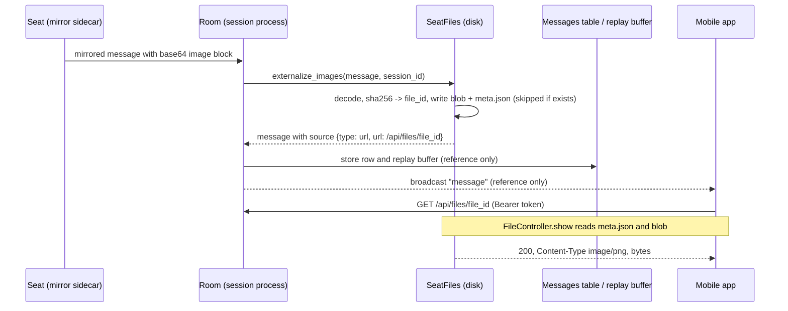

# App builds and seat files

Two small file stores on the server's data volume:

- **App builds** (`ClaudiverseServer.AppBuilds`): the Android app's self-update store. The app, or a release script holding an `app` or `super` token, publishes a signed APK; every installed app downloads the latest one from the server. The server only stores and serves it; Android enforces the signing key and the app checks the sha256.
- **Seat files** (`ClaudiverseServer.SeatFiles`): files the operator's app sends to a seat, and images that a seat mirrors. Seats run on other hosts, so a file is stored on the server and the seat fetches it over HTTP with its own token. Mirrored images are moved out of message payloads into the same store so that a screenshot (about 120K characters of base64) is not kept in the message row, held in the replay buffer and sent to every viewer.

For how the apps are installed and updated, see [the apps guide](../../guide/5-apps.md).

## How it works

### App builds: one build, replaced only on success

Only one build is kept. A publish copies the upload to a random file name (`<16 url-safe base64 chars>.apk`, from 12 random bytes) under the build directory, computes its sha256, inserts an `app_builds` row, and only then deletes every other row and its file (rows first, then files, so a crash leaves at worst an orphan file and never a row pointing at nothing). If the copy or the insert fails, the new file is removed and the previous build is untouched. There is no history of older builds; once replaced, the old build's id returns 404 on download.

`latest/0` picks the build with the highest `version_code` (ties broken by highest `id`), so it stays correct even if more than one row ever existed.

`app_builds` table (migration `20261004000000_create_app_builds.exs`):

| Column | Type | Notes |
|---|---|---|
| `id` | integer | primary key |
| `version_code` | integer, not null | must be greater than 0 |
| `version_name` | string, not null | at most 100 characters |
| `commit` | string | optional |
| `notes` | text | optional, at most 20 000 characters |
| `sha256` | string, not null | lowercase hex, computed by the server |
| `size` | bigint, not null | bytes, taken from the uploaded temp file |
| `file` | string, not null | file name under the build directory (server-generated, never client-chosen) |
| `inserted_at`, `updated_at` | utc_datetime | |

### Seat files: one directory per file

Each file gets a directory under the seat-files directory:

```
<seat_files_dir>/<file_id>/meta.json   name, size, session_id, uploaded_at (and media_type for mirrored images)
<seat_files_dir>/<file_id>/blob
```

The original file name lives only in `meta.json`, never in a path. `clean_name` keeps the last path segment, strips control characters and trims whitespace; an empty result, `.` or `..` becomes `file`. `file_id` is a 22-character url-safe base64 string (matched by `\A[A-Za-z0-9_-]{22}\z` before any filesystem access), so a request cannot steer the lookup outside the directory.

- **Uploads from the app** (`SeatFiles.store/3`): `file_id` is 16 random bytes, so every upload is a new file.
- **Mirrored images** (`SeatFiles.store_bytes/4`): content-addressed. `file_id` is the first 16 bytes of the sha256 of the image bytes, so the same picture mirrored twice (a replayed record, a second viewer) is stored once. The meta includes `media_type`.

### Image externalising

When a seat mirrors a message, the Room calls `SeatFiles.externalize_images(message, session_id)` before the message is stored, put in the replay buffer and broadcast. It walks the whole message at any depth (a user prompt's pasted image, an image inside a tool result) and replaces every inline base64 image block:

Before:

```json
{"type": "image", "source": {"type": "base64", "media_type": "image/png", "data": "iVBORw0KGgo..."}}
```

After:

```json
{"type": "image", "size": 48213,
 "source": {"type": "url", "url": "/api/files/<file_id>", "media_type": "image/png"}}
```

`size` is the decoded byte count. Only `image/png`, `image/jpeg`, `image/gif` and `image/webp` are moved. A block is left exactly as it was if the media type is not one of those, the base64 does not decode (whitespace is ignored), the image exceeds 25 MiB, or storing fails. If the server has no seat-files directory, the whole message is returned unchanged.

Call sites in `sessions/room.ex`: the general mirrored-message clause (every type except `stream_event`, whose fragments carry no images) and the agent-row clause (types in `@agent_types`). Clients resolve the relative `url` against the server base URL with their normal bearer token.



## Configuration

| Key / env var | Default | Effect |
|---|---|---|
| `DATABASE_PATH` (env) | none | If set and no explicit dir is configured, both stores live in the database's directory: `app-builds/` and `seat-files/`. Read at call time. |
| `config :claudiverse_server, :app_builds_dir` | `app-builds/` beside `DATABASE_PATH`, else none | Directory for APKs. |
| `config :claudiverse_server, :app_builds_max_bytes` | 100 MiB (`AppBuilds.max_bytes/0`) | Enforced size cap of an APK (mainly lets tests use a small cap). |
| `config :claudiverse_server, :seat_files_dir` | `seat-files/` beside `DATABASE_PATH`, else none | Directory for seat files and mirrored images. |

The seat-file cap (25 MiB, `SeatFiles.max_bytes/0`) is a compile-time constant with no config key.

If neither the key nor `DATABASE_PATH` is set, the directory is `nil` and the stores report "no storage" (see failure modes). See [configuration](configuration.md) for the full list.

### Request body limit

`endpoint.ex` configures `Plug.Parsers` with `{:multipart, length: AppBuilds.max_bytes() + 1_000_000}` (100 MiB + 1 000 000 bytes), raised from Plug's 8 MB default. It is evaluated at compile time from the constant, so setting `:app_builds_max_bytes` does not move it. Uploads are spooled to a temp file, not held in memory. Each store then enforces its own exact cap (25 MiB for seat files, 100 MiB or the configured value for builds). A body above the parser limit is rejected by Plug before any controller runs.

## Interface

All endpoints are under `/api` and need `Authorization: Bearer $TOKEN`. "App token" means a token whose context is `app` or `super` (`Accounts.app_powers?/1`); the shared `api` token that seats carry is not enough.

| Method and path | Token | Purpose |
|---|---|---|
| `POST /api/app/builds` | app or super | Publish a build, replacing the stored one |
| `GET /api/app/builds/latest` | any | Metadata and download URL of the stored build |
| `GET /api/app/builds/:id/apk` | any | Download the APK |
| `POST /api/sessions/:id/files` | app or super | Send a file to a seat's session |
| `GET /api/files/:file_id` | any | Download a seat file or mirrored image |

### POST /api/app/builds

Multipart form fields:

| Field | Required | Notes |
|---|---|---|
| `apk` | yes | file part |
| `version_code` | yes | integer greater than 0 |
| `version_name` | yes | at most 100 characters |
| `commit` | no | |
| `notes` | no | at most 20 000 characters |

```bash
curl -X POST https://claudiverse.example/api/app/builds \
  -H "Authorization: Bearer $TOKEN" \
  -F apk=@app-release.apk -F version_code=2058 -F version_name=1.0.2058 \
  -F commit=def456 -F notes="fixes"
```

Response `200`:

```json
{"id": 7, "version_code": 2058, "version_name": "1.0.2058", "commit": "def456",
 "notes": "fixes", "sha256": "<64 hex chars>", "size": 31457280,
 "inserted_at": "2026-10-04T12:00:00Z"}
```

| Status | Body `error` | Meaning |
|---|---|---|
| 403 | `publishing app builds is app-only` | token context is `api` |
| 400 | `multipart field "apk" is required` | no `apk` file part |
| 413 | `apk exceeds <bytes> bytes` | larger than the cap |
| 503 | `no build storage configured` | no build directory resolvable |
| 422 | `inspect` of the changeset errors | missing/invalid `version_code`/`version_name`, etc. |
| 500 | `store failed: <reason>` | filesystem error |

### GET /api/app/builds/latest

Same JSON as above plus `"url": "/api/app/builds/<id>/apk"`. `404 {"error": "no builds"}` if none.

### GET /api/app/builds/:id/apk

`200` with `Content-Type: application/vnd.android.package-archive` and `Content-Disposition: attachment; filename="claudiverse-<version_name>.apk"`. `404 {"error": "build not found"}` if `id` is not an integer, the row is gone (replaced), or the file is missing on disk. Compare the downloaded bytes with the `sha256` from `latest`.

### POST /api/sessions/:id/files

Multipart field `file` (the original `filename` is kept as the display name). The session must belong to the token's user.

```bash
curl -X POST https://claudiverse.example/api/sessions/$SESSION_ID/files \
  -H "Authorization: Bearer $APP_TOKEN" -F file=@notes.txt
```

Response `200`:

```json
{"file_id": "<22 chars>", "name": "notes.txt", "size": 1234, "url": "/api/files/<22 chars>"}
```

The server does not tell the seat itself; the app then sends the seat an ordinary message saying how to fetch the file.

| Status | Body `error` | Meaning |
|---|---|---|
| 403 | `file send is app-only` | token context is `api` (checked first; nothing stored) |
| 404 | `session not found` | no such session for this user |
| 400 | `multipart field "file" is required` | no `file` file part |
| 413 | `file exceeds 26214400 bytes` | over 25 MiB |
| 503 | `no file storage configured` | no seat-files directory resolvable |
| 500 | `store failed: <reason>` | filesystem error |

### GET /api/files/:file_id

Any valid token, so a seat can fetch with its own `CLAUDIVERSE_TOKEN`:

```bash
curl -H "Authorization: Bearer $TOKEN" -o notes.txt https://claudiverse.example/api/files/$FILE_ID
```

`200` with the blob. If the stored `media_type` is one of the four image types the `Content-Type` is that type; everything else is `application/octet-stream`. `Content-Disposition` is `attachment` with an ASCII-sanitised `filename` plus `filename*=UTF-8''...` (RFC 6266) for the exact name. `404 {"error": "file not found"}` for a malformed id, a missing file, or no storage. Note that any valid token can read any file id (there is no per-session check on download); the id is unguessable (128 bits).

## Failure modes and troubleshooting

| Symptom | Cause | Action |
|---|---|---|
| 403 on publish or file send | A seat or web token (`api` context) was used | Use an app (or super) token. |
| 413 on an upload close to a limit | Per-store cap (25 MiB files, 100 MiB builds) or the parser limit (100 MiB + 1 000 000 bytes) | Shrink the file. Raising `:app_builds_max_bytes` above 100 MiB has no effect past the parser limit without a rebuild. |
| 503 "no ... storage configured" | Neither the directory key nor `DATABASE_PATH` is set | Set `DATABASE_PATH` (the Docker image does) or the `*_dir` key. See [deployment](deployment.md). |
| 422 on publish with `version_code`/`version_name` errors | Missing or invalid metadata | Send both fields; `version_code` > 0. |
| Download of an old build id returns 404 | Only the latest build is kept | Fetch `latest` again. |
| Images in old messages stay inline | They were mirrored before externalising, or were not storable (see above) | None; they are left as they were. |
| Image reference 404s after a volume change | Store lives beside the database; a new volume without `seat-files/` loses it | Keep `/data` across container swaps. |

There is no cleanup of seat files or mirrored images; they accumulate on disk.

## Related pages

- [Mirror, inbox and liveness](mirror-inbox-liveness.md): how seats mirror messages to the Room.
- [Sessions and Rooms](sessions-and-rooms.md)
- [Configuration](configuration.md), [Deployment](deployment.md)
- [Apps guide](../../guide/5-apps.md)
- Android: [Builds and updates](https://github.com/Promises/claudiverse-apps/blob/main/docs/android/builds-and-updates.md), [Seat controls](https://github.com/Promises/claudiverse-apps/blob/main/docs/android/seat-controls.md)
- Mac: [Images](https://github.com/Promises/claudiverse-apps/blob/main/docs/mac/images.md)

## Source

- `claudiverse_server/lib/claudiverse_server/app_builds.ex`
- `claudiverse_server/lib/claudiverse_server/app_builds/app_build.ex`
- `claudiverse_server/lib/claudiverse_server/seat_files.ex`
- `claudiverse_server/lib/claudiverse_server_web/controllers/app_build_controller.ex`
- `claudiverse_server/lib/claudiverse_server_web/controllers/file_controller.ex`
- `claudiverse_server/lib/claudiverse_server_web/endpoint.ex`
- `claudiverse_server/lib/claudiverse_server/sessions/room.ex`
- `claudiverse_server/priv/repo/migrations/20261004000000_create_app_builds.exs`
- `claudiverse_server/test/claudiverse_server_web/controllers/app_build_test.exs`
- `claudiverse_server/test/claudiverse_server_web/controllers/mirror_test.exs`
- `claudiverse_server/test/claudiverse_server_web/controllers/file_controller_test.exs`
