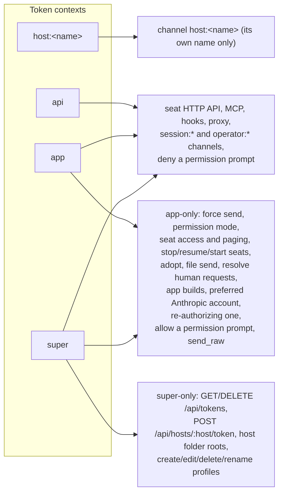

# Accounts, sign-up and tokens

The server has users and bearer tokens. A user is an email and a bcrypt-hashed password. Every API call, WebSocket connection and proxy request is authenticated by a token that belongs to a user. Tokens come in four kinds ("contexts"): `api`, `app`, `super` and `host:<name>`. The context decides what the token may do.

There is no open registration. The first account is created in the web panel with a one-time setup code that the server logs at boot. Every later account is created on the server itself with `mix claudiverse.register` or `Release.create_user/2`.

For the operator's view (first sign-in, adding accounts), see [1. The server](../../guide/1-server.md); for connecting a machine, see [3. A machine for seats](../../guide/3-machine.md).

## How it works

### Users

`ClaudiverseServer.Accounts.User` (table `users`: `email`, `hashed_password`, timestamps; unique index on `email`).

- `email`: required, must match `^[^\s]+@[^\s]+$`, at most 160 characters, unique (a duplicate is a changeset error on `email`).
- `password`: required, 8 to 72 characters. It is hashed with `Bcrypt.hash_pwd_salt/1` and only `hashed_password` is stored. The 72 limit is bcrypt's input limit.
- Checking a password for an unknown email runs `Bcrypt.no_user_verify/0` so a missing user takes about as long as a wrong password.

### Tokens

`ClaudiverseServer.Accounts.UserToken` (table `user_tokens`: `user_id`, `token`, `context`, `label`, `inserted_at`; no `updated_at`).

- A token is 32 random bytes (`:crypto.strong_rand_bytes/1`). The bearer value handed out is the URL-safe Base64 of those bytes (`Base.url_encode64/1`).
- The raw 32 bytes are stored in `token` as they are. They are **not hashed**: anyone who can read the SQLite file can use every token in it. Protect the data volume accordingly (see [deployment.md](deployment.md)).
- There is a unique index on `(context, token)` and an index on `user_id`. Deleting a user deletes their tokens (`on_delete: :delete_all`).
- **Tokens never expire.** A token lives until its row is deleted (logout, `DELETE /api/tokens/:id`, or deleting the user).
- `label` is a free-text name for the client a token was handed to. It is `nil` for tokens minted out of band. Whether a token has a label decides whether logout and the token list may revoke it (see below).

Lookup (`Accounts.fetch_api_token/1`) decodes the Base64, then finds a row whose context is in `api`, `app`, `super`, or matches `host:%`, and returns the user and the context.

### Token contexts

| Context | Issued by | May do |
| --- | --- | --- |
| `api` | `mix claudiverse.register`, `Release.create_user/2` (unlabelled, the fleet's shared token); `POST /api/auth/login` default scope (labelled); `connect_machine` (labelled with the machine name) | Everything a seat needs: the seat endpoints, MCP, hooks, proxy, reading, sending messages, joining `session:*` as seat or observer, `operator:*` topics. May not use any "app-only" or "super-only" operation. The web panel and the apps do not use `api`: the web panel signs in with `app`, the Mac and Android apps with `super`. |
| `app` | `POST /api/auth/login` with `scope: "app"` (labelled); `Release.create_app_token/1` (unlabelled) | All of `api`, plus the app-only operations (`app_powers?/1`). |
| `super` | `POST /api/auth/login` with `scope: "super"` (labelled); `Accounts.create_user_api_token(user, "super")` from a release `eval` | All of `app`, plus the super-only operations (`super_powers?/1`): managing hosts, profiles and the tokens themselves. |
| `host:<name>` | `POST /api/hosts/:host/token` (super only); `connect_machine` | Joining the channel `host:<name>` and nothing else. |

`Accounts.app_powers?(context)` is true for `app` and `super`. `Accounts.super_powers?(context)` is true only for `super`. A `host:` context is neither.

The reason for the split: every seat carries the one shared `api` token, so `api` alone cannot be allowed to do anything that would let one seat act on another or on the machine (force a message into a busy seat, allow a permission prompt, start or stop seats, send files). Those need the operator's own app or desktop token.



### What each context reaches

App-only (context `app` or `super`; `api` gets 403, or a channel error reply):

| Where | Operation |
| --- | --- |
| `POST /api/notify/send` | `force: true` (message into a busy seat). Refused before the session is looked up. |
| `POST /api/sessions/:id/permission_mode` | set a seat's permission mode |
| `POST /api/sessions/:id/access` | set a seat's access level |
| `POST /api/sessions/:id/notify` | seat paging switch |
| `POST /api/sessions/:id/human_requests/resolve` | resolve a seat's human requests |
| `POST /api/sessions/:id/files` | send a file to a seat |
| `POST /api/sessions/:id/stop`, `POST /api/sessions/:id/resume` | stop or resume a seat on a host |
| `POST /api/profiles/:id/start`, `.../restart`, `.../stop` | start, restart, stop a profile's seat |
| `GET /api/sessions/:id/adopt_preview`, `POST /api/sessions/:id/adopt` | adopt a seat into a profile |
| `POST /api/hosts/:host/spawn` | start a seat on a host |
| `POST /api/join_codes` | make a one-time join code for a new machine |
| app build upload (`AppBuildController.create`) | publish an app build |
| `POST /api/anthropic_auths/:id/preferred` | choose the preferred Anthropic account |
| `POST /api/anthropic_auths/:id/reauthorize/complete` | re-authorize an Anthropic account |
| channel `session:*`, event `send_raw` (observer) | keystrokes into a seat |
| channel `session:*`, event `permission_response` with `decision: "allow"` (observer) | allow a permission prompt. Any observer may deny. |

Super-only (context `super`; others get 403):

| Where | Operation |
| --- | --- |
| `GET /api/tokens`, `DELETE /api/tokens/:id` | list and revoke tokens |
| `POST /api/hosts/:host/token` | mint a host token |
| `POST /api/hosts/:host/roots`, `DELETE /api/hosts/:host/roots` | add or remove a folder the host serves |
| `POST /api/profiles`, `PATCH /api/profiles/:id`, `DELETE /api/profiles/:id`, `POST /api/profiles/:id/rename` | create, edit, delete, rename profiles |

Details of those endpoints are on their own pages: [sessions-and-rooms.md](sessions-and-rooms.md), [questions-and-permissions.md](questions-and-permissions.md), [profiles-and-hosts.md](profiles-and-hosts.md), [account-pool.md](account-pool.md), [app-builds-and-seat-files.md](app-builds-and-seat-files.md), [human-requests.md](human-requests.md), [access-and-notify.md](access-and-notify.md).

### The Auth plug

`ClaudiverseServerWeb.Plugs.Auth` guards every route in the `:authenticated` pipeline (everything under `/api` except `/api/health`, `/api/auth/login`, `/api/setup`).

1. It requires an `Authorization: Bearer <token>` header and looks the token up with `Accounts.fetch_api_token/1`.
2. A `host:<name>` token is refused here. Host tokens work only on the host channel.
3. On success it assigns `current_user`, `api_token` (the presented value), `token_context` and `client_identity`.
4. Any failure (no header, wrong scheme, unknown token, host token) answers `401 {"error":"Unauthorized"}` and halts.

The proxy (`ProxyPlug`) reads its token from the `X-Claudiverse-Token` header and uses `Accounts.fetch_user_by_api_token/1`, which also refuses host tokens. A bad token there is a 403 (not 401, because a 401 would make Claude Code try to refresh its OAuth token). See [api-proxy.md](api-proxy.md).

### Client identity header

Because all seats share one `api` token, `current_user` identifies the fleet, not the caller. A seat says who it is in the `X-Claudiverse-Client` header:

```
X-Claudiverse-Client: title=lorem-w1; id=<claude session id>; instance=<instance id>
```

- Fields are separated by `;`, each is `key=value`, values are percent-encoded (decoded with `URI.decode/1`). Unknown keys are ignored.
- Result assigned as `conn.assigns.client_identity`: `%{title, claude_session_id, instance_id}`, from `title`, `id`, `instance`. `instance` is the join key; the others are descriptive.
- `id` is empty on a seat's first request (the startup lease runs before Claude's session hook fires). That is expected.
- The parser never raises. A missing header, a malformed part, an empty value or a decode failure gives `nil` for that field. The header is a diagnostic, not a credential: it is not verified.

### The WebSocket token

`UserSocket.connect/3` requires a `token` connect param (`{token: "..."}`), looks it up with `Accounts.fetch_api_token/1` (so `host:` tokens are accepted here) and assigns `current_user`, `token_context` and `peer_ip`. A missing param or an unknown token refuses the connection. The socket id is `user_socket:<user id>`.

Channel checks on top of the context:

- `session:*` and `operator:*` joins are refused for host tokens (`"host tokens cannot join seats"`, `"host tokens cannot join operator topics"`).
- `host:<name>` is joinable only with a token whose context is exactly `host:<name>`; any other token gets `"this token may not join host:<name>"`.
- Within `session:*`, `send_raw` and an `allow` permission response need `app_powers?`.

### Setup-code sign-up

`ClaudiverseServer.Setup` is a GenServer that creates the first account.

- At boot, while the `users` table is empty, it generates a code and logs it at warning level inside a banner. The code is 20 random bytes (160 bits) in Base32, grouped as eight groups of four, e.g. `ABCD-EFGH-...`. Every boot makes a new code until an account exists, so the newest one in `docker compose logs server` is the valid one.
- A lost code can be replaced: `Setup.issue/0` returns `{:ok, code}` (and replaces any earlier code) or `{:error, :closed}` once an account exists. From a running release: `bin/claudiverse_server rpc 'IO.inspect(ClaudiverseServer.Setup.issue())'`.
- `Setup.sign_up(code, attrs)` creates the user only if no user exists and the code matches (constant-time compare, ignoring case, dashes and spaces). Calls are serialised in the GenServer, so two racing sign-ups create exactly one account.
- Once any account exists, the check `Setup.needed?/0` (the users table itself) is false and every sign-up is refused, with or without a code, including accounts made by `mix claudiverse.register` or `Release.create_user/2`.
- A wrong code does not consume the code. A successful sign-up drops it. A changeset error (bad email or password) keeps it valid.
- `config :claudiverse_server, ClaudiverseServer.Setup, at_boot: false` skips the boot code (used in tests).

### Login, logout, throttle

`POST /api/auth/login` and `POST /api/setup` share their pre-checks (`scope`, `client`, throttle) and both end by minting a token with label `client` (or the scope name if `client` is absent).

Scopes: `api` (default), `app`, `super`. Any other value, including `host:...`, is a 400. The token returned has the context equal to the scope.

`LoginThrottle` counts failed sign-ins per remote IP (`conn.remote_ip`), in memory (lost on restart). After `login_max_failures` (default 5) failures within `login_window_ms` (default 60000), further attempts from that address are refused with 429 until the oldest failure ages out, **even with the right password**. The check runs before the password is verified. A successful sign-in clears the address. A failed login, a wrong setup code and a setup attempt after the server is closed count as failures; an invalid email/password (422) on setup does not.

Behind a reverse proxy or Docker's userland proxy all clients may share one address, so the throttle then applies to everyone together. See [deployment.md](deployment.md).

Logout (`DELETE /api/auth/logout`) deletes **only the token presented**, never the user's other tokens (the fleet shares one `api` token, so revoking all would take every seat offline). It deletes an `api` token (labelled or not) and an `app` or `super` token only if it has a label, that is, if a sign-in handed it out. An `app` token minted out of band (`Release.create_app_token/1`, unlabelled) survives logout: the call still answers 200 `{"ok": true}` but the token keeps working.

### Host tokens

A host token is bound to its host name: `Accounts.create_host_token(user, name)` stores context `host:<name>`. The name must match `\A[A-Za-z0-9._-]{1,128}\z`, else `{:error, :bad_host_name}`. It is not labelled.

`Accounts.connect_machine(user, name)` mints both tokens a new machine needs: a host token bound to `name`, and an `api` seat token labelled `name`, so the token list shows which machine owns it. It returns `{:ok, %{seat_token: ..., host_token: ...}}`. The seat token goes to the machine's `claudiverse-seat` mod and host agent, the host token to the host agent. See [3. A machine for seats](../../guide/3-machine.md) and [profiles-and-hosts.md](profiles-and-hosts.md).

### Revoking tokens

`Accounts.revoke_token(user, id)` (behind `DELETE /api/tokens/:id`):

- a `host:<name>` token: deleted;
- an `api` token **with no label**: refused (`:protected`, 409), because it may be the fleet's shared seat token and deleting it takes every seat offline. Revoke that one on the server (delete the row, or restart seats with a new token);
- any other token (labelled `api`, `app`, `super`): deleted;
- an id that does not exist or belongs to another user: `:not_found` (404).

Revoking the token you are calling with is allowed.

## Configuration

| Key | Default | Meaning |
| --- | --- | --- |
| `config :claudiverse_server, :login_max_failures` | `5` | Failed sign-ins per remote IP allowed within the window. Test config sets 1,000,000. |
| `config :claudiverse_server, :login_window_ms` | `60_000` | The window in milliseconds. |
| `config :claudiverse_server, ClaudiverseServer.Setup, at_boot:` | `true` | Whether to issue and log a setup code at boot while no account exists. `false` in test. |

There are no environment variables for accounts or tokens; there is no server-side token env var. All tokens are database rows. See [configuration.md](configuration.md).

## Interface

All JSON. `Authorization: Bearer $TOKEN` where a token is required.

| Method and path | Auth | Purpose |
| --- | --- | --- |
| `GET /api/setup` | none | Does the server still need its first account? |
| `POST /api/setup` | none (setup code) | Create the first account and sign in. |
| `POST /api/auth/login` | none | Sign in, get a token. |
| `DELETE /api/auth/logout` | any non-host token | Revoke the presented token (rules above). |
| `GET /api/me` | any non-host token | Current user and token context. |
| `GET /api/tokens` | `super` | List the user's tokens. |
| `DELETE /api/tokens/:id` | `super` | Revoke one token. |
| `POST /api/hosts/:host/token` | `super` | Mint a host token. |

### GET /api/setup

```bash
curl https://claudiverse.example/api/setup
```
```json
{"setup_needed": true}
```

`false` once an account exists. It reveals nothing else.

### POST /api/setup

Body: `email`, `password`, `code` (all strings, required), and optionally `scope` and `client` as for login.

```bash
curl -X POST https://claudiverse.example/api/setup \
  -H 'Content-Type: application/json' \
  -d '{"email":"you@example.com","password":"a-long-password","code":"ABCD-EFGH-IJKL-MNOP-QRST-UVWX-YZ23-4567","scope":"super","client":"desktop"}'
```
```json
{"token":"<url-safe base64>","scope":"super","user":{"id":1,"email":"you@example.com"}}
```

| Status | Body | When |
| --- | --- | --- |
| 200 | as above | account created |
| 400 | `{"error":"email, password and code are required"}` | a field missing or not a string |
| 400 | `{"error":"scope must be one of api, app, super"}` / `{"error":"client must be 1-64 of A-Z a-z 0-9 space . _ -"}` | bad scope or client |
| 403 | `{"error":"this server already has an account; sign in instead"}` | an account exists, whatever the code |
| 403 | `{"error":"wrong setup code; use the newest one in the server's log"}` | wrong code |
| 422 | `{"errors":{"password":["should be at least 8 character(s)"]}}` | the account rules refuse the email or password; the code stays valid |
| 429 | see login | throttled |

### POST /api/auth/login

Body: `email`, `password` (required strings); `scope` (`api` default, `app`, `super`); `client` (optional device name, `^[A-Za-z0-9 ._-]{1,64}$`, shown in the token list).

```bash
curl -X POST https://claudiverse.example/api/auth/login \
  -H 'Content-Type: application/json' \
  -d '{"email":"you@example.com","password":"a-long-password","scope":"app","client":"pixel-10"}'
```
```json
{"token":"<url-safe base64>","scope":"app","user":{"id":1,"email":"you@example.com"}}
```

| Status | Body | When |
| --- | --- | --- |
| 200 | as above | signed in; the new token is labelled `client`, or the scope if `client` is absent |
| 400 | `{"error":"email and password are required"}` | missing or non-string fields |
| 400 | scope or client error as above | |
| 401 | `{"error":"Invalid email or password"}` | wrong email or password; counts as a failure |
| 429 | `{"error":"too many failed sign-ins; try again in 42 s","retry_after":42}` plus a `Retry-After: 42` header | throttled |

Each sign-in creates a new token; signing in twice gives two tokens.

### DELETE /api/auth/logout

```bash
curl -X DELETE https://claudiverse.example/api/auth/logout -H "Authorization: Bearer $TOKEN"
```
```json
{"ok": true}
```

Always 200 for an authenticated caller, whether or not the token was deleted (see the unlabelled `app`/`super` case above). After a real revoke the same token gets 401.

### GET /api/me

```bash
curl https://claudiverse.example/api/me -H "Authorization: Bearer $TOKEN"
```
```json
{"user":{"id":1,"email":"you@example.com"},"scope":"super"}
```

`scope` is the token's context (`api`, `app` or `super`). 401 with an invalid token.

### GET /api/tokens (super)

Never returns token values. `current` is true for the token making the request.

```bash
curl https://claudiverse.example/api/tokens -H "Authorization: Bearer $TOKEN"
```
```json
{"tokens":[
  {"id":7,"context":"super","label":"desktop","inserted_at":"2026-10-04T08:12:00","current":true},
  {"id":6,"context":"api","label":"lorem-mac","inserted_at":"2026-10-03T19:40:11","current":false},
  {"id":5,"context":"host:lorem-mac","label":null,"inserted_at":"2026-10-03T19:40:11","current":false}
]}
```

Newest first. 403 `{"error":"managing tokens needs the super (desktop) token"}` for other contexts.

### DELETE /api/tokens/:id (super)

```bash
curl -X DELETE https://claudiverse.example/api/tokens/6 -H "Authorization: Bearer $TOKEN"
```
```json
{"ok": true}
```

| Status | Body | When |
| --- | --- | --- |
| 200 | `{"ok":true}` | revoked |
| 400 | `{"error":"bad token id"}` | id not an integer |
| 403 | as above | not a super token |
| 404 | `{"error":"Not found"}` | no such id for this user |
| 409 | `{"error":"this may be the fleet's shared seat token; revoke it on the server"}` | unlabelled `api` token |

### POST /api/hosts/:host/token (super)

```bash
curl -X POST https://claudiverse.example/api/hosts/lorem-mac/token -H "Authorization: Bearer $TOKEN"
```
```json
{"name":"lorem-mac","token":"<url-safe base64>"}
```

Status 201. 400 `{"error":"host name must be 1-128 of A-Z a-z 0-9 . _ -"}` for a bad name; 403 `{"error":"managing machines needs the super (desktop) token"}`. Each call mints a new token; older ones for the same name stay valid until revoked. See [profiles-and-hosts.md](profiles-and-hosts.md).

### Release functions and mix task

In a built release there is no `mix`. Use `bin/claudiverse_server eval` (it starts only the repo and bcrypt, so it can run beside the running server). In Docker: `docker compose exec server bin/claudiverse_server eval '...'` (see [deployment.md](deployment.md)).

| Command | Effect |
| --- | --- |
| `ClaudiverseServer.Release.create_user("you@example.com", "password")` | Registers the user, prints `User created: ... (id: N)` and `API token: <token>`: an unlabelled `api` token, the fleet's shared seat token. Returns `{:ok, token}` or `{:error, changeset}` (prints the changeset errors). Also closes setup-code sign-up. |
| `ClaudiverseServer.Release.create_app_token("you@example.com")` | Prints `App token: <token>`: an unlabelled `app` token, never revoked by logout. `{:error, :no_user}` if the email is unknown. |
| `ClaudiverseServer.Release.connect_machine("you@example.com", "lorem-mac")` | Prints `Machine:`, `Seat token:` (`api`, labelled `lorem-mac`) and `Host token:` (`host:lorem-mac`). `{:error, :no_user}` or `{:error, :bad_host_name}`. |
| `ClaudiverseServer.Release.migrate()` | Runs pending migrations by hand (they normally run at boot). |
| `mix claudiverse.register you@example.com password` | Development equivalent of `create_user`: registers and prints the `api` token. Prints `Failed: field: message; ...` on validation errors, or a usage line if the arguments are not exactly two. |

## Failure modes and troubleshooting

| Symptom | Meaning | What to do |
| --- | --- | --- |
| `401 {"error":"Unauthorized"}` on any API call | no `Authorization: Bearer` header, unknown/revoked token, or a `host:` token | Sign in again; check the header. A host token is never valid on the HTTP API. |
| `403 ... is app-only` / `needs the super (desktop) token` | the token's context is too weak | Sign in with `scope: "app"` or `"super"`. |
| `429` on login with `retry_after` | five failed attempts from your address in 60 s | Wait `retry_after` seconds. Behind a proxy that hides client addresses, one user's mistakes lock out everyone. A server restart clears the counters. |
| `403 wrong setup code` | the code is not the newest, or has a typo | Use the newest code in the server log; dashes, spaces and case do not matter. Or `Setup.issue()` via `rpc` for a fresh one. |
| `403 this server already has an account` | the first account exists | Sign in. Add accounts with `Release.create_user/2`. |
| No setup code in the log | an account already exists, or `at_boot` is false | Check `GET /api/setup`. |
| `409` on token revoke | unlabelled `api` token, possibly the shared seat token | Revoke on the server only, knowing every seat using it goes offline. |
| WebSocket refuses to connect | missing `token` param or unknown token | Pass `{token: "..."}` in the socket params. |
| Channel join error `this token may not join host:<name>` | the token is not the host token for that exact name | Mint a host token for that name. |

## Related pages

- [1. The server](../../guide/1-server.md), [3. A machine for seats](../../guide/3-machine.md)
- [Deployment](deployment.md), [Configuration](configuration.md)
- [Profiles and the host channel](profiles-and-hosts.md), [The API proxy](api-proxy.md), [Questions and permission relays](questions-and-permissions.md), [Tool levels and paging](access-and-notify.md)
- [Data model](data-model.md)
- Mod: [Configuration reference](../services/mod/configuration.md)
- Web panel: [Setup, login and the session token](../services/web/setup-and-login.md)
- Runners and tools: [cv-mcp: the claudiverse MCP server (overview)](../runners/mcp.md)
- Host agent: [Installing and running the host agent as a service](../host-agent/install-and-service.md)
- Android: [Connecting to a server](https://github.com/Promises/claudiverse-apps/blob/main/docs/android/connecting.md)
- Mac: [Connecting](https://github.com/Promises/claudiverse-apps/blob/main/docs/mac/connecting.md), [Settings](https://github.com/Promises/claudiverse-apps/blob/main/docs/mac/settings.md)

## Source

- `server/api/lib/claudiverse_server/accounts.ex`
- `server/api/lib/claudiverse_server/accounts/user.ex`
- `server/api/lib/claudiverse_server/accounts/user_token.ex`
- `server/api/lib/claudiverse_server/setup.ex`
- `server/api/lib/claudiverse_server/login_throttle.ex`
- `server/api/lib/claudiverse_server/release.ex`
- `server/api/lib/mix/tasks/register.ex`
- `server/api/lib/claudiverse_server_web/plugs/auth.ex`
- `server/api/lib/claudiverse_server_web/controllers/auth_controller.ex`
- `server/api/lib/claudiverse_server_web/controllers/token_controller.ex`
- `server/api/lib/claudiverse_server_web/controllers/host_controller.ex` (host token minting)
- `server/api/lib/claudiverse_server_web/channels/user_socket.ex`
- `server/api/priv/repo/migrations/20260331202923_create_users.exs`
- `server/api/priv/repo/migrations/20261004020000_add_label_to_user_tokens.exs`
- `server/api/test/claudiverse_server_web/controllers/{auth_controller,setup,super_token}_test.exs`
