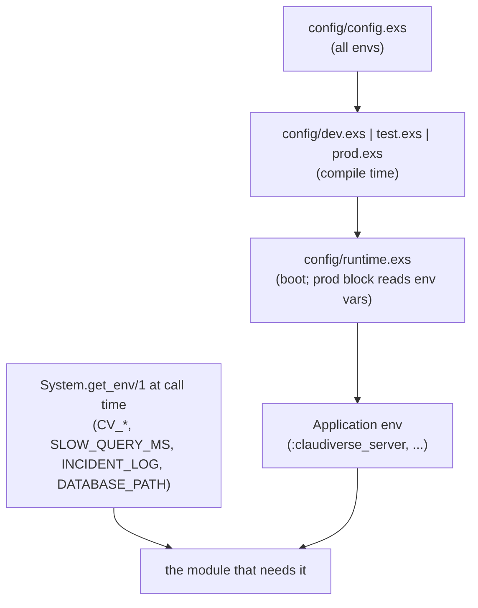

# Configuration

Everything the server reads from its environment, and every application
config key it reads at runtime, with defaults. The server has no config file
of its own beyond the standard Phoenix `config/*.exs`; production values come
from environment variables, read in `config/runtime.exs` at boot or by the
module that needs them.

There is **no server-side bearer token or admin password variable**. API
tokens live in the database (see [auth.md](auth.md)).

## How configuration is loaded



Two kinds of variable behave differently:

- **Read in `runtime.exs`** (`DATABASE_PATH` for the Repo, `SECRET_KEY_BASE`,
  `PHX_*`, `PORT`, `CHECK_ORIGIN`, `POOL_SIZE`, `DNS_CLUSTER_QUERY`,
  `SNAPSHOT_*`): read once at boot. Most of the `runtime.exs` block only runs
  when `MIX_ENV=prod`; `PHX_SERVER` is read in every environment.
- **Read by the module at call time** (`CV_VAULT_KEY`, `CV_USAGE_*`,
  `SLOW_QUERY_MS`, `INCIDENT_LOG`, and `DATABASE_PATH` for deriving file
  directories): read by the module whenever it needs the value, in any
  environment. They still need a restart in practice, because the process
  environment of a running release does not change.

## Environment variables

### Server and HTTP

| Variable | Default | Read in | Meaning |
|---|---|---|---|
| `SECRET_KEY_BASE` | none; **required in prod** (boot raises without it) | `runtime.exs` (prod) | Phoenix signing/encryption secret. Generate with `mix phx.gen.secret`. Dev and test use fixed values from `dev.exs`/`test.exs`. |
| `PHX_SERVER` | unset | `runtime.exs` (all envs) | Any value sets `server: true` on the endpoint, so a release starts the HTTP listener. The Docker image sets `PHX_SERVER=true`. |
| `PHX_HOST` | `example.com` | `runtime.exs` (prod) | Public host name used for URL generation. `compose.prod.yml` defaults it to `localhost`. |
| `PORT` | `4000` | `runtime.exs` (prod), `dev.exs` | Port the HTTP listener binds. In prod it binds all interfaces (`::`). In dev it binds `127.0.0.1`, or `0.0.0.0` when `DATABASE_PATH` is set (the dev container). |
| `PHX_SCHEME` | `http` | `runtime.exs` (prod) | Scheme of the public URL. Set `https` behind a TLS-terminating reverse proxy. |
| `PHX_URL_PORT` | value of `PORT` | `runtime.exs` (prod) | Port of the public URL. Set `443` behind a TLS-terminating reverse proxy. |
| `CHECK_ORIGIN` | unset → `false` | `runtime.exs` (prod) | WebSocket origin check. Unset or `false`: disabled (the web panel is served from another origin). `true`: Phoenix's default check against the endpoint host. Anything else: a comma-separated list of allowed origins, e.g. `https://panel.claudiverse.example`. |
| `DNS_CLUSTER_QUERY` | unset (clustering off) | `runtime.exs` (prod) | DNS name for `DNSCluster` node discovery. The server is designed to run as a single node (state such as Rooms, question holds and the seat inbox is in memory), so leave it unset. |
| `RELEASE_NAME` | set by the release | `application.ex` | Not something you set. When it is present (a built release), migrations run at boot; under `mix` they are skipped. |

### Database and files

| Variable | Default | Read in | Meaning |
|---|---|---|---|
| `DATABASE_PATH` | **required in prod**; dev: `claudiverse_server/claudiverse_server_dev.db` | `runtime.exs` (prod), `dev.exs`, and at call time by `SeatFiles`, `AppBuilds`, `IncidentLog` | Path of the SQLite database file. The Docker image sets `/data/claudiverse.db`. Its directory also holds `seat-files/`, `app-builds/` and `incidents.jsonl` unless overridden (below). |
| `POOL_SIZE` | `5` | `runtime.exs` (prod) | Ecto connection pool size. SQLite allows one writer at a time; keep it small. Pool starvation shows up as a high `queue` time in the slow-query log ([operations.md](operations.md)). |
| `INCIDENT_LOG` | `incidents.jsonl` beside `DATABASE_PATH` | `IncidentLog` | Path of the append-only 5xx log. If neither this nor `DATABASE_PATH` is set, no incidents are recorded. |
| `SLOW_QUERY_MS` | `500` | `SlowQueryLog` (at boot, when the handler attaches) | Queries slower than this many ms are logged at `warning`. Non-positive or non-numeric values fall back to 500. |

### Knowledge-store snapshots (prod only)

Read in the prod block of `runtime.exs` into the
`ClaudiverseServer.Knowledge.Custodian` config. See
[knowledge-backups.md](knowledge-backups.md).

| Variable | Default | Meaning |
|---|---|---|
| `SNAPSHOT_DIR` | unset → scheduled snapshots **off** | Directory for scheduled verified database snapshots. Setting it is what enables the custodian. |
| `SNAPSHOT_KEEP` | `7` | Number of snapshots kept; older ones are deleted. |
| `SNAPSHOT_EVERY_HOURS` | `24` | Interval between snapshots, in hours. |

### Anthropic account pool

See [account-pool.md](account-pool.md).

| Variable | Default | Meaning |
|---|---|---|
| `CV_VAULT_KEY` | unset → the pool is unconfigured | Base64 of exactly 32 random bytes; the AES-256-GCM key that encrypts stored account tokens. Generate with `mix run -e 'IO.puts Base.encode64(:crypto.strong_rand_bytes(32))'` (or `openssl rand -base64 32`). Without it the pool refuses to store or read credentials; it never falls back to plaintext. **Changing it makes every stored token undecryptable**: all accounts must be enrolled again. |
| `CV_USAGE_POLL` | enabled | Set to `0` to turn the usage poller off. Any other value, or unset, leaves it on. |
| `CV_USAGE_POLL_MS` | `300000` (5 min) | Interval between usage polls, in ms. Values under `30000` are ignored (the default is used). |
| `CV_USAGE_COOLDOWN_PCT` | `95` | Usage percentage at which the poller puts an account into cooldown. Must be 1–100, otherwise the default is used. |

### Docker Compose only

`compose.prod.yml` and `.env.example` also define variables the server never
reads itself:

| Variable | Used by | Meaning |
|---|---|---|
| `VITE_API_URL` | web image build | The API URL as the browser reaches it, baked into the web panel's JS bundle at build time. |
| `WEB_PORT` | `compose.prod.yml` | Host port the web panel is published on. |

## Application config keys

These are read with `Application.get_env(:claudiverse_server, key, default)`.
None is set in `config/prod.exs` or `runtime.exs`, so production runs on the
defaults below. Override one in a config file. These lines are examples (`inbox_max_wait_s` defaults to 60, not 30):

```elixir
# config/runtime.exs
config :claudiverse_server, inbox_max_wait_s: 30
config :claudiverse_server, ClaudiverseServer.Sessions.ZombieSweep, idle_ms: :timer.hours(1)
```

### Sessions, Rooms and seats

| Key | Default | Read by | Meaning |
|---|---|---|---|
| `:room_liveness_ms` | `60_000` | `Sessions.Room` | Interval of the Room's liveness check. A seat with no sidecar socket whose inbox poll is missing for 3 consecutive checks is marked stopped. See [mirror-inbox-liveness.md](mirror-inbox-liveness.md). |
| `:sidecar_grace_ms` | `20_000` | `Sessions.Room` | After the sidecar socket drops, how long the Room waits for it to reconnect before it marks the session stopped and broadcasts `session_ended`. Test config sets `100`. |
| `:mode_reply_ms` | `8_000` | `Sessions.Room` | How long a permission-mode change (`POST /api/sessions/:id/permission_mode`) waits for the seat's reply before it fails with a timeout. |
| `:inbox_stale_ms` | `120_000` | `Sessions.Room` | For a seat that also has a sidecar: when its last inbox poll is older than this and no poll is open, prompts queued for the inbox are handed to the sidecar instead. |
| `:inbox_max_wait_s` | `60` | `InboxController` | Upper bound on an inbox long-poll's `wait` (the default `wait` is 50 s). |
| `ClaudiverseServer.Sessions.ZombieSweep` | `[enabled: true, first_run_ms: 10 min, every_ms: 10 min, idle_ms: 30 min]` | `ZombieSweep` | Keyword list. `enabled: false` stops the sweeper starting (test config does this). |
| `ClaudiverseServer.Schedules.Scheduler` | `[enabled: true]` | `Schedules.Scheduler` | `enabled: false` stops its ticks (test config does this; tests call `Scheduler.tick/1`). See [schedules.md](schedules.md). |
| `ClaudiverseServer.AutoResume` | `[enabled: true, track: true, grace_s: 60]` | `AutoResume`, `AutoResume.Server`, `ProxyPlug` | `enabled: false`: no boot conversion, ticks or pool subscription; `track: false`: the proxy reports nothing (test config sets both; the auto-resume tests turn tracking on). `grace_s`: seconds after boot before a seat whose stream the restart cut gets its `continue`. See [auto-resume.md](auto-resume.md). |

### Questions and permission relays

See [questions-and-permissions.md](questions-and-permissions.md).

| Key | Default | Read by | Meaning |
|---|---|---|---|
| `:question_hold_ms` | 59 minutes | `HookController` | How long a held (non-polling) PreToolUse request for an AskUserQuestion waits for an answer; just under the hook's own 3600 s timeout, so the server answers first. |
| `:question_poll_hold_ms` | 24 hours | `HookController` | Upper bound on the life of a question the mod asks by polling. It only stops a question living for ever; a seat that stops polling is forgotten sooner. |
| `:permission_hold_ms` | 59 minutes | `HookController` | How long the PermissionRequest hook waits for a decision. |
| `:permission_keepalive_ms` | `10_000` | `HookController` | Interval of the keep-alive bytes written to a held permission request. |

### Hosts and profiles

See [profiles-and-hosts.md](profiles-and-hosts.md).

| Key | Default | Read by | Meaning |
|---|---|---|---|
| `:host_spawn_interval_ms` | `10_000` | `Hosts`, `Profiles` | Minimum gap between two spawns on the same host. `Profiles` waits this plus 500 ms between starts. |
| `:host_spawn_timeout_ms` | `120_000` | `Hosts` | How long a spawn or resume may take before it is reported failed. |
| `:host_adopt_timeout_ms` | `30_000` | `Hosts` | After a host reports a successful spawn, how long the server looks for the new seat's session row (polling every 500 ms) to link it to the spawn. Despite the name, it has nothing to do with adopt. |

### Runners

See [tasks-and-runners.md](tasks-and-runners.md).

| Key | Default | Read by | Meaning |
|---|---|---|---|
| `:runner_missing_after_ms` | `75_000` | `Runners` | A runner slot with no heartbeat for this long is reported missing. |
| `:runner_sweep_ms` | `15_000` | `Runners` | How often runner slots are checked. |

### API proxy

See [api-proxy.md](api-proxy.md).

| Key | Default | Read by | Meaning |
|---|---|---|---|
| `:proxy_upstream` | `"https://api.anthropic.com"` | `ProxyPlug` | Where proxied model requests are sent. |
| `:proxy_idle_ms` | `1500` | `Proxy.Observer` | After an `end_turn` response, how long the observer waits for another main request before it reports the proxied seat idle. |

### Files and uploads

See [app-builds-and-seat-files.md](app-builds-and-seat-files.md).

| Key | Default | Read by | Meaning |
|---|---|---|---|
| `:seat_files_dir` | `seat-files/` beside `DATABASE_PATH`, else none | `SeatFiles` | Where files sent to seats are stored. |
| `:app_builds_dir` | `app-builds/` beside `DATABASE_PATH`, else none | `AppBuilds` | Where uploaded Android builds are stored. |
| `:app_builds_max_bytes` | 100 MiB | `AppBuilds` | Size cap of an uploaded app build. The request parser's multipart limit is fixed at compile time to 100 MiB + 1 MB and does not follow this key. |
| `:incident_log` | unset | `IncidentLog` | Takes precedence over `INCIDENT_LOG`. |

Seat files have a fixed 25 MiB cap (`SeatFiles.max_bytes/0`); it is not
configurable.

### Auth

See [auth.md](auth.md).

| Key | Default | Read by | Meaning |
|---|---|---|---|
| `:login_max_failures` | `5` | `LoginThrottle` | Failed sign-ins per client address allowed within the window. Test config sets 1,000,000. |
| `:login_window_ms` | `60_000` | `LoginThrottle` | The window for `:login_max_failures`. |
| `ClaudiverseServer.Setup` | `[at_boot: true]` | `Setup` | `at_boot: false` stops the server issuing and logging a setup code at boot (test config does this). |

### Knowledge custodian

| Key | Default | Meaning |
|---|---|---|
| `ClaudiverseServer.Knowledge.Custodian` | `enabled: false`, `dir: <cwd>/snapshots`, `keep: 7`, `every_ms: 24 h`, `first_run_ms: 10 min` | Set from `SNAPSHOT_*` in prod; see above. A `nil` value counts as absent. |

## Troubleshooting

- **Boot fails with "environment variable DATABASE_PATH is missing" or
  "SECRET_KEY_BASE is missing".** Both are required when `MIX_ENV=prod`. The
  Docker image sets `DATABASE_PATH`; `compose.prod.yml` refuses to start
  without `SECRET_KEY_BASE` in `.env`.
- **The account pool says it is unconfigured, or an enrolment fails with
  "AnthropicAuths vault key is not set / not valid base64 / N bytes after
  base64 decode, needs exactly 32".** Set `CV_VAULT_KEY` to base64 of exactly
  32 bytes and restart.
- **Every stored account fails to decrypt after a redeploy.** `CV_VAULT_KEY`
  changed. Restore the old value, or enrol every account again.
- **The web panel cannot open its WebSocket.** `CHECK_ORIGIN` is set to an
  allowlist that does not contain the panel's origin. Add the origin or set
  `false`.
- **Generated URLs use the wrong scheme or port behind a reverse proxy.** Set
  `PHX_SCHEME=https` and `PHX_URL_PORT=443`.
- **No `incidents.jsonl` appears.** Neither `INCIDENT_LOG` nor `DATABASE_PATH`
  is set in the server's environment.

## Related pages

- [Deployment](deployment.md): the Docker image, Compose stack and
  upgrades.
- [../../DEPLOY.md](../../DEPLOY.md): the production runbook.
- [../../guide/1-server.md](../../guide/1-server.md): installing the server.
- [../../guide/2-accounts.md](../../guide/2-accounts.md): enrolling accounts
  (needs `CV_VAULT_KEY`).
- Mod: [Configuration reference](../services/mod/configuration.md)
- Host agent: [Configuration reference](https://github.com/Promises/claudiverse-host-agent-oss/blob/main/docs/reference/configuration.md)

## Source

- `claudiverse_server/config/config.exs`
- `claudiverse_server/config/dev.exs`
- `claudiverse_server/config/prod.exs`
- `claudiverse_server/config/runtime.exs`
- `claudiverse_server/config/test.exs`
- `claudiverse_server/lib/claudiverse_server/application.ex`
- `claudiverse_server/lib/claudiverse_server/anthropic_auths/vault.ex`
- `claudiverse_server/lib/claudiverse_server/anthropic_auths/usage_poller.ex`
- `claudiverse_server/lib/claudiverse_server/incident_log.ex`
- `claudiverse_server/lib/claudiverse_server/slow_query_log.ex`
- `compose.prod.yml`
- `.env.example`
