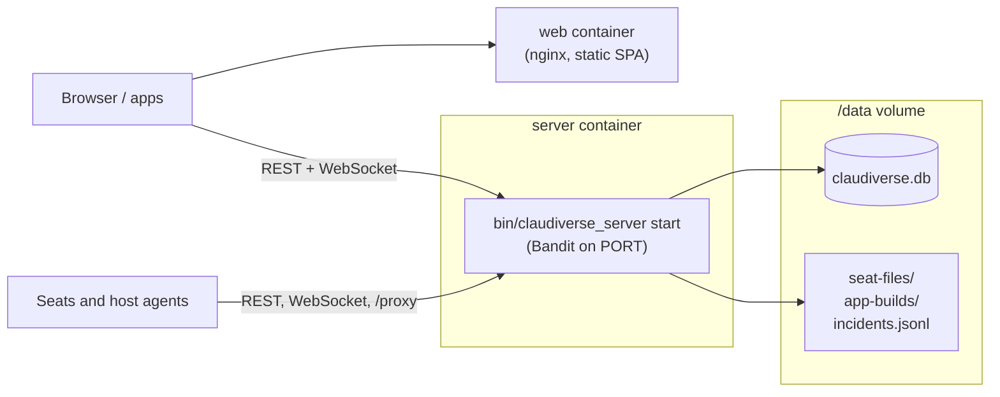
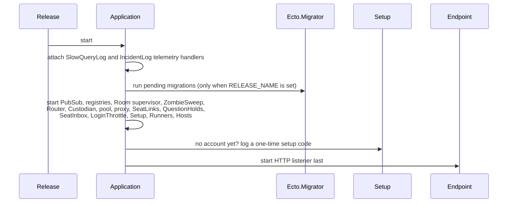

# Deployment

How the server is built, started and upgraded. The step-by-step production
runbook is [../../DEPLOY.md](../../DEPLOY.md), and a first install is walked
through in [../../guide/1-server.md](../../guide/1-server.md). This page
describes what those steps do inside the server, so you can deploy it some
other way or diagnose a deployment.

## What runs

The server is one Elixir release, `server/api`, with one SQLite
database file. It is designed to run as a **single node**: Rooms, the seat
inbox, question holds, seat links, runner slots, the notification queues and
the host registry all live in memory in that node. Two instances against one
database would each hold half of that state; don't run two.



The web panel is a separate static build served by nginx (`server/web/Dockerfile`); it
talks to the API cross-origin. It is not part of the server.

## The image

`server/api/Dockerfile` is a two-stage build:

1. **Build stage** (`elixir:1.19-otp-28-slim`): `mix deps.get --only prod`,
   `mix compile`, `mix release` with `MIX_ENV=prod`.
2. **Runtime stage** (`debian:trixie-slim`): the release plus `openssl`,
   `libstdc++6`, `libncurses6`, `ca-certificates`, `curl` (for the health
   check), `sqlite3` and `procps` (for diagnosis inside the container).

The runtime stage sets:

| Variable | Value |
|---|---|
| `DATABASE_PATH` | `/data/claudiverse.db` |
| `PHX_SERVER` | `true` |
| `PORT` | `4000` |
| `LANG`, `LC_ALL` | `en_US.UTF-8` |

It exposes port 4000 and runs `bin/claudiverse_server start`.
`SECRET_KEY_BASE` must come from the environment; the release refuses to boot
without it. All variables are listed in [configuration.md](configuration.md).

`server/api/Dockerfile.dev` is the development image used by the root
`compose.dev.yml`: it bind-mounts the source and runs
`mix ecto.create && mix ecto.migrate && mix phx.server` on port 4000.

## Compose stacks

| File | Purpose | Server port | Web |
|---|---|---|---|
| `compose.dev.yml` | Development: source mounted, code reloading, `MIX_ENV=dev`, database at `server/api/data/claudiverse_dev.db` | 4000 | Vite dev server on 5173 |
| `compose.yml` | Production: built images, named volume `claudiverse_db` at `/data` | `PORT` (default 4000) | nginx on `WEB_PORT` (default 8080) |

`compose.yml` also:

- caps container logs at 3 files of 10 MB each (the json-file driver has no
  limit by default, and the health check alone logs on every probe);
- health-checks the server with `curl -fsS http://localhost:$PORT/api/health`
  every 15 s (5 retries, 30 s start period), and starts `server/web` only once the
  server is healthy;
- passes `CV_VAULT_KEY`, `CV_USAGE_POLL`, `CV_USAGE_POLL_MS` and
  `CV_USAGE_COOLDOWN_PCT` through, so the account pool can be configured from
  `.env`. `CV_VAULT_KEY` is optional; without it the pool stays unconfigured
  and the rest of the server works.

## Boot sequence



- **Migrations run automatically at boot** in a release, as a child of the
  supervision tree, before anything else touches the database. Under `mix`
  (development) they are skipped; run `mix ecto.migrate` yourself.
  `ClaudiverseServer.Release.migrate/0` runs them out of band if you ever
  need to.
- The telemetry handlers are attached before the tree starts, so migrations
  are observed too.
- The endpoint starts last, so the health check only answers once everything
  else is up. `GET /api/health` returns `{"status":"ok"}` without auth.
- While no account exists, `Setup` logs a one-time setup code at `warning`
  level. Find it with
  `docker compose -f compose.yml logs server | grep -A3 "setup code"`.
  See [auth.md](auth.md).

## Release commands

A release has no `mix`. Operator tasks are functions in
`ClaudiverseServer.Release`, run in a short-lived node with `eval` (they start
only the Repo, so they work beside a running server):

```bash
docker compose -f compose.yml exec server bin/claudiverse_server eval \
  'ClaudiverseServer.Release.connect_machine("you@example.com", "lorem-mac")'
```

| Function | Prints | Use |
|---|---|---|
| `create_user(email, password)` | the user and an API token | create an account from a script |
| `create_app_token(email)` | an `app` token | a token for the operator's app; never expires, not revoked by logout |
| `connect_machine(email, name)` | a seat token and a host token | the tokens a new machine needs; `name` is 1–128 of `A-Z a-z 0-9 . _ -` |
| `migrate()` | nothing | run migrations out of band |

Some tasks need the running node instead (for example issuing a new setup
code with `ClaudiverseServer.Setup.issue/0`); use
`bin/claudiverse_server rpc '<expression>'` for those. Snapshot and mirror
commands are in [knowledge-backups.md](knowledge-backups.md); the mirror
tasks (export, verify, restore) exist only as mix tasks.

In development the equivalents are mix tasks, e.g.
`mix claudiverse.register you@example.com <password>`.

## Data on disk

Everything the server keeps is under the directory of `DATABASE_PATH`
(`/data` in the image):

| Path | What | Detail |
|---|---|---|
| `claudiverse.db` (plus `-wal`/`-shm`) | the SQLite database | [data-model.md](data-model.md) |
| `seat-files/` | files sent to seats | [app-builds-and-seat-files.md](app-builds-and-seat-files.md) |
| `app-builds/` | uploaded Android builds | same |
| `incidents.jsonl` | one JSON line per 5xx | [operations.md](operations.md) |
| `SNAPSHOT_DIR` (if set) | verified database snapshots | [knowledge-backups.md](knowledge-backups.md) |

Back up the whole volume, not only the database: seat files and app builds
are stored only as files there. The database runs in WAL mode, so a plain `cp`
of `claudiverse.db` while the server is writing can miss committed data that
is still in the `-wal` file; use a verified snapshot instead: the scheduled custodian (`SNAPSHOT_DIR`), or
`bin/claudiverse_server rpc 'ClaudiverseServer.Knowledge.Backup.snapshot("/data/snapshots")'`
on demand. See [knowledge-backups.md](knowledge-backups.md).

## Upgrades

Rebuild the image and recreate the container (see
[../../DEPLOY.md](../../DEPLOY.md), section 8). Expect:

- pending migrations to run on boot;
- every in-memory state to start empty: Rooms are recreated lazily as seats
  mirror, poll or reconnect; queued notification pings, queued inbox prompts
  and open question holds are lost; runner slots reappear with their next
  heartbeat (within about 30 s); host agents reconnect on their own;
- `ZombieSweep` to wait 10 minutes after boot before its first sweep, so seats
  have time to reconnect before their rows are judged.

Keep `CV_VAULT_KEY` and `SECRET_KEY_BASE` unchanged across upgrades. A new
`CV_VAULT_KEY` makes every stored account token undecryptable.

## Behind a reverse proxy

- Set `PHX_SCHEME=https` and `PHX_URL_PORT=443` so generated URLs are right.
- Forward WebSocket upgrades on `/socket`.
- Do not buffer responses on `/api/seats/*/inbox`, `/api/hooks/*`,
  `/api/mcp/*` and `/proxy`: they are long-polls, held requests, SSE and
  streamed model responses. Allow read timeouts above 60 minutes for
  `/api/hooks/*` (held hooks wait up to 59 minutes) and above 60 s for the
  inbox poll.
- `LoginThrottle` counts failed sign-ins per client address. Behind a proxy
  that hides the client address, every client shares one address and the
  throttle applies to all of them together.

## Troubleshooting

| Symptom | Cause | Action |
|---|---|---|
| Container exits at boot: `environment variable SECRET_KEY_BASE is missing` | Not set in `.env` | Generate one (`mix phx.gen.secret` or `openssl rand -base64 48`). |
| Container exits at boot: `DATABASE_PATH is missing` | Running a prod release outside the image without it | Set `DATABASE_PATH`. |
| Health check never passes | Boot failed (often a migration) or the port is wrong | `docker compose -f compose.yml logs server`. |
| No setup code in the log | An account already exists, or the code scrolled away | Sign in, or issue a new code with `bin/claudiverse_server rpc 'ClaudiverseServer.Setup.issue()'` (works only while no account exists). |
| Seats all show disconnected right after an upgrade | In-memory state was reset | Wait for seats to reconnect; see [mirror-inbox-liveness.md](mirror-inbox-liveness.md). |
| Disk filling | Container logs without a cap, or snapshots kept too long | Use the log caps in `compose.yml`; lower `SNAPSHOT_KEEP`. |

## Related pages

- [Configuration](configuration.md): every variable and config key.
- [Operations: health, incidents and slow queries](operations.md): health, incident and slow-query logs.
- [Data model](data-model.md): the tables and migrations.
- [Accounts, sign-up and tokens](auth.md): the setup code, accounts and tokens.
- [../../DEPLOY.md](../../DEPLOY.md), [../../guide/1-server.md](../../guide/1-server.md),
  [../../guide/6-troubleshooting.md](../../guide/6-troubleshooting.md).
- Web panel: [Building and serving the panel](../services/web/build-and-deploy.md)

## Source

- `server/api/Dockerfile`
- `server/api/Dockerfile.dev`
- `compose.dev.yml`
- `compose.yml`
- `.env.example`
- `server/api/config/runtime.exs`
- `server/api/lib/claudiverse_server/application.ex`
- `server/api/lib/claudiverse_server/release.ex`
- `server/api/lib/claudiverse_server/setup.ex`
- `server/api/lib/claudiverse_server_web/controllers/health_controller.ex`
