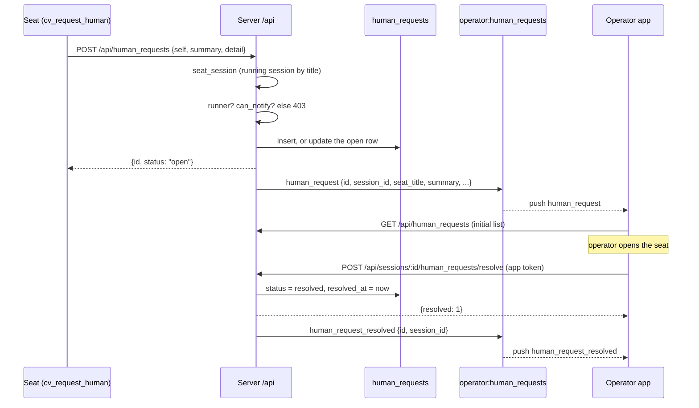
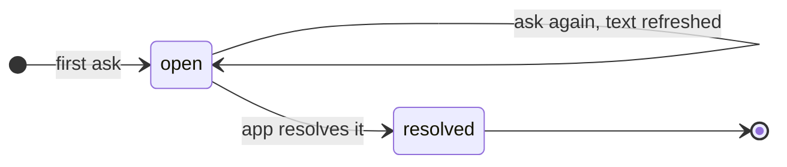

# Human requests

A human request is a seat asking the operator (the human) to come to it: "I am blocked, I need a decision". The server stores the request, pushes it live to the operator's apps on a Phoenix channel, and marks it resolved when an app says the operator has opened the seat. The apps turn the push into a phone notification; the server itself sends nothing to the phone.

The seat side is the MCP tool `cv_request_human` in `agent/tools/cv-mcp.mjs`, which calls `POST /api/human_requests`. For what the apps do with it, see [the apps guide](../../guide/5-apps.md).

## How it works

- **Who may ask.** `HumanRequests.request/3` refuses a seat whose `origin` is `runner` (always, whatever else is set). Any other seat must be allowed to page: `Sessions.Access.can_notify?/1` is true when the operator's paging switch (`notify_grant`, within its optional `notify_until`) is on, or, with no active switch, when the seat's derived default is true. The derived default is: true for access level `notify`; false for `origin: "plain"` sessions; otherwise the seat's own `can_notify` flag, which its launcher sets by registering with `notify=1` (the seat's environment variable `CLAUDIVERSE_NOTIFY=1`). The operator's switch is set with `POST /api/sessions/:id/notify`; see [access-and-notify.md](access-and-notify.md).
- **One open request per seat.** If the seat already has a request with status `open`, asking again updates its `summary` and `detail` in place and force-bumps `updated_at` (so a repeat ask always shows as recent even if the text is unchanged). The `id` stays the same. A looping seat therefore cannot create more than one open row.
- **Every ask broadcasts.** New and refreshed requests both broadcast a `human_request` event on the PubSub topic `operator:human_requests:<user_id>`.
- **Resolution is manual only.** The only code path that sets `status` to `resolved` is `HumanRequests.resolve_session/2`, called by `POST /api/sessions/:id/human_requests/resolve`, which only an app token may call. Nothing in the server resolves a request automatically: not the seat ending, not a question being answered, not the seat replying. The one other way a request disappears is deletion of its session or user, since the migration declares both foreign keys `on_delete: :delete_all`; no `human_request_resolved` event is broadcast in that case.
- **Resolve is per seat, not per request.** It resolves every open request of that session (in practice at most one) and broadcasts one `human_request_resolved` per row.



State machine of a request:



A later ask by the same seat after resolution creates a new row.

## The `HumanRequest` record

Table `human_requests` (migration `20261003000100_create_human_requests.exs`), schema `ClaudiverseServer.HumanRequests.HumanRequest`.

| Field | Type | Notes |
|---|---|---|
| `id` | integer | Primary key. |
| `session_id` | integer | The asking seat's session. Required. Cascade-deleted with the session. |
| `user_id` | integer | Owner. Required. Cascade-deleted with the user. |
| `summary` | text | Required, 1 to 500 characters. |
| `detail` | text | Optional, at most 10000 characters. |
| `status` | string | `open` (default) or `resolved`. |
| `resolved_at` | utc datetime | Set when resolved; otherwise null. Not included in the JSON. |
| `inserted_at`, `updated_at` | utc datetime | Second precision. `updated_at` is bumped on every re-ask. |

Indexes: `(session_id, status)` and `(user_id, status)`.

The JSON form (`HumanRequests.serialize/2`) has exactly: `id`, `session_id`, `seat_title`, `summary`, `detail`, `status`, `inserted_at`, `updated_at`. `seat_title` is the session's current `title`.

## Configuration

None for the server. The seat-side opt-in is the environment variable `CLAUDIVERSE_NOTIFY=1` in the seat's launcher environment. `cv-mcp.mjs` registers `cv_request_human` only when the seat's role is not `worker` and `CLAUDIVERSE_NOTIFY` is `1` (or the MCP runs in its dynamic mode); the server enforces the same rule independently. The operator can override paging per seat from the app, see [access-and-notify.md](access-and-notify.md).

## Interface

All HTTP endpoints are under `/api` and need `Authorization: Bearer $TOKEN`; requests are scoped to the token's user.

| Method and path | Token | Purpose |
|---|---|---|
| `POST /api/human_requests` | any authenticated token (seats use the shared `api` token) | Open or refresh the seat's request. |
| `GET /api/human_requests` | any authenticated token | List the user's requests. |
| `POST /api/sessions/:id/human_requests/resolve` | token context `app` or `super` only | Resolve the seat's open requests. |

### POST /api/human_requests

| Param | Type | Notes |
|---|---|---|
| `self` | string | The asking seat's title. If omitted, the title from the caller's client identity (`X-Claudiverse-Client` header, parsed in `plugs/auth.ex`) is used. |
| `summary` | string | Required, non-empty. Over 500 characters is a 422. |
| `detail` | string | Optional. Over 10000 characters is a 422. |

The seat is resolved to the user's session with that title whose status is `running` (`McpController.seat_session/2`).

```bash
curl -s -X POST https://claudiverse.example/api/human_requests \
  -H "Authorization: Bearer $TOKEN" -H 'Content-Type: application/json' \
  -d '{"self":"lorem-orchestrator","summary":"Need a decision on the schema change","detail":"Two options, see the forum post."}'
# {"id":12,"status":"open"}
```

| Status | Body | Meaning |
|---|---|---|
| 200 | `{"id": 12, "status": "open"}` | Created, or the existing open request was updated (same `id`). |
| 400 | `{"error": "which seat? pass self"}` | No `self` and no title in the client identity. |
| 400 | `{"error": "summary is required"}` | `summary` missing, not a string, or empty. |
| 403 | `{"error": "runner seats cannot request a human"}` | Seat `origin` is `runner`. Nothing stored. |
| 403 | `{"error": "this seat may not request a human (its launcher does not set CLAUDIVERSE_NOTIFY=1)"}` | `can_notify?` is false. Nothing stored. The text names the launcher flag, but the operator's paging switch also decides this. |
| 404 | `{"error": "no running session for that seat"}` | No `running` session with that title for this user. |
| 422 | `{"error": "<inspected changeset errors>"}` | Length validation failed. |

### GET /api/human_requests

Query parameter `status`: `open` or `resolved`. Any other value, or none, means `open`. Newest first (`updated_at` desc, then `id` desc). Only the caller's own user's requests are returned.

```bash
curl -s "https://claudiverse.example/api/human_requests?status=open" -H "Authorization: Bearer $TOKEN"
```

```json
{"requests": [
  {"id": 12, "session_id": 41, "seat_title": "lorem-orchestrator",
   "summary": "Need a decision on the schema change",
   "detail": "Two options, see the forum post.", "status": "open",
   "inserted_at": "2026-10-10T09:12:03Z", "updated_at": "2026-10-10T09:14:40Z"}
]}
```

There is no pagination.

### POST /api/sessions/:id/human_requests/resolve

`:id` is the session id (not a request id). No body. A token whose context is not `app` or `super` gets 403 and nothing changes, the same gate as force-send.

```bash
curl -s -X POST https://claudiverse.example/api/sessions/41/human_requests/resolve \
  -H "Authorization: Bearer $APP_TOKEN"
# {"resolved":1}
```

| Status | Body | Meaning |
|---|---|---|
| 200 | `{"resolved": N}` | `N` open requests were resolved; `0` if there were none (idempotent, no events). |
| 403 | `{"error": "resolving human requests is app-only"}` | Token context is `api` (or a host token context). |
| 404 | `{"error": "session not found"}` | Session id is not one of the user's sessions. |

### Channel `operator:human_requests`

Connect to the socket at `/socket` with params `{token: "..."}` and join topic `operator:human_requests` (handled by `OperatorChannel`; the same channel module also serves `operator:events`, documented elsewhere). The join subscribes to PubSub topic `operator:human_requests:<user_id>`, so a socket only ever sees its own user's requests.

Join rules:

- Host-agent tokens (token context starting with `host:`) are refused with `{reason: "host tokens cannot join operator topics"}`.
- Any other valid token, including a plain `api` token, can join; only the resolve endpoint is app-gated.
- Joining does not replay existing requests. A client fetches `GET /api/human_requests` first, then applies pushes.

Events pushed to the client:

| Event | Payload | When |
|---|---|---|
| `human_request` | the JSON form above | A new request, and again on every re-ask (same `id`, new `summary`/`detail`/`updated_at`). |
| `human_request_resolved` | `{"id": 12, "session_id": 41}` | Once per resolved row. |

## Failure modes and troubleshooting

- **Seat gets 403 "may not request a human".** The seat is not allowed to page. Either its launcher did not register it with `notify=1`, it is a `plain` terminal session, or the operator switched paging off. Enable paging from the app (`POST /api/sessions/:id/notify`) or relaunch with `CLAUDIVERSE_NOTIFY=1`. Note a relaunch that registers without `notify` clears the flag.
- **403 "runner seats cannot request a human".** Runner workers are driven by their runner and can never page, even with the switch on. Use `cv_report` to the runner's orchestrator instead (see [notifications.md](notifications.md)).
- **404 "no running session for that seat".** The title does not match a `running` session; check the seat is registered and not stopped (see [sessions-and-rooms.md](sessions-and-rooms.md)).
- **The tool `cv_request_human` is missing on a seat.** `cv-mcp.mjs` hides it for workers and for seats without `CLAUDIVERSE_NOTIFY=1`; the access level and paging switch are picked up by the MCP without a restart (comments say within a minute).
- **A request stays open after the operator answered the seat in another way.** Nothing resolves it except the app's resolve call. Resolve it from an app token, or `POST .../human_requests/resolve` manually.
- **Resolve returns 403 from a script.** You used the shared `api` token; use an `app` or `super` token (see [auth.md](auth.md)).

## Related pages

- [Access and notify](access-and-notify.md): the paging switch that decides who may ask.
- [Notifications](notifications.md): the separate inter-seat ping queue.
- [Sessions and Rooms](sessions-and-rooms.md), [Auth](auth.md), [Profiles and hosts](profiles-and-hosts.md) (the other `operator:events` topic).
- Guide: [Apps](../../guide/5-apps.md), [Troubleshooting](../../guide/6-troubleshooting.md).
- Runners and tools: [cv-mcp: seat, ping and question tools](../runners/mcp-seats.md)
- Android: [Notifications: seats that need you](https://github.com/Promises/claudiverse-apps/blob/main/docs/android/notifications.md)
- Mac: [Notifications and the menu bar](https://github.com/Promises/claudiverse-apps/blob/main/docs/mac/notifications.md)

## Source

- `server/api/lib/claudiverse_server/human_requests.ex`
- `server/api/lib/claudiverse_server/human_requests/human_request.ex`
- `server/api/lib/claudiverse_server_web/controllers/human_request_controller.ex`
- `server/api/lib/claudiverse_server_web/channels/operator_channel.ex`
- `server/api/lib/claudiverse_server_web/channels/user_socket.ex`
- `server/api/lib/claudiverse_server/sessions/access.ex`
- `server/api/priv/repo/migrations/20261003000100_create_human_requests.exs`
- `server/api/test/claudiverse_server_web/controllers/human_request_test.exs`
- agent/tools/cv-mcp.mjs
