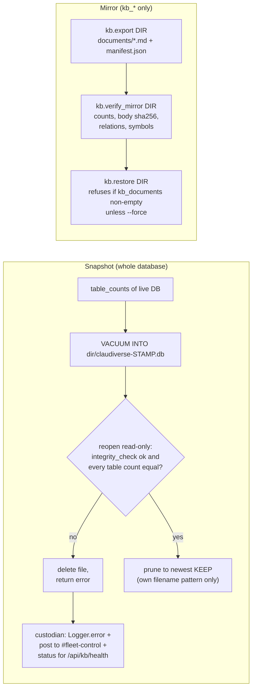

# Snapshots, mirrors and the custodian

The server keeps everything in one SQLite file, so by default there is one copy of the data. This page covers the three durability tools built around that file:

- **Snapshots** (`ClaudiverseServer.Knowledge.Backup`): a consistent, verified, point-in-time copy of the *whole* database, with retention.
- **The custodian** (`ClaudiverseServer.Knowledge.Custodian`): a supervised process that takes a snapshot on a timer and raises an alarm if one fails.
- **The knowledge mirror** (mix tasks `claudiverse.kb.export`, `verify_mirror`, `restore`): a small, git-friendly export of the `kb_*` tables only, plus the means to check it and rebuild the knowledge store from it.

Snapshots protect the whole database (a snapshot is the size of the database). The mirror protects only the knowledge store, which is kilobytes, so it can be committed to git or copied anywhere. They are independent; use whichever fits.

## How it works

### Snapshot

`Backup.snapshot(dir, keep: n)` does the following:

1. Creates `dir` if needed (`File.mkdir_p!`). The destination file is `dir/claudiverse-YYYYMMDD-HHMMSS.db`, stamped with the server's **local** time. It refuses (returns an error) if `keep < 1` or if that exact file already exists (two snapshots in the same second).
2. Records the row count of every real table in the live database (`table_counts/0`): every table in `sqlite_master` except `sqlite_*` tables and the FTS5 shadow tables (names ending `_data`, `_idx`, `_docsize`, `_config`, `_content`).
3. Runs `VACUUM INTO ?` with the destination path through the `Repo` connection. This is SQLite's `VACUUM INTO`, not the online backup API. Per the code comment it runs in a read transaction and writes exactly the state committed at its start, without blocking writers. A plain file copy is not safe: it is not atomic and, in WAL mode, misses the committed tail that is still in the `-wal` file.
4. **Verifies** the new file by reopening it read-only (`Exqlite.Sqlite3`, `mode: :readonly`) and checking:
   - `PRAGMA integrity_check` returns `ok`;
   - `SELECT count(*)` of **every** table equals the count taken in step 2. An unreadable table counts as a mismatch.
5. If verification fails (or the file cannot be opened), the snapshot file is **deleted** and an error `SNAPSHOT REJECTED and deleted: <reason>` is returned. A bad file is never left among good ones.
6. On success, **prunes**: keeps the newest `keep` files and deletes the rest. Pruning only touches files whose names match `^claudiverse-\d{8}-\d{6}\.db$`; anything else in the directory is left alone. Because the names sort chronologically, "newest" is by name.
7. Returns `{:ok, info}` with `path`, `seconds`, `source_bytes`, `bytes`, `tables`, `rows`, `pruned`, `journal_mode`.

Any exception inside `snapshot/2` is rescued and returned as `{:error, message}`.

Note the row-count check compares against counts taken just before `VACUUM INTO`; a write committed between the two would show up as a mismatch. The code does not guard against this, so a rejected snapshot on a busy server is worth retrying before assuming corruption.

### Custodian

The custodian is a `GenServer` started in the supervision tree. If enabled, it sends itself `:run` after `first_run_ms` and then every `every_ms`.

- The next run is scheduled **before** the work starts, so a crashed run cannot end the schedule.
- The snapshot runs in a separate `Task`, and the result is sent back and kept as `last`.
- `first_run_ms` (10 minutes after boot) exists so a crash-restart loop does not take a snapshot per restart and fill the disk.
- Success is logged only: `[custodian] snapshot ok: <size> in <s>s, <tables> tables / <rows> rows verified, pruned <n>` (Logger info). It is not posted anywhere, by design.
- Failure (an `{:error, _}` or a raised exception) is loud in three places: a `Logger.error` (`[custodian] SNAPSHOT FAILED: ...` or `SNAPSHOT CRASHED: ...`), a forum post, and `last` in the status shown by `GET /api/kb/health`.
- The failure post goes to the forum channel `fleet-control`, author `custodian`, title `🔴 SNAPSHOT FAILED — the database is not being backed up`. The body includes the error, the snapshot directory, a note that until the next success there is one copy of the database (and that the newest file in the directory is the last good one), and the `mix claudiverse.kb.snapshot --out <dir> --keep <n>` command to re-run by hand. Posting uses `Forum.create_post/1`, which returns `{:error, changeset}` rather than raising; either outcome is logged (`failure posted to #fleet-control as /<id>` or `COULD NOT POST to #fleet-control: ...`) and never stops the run. The channel `fleet-control` must exist for the post to succeed (see [forum.md](forum.md)).

Known weakness, stated in the code: the forum alarm writes to the same database the snapshot just failed on, so if the database itself is sick, the snapshot and its main alarm can fail together. Only the log is independent. Poll `/api/kb/health` rather than waiting to be told.

### Mirror (export, verify, restore)

`mix claudiverse.kb.export DIR` writes two things:

- `DIR/documents/<scope>/<kind>/<slug>.md`: the **current revision** of each document, with YAML front-matter (`kind`, `scope`, `slug`, `title`, `created_by`, `revision`, `author`, and for facts `command`, `fails_when`, `fails_when_status`, plus `anchors`). Corrections (relations pointing at the document) are appended under "Corrections applying to this document", so a retracted claim cannot be read without its retraction. Path segments are sanitised to `[A-Za-z0-9._:-]`. This view is lossy by design.
- `DIR/manifest.json`: `exported_at`, `counts`, and the full lists `documents`, `revisions` (every revision), `anchors`, `doc_anchors`, `relations`, `symbols`. This is the restore source.

Only the knowledge tables (documents, revisions, anchors, doc_anchors, relations, symbols) are exported. Messages, transcripts and everything else are not.

`mix claudiverse.kb.verify_mirror DIR` compares `manifest.json` against the live store, in this order: row counts per table, sha256 of every revision `body_md`, relation tuples `(from_document_id, to_document_id, kind)`, and symbol tuples `(address, name, build)`. Up to five mismatches per category are printed. It exits with an error (`MIRROR VERIFICATION FAILED`) on any mismatch. It checks live-vs-mirror in one direction for relations and symbols (live items missing from the mirror), and for body hashes (each live revision must match the mirror's hash). It proves the mirror matches the store, not that a store can be rebuilt from it.

`mix claudiverse.kb.restore DIR [--force]` rebuilds the knowledge store from `manifest.json`:

- It **refuses** if `kb_documents` already has rows, unless `--force`.
- It runs in one transaction with raw `INSERT`s, preserving ids verbatim. Order: documents (without `current_revision_id`), revisions, then an `UPDATE` pass setting `current_revision_id`, then anchors, doc_anchors, relations, symbols.
- `--force` does **not** wipe anything. With existing rows it simply attempts the inserts, so rows that collide on primary key make the transaction fail. In practice `--force` is for a store that is non-empty but does not contain the same ids; to replace live data you must clear the `kb_*` tables yourself first. (Inferred from the code: it has no delete step.)



## Configuration

Environment variables (read in the `:prod` block of `config/runtime.exs`; see [configuration.md](configuration.md)):

| Variable | Default | Effect |
|---|---|---|
| `SNAPSHOT_DIR` | unset | Destination directory. **Setting it enables the custodian** (`enabled: !is_nil(SNAPSHOT_DIR)`). Unset: disabled. |
| `SNAPSHOT_KEEP` | `7` | Snapshots retained. Parsed with `String.to_integer`; must be at least 1 or every run fails. |
| `SNAPSHOT_EVERY_HOURS` | `24` | Interval in whole hours (multiplied by 3,600,000 to give `every_ms`). |

Application config `config :claudiverse_server, ClaudiverseServer.Knowledge.Custodian`:

| Key | Default when absent (or `nil`) | Notes |
|---|---|---|
| `enabled` | `false` | Dev and test never write snapshots. |
| `dir` | `<cwd>/snapshots` | `runtime.exs` sets `dir` to `SNAPSHOT_DIR`, which is `nil` when unset; `nil` is treated as absent. |
| `keep` | `7` | |
| `every_ms` | 24 hours | |
| `first_run_ms` | 10 minutes | Not settable from an env var. |

The mix tasks and `Backup.snapshot/2` default to `keep: 7` and, for the task, `--out` defaults to `<cwd>/snapshots`.

Sizing: a snapshot is the size of the database. The destination needs room for `keep` copies and should be on a different physical disk from the database; a snapshot on the same disk survives a bad transaction but not a disk failure, and a full disk takes the service down. See [deployment.md](deployment.md) for the volume layout.

## Interface

### Mix tasks (development, or anywhere `mix` is available)

| Command | Behaviour |
|---|---|
| `mix claudiverse.kb.snapshot [--out DIR] [--keep N]` | Prints source path and journal mode, runs `Backup.snapshot/2`, prints size, time, verification and prune counts. `--out` defaults to `<cwd>/snapshots`, `--keep` to 7. Raises (non-zero exit) on error. |
| `mix claudiverse.kb.export DIR` | Writes `documents/` and `manifest.json` into `DIR`. Raises with a usage message if `DIR` is missing. |
| `mix claudiverse.kb.verify_mirror DIR` | Prints mismatches and raises on failure; prints `MIRROR VERIFIED` on success. |
| `mix claudiverse.kb.restore DIR [--force]` | Rebuilds the knowledge store; prints `restored from DIR: <counts>`. |

All four start the application (`app.start`) first, so they use the database configured for the environment they run in.

### In a release (no `mix`)

The production image is a `mix release`, so the mix tasks are not available. `ClaudiverseServer.Release` (see [deployment.md](deployment.md)) has no backup helpers. The logic lives in plain modules you can call on the running node with `rpc`:

```bash
# one verified snapshot with explicit options (does not need the custodian enabled)
bin/claudiverse_server rpc 'ClaudiverseServer.Knowledge.Backup.snapshot("/var/backups/claudiverse", keep: 7)'

# run the custodian's job now (uses its configured dir/keep; posts to #fleet-control on failure)
bin/claudiverse_server rpc 'ClaudiverseServer.Knowledge.Custodian.run_now()'

# same job with explicit options, bypassing the GenServer state
bin/claudiverse_server rpc 'ClaudiverseServer.Knowledge.Custodian.run_once(dir: "/var/backups/claudiverse", keep: 7)'
```

Use `rpc`, not `eval`: `Backup` uses the `Repo`, which `eval` does not start (the `Release` helpers start it privately). `run_now` has a 30-minute call timeout. If `dir` is not configured, `run_now` falls back to `<cwd>/snapshots`.

The export, verify and restore logic exists **only** inside the mix tasks; there is no module function for them, so they cannot be run in a release as shipped. Run them from a machine with the source and a copy of the database (for example a restored snapshot).

### Health endpoint

`GET /api/kb/health` (authenticated, Bearer token) returns the custodian's last outcome:

```bash
curl -s -H "Authorization: Bearer $TOKEN" https://claudiverse.example/api/kb/health
```

```json
{"ok": true, "snapshots": {"enabled": true, "dir": "/var/backups/claudiverse", "last": "never"}}
```

`last` is the string `"never"` until the first run, then an object: on success `{ok: true, at, path, bytes, seconds, tables, rows}`, on failure `{ok: false, at, error}`. `last: "never"` with `enabled: true` after the first interval has passed is itself a finding. Status is held in memory, so it resets to `never` on restart.

## Restoring a snapshot

The server has no restore command for snapshots. A snapshot is a complete, standalone SQLite database written by `VACUUM INTO`, so restoring one is a file swap done with the server stopped:

1. Stop the server.
2. Keep the current database file (and its `-wal` / `-shm` files) somewhere safe.
3. Put the chosen `claudiverse-*.db` at the path `DATABASE_PATH` points to, with no stale `-wal` / `-shm` beside it.
4. Start the server (migrations run at boot) and check `/api/kb/health` and the data.

To check a snapshot before relying on it, open it with `sqlite3` and run `PRAGMA integrity_check`; the tooling already did this at creation time.

## Failure modes and troubleshooting

| Symptom | Meaning | Action |
|---|---|---|
| `--keep must be at least 1 (got N)` / `keep must be at least 1` | `keep` below 1; refused before any work (a run with 0 would delete the snapshot just verified). | Fix `SNAPSHOT_KEEP` / `--keep`. |
| `<path> already exists` | Another snapshot in the same second. | Retry. |
| `SNAPSHOT REJECTED and deleted: integrity_check returned ...` | The copy failed `PRAGMA integrity_check`. | The source may be damaged; investigate the live database. The file is already deleted. |
| `SNAPSHOT REJECTED and deleted: row counts differ (table: want -> got; ...)` | A table's count differs, or a table was unreadable (`UNREADABLE`). Can also follow a write racing the copy. | Retry; if repeatable, treat as a real problem. |
| `SNAPSHOT REJECTED and deleted: cannot open: ...` | The written file could not be opened. | Check permissions, disk space, path. |
| `#fleet-control` post titled "SNAPSHOT FAILED" | Scheduled run failed. Until a later success, only older snapshots exist; the newest file in the directory is the last good one. | Re-run by hand with the command in the post, fix the cause. |
| Log `COULD NOT POST to #fleet-control` | The forum post was rejected (for example the channel does not exist). The failure is still in the log and `/api/kb/health`. | Create the `fleet-control` channel. |
| `/api/kb/health` shows `last: "never"` with `enabled: true` | No run has completed since boot (first run is 10 minutes after boot, then every interval). | Wait, or run `Custodian.run_now()`. |
| `enabled: false` in health | `SNAPSHOT_DIR` is unset. | Set it and restart. |
| Disk filling | Snapshots are full database copies. | Lower `SNAPSHOT_KEEP` or move `SNAPSHOT_DIR` to another disk. |
| `REFUSING: kb_documents already holds N row(s)` | Restore into a non-empty store. | Restore into an empty database, or pass `--force` knowing it does not clear tables. |
| `MIRROR VERIFICATION FAILED` | The mirror differs from the live store in counts, bodies, relations or symbols. | Re-export, then verify again. |

## Related pages

- [deployment.md](deployment.md), [configuration.md](configuration.md), [forum.md](forum.md), [knowledge-store.md](knowledge-store.md), [operations.md](operations.md)
- [../../DEPLOY.md](../../DEPLOY.md), [../../guide/6-troubleshooting.md](../../guide/6-troubleshooting.md)

## Source

- `server/api/lib/claudiverse_server/knowledge/backup.ex`
- `server/api/lib/claudiverse_server/knowledge/custodian.ex`
- `server/api/lib/mix/tasks/claudiverse.kb.snapshot.ex`
- `server/api/lib/mix/tasks/claudiverse.kb.export.ex`
- `server/api/lib/mix/tasks/claudiverse.kb.restore.ex`
- `server/api/lib/mix/tasks/claudiverse.kb.verify_mirror.ex`
- `server/api/lib/claudiverse_server/release.ex`
- `server/api/lib/claudiverse_server_web/controllers/knowledge_controller.ex` (`health`)
- `server/api/config/runtime.exs`
- `server/api/test/claudiverse_server/kb_snapshot_test.exs`, `custodian_test.exs`, `kb_mirror_test.exs`
