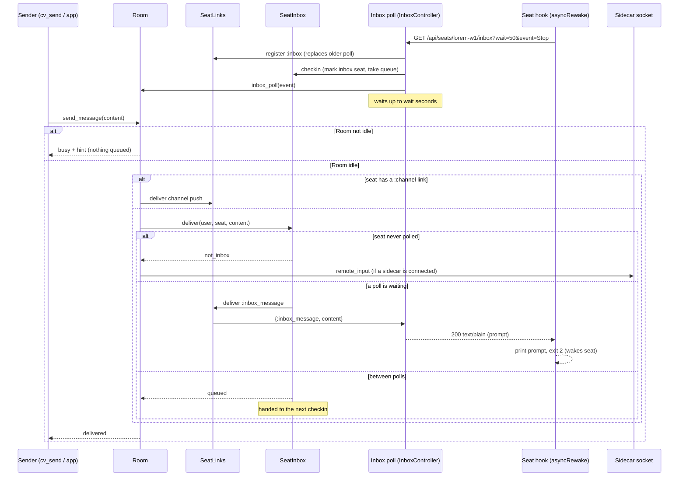
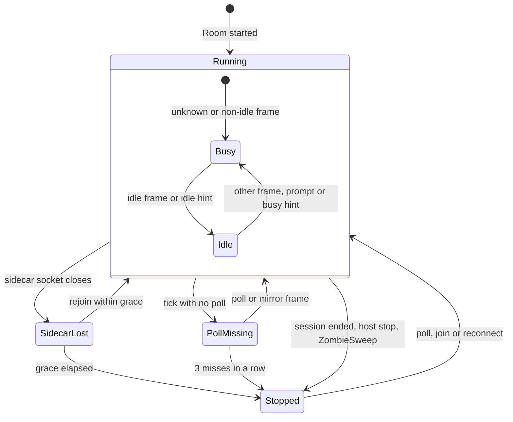

# HTTP mirror, inbox long-poll and liveness

A seat running stock Claude Code has no patched binary and no WebSocket sidecar. It talks to the server over plain HTTP instead:

- it **mirrors** its transcript with `POST /api/sessions/:id/mirror`;
- it **receives prompts** by holding a long poll, `GET /api/seats/:seat/inbox`, open from an `asyncRewake` hook;
- it **proves it is alive** by that poll.

This page covers those two endpoints, `GET /api/seats/whoami`, how a `Room` chooses a delivery route for a prompt, what "connected", "idle" and "busy" mean, how a Room decides a seat is gone, and the `ZombieSweep` that cleans up rows nothing else can stop. A "seat" is a running Claude Code session identified by its title (for example `lorem-w1`). A "Room" is the per-session GenServer described in [sessions-and-rooms.md](sessions-and-rooms.md).

## How it works

### Mirror

`POST /api/sessions/:id/mirror` is the HTTP form of the sidecar's `mirror_messages` channel event. The seat posts a batch of transcript frames; the controller checks them and hands them to the session's Room, which processes each exactly as it would a sidecar's: stores it, broadcasts it to viewers, updates readiness. The controller starts the Room if it is not running (`Sessions.Supervisor.start_room`, with the caller as owner). The Room call is a cast: the response says the batch was accepted, not that it was processed.

Per frame, the Room does the following (types are the frame's `"type"`):

| Frame type | Effect |
|---|---|
| `cvstate` | Not stored. Reconciles the idle flag with the reported `idle` boolean (a mismatch flips it and records an `idle_reconcile` event; flipping to idle flushes queued pings). Logs task-set changes. Marks readiness known. |
| `session_ended` | The seat is exiting. Ends the session now: row set to `stopped` (`crashed` if `exit_code` is a non-zero integer), `session_ended` broadcast to viewers, inbox liveness cleared. Not stored. |
| `background_tasks` | Stored, broadcast, and the Room's background task list replaced with `tasks`. |
| `agent_started`, `agent_message`, `agent_turn_complete`, `agent_ended`, `agents` | Stored and broadcast, kept in a separate agent replay buffer (300 entries). Never affects the main seat's idle or busy state. |
| `stream_event`, `progress`, `set_in_progress_tool_use_ids`, `interruptible_tool_in_progress`, `stream_request_start` | Live-only: broadcast to viewers, never stored and never put in the replay buffer. |
| anything else | Image blocks are moved to the file store and replaced by a reference; a timestamp is stamped if missing; the assistant model is recorded on the session row when it changes; the row is stored, buffered (500-entry replay buffer), broadcast; `can_use_tool` control requests become pending permissions. Readiness: `{"type": "idle"}` sets idle, **any other type sets busy**. |

Every accepted batch also resets the Room's missed-poll counter if the seat is an inbox seat (see Liveness): a seat that keeps mirroring is alive even if its poll has paused.

### Inbox long-poll

The seat's hook (`cv-inbox.sh` in the seat tooling) runs on `SessionStart`, `UserPromptSubmit`, `Stop` and, per the server's event list, `Notification`. It long-polls the inbox. When a prompt arrives the hook prints it and exits with code 2, which wakes the idle seat with that text as a prompt.

On each `GET /api/seats/:seat/inbox`, `InboxController.poll`:

1. Registers the request process as the seat's `:inbox` link in `SeatLinks`, replacing any older poll for that `{user, seat}` (the older one is told to stop and answers 409).
2. Finds the seat's row: the user's non-proxy row with that title that has the newest `last_activity_at` (ties by highest id), **whatever its status**. It writes any placement params that changed (`host`, `fleet`, `origin`, `working_directory`, `can_notify`) and sets `status` to `running`, so a poll revives a row the liveness check had stopped. It then starts the Room (if needed), calls `Room.inbox_poll(id, event)` and `Notifications.Router.seat_seen(seat, id)` so pings queued while the seat's listener was unbound are delivered now.
3. Calls `SeatInbox.checkin`, which marks the seat as an inbox seat, records the hook `event` (if it is one of `SessionStart`, `UserPromptSubmit`, `Stop`, `Notification`), stamps the poll time and returns any queued prompts.
4. If prompts were queued, answers 200 at once. Otherwise waits up to `wait` seconds for a delivery, an interrupt, or a replacement.

The hook event describes the seat's latest transition: `SessionStart`, `Stop` and `Notification` (the `idle_prompt` notification, about a minute at the prompt; it covers turns that end with no `Stop` hook, such as an Escape interrupt) mean idle; `UserPromptSubmit` means busy.

`SeatInbox` is an in-memory GenServer holding three maps per `{user_id, seat}`: queues, last event, last poll time. A server restart forgets all of it. A seat re-marks itself on its next poll; prompts queued at restart are lost.

### Prompt routing

`Room.send_message/2` (used by the `cv_send` tool through `POST /api/notify/send`, and by the observer channel event `send_message`) is reject-busy: it delivers only if the Room's `idle` flag is true; otherwise it returns `{:busy, hint}` and nothing is queued. `Room.force_message/2` skips the idle check (`POST /api/notify/send` with `"force": true`, which requires an app token, otherwise 403). Both set `idle: false` and `readiness_known: true` after delivering. The notifications Router delivers its pings through the same reject-busy `send_message` ([notifications.md](notifications.md)).

A delivered prompt takes the first route that applies:

1. **MCP channel**: if the seat holds a `:channel` link (its `GET /api/mcp/seat/:seat` stream), the prompt is pushed down it as a `notifications/claude/channel` notification.
2. **Inbox**: else `SeatInbox.deliver`. This answers `:not_inbox` for a seat that has never polled; otherwise the prompt goes straight to the waiting poll (`:ok`) or is queued for the next one (`:queued`).
3. **Sidecar**: else (`:not_inbox`) it is forwarded to the sidecar socket as `remote_input`. A seat with no sidecar and no links drops it; the caller still sees `delivered` if the Room was idle.

Stale inbox mark: one poll makes a title an inbox seat until the Room forgets it. If the Room has a live sidecar, no poll is currently waiting, and the last poll is older than `inbox_stale_ms`, the seat is treated as a sidecar seat again: `SeatInbox.forget` returns what was queued, and those prompts plus the new one go down the sidecar. A seat with no sidecar keeps queueing, since its poller is the only way in.

Interrupt (observer `interrupt` event, `Room.interrupt/1`): if the seat is busy, the Room delivers `:inbox_interrupt` to the live poll, which answers 205 so the hook presses Escape in the seat's pane. Interrupts are never queued, and an idle seat is not sent Escape (it would clear the operator's draft). With no live poll, the Room asks the seat's host agent to press Escape (`interrupt` request to the host named on the row, asynchronous). The sidecar is told `remote_interrupt` as well.



### Liveness

A Room has three independent ways to learn a seat is gone, depending on how the seat is attached.

**Sidecar seat.** The Room monitors the sidecar channel process. When it dies, the Room waits `sidecar_grace_ms` (default 20 000 ms). A sidecar that rejoins within the grace is a blip: nothing is announced and the row is set `running` again on join. If the grace elapses with no sidecar, the row is set `stopped` and `session_ended` is broadcast. The sidecar's explicit `session_ended` frame ends the session at once.

**Inbox seat (no sidecar).** Every `room_liveness_ms` (default 60 000 ms) the Room runs a liveness tick. It acts only if the seat has polled at least once (`inbox_live`) and has no sidecar:

- if an `:inbox` link exists for the seat's title, the miss counter resets to 0;
- otherwise the counter increments, and at 3 consecutive misses (hard-coded `@inbox_miss_limit`) the row is set `stopped`, `session_ended` is broadcast, and `inbox_live` clears. With the defaults that is about 3 minutes.

A mirrored batch resets the counter, and each `Room.inbox_poll` sets `inbox_live` true and the counter to 0. Rooms that never had an inbox poll, and Rooms with a sidecar, are left alone by the tick. The inbox link is keyed by the seat's title, not the row id, so a stale row sharing a live seat's title can read live.

**No Room at all, or superseded Room.** `ZombieSweep` (below).

Readiness (`Room.get_status/1`, returned by `GET /api/notify/status`):

| Field | Meaning |
|---|---|
| `status` | `running` or `stopped` as the Room last knew. |
| `sidecar_connected` | True if a sidecar socket is attached **or** the seat's inbox poll is live (`inbox_live`). This is the "connected" shown by the web panel's seat list, `cv_status` and the apps. |
| `has_sidecar` | True only for a real sidecar socket. Used by `ZombieSweep`, because `inbox_live` counts any poll under the title. |
| `idle` | True after an `idle` frame, an idle `cvstate`, or an idle inbox hint; false after any other mirrored frame, or a delivered prompt. Only an idle seat accepts `send_message`. |
| `readiness_known` | False until something has said whether the seat is idle (a mirrored frame, a heartbeat, a delivery). A Room created by a server restart starts false. |
| `busy_agents`, `background_running`, `permission_mode` | Count of agents with status `pending` or `running`; count of background tasks with that status; last reported permission mode (nil if never reported). |

Restart recovery: a new Room restores `idle` from the last stored `idle_transition` event (without marking readiness known). While `readiness_known` is false, the hook event from the seat's poll (taken from `SeatInbox.last_event` when a sidecar joins, or passed to `Room.inbox_poll`) sets idle (`SessionStart`, `Stop`, `Notification`) or busy (`UserPromptSubmit`) and records an `idle_transition` event with trigger `inbox_hint:<event>`. Once readiness is known the hint is ignored. Going idle through a hint also triggers `Router.went_idle`.



### ZombieSweep

`ClaudiverseServer.Sessions.ZombieSweep` is a GenServer in the supervision tree. It stops rows that read `running` with nothing behind them: the sidecar's goodbye, the mod's `session_ended` and the Room's liveness tick are the normal stoppers, and a row whose Room died with a server restart before its poll started has none left.

A row is a zombie when it is `status = running`, not a `proxy` row, its last activity is older than `idle_ms`, and either:

- it has **no Room** (no entry in `Sessions.Registry`), or
- it has a Room with **no sidecar socket of its own** (`has_sidecar` false, or the Room does not answer) while a more recently active non-proxy row with the same user and title exists (it has been superseded).

"Last activity" is the newest message `inserted_at` for the row, or the row's own `inserted_at` if it has no messages. A Room alone does not prove life (inbox liveness is title-wide) and idleness alone does not either (a live seat can idle for hours), hence both conditions. Each zombie is stopped through `Room.ended_by_machine/1`: with a Room, the row is set `stopped` and `session_ended` broadcast; without one, only the row is set `stopped`. The sweep logs `ZombieSweep stopped N running row(s) with no Room: [{id, title}, ...]` at info level when it stops any, and rescues and logs any exception so the timer keeps running.

A wrong stop heals itself: the seat's next inbox poll sets its row back to `running`, and a sidecar reconnect does the same.

## Configuration

All are `Application` config under `:claudiverse_server`. None is read from an environment variable; set them in your own `config/runtime.exs` if you need to change them. The defaults are right for normal use.

| Key | Default | Meaning |
|---|---|---|
| `:inbox_max_wait_s` | `60` | Upper bound, in seconds, on an inbox poll's wait, whatever the client asks for. Kept short because a held poll cannot see its client disappear and counts as a heartbeat. |
| `:room_liveness_ms` | `60_000` | Interval of the Room's liveness tick. An inbox seat with no poll is stopped after 3 consecutive missed ticks. |
| `:sidecar_grace_ms` | `20_000` | How long a lost sidecar socket may stay down before the session is stopped. The test config sets `100`. |
| `:inbox_stale_ms` | `120_000` | Age of the last poll after which a seat with a live sidecar and no waiting poll is routed to the sidecar again, with its queue. |
| `:mode_reply_ms` | `8_000` | How long a `set_permission_mode` request waits for the seat's answer before replying `{:error, :timeout}`. |
| `ClaudiverseServer.Sessions.ZombieSweep` `enabled` | `true` | If false the process does not start (`:ignore`). Test config sets it false. |
| ... `first_run_ms` | 10 minutes | Delay before the first sweep, so seats can poll or reconnect after a restart first. |
| ... `every_ms` | 10 minutes | Interval between sweeps. |
| ... `idle_ms` | 30 minutes | Minimum time without activity before a row can be a zombie. |

ZombieSweep example:

```elixir
config :claudiverse_server, ClaudiverseServer.Sessions.ZombieSweep,
  enabled: true,
  first_run_ms: :timer.minutes(10),
  every_ms: :timer.minutes(10),
  idle_ms: :timer.minutes(30)
```

Fixed in code and not configurable: inbox miss limit 3; default poll wait 50 s; mirror batch limit 200; replay buffers 500 (main) and 300 (agents).

## Interface

All three endpoints require `Authorization: Bearer $TOKEN` (the `:authenticated` pipeline) and are scoped to the token's user.

### POST /api/sessions/:id/mirror

Body: `{"messages": [ {"type": "<string>", ...}, ... ]}`. At most 200 messages. Each must be a JSON object with a string `type`; other fields are free-form and are what a sidecar would send (assistant, user, `idle`, `cvstate`, `session_ended`, ...).

| Status | Body | When |
|---|---|---|
| 202 | `{"ok": true, "count": <n>}` | Batch accepted (processed asynchronously by the Room). |
| 400 | `{"error": "at most 200 messages per call"}` | More than 200 messages. |
| 400 | `{"error": "each message must be an object with a type"}` | An element is not an object or has no string `type`. |
| 400 | `{"error": "messages must be a list"}` | `messages` missing or not a list. |
| 404 | `{"error": "Not found"}` | `:id` is not an integer or is not one of the caller's sessions. |

```bash
curl -X POST https://claudiverse.example/api/sessions/42/mirror \
  -H "Authorization: Bearer $TOKEN" -H "Content-Type: application/json" \
  -d '{"messages":[{"type":"assistant","message":{"role":"assistant","content":[{"type":"text","text":"hi"}]}},{"type":"idle"}]}'
# {"ok":true,"count":2}
```

The mirror does not check that the row is `running`; it starts a Room for any of the caller's sessions.

### GET /api/seats/:seat/inbox

Query parameters (all optional):

| Param | Meaning |
|---|---|
| `wait` | Seconds to hold the poll. Positive integer, capped at `inbox_max_wait_s`. Missing: 50 (or the cap if lower). Non-numeric or non-positive: 50. |
| `event` | The hook event that started this poller: `SessionStart`, `UserPromptSubmit`, `Stop`, `Notification`. Other values are ignored. |
| `host`, `fleet`, `origin`, `working_directory` | Placement of a seat with no sidecar; non-empty strings are written to the row when they differ. |
| `notify` | `1` or `0` sets the row's `can_notify`. |

| Status | Body | Meaning |
|---|---|---|
| 200 | `text/plain`: prompts oldest first, separated by a blank line | One or more prompts. |
| 204 | empty | Nothing arrived within `wait`; poll again. |
| 205 | empty | Interrupt: press Escape in the seat's pane, then poll again. |
| 409 | empty | A newer poll for this seat replaced this one; stop. |

```bash
curl -i "https://claudiverse.example/api/seats/lorem-w1/inbox?wait=50&event=Stop" \
  -H "Authorization: Bearer $TOKEN"
# HTTP/1.1 200 OK
# content-type: text/plain
#
# Please rebase onto main and rerun the tests.
```

### GET /api/seats/whoami

Query: `claude_session_id=<id>` or `title=<title>` (the first takes precedence). This lets one shared MCP config serve every seat: the MCP process learns its seat from the `CLAUDE_CODE_SESSION_ID` it inherits. The row chosen is the caller's non-proxy row, preferring a `running` one, then the newest by `inserted_at`, then highest id.

```json
{"session_id": 42, "title": "lorem-w1", "role": "worker", "can_notify": false,
 "access": "basic", "fleet": "lorem-fleet", "origin": "runner", "profile_id": null}
```

`role` is `"worker"` or `"orchestrator"` (the server's tool policy for the seat); `access` is the effective access level; `profile_id` is the profile the seat was started from, or null.

| Status | Body | When |
|---|---|---|
| 200 | the object above | Found. |
| 400 | `{"error": "claude_session_id or title is required"}` | Neither param (or both empty). |
| 404 | `{"error": "no seat registered under that id yet"}` | Seat has not registered; the caller should retry. |

```bash
curl "https://claudiverse.example/api/seats/whoami?title=lorem-w1" -H "Authorization: Bearer $TOKEN"
```

### Related endpoints and events

- `POST /api/notify/send` `{session_id, content, force?}` delivers a prompt (`cv_send`). Response `status` is `delivered`, `busy` (with `hint`), `error` ("not connected"), `stopped` (row not running; includes `live_session_id`), or `refused` (slash command to a mod seat). `GET /api/notify/status?session_id=<id>` returns the Room status described above, or `{"idle": false, "sidecar_connected": false, "status": "not_connected"}` if there is no Room.
- Channel `session:<id>`, observer events `send_message` (reply `{status: "delivered"}`, `{status: "busy", hint}` or `{status: "error", error: "not connected"}`) and `interrupt`; server events `message`, `session_ended`.

## Failure modes and troubleshooting

| Symptom | Cause | What to do |
|---|---|---|
| Poll returns 409 | A newer poll for the same title replaced it. Normal when the hook re-arms on a new event. | Stop that poller; the newer one is live. If it repeats forever, two processes poll under one title: stop the duplicate. |
| Seat shows `stopped` but is alive | Three missed ticks (about 3 min) or the sweep stopped it. | Its next poll (or sidecar reconnect) sets it `running`. If it never recovers, check the hook is running and can reach the server. |
| A killed seat still reads running for a while | Its last held poll keeps the link live until `wait` ends (at most `inbox_max_wait_s`), then 3 ticks. | Expect up to about 4 minutes. Do not raise `inbox_max_wait_s`. |
| `cv_send` returns `busy` | Room `idle` is false. After a server restart the flag is restored from the last stored transition; only the next poll's hook event or a mirrored `idle` corrects a wrong one. | Retry when the seat goes idle, or use an app token with `force: true`. |
| `cv_send` returns `error: not connected` | No Room (stopped session after restart, never started). | Make the seat poll or reconnect; a poll starts the Room. |
| `cv_send` returns `stopped` | The id is a stopped row; the seat restarted on a new row. | Send to `live_session_id`. |
| Prompts delivered but the seat never wakes | Seat was marked an inbox seat but its poller is gone, and it has no sidecar: prompts queue indefinitely. | Check the hook; the queue is handed over on the next poll. A restart of the server loses the queue. |
| Second "running" copy of a seat in the apps | Old row of the same title with no Room or socket. | `ZombieSweep` stops it after `idle_ms` (30 min default) and after the first run delay. |
| Mirror returns 404 | Wrong id, or the id belongs to another user. | Use the id the seat registered under (see `whoami`). |
| Mirror returns 400 | Over 200 messages, or a frame without a `type`. | Split the batch; fix the frame. |
| `whoami` returns 404 | The seat has not registered a row yet. | Retry shortly. |

See [../../guide/6-troubleshooting.md](../../guide/6-troubleshooting.md) for operator-level symptoms.

## Related pages

- [Sessions and Rooms](sessions-and-rooms.md): Room lifecycle, sidecar channel, viewers.
- [Questions and permission relays](questions-and-permissions.md): the question and permission links that share `SeatLinks` with the inbox.
- [Notifications Router, pings and cv_subscribe](notifications.md): the ping router that uses `went_idle` and `seat_seen`.
- [Accounts, sign-up and tokens](auth.md): tokens and the `:authenticated` pipeline.
- [Configuration](configuration.md), [Operations: health, incidents and slow queries](operations.md).
- Guide: [first seat](../../guide/4-first-seat.md), [troubleshooting](../../guide/6-troubleshooting.md).
- Mod: [The inbox: remote input and inbox commands](../services/mod/inbox.md), [Mirroring](../services/mod/mirroring.md), [Outages and session end](../services/mod/outages-and-session-end.md)
- Web panel: [The seat view](../services/web/seat-view.md)
- Runners and tools: [cvctl: the orchestrator CLI](../runners/cvctl.md), [cv-mcp: seat, ping and question tools](../runners/mcp-seats.md)
- Android: [Seat controls](https://github.com/Promises/claudiverse-apps/blob/main/docs/android/seat-controls.md), [Seat view](https://github.com/Promises/claudiverse-apps/blob/main/docs/android/seat-view.md)
- Mac: [Seat view](https://github.com/Promises/claudiverse-apps/blob/main/docs/mac/seat-view.md), [Transcript](https://github.com/Promises/claudiverse-apps/blob/main/docs/mac/transcript.md)

## Source

- `server/api/lib/claudiverse_server_web/controllers/session_controller.ex` (`mirror`)
- `server/api/lib/claudiverse_server_web/controllers/inbox_controller.ex`
- `server/api/lib/claudiverse_server_web/controllers/seat_controller.ex`
- `server/api/lib/claudiverse_server_web/controllers/notify_controller.ex` (`send`, `status`)
- `server/api/lib/claudiverse_server_web/channels/session_channel.ex` (`send_message`, `interrupt`)
- `server/api/lib/claudiverse_server/seat_inbox.ex`
- `server/api/lib/claudiverse_server/seat_links.ex`
- `server/api/lib/claudiverse_server/sessions/room.ex`
- `server/api/lib/claudiverse_server/sessions/zombie_sweep.ex`
- `server/api/lib/claudiverse_server_web/router.ex`
- `server/api/test/claudiverse_server_web/controllers/mirror_test.exs`
- `server/api/test/claudiverse_server_web/seat_links_test.exs`
- `server/api/test/claudiverse_server/sessions/zombie_sweep_test.exs`
