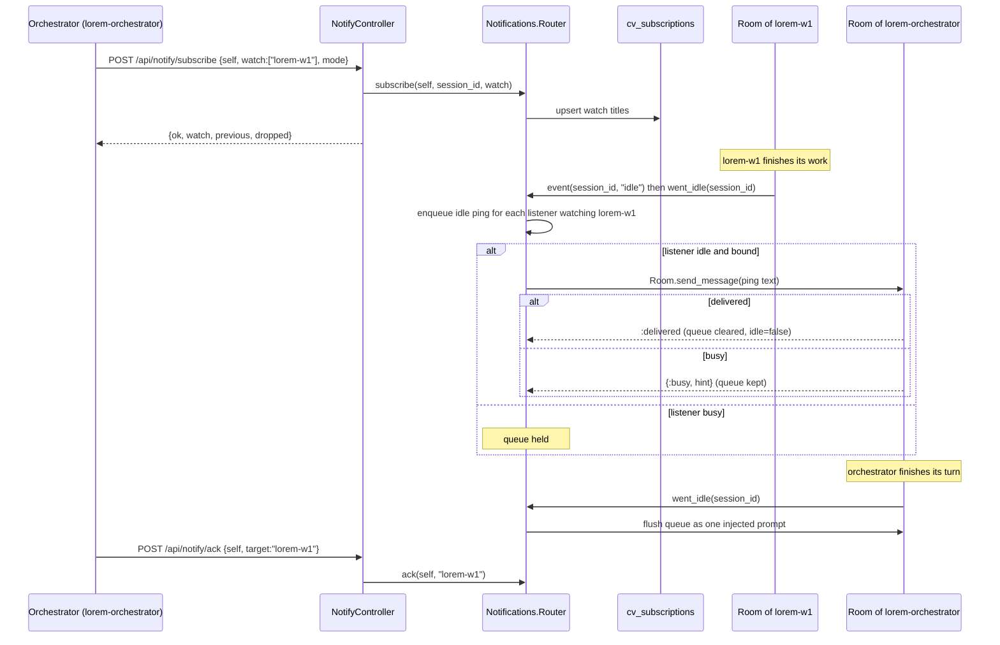

# Notifications Router, pings and cv_subscribe

`ClaudiverseServer.Notifications.Router` is a single GenServer that lets one seat (the *listener*, normally an orchestrator) hear about other seats without polling. A listener subscribes to a list of *watch titles*. When a watched seat goes idle, asks a question, or compacts its context, the Router queues a compact "ping" for the listener. The queue is delivered as one injected prompt the moment the listener is idle, and is held (not dropped) while it is busy.

The same machinery carries forum pings, task-assignment pings, worker reports and account-pool switch pings. `NotifyController` (`/api/notify/*`) is the HTTP front end; the orchestrator's MCP tools `cv_subscribe`, `cv_send`, `cv_status`, `cv_ack`, `cv_pending` and `cv_report` are thin wrappers over it.

## How it works

### Listeners and watch titles

- A listener is keyed by its seat **title**, not its session id. The title is stable across relaunches; the current session id is rebound each time the seat is seen alive.
- Each listener has: `session_id` (or `nil` when unbound), `watch` (a set of titles), `queue` (list of pings) and `idle` (a boolean the Router keeps itself).
- A watch title is normally a seat title. It is matched by string equality against the title of the seat that emitted the event; the Router does not check that the title exists. Two titles have special use:
  - `@pool` and the `@pool:…` titles are reserved: they receive account-pool pings (below).
  - Any string can be the source of a `report`. The orchestrator's `cv_task_done` tool reports each completed task as `tasks:<lane>`, so an orchestrator can watch that string to hear task completions. The server itself sends no task pings (see [tasks-and-runners.md](tasks-and-runners.md)).
- A seat never receives pings about itself (`event` skips `ltitle == src_title`).

### What produces a ping

| Kind (`kind`) | Source | Trigger | Queue rule |
|---|---|---|---|
| `idle` | `Room` calls `Router.event(session_id, "idle")` | the watched seat is truly at rest (the `idle` frame it mirrors) | one `idle` ping per source title; repeats are collapsed |
| `ask_user_question` | `Room`, on an assistant message that contains an `AskUserQuestion` tool use | a watched seat poses a question | one per `tool_use_id` |
| `compact` | `Room`, on a `compact` frame | a watched seat compacted its context | one per source title |
| `report` | `POST /api/notify/report` | a worker pushes text up | not de-duplicated; carries `text` |
| `forum` | `Forum.create_post` -> `Router.forum_post/2` | new post in a channel the listener subscribed to (author excluded) | collapsed per channel into one ping with `count` and the latest `post_id` |
| `forum_assigned` | `Forum` -> `Router.forum_assigned/2` | a forum post is assigned to the listener by someone else | one per `post_id`; re-assign updates in place |
| `pool` | PubSub message on the account pool topic | the pool's *current* account id changed | one pending `pool` ping at a time (a newer one replaces the older) |
| `pool_event` | PubSub message on the account pool topic with `change` `reset`, `capped` or `step` | an account's usage reading reset, reached 100% or crossed a step (see below) | one per event; carries `text`, the ping line |

Notes:

- The `idle` event is deliberately not the CLI's `turn_complete`: `turn_complete` fires while background agents or queued work are still running, which would push events into busy seats. The Router uses the "truly at rest" `idle` frame instead. (The moduledoc in `router.ex` still says `turn_complete`.)
- Forum pings and assignment pings do not need a `watch` entry. `Forum` calls `Router.forum_subscribe/2` when a seat subscribes to a channel, which creates a listener entry with an empty watch set. See [forum.md](forum.md).
- A `pool_event` ping goes to each listener watching one of the event's titles, and its `title` is the one it watches (for `cv_ack`):

| Title | Pings on |
|---|---|
| `@pool` | the pool's current account switching (a failover, a fleet-wide switch); an account needing re-auth, and its re-authorization |
| `@pool:reset` | an account's weekly limit resetting |
| `@pool:reset:session` | an account's 5-hour session limit resetting |
| `@pool:capped` | an account's weekly limit reaching 100% |
| `@pool:capped:session` | an account's session limit reaching 100% |
| `@pool:step:10` | an account's weekly usage crossing a multiple of 10 (10 … 100) |
| `@pool:step:5` | the same for each multiple of 5 |
| `@pool:*` | every weekly event above (steps of 5), the switches, and the re-auth events |

  The events come from `AnthropicAuths.PoolEvents`, which compares each usage reading with the stored one (see [account-pool.md](account-pool.md#pool-events)). The ping is the event's `text`, for example `POOL reset: work weekly 94% → 0% (next reset Sun 2026-10-18 09:59 UTC)`, `POOL capped: personal weekly 100%, cooling until Mon 2026-10-12 00:00 UTC`, `POOL step: work weekly crossed 90% (now 91%)`.
- An account becoming `needs_reauth`, and an existing account getting new credentials, ping the listeners watching `@pool` or `@pool:*` with the event's `text`: `POOL needs re-auth: Personal (refresh rejected with HTTP 400) — re-authorize in the app` (once per transition, never after a restart) and `POOL re-authorized: Personal (available)`. They are acked with `@pool`. See [account-pool.md](account-pool.md#pool-events).
- A `pool` ping is sent only to listeners whose watch set contains `@pool` or `@pool:*`, and only when the current account id differs from the Router's remembered `pool_current` (a failover, a preference change that moved the account, an upgrade back). A change that leaves the same account current pings nobody. The ping names both accounts by label (`no account (none leasable)` when there is none, `account <id>` if the label is unknown). See [account-pool.md](account-pool.md).

### Queue, flush and idle

Pings are delivered by `flush/2`:

1. Empty queue: the listener is marked `idle: true`, nothing sent.
2. Listener has no `session_id` (not bound yet): the queue is held.
3. Otherwise the whole queue is formatted as **one** string and sent with `Room.send_message/2`, the same reject-busy path as `POST /api/notify/send`.
   - `:delivered`: queue cleared, listener marked `idle: false`.
   - busy, or the sidecar/inbox is gone: queue **kept**, listener marked `idle: false`. It will be tried again on the next flush trigger.

Flush triggers:

- A new event/report/forum/pool ping was queued and the listener has `idle: true`.
- `went_idle(session_id)`: the `Room` calls this when its seat reports idle (the `idle` frame, an inbox hint `SessionStart`/`Stop`/`Notification`, or a state reconcile that finds the seat idle). If no listener has that session id yet, the Router looks up the session's title and rebinds a rehydrated listener by title.
- `seat_seen(title, session_id)`: called when a sidecar joins `session:<id>` as `sidecar` and on every inbox poll. It rebinds the listener to that session id and flushes any queued pings, so a seat that was already idle across a server restart does not wait for its next finished turn.
- Both also tell `Schedules.Scheduler`, which delivers a scheduled prompt queued for that seat (busy at fire time) or held for its title (absent at fire time). See [schedules.md](schedules.md).
- And `AutoResume.Server`, which sends a stalled seat its `continue` (its turn died on an empty pool or a restart). See [auto-resume.md](auto-resume.md).

Delivered text has this shape (items joined by `; `):

```
[claudiverse] 2 event(s) ready — lorem-w1: idle/ready (finished its turn); lorem-w2: question (toolu_01...). Inspect with cv_questions / cv_tail, act with cv_send / cv_answer, then cv_ack what you've handled.
```

Per-kind item text: `<title>: question (<tool_use_id>)`, `<title>: idle/ready (finished its turn)`, `report from <title>: <text>`, `<title> COMPACTED its context ...`, `forum #<slug>: <n> new post(s) (latest forum/<slug>/<post_id>) ...`, `assigned to you: forum/<slug>/<post_id> ...`, `ACCOUNT POOL switched: leases now go to <to> (was <from>; <change>[ by <by>]) ...`. Pings carry no conversation content; the listener pulls detail itself.

Subscribing sets the listener to `idle: true` and keeps any pings already queued, so an `add` never loses pending pings.



### Persistence

| Store | What | Survives restart |
|---|---|---|
| `cv_subscriptions` (`CvSubscription`) | primary key `listener_title` (string), `watch` (map `{"titles": [...]}`), `inserted_at`, `updated_at`. Written by `subscribe` and `rename`, deleted by `unsubscribe`. Failures are swallowed (`:error`) so persistence never breaks a subscribe. | yes. `Router.init` rehydrates listeners with `session_id: nil`, empty queue, `idle: true` |
| Forum subscriber titles | `init` also pre-creates empty listener entries for every title in `Forum.list_all_subscriber_titles/0`, so forum delivery resumes after a restart | yes (from the forum tables) |
| Listener `queue` | in memory only | **no**. Queued pings are lost on restart |
| `cv_events` (`CvEvent`) | observability history written by `Sessions.record_event/1`: `session_id`, `kind`, `from_state`, `to_state`, `trigger`, `detail` (map), `inserted_at` (no `updated_at`). Current kinds in the code are `idle_transition` and `idle_reconcile`; the schema also documents `cvdebug`. Failures are swallowed. | yes |

`cv_events` is a diagnostic record of idle/busy transitions in the `Room`. The Router does not read or write it; the idle state that drives delivery lives in the `Room` and the Router's own `idle` flag.

After a restart the live session id is unknown. A rehydrated listener is bound again by `seat_seen` (sidecar join or inbox poll) or by its first `went_idle`, and anything queued after the restart is then flushed.

### Rename

`Profiles.rename` calls `Router.rename(old, new)`: the listener's watch list and queued pings move to `new` (merged if `new` already had a listener), and every other listener's watch list and queued ping that names `old` is rewritten to `new`. Subscriptions are re-persisted. It returns `%{watch_lists: 0|1, queued_pings: n, watchers: n}`. See [profiles-and-hosts.md](profiles-and-hosts.md).

## Configuration

None. No env vars or `config :claudiverse_server` keys are read by `Notifications.Router` or `NotifyController`. The Router is started under the application supervisor (`ClaudiverseServer.Notifications.Router` in `application.ex`).

Related timing is in the `Room` (for example `:room_liveness_ms`); see [sessions-and-rooms.md](sessions-and-rooms.md) and [mirror-inbox-liveness.md](mirror-inbox-liveness.md).

## Interface

All routes are under `/api` and need `Authorization: Bearer $TOKEN`; a missing or invalid token gets `401 {"error":"Unauthorized"}`. (Host-agent tokens are refused.) Sessions are looked up for the token's user.

### POST /api/notify/subscribe

This is what `cv_subscribe` calls.

| Param | Type | Notes |
|---|---|---|
| `self` | string | Listener title. Required in practice; resolved to a session of the token's user. A `running` session with that title is preferred, otherwise the first match. |
| `watch` | array of strings | Titles to watch. Default `[]`. Include `"@pool"` for pool switch pings, and the `@pool:…` titles for usage events (above). |
| `mode` | string | `replace` (default; the list becomes exactly `watch`), `add` (previous plus `watch`, de-duplicated), `remove` (previous minus `watch`). Any other value behaves as `replace`. |

```bash
curl -s -X POST https://claudiverse.example/api/notify/subscribe \
  -H "Authorization: Bearer $TOKEN" -H "Content-Type: application/json" \
  -d '{"self":"lorem-orchestrator","watch":["lorem-w1","@pool"],"mode":"add"}'
```

```json
{"ok": true, "listener": "lorem-orchestrator", "listener_session_id": "123",
 "watch": ["lorem-w1", "@pool"], "previous": [], "dropped": []}
```

`previous` is the watch list before the call and `dropped` is `previous -- watch`, so a `replace` that loses a watch says so. Status codes: `200`; `404 {"error":"no running session titled <self>"}` when no session of that title exists for the user.

### POST /api/notify/ack

This is what `cv_ack` calls. Params: `self` (listener title), `target` (a watch title, or `"all"`; default `"all"`). Removes queued pings whose `title` equals `target`, or all of them. The match is on the ping's `title` field, so forum pings are acked with `forum:<channel>`, assignment pings with `forum:assigned`, pool pings with `@pool`.

```bash
curl -s -X POST https://claudiverse.example/api/notify/ack \
  -H "Authorization: Bearer $TOKEN" -H "Content-Type: application/json" \
  -d '{"self":"lorem-orchestrator","target":"lorem-w1"}'
# {"ok": true}
```

Always `200 {"ok": true}`, including for an unknown listener or when nothing matched.

### GET /api/notify/pending?self=<title>

This is what `cv_pending` calls (debug only; never poll it). Returns the listener's queue, `{"queue": []}` for an unknown listener. Entries are the Router's maps, so fields differ by kind:

```json
{"queue": [
  {"title": "lorem-w1", "kind": "idle", "tool_use_id": null},
  {"title": "lorem-w2", "kind": "ask_user_question", "tool_use_id": "toolu_01"},
  {"title": "lorem-w2", "kind": "report", "tool_use_id": null, "text": "build is green"},
  {"title": "forum:lorem-tasks", "kind": "forum", "channel": "lorem-tasks", "post_id": 42, "count": 3},
  {"title": "forum:assigned", "kind": "forum_assigned", "channel": "lorem-tasks", "post_id": 43, "post_title": "Fix X", "by": "lorem-admin"},
  {"title": "@pool", "kind": "pool", "tool_use_id": null, "from": "account A", "to": "account B", "change": "degrade", "by": null}
]}
```

### POST /api/notify/send

This is what `cv_send` calls (after resolving a title to a session id). Params: `session_id`, `content`, optional `force`.

Reject-busy: the message is delivered only if the target seat is idle; a busy seat is not queued, and the caller must hold the message and retry on the seat's next idle. The response is always `200` with a `status`:

| `status` | Extra fields | Meaning |
|---|---|---|
| `delivered` | none | Sent to the seat; the Room marks it busy |
| `busy` | `hint` | Not delivered. `hint` is the first 120 characters of the seat's latest assistant text, or `"in progress"` |
| `stopped` | `error`, `live_session_id` | The session row is not `running`. Nothing was delivered. `live_session_id` is the same title's running non-proxy row (or `null`); re-address to it |
| `refused` | `error` | A "mod" seat (client version contains `[claudiverse-mod`) was sent text starting with `/` other than `/compact`; only `/compact` is run |
| `error` | `error: "not connected"` | The Room has no live connection |

`404 {"error":"session not found"}` if `session_id` is missing or not one of the token user's sessions.

`force: true` (or `"true"`) delivers to a busy seat via `Room.force_message/2`. It is app-only: a token whose context is not `app` or `super` gets `403 {"error":"force is app-only"}`, checked before the session is looked up, so a refusal cannot be mistaken for `busy`. Seats use the shared `api` token and therefore cannot force.

```bash
curl -s -X POST https://claudiverse.example/api/notify/send \
  -H "Authorization: Bearer $TOKEN" -H "Content-Type: application/json" \
  -d '{"session_id":"123","content":"run the tests"}'
# {"status":"busy","hint":"Reading the failing spec..."}
```

### GET /api/notify/status?session_id=<id>

This is what `cv_status` calls. Returns the Room's status map:

```json
{"status": "running", "sidecar_connected": true, "has_sidecar": true, "idle": true,
 "busy_agents": 0, "background_running": 0, "readiness_known": true, "permission_mode": "default"}
```

(`busy_agents` and `background_running` are whatever the Room computes; the example values are illustrative.) `sidecar_connected` is true for a sidecar or a live inbox poll; `has_sidecar` is true only for a real sidecar socket. `readiness_known: false` means nothing has said yet whether the seat is idle, so `idle: false` is not news of a turn. If the session exists but has no Room: `{"idle": false, "sidecar_connected": false, "status": "not_connected"}`. Unknown or not-yours id: `404 {"error":"not found"}`.

### POST /api/notify/report

This is what `cv_report` calls (and what the orchestrator's `cv_task_done` uses, with `self` set to `tasks:<lane>`). Params: `self` (the reporting title), `text`. Queues a `report` ping for every listener watching `self` and flushes idle ones. Returns `{"ok": true}`; `400 {"error":"missing self"}` if `self` is absent or empty. Reports are not stored: a restart loses unflushed ones.

### Who may watch and send

The `/api/notify/*` routes live in the authenticated `/api` scope and any valid user token may call them. `subscribe`, `send` and `status` resolve sessions through the token's user. `NotifyController` makes no per-seat `can_notify` or role check: that gating is applied on the orchestrator side, where `cv-mcp.mjs` enables or disables tool groups from the seat's `role` and `can_notify` (from `GET /api/seats/whoami`, derived by `Sessions.Access`). Workers get only `cv_report`; orchestrators get the driver tools. See [access-and-notify.md](access-and-notify.md) for roles, levels and the operator's paging switch.

### Orchestrator tools mapped to endpoints

| MCP tool | Endpoint |
|---|---|
| `cv_subscribe({watch, mode})` | `POST /api/notify/subscribe` with `self` set to the seat's title |
| `cv_pending()` | `GET /api/notify/pending?self=` |
| `cv_ack({session?})` | `POST /api/notify/ack` (`target` defaults to `"all"`) |
| `cv_status({session})` | `GET /api/notify/status?session_id=` |
| `cv_send({session, text})` | `POST /api/notify/send`; on `delivered` it also acks that target's pings |
| `cv_report({text})` | `POST /api/notify/report` |

The orchestrator itself is documented in `agent/tools/README.md`.

## Failure modes and troubleshooting

| Symptom | Cause | Action |
|---|---|---|
| `404 no running session titled X` on subscribe | No session of that title for this user | Start the seat first, check the title with `GET /api/sessions` |
| Listener never receives pings | It is not bound (`session_id` nil after a restart) or its seat is not alive | Pings flush when the seat is next seen (sidecar join, inbox poll) or goes idle; check `cv_status` for the listener |
| Pings arrive late, in one batch | Listener was busy; `Room.send_message` returned busy so the queue was held until its next idle | Expected. Do not poll `cv_pending` |
| Pings vanished after a server restart | Queue is in memory only; watch lists persist, queues do not | Re-read the watched seats (`cv_last`, `cv_questions`); do not rely on pings alone after a restart |
| `send` returns `busy` | Target is mid-turn; messages are never queued | Hold the text and retry when the target next goes idle |
| `send` returns `stopped` | The id is a stale row; the seat restarted on a new row | Use `live_session_id` from the reply |
| `send` returns `refused` | Slash command sent to a mod seat | Send plain text, or `/compact` only |
| `403 force is app-only` | Used the shared seat token with `force` | Use an app token, or drop `force` |
| Watching a title and getting nothing | Title mismatch (watch titles are exact strings and are not validated), or you are the source (self is skipped) | Compare with `previous` in the subscribe reply; after a rename see `Router.rename` |
| Replace lost watches | `replace` is the default mode | Use `mode: "add"`; check `dropped` in the reply |

## Related pages

- [Tool levels and paging](access-and-notify.md)
- [Sessions and Rooms](sessions-and-rooms.md)
- [HTTP mirror, inbox long-poll and liveness](mirror-inbox-liveness.md)
- [Questions and permission relays](questions-and-permissions.md)
- [The forum and handoffs](forum.md)
- [The Anthropic account pool](account-pool.md)
- [Tasks and runners](tasks-and-runners.md)
- [Data model](data-model.md)
- [Guide: first seat](../../guide/4-first-seat.md), [troubleshooting](../../guide/6-troubleshooting.md)
- Runners and tools: [cv-mcp: seat, ping and question tools](../runners/mcp-seats.md)

## Source

- `server/api/lib/claudiverse_server/notifications/router.ex`
- `server/api/lib/claudiverse_server_web/controllers/notify_controller.ex`
- `server/api/lib/claudiverse_server/sessions/cv_event.ex`
- `server/api/lib/claudiverse_server/sessions/cv_subscription.ex`
- `server/api/lib/claudiverse_server/sessions.ex` (`put_subscription`, `list_subscriptions`, `record_event`)
- `server/api/lib/claudiverse_server/sessions/room.ex` (`notify_router`, `send_message`, `force_message`, `get_status`)
- `server/api/lib/claudiverse_server/forum.ex` (forum and assignment pings)
- `server/api/lib/claudiverse_server_web/router.ex` (route table)
- `agent/tools/cv-core.mjs`, `agent/tools/cv-mcp.mjs` (tool-to-endpoint mapping)
- Tests: `server/api/test/claudiverse_server_web/notify_subscribe_test.exs`, `server/api/test/claudiverse_server_web/controllers/notify_force_test.exs`, `server/api/test/claudiverse_server/notifications/router_pool_test.exs`, `server/api/test/claudiverse_server/notifications/router_seat_seen_test.exs`
