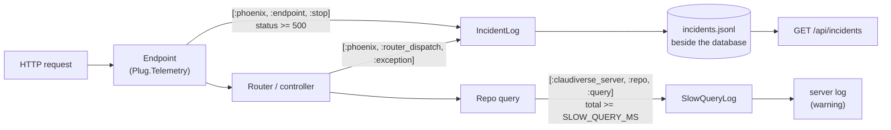

# Operations: health, incidents and slow queries

The server's own diagnostics: a health probe, an append-only record of every
5xx it answers, and a log of slow database queries that separates waiting for
a connection from executing. All three are built to stay useful during an
incident, which is exactly when the database may be the thing that is
failing.

## How it works



Both handlers are `:telemetry` handlers attached in `Application.start/2`
**before** the supervision tree starts, so even migrations at boot are
observed. A `:telemetry` handler that raises is detached silently and for
good, so both wrap everything they do in `rescue`: a malformed event can cost
one record, never the diagnostic itself.

### Health probe

`GET /api/health` is unauthenticated and touches nothing but the endpoint. It
answers `200 {"status":"ok"}` once the application is up. Because the
endpoint is the last child of the supervision tree, and migrations run before
it, a 200 means the database is migrated and every process started. The
container health check in `compose.prod.yml` uses it.

### Incident log

`ClaudiverseServer.IncidentLog` appends one JSON line per incident to a file:

- **`kind: "response"`**: any response with status 500 or above, recorded from
  `[:phoenix, :endpoint, :stop]`. Fields: `status`, `method`, `route`,
  `request_id`.
- **`kind: "exception"`**: an exception raised in a controller, recorded from
  `[:phoenix, :router_dispatch, :exception]`. Fields: `method`, `route`,
  `exception` (the exception module), `message` (first 300 characters),
  `request_id`.

Every line also has `at` (UTC, millisecond precision). `route` is the Phoenix
route pattern (for example `/api/tasks/:id`); when there is none, the request
path with numeric segments replaced by `:id`. `request_id` is the
`x-request-id` response header, so an entry can be matched to the server log.
A failing request usually produces both an `exception` and a `response`
line.

Design rules stated in the code:

- **Not in SQLite.** The incident being counted is often SQLite itself being
  busy; a table would fail for the same reason, exactly when it matters. Lines
  are appended with `O_APPEND`, so concurrent writes of short lines do not
  interleave.
- **On the data volume.** The file lives beside the database, so a count
  survives container swaps (a fresh container starts with empty
  `docker logs`).
- **No request content.** Method, route, status, request id, exception module
  and message only; never params, bodies or headers, which carry API and
  OAuth tokens.

The file is never rotated or truncated by the server.

### Slow-query log

`ClaudiverseServer.SlowQueryLog` logs every `Repo` query whose total time is at
least `SLOW_QUERY_MS` (default 500 ms), at `warning` level so it survives the
production log level:

```
SLOW QUERY total=1840ms queue=1790ms query=48ms decode=0ms source="tasks" sql=SELECT t0."id", t0."fleet", ...
```

| Field | Meaning |
|---|---|
| `total` | Whole query time. Compared with the threshold. |
| `queue` | Time spent waiting for one of the `POOL_SIZE` connections. |
| `query` | Time SQLite spent executing. |
| `decode` | Time decoding the result. |
| `source` | The table (Ecto source), when known. |
| `sql` | The first 240 characters of the SQL with whitespace collapsed. |

A high `queue` with a low `query` means pool starvation (something else is
holding the connections); a high `query` means the query itself is slow.
Query **parameters are never logged**, because they carry API tokens and OAuth
credentials. The line carries the `request_id` of the request that ran the
query (the handler runs in the caller's process and the logger metadata
includes `request_id`).

### Telemetry metrics

`ClaudiverseServerWeb.Telemetry` is the stock Phoenix telemetry supervisor: a
`telemetry_poller` every 10 s and metric definitions for endpoint, router,
socket, channel, Repo and VM measurements. No reporter is configured (the
console reporter is commented out), so these metrics are not exported
anywhere unless you add a reporter.

## Configuration

| Setting | Default | Meaning |
|---|---|---|
| `INCIDENT_LOG` (env) | `incidents.jsonl` beside `DATABASE_PATH` | Path of the incident file. With neither this nor `DATABASE_PATH` set, nothing is recorded. |
| `config :claudiverse_server, :incident_log` | unset | Takes precedence over `INCIDENT_LOG`. |
| `SLOW_QUERY_MS` (env) | `500` | Slow-query threshold in ms, read once when the handler attaches at boot. Non-positive or non-numeric values fall back to 500. |

See [configuration.md](configuration.md) for everything else.

## Interface

### `GET /api/health`

No auth.

```bash
curl -fsS https://claudiverse.example/api/health
# {"status":"ok"}
```

### `GET /api/incidents`

Bearer token required (any user token). Query parameter `since`: an ISO 8601
timestamp with offset; missing or unparseable means the last 24 hours.

```bash
curl -s -H "Authorization: Bearer $TOKEN" \
  "https://claudiverse.example/api/incidents?since=2026-10-09T00:00:00Z"
```

```json
{
  "since": "2026-10-09T00:00:00Z",
  "total": 3,
  "counts": [
    {"kind": "exception", "route": "/api/forum/handoff/set",
     "exception": "Exqlite.Error", "count": 1},
    {"kind": "response", "route": "/api/forum/handoff/set", "status": 500, "count": 1},
    {"kind": "response", "route": "/api/tasks/:id", "status": 503, "count": 1}
  ],
  "latest": [
    {"kind": "exception", "method": "POST", "route": "/api/forum/handoff/set",
     "exception": "Exqlite.Error", "message": "Database busy",
     "request_id": "F1x...", "at": "2026-10-09T08:12:01.123Z"}
  ]
}
```

`counts` groups entries by `kind`, `route`, `status` and `exception` (a key
an entry does not have is left out), largest first. `latest` is the last 20 entries in the window, oldest first. The
endpoint reads the whole file on each call; it is small by design (one line
per 5xx).

On the server itself the file can be read directly, e.g.
`docker compose -f compose.prod.yml exec server tail -n 20 /data/incidents.jsonl`.

### Reading the slow-query log

```bash
docker compose -f compose.prod.yml logs server | grep "SLOW QUERY"
```

## Failure modes and troubleshooting

| Symptom | Meaning | Action |
|---|---|---|
| `GET /api/incidents` always returns `total: 0` | The file path is unset (neither `INCIDENT_LOG` nor `DATABASE_PATH` in the server's environment), or nothing failed in the window. | Check the environment; the Docker image sets `DATABASE_PATH`. |
| `[incident_log] could not record: ...` in the log | The file could not be written (permissions, full disk). | Fix the volume; nothing else is affected. |
| Many `SLOW QUERY` lines with high `queue` | Pool starvation: requests wait for one of `POOL_SIZE` connections, often behind a long write. | Find the slow `query` lines around the same time; they are the holders. SQLite allows one writer at a time, so raising `POOL_SIZE` does not add write capacity. |
| A single `SLOW QUERY` with high `query` | The query itself is slow. | Look at `source` and `sql`; check indexes ([data-model.md](data-model.md)). |
| Health probe times out but the port is open | The node is overloaded or wedged. | Check `SLOW QUERY` lines and `incidents.jsonl` for the minutes before; restart the container if needed. |
| `incidents.jsonl` grows large | It is never rotated. | Rotate or truncate it yourself; the server reopens it per write. |

## Related pages

- [deployment.md](deployment.md): the image, the health check, the data
  volume.
- [configuration.md](configuration.md): `POOL_SIZE`, `SLOW_QUERY_MS`,
  `INCIDENT_LOG`.
- [knowledge-backups.md](knowledge-backups.md): `GET /api/kb/health` reports
  the snapshot custodian's status.
- [../../guide/6-troubleshooting.md](../../guide/6-troubleshooting.md).

## Source

- `claudiverse_server/lib/claudiverse_server/incident_log.ex`
- `claudiverse_server/lib/claudiverse_server/slow_query_log.ex`
- `claudiverse_server/lib/claudiverse_server/application.ex`
- `claudiverse_server/lib/claudiverse_server_web/controllers/incident_controller.ex`
- `claudiverse_server/lib/claudiverse_server_web/controllers/health_controller.ex`
- `claudiverse_server/lib/claudiverse_server_web/telemetry.ex`
- `compose.prod.yml`
