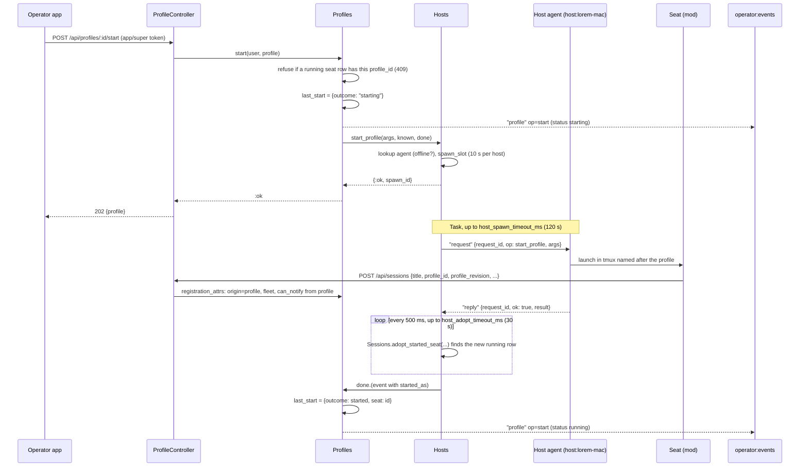
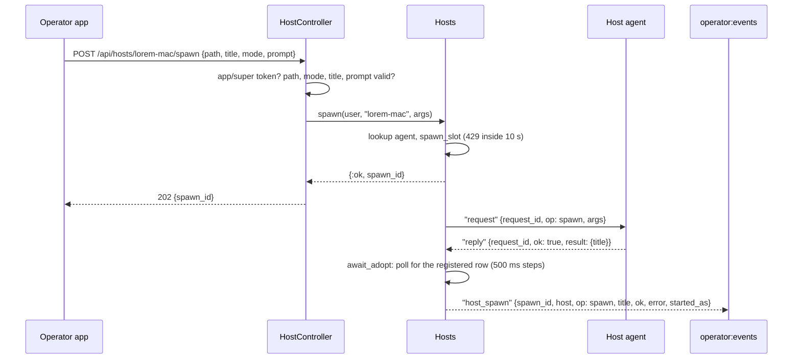
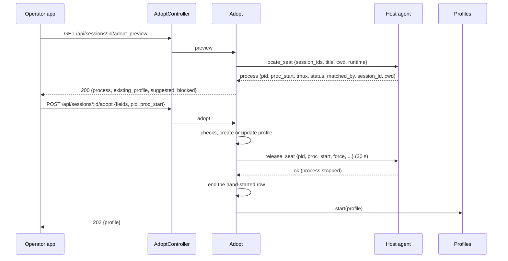

# Profiles and the host channel

A **host agent** is a small service on each machine that runs seats. It connects *out* to the server on the Phoenix channel `host:<name>`, so the machine needs no open port. The server uses that connection to ask the agent things (list a folder, start a seat, stop a seat). A **profile** is a stored, editable description of one managed, long-lived seat (machine, folder, fleet, model, permission mode, ...). Starting a profile asks the profile's machine's agent to launch the seat; the seat then registers with the profile's id and the server fills in the seat's row from the profile. **Adopt** turns a seat somebody started by hand into a profile.

Installing the host agent on a machine is covered in [3. A machine for seats](../../guide/3-machine.md). This page is about what the server does with it.

Design background is in `docs/design/seat-profiles.md`; where it differs from the code, this page follows the code (see "Differences from the design document" below).

## How it works

### Hosts

- A new machine usually gets its tokens with a **join code**: the web panel's (or an app's) **Add a machine** mints one (`POST /api/join_codes`, app or super token), and the machine's installer redeems it once (`POST /api/join`, no token) for the seat token and host token, the pair `Accounts.connect_machine/2` mints. A code is 8 characters (`XXXX-XXXX`, no look-alike letters), works once, for 15 minutes, and only its sha256 is stored. An unknown, used or expired code gets one answer, and failed redeems are throttled per address like sign-ins. See [the installer](../installers.md).
- A host token is minted for a machine name with `POST /api/hosts/:host/token`. The token has context `host:<name>` and can do exactly one thing: join the channel `host:<name>`. It is refused on the HTTP API, on `session:*` topics and on `operator:*` topics.
- The agent joins `host:<name>` and sends what it allows: `roots` (folders it will serve), `version`, `remote_roots`, and, from agents that support profiles, `modes`, `runtimes` and `mcp`. The server stores this as the host's presence record (per user and host name, in a `Registry`). A host is "online" while its channel is joined.
- A second connection for the same host name replaces the first: the old channel is sent `:host_replaced` and stops. If it has not released its registry entry within about 2 seconds, it is killed.
- On join the server also records the socket's peer address as `ip`. That address is used to place seats that did not report their machine (see "Placement" below).
- The server asks, the agent answers. `Hosts.request/5` pushes `"request"` `{request_id, op, args}` to the agent and waits for the matching `"reply"`. The agent is the authority on what it allows (roots, modes, limits); the server only checks the shape of a request and who may ask.
- Spawn, resume and profile start are asynchronous: the agent waits for the new seat's shell and checks it started, which can take tens of seconds. The HTTP call returns 202 at once and the outcome arrives later as an event.

Agent ops the server sends (all inside the `"request"` event):

| `op` | Sent by | `args` |
|---|---|---|
| `ls` | `GET /api/hosts/:host/ls` | `path` |
| `spawn` | `POST /api/hosts/:host/spawn` | `path`, `title`, `mode`, `prompt` |
| `resume` | `POST /api/sessions/:id/resume` | `path`, `title`, `mode`, `session_id` |
| `stop` | `POST /api/sessions/:id/stop`, profile stop | `title` |
| `add_root`, `remove_root` | `POST`/`DELETE /api/hosts/:host/roots` | `path` |
| `start_profile` | profile start/restart/rename/autostart | see "Profiles" below |
| `locate_seat`, `release_seat` | adopt | see "Adopt" below |
| `set_mode` | `POST /api/sessions/:id/permission_mode` | `title`, `mode` (15 s timeout) |
| `interrupt` | the seat's room, when interrupting a busy seat with no inbox poller | `title` |

The last two are used by other features; they are listed so the full op set is in one place.

### Start a profile



A refusal by the agent (`outside_roots`, `not_allowed`, `bad_request`, `not_found`, `limit`) is recorded as outcome `refused`; any other error or a timeout as `failed`; an agent that goes offline as `offline`.

### Spawn via the host channel



If the agent replies with an error, or does not reply within `host_spawn_timeout_ms`, the event has `ok: false` and `error` set (`"<code>: <message>"`, or `"timeout"`/`"offline"`).

### Placement of seats on hosts

A seat row has a `host` column. A seat that reported its machine keeps it. For one that did not (an older plain seat), `Hosts.place/3` fills it in when it registers over HTTP (`POST /api/sessions`) or joins its session channel as sidecar:

1. `Hosts.host_at/2` looks at the user's online agents and picks the one whose `ip` equals the seat's peer address, but only if exactly one agent is at that address. Never a guess: zero or several matches leave the host unset.
2. If there is no agent at that address yet, the seat is remembered in the `Hosts` process (in memory) and placed when an agent at that address joins (`Hosts.place_waiting/2`). This covers a server restart where the seats rejoin before the agents do. The memory is lost on the next restart.

IPv4-mapped IPv6 addresses are converted to plain IPv4 (`Hosts.peer_ip/1`). This depends on the server seeing the machines' real addresses, which holds when they share a LAN with the server and the server is not behind a NAT or a Docker gateway that rewrites them.

Seats started by `spawn`, `resume` or `start_profile` are placed differently: `Sessions.adopt_started_seat/5` finds the row the new seat registered (running, same user and title, host equal or unset, inserted or updated since a second before the request) and fills in whichever of `host`, `origin` (`"spawn"` by default), `working_directory`, and for profiles `profile_id`, `profile_revision`, `tmux_session` are unset. A resume also sets `conversation_id`. Values the seat reported itself are kept.

### Profiles

A profile is one row in `profiles`, unique per `(user_id, name)`. `name` is both the seat title and the tmux session name, and cannot be changed by an edit (only by `rename`). Free-form CLI arguments, environment variables, binary paths and MCP commands are deliberately not fields: `runtime` and `mcp` are names that the machine's agent maps to its own binaries and catalog.

Fields (everything except `id`, `last_start` and the timestamps is writable):

| Field | Type | Default | Validation |
|---|---|---|---|
| `id` | integer | assigned | |
| `name` | string | required at creation | `A-Za-z0-9._-`, 1-64 characters; unique per user; set only at creation or by rename |
| `revision` | integer | 1 | bumped on every edit and rename |
| `machine` | string | required | same character set and length as `name`; the host name |
| `folder` | string | required | must start with `/` |
| `fleet` | string or null | null | same format as `name` |
| `role` | string | `member` | one of `member`, `watcher`, `agent/tools` |
| `can_notify` | boolean | false | |
| `runtime` | string | `stock+mod` | `A-Za-z0-9.+_-`, 1-64 characters; a name the agent knows |
| `model` | string or null | null | free text |
| `effort` | string or null | null | one of `low`, `medium`, `high`, `xhigh`, `max` |
| `permission_mode` | string | `auto` | one of `default`, `acceptEdits`, `plan`, `auto` (never `bypassPermissions`). A profile created before 2026-10-12 without a mode has `default`, and keeps it. |
| `mcp` | list of strings | `[]` | each matches the `name` format; names from the machine's catalog |
| `pooled` | boolean | **true** | a pooled seat goes out with the preferred account and fails over with the pool |
| `autostart` | boolean | false | start when the machine's agent comes online |
| `resume` | string | `latest` | `latest`, `new`, or a conversation UUID |
| `debug` | boolean | false | |
| `last_start` | map or null | null | server-written, see below |
| `inserted_at`, `updated_at` | timestamps | | |

Listings add three derived fields: `status`, `seat` (the id of the running seat row, or null) and `restart_needed` (true when a running seat was started from an older `revision`).

**Status** is derived on every read, never stored. In order, the first match wins:

| Status | Condition |
|---|---|
| `running` | a running, non-proxy seat row has this `profile_id` (the newest wins) |
| `starting` | `last_start.outcome` is `starting` and recorded less than 180 s ago |
| `unregistered` | `last_start.outcome` is `started` with no `seat`, and no `stopped_at`: the machine started the seat but it never registered (for example it sits at a trust prompt in its tmux session), so a client should offer Stop |
| `offline` | the profile's `machine` has no connected agent |
| `failed` | `last_start.outcome` is `refused` or `failed` |
| `stopped` | otherwise |

**`last_start`** is a fact recorded beside the profile, not an edit (the revision is not bumped): `{"at", "requested_at", "outcome", "reason", "seat"}` plus `"stopped_at"` after a stop. `outcome` is `starting`, `started`, `refused`, `failed` or `offline`. `at` is when the outcome was recorded; `requested_at` is when the start was asked for (kept from the `starting` record). If the agent started the seat but no row registered within `host_adopt_timeout_ms`, the outcome is `started` with `seat: null` and the reason "the seat did not register within 30 s" (the text is fixed even if the timeout is configured differently).

**What the agent is told** (`start_profile` args, from `Profiles.launch_args/2`): `name`, `profile_id`, `revision`, `folder`, `fleet`, `can_notify`, `runtime`, `model`, `effort`, `mode` (the profile's `permission_mode`), `mcp`, `debug`, `pooled`, `resume`, `resume_policy`. The server resolves `resume`: `new` becomes null, `latest` becomes the newest conversation id any non-proxy seat row of this profile had (`conversation_id`, else `claude_session_id`), and a UUID is passed as is. `resume_policy` is `latest` when the profile's `resume` is `latest`, else `fixed` (a fixed id must exist on the machine; `latest` lets the agent start fresh if the conversation is gone).

**How a profile becomes a seat.** The agent launches the seat in a tmux session named after the profile, with the profile id and revision in its launch environment. The seat's mod registers with `POST /api/sessions` including `profile_id` and `profile_revision`. In `Profiles.registration_attrs/2` the server then sets, overriding what the seat reported, `origin: "profile"`, `fleet` (from the profile) and `can_notify` (from the profile). A `profile_id` that is not the caller's is dropped along with `profile_revision`. The `role` and `runtime` fields are not copied onto the seat row at registration. `Hosts` additionally fills `host`, `working_directory`, `tmux_session` on the row (see placement above).

**Start, stop, restart.**

- `start`: refused with 409 when a running seat row exists for the profile. Otherwise it records `starting`, calls `Hosts.start_profile`, and returns 202. A rate-limited or offline machine is recorded as `refused` (reason `rate_limited`) or `offline` and returned as an error.
- `stop`: asks the agent to close the tmux session named after the profile (`op: stop`, `args: {title: name}`). On success it stamps `stopped_at` into `last_start` and ends the profile's running rows immediately (`Room.ended_by_machine`), then emits a `stopped` event.
- `restart`: stop, then start, so the seat picks up the current revision. If the agent answers `not_found` (the seat is not running on its machine), the stale running row is ended and the profile is started.
- `autostart`: when an agent joins `host:<name>`, the channel starts a task that starts that machine's `autostart` profiles whose status is `stopped` or `failed`, skipping any whose last start was `refused` or `failed` less than 10 minutes ago (600 000 ms, so a broken profile is not retried on every reconnect). Starts are spaced by `host_spawn_interval_ms + 500` ms (10.5 s by default). When the agent sent `live_seats`, a profile whose rows read running, all on this machine, while no live seat there has its name, is a leftover of a reboot or a dead process: its rows end (as a stop would end them) and it is started like a stopped one. Without `live_seats`, or with a running row on another machine, a running row is left alone, as before.

**Rename.** `POST /api/profiles/:id/rename` is the only way to change `name`, because a running seat reads its title once at launch (the mod's inbox poll and hook URLs, the MCP server's identity, the tmux session). So:

1. Checks, before anything is touched: the `revision` matches (else `stale`); the new name is valid and no other profile of the user has it; no running seat is called that; no handoff exists for the new name as a role; no task in `CLAIMED` or `RUNNING` is claimed by the old name (a runner tracks those by title); and a running seat is not mid-turn (`busy`).
2. If a seat is running it is stopped first (remembering its conversation id).
3. In one database transaction the name moves: the profile row (revision + 1), its session rows (`title`; `display_title` is cleared; `tmux_session` too where it equalled the old name), forum subscriptions of the old name (a subscription the new name already held is not duplicated), the handoff and its version history, and open forum tasks owned by the old name (status other than `done`).
4. Outside the transaction `Notifications.Router.rename/2` moves the seat's notification listener (watch list and queued pings, merged with any the new name already had) and rewrites every other listener's watch list and queued pings that named the old name.
5. A `renamed` event is emitted. If a seat had been running it is started again on the conversation it had (`resume_policy: latest`), and the call returns 202; otherwise 200.

Authorship (posts, documents), done tasks and task events keep the old name. Nothing aliases the old name: a `cv_send` to it finds no seat. If the rename fails after the stop (a lost race), the seat is started again under its old name.

The `moved` object in the response counts what moved: `past_seats`, `forum_subscriptions`, `handoffs`, `handoff_versions`, `open_tasks`, plus from the router `watch_lists` (0 or 1), `queued_pings`, `watchers`.

### Adopt

Adopt puts a seat someone started by hand (for example with `claude` in a terminal) under a profile, so the apps can stop, start and restart it. It needs an agent version 0.9.0 or newer on the seat's machine. The agent finds the seat's process from Claude Code's own session records; on adopt it stops exactly that process (`release_seat`), and the profile is then started the ordinary way, resuming the same conversation in a tmux session the agent runs.



Rules, from `Adopt`:

- The row must be running, must not be a `runner` origin seat, must not already have a `profile_id`, and must have a known `host`. A row with no host can name one (`?host=` on the preview, `"host"` in the adopt body); that guess is accepted only when the agent matches the process by conversation id, never by tmux name and folder alone. A row that has a host ignores the hint.
- A profile with the seat's title may already exist. Then it must be on the same machine, must not be running or starting, and the request must name it with `profile_id`. If the request supplies `profile_id` but no profile has the seat's name, or the profile exists and `profile_id` is missing or different, the request is refused with code `blocked`.
- The resume id always comes from the process the agent found, not from the row (a patched seat's row can carry a stale conversation id).
- `adopt` creates the profile (name = the seat's title, machine = the seat's host) or applies changed fields to the existing one (bumping its revision; a concurrent edit is `blocked` with "the profile was edited meanwhile"), then releases the process. A refusal before the release leaves the process untouched, but the created or edited profile is kept. After the release the hand-started row is ended and `Profiles.start/2` is called; its outcome arrives as for any start (a failed start shows in `last_start`).
- The suggested runtime is `stock+mod` unless the seat's client version contains `[claudiverse]` without `[claudiverse-mod]`, which suggests `patched`. `pooled` is suggested true except for `patched`.
- If the agent reports that the transcript for the conversation is not in the runtime's config dir, the preview returns `blocked` with a sentence saying so.

## Configuration

There are no environment variables. These Application config keys are read at call time with `Application.get_env(:claudiverse_server, key, default)`; none of them is set in `config/*.exs`, so the defaults apply unless you add them (the tests override them).

| Key | Default | Meaning |
|---|---|---|
| `host_spawn_interval_ms` | `10_000` | Minimum gap between spawn, resume and profile-start requests to the same `(user, host)`. Shared by all three. Also paces autostart (plus 500 ms). |
| `host_spawn_timeout_ms` | `120_000` | How long the server waits for the agent to reply to `spawn`, `resume` or `start_profile`. |
| `host_adopt_timeout_ms` | `30_000` | After the agent replies, how long the server polls (every 500 ms) for the new seat's row to register. If none appears, `started_as` / `resumed_as` is null. |

Other fixed values in the code: ordinary requests (`ls`, `stop`, `add_root`, `remove_root`) wait 10 s; `locate_seat` 15 s; `release_seat` 30 s; `set_mode` 15 s. A profile's `starting` status expires after 180 s; autostart skips profiles that failed in the last 600 s.

Token powers: `app` and `super` tokens may use the operator-app endpoints; `super` alone may manage machines and edit profiles; the shared `api` token that seats carry is neither.

## Interface

### Channel: `host:<name>` (host agent)

Connect to `wss://claudiverse.example/socket` with `token=<host token>`, then join `host:<name>`. Only a token whose context is exactly `host:<name>` joins; otherwise the join fails with `this token may not join host:<name>`.

Join payload (all optional; anything of the wrong type is dropped):

| Key | Type | Used for |
|---|---|---|
| `roots` | list of strings | folders the agent serves; shown in `GET /api/hosts` |
| `version` | string | agent version; adopt requires 0.9.0 or newer |
| `remote_roots` | boolean (`true` only) | whether the machine accepts whitelist additions from the desktop |
| `modes` | list of strings | permission modes a profile may choose here |
| `runtimes` | list of `{"name", "version"}` | runtimes a profile may choose; entries without a string `name` are dropped |
| `mcp` | list of strings | MCP catalog names a profile may choose |
| `live_seats` | list of strings | agent 0.12+: the tmux sessions on the machine with a Claude Code process in their pane, at this join. Autostart uses it to start a profile whose row is a leftover (see "Profiles"). Absent when the agent is older or tmux could not say. |

Events:

| Direction | Event | Payload |
|---|---|---|
| server to agent | `request` | `{"request_id", "op", "args"}` |
| agent to server | `reply` | `{"request_id", "ok": true, "result": {...}}` or `{"request_id", "ok": false, "code", "error"}`; a refusal may carry extra keys (an `outside_roots` refusal also carries `path`) |
| agent to server | `seat_modes` | `{"modes": {"<title>": "<mode>"}}` : the permission modes the agent read from its running seats' footers (a mod seat does not report its own). Applied only to this host's running non-proxy seats with that exact title; modes must be one of `default`, `acceptEdits`, `plan`, `auto` |

A reply to an unknown or already-expired `request_id` is ignored. Other incoming events are ignored.

The agent's refusal `code` maps to HTTP as: `outside_roots`, `not_allowed` to 403; `not_found` to 404; `bad_request` to 400; `limit` to 429; anything else to 502. The body is `{"error": message, "code": code}`.

### Channel: `operator:events` (operator apps)

Join `operator:events` with an `app` or `super` (or any non-host) token. Host tokens cannot join. The channel pushes:

| Event | Payload |
|---|---|
| `host_spawn` | `{"spawn_id", "host", "op": "spawn"\|"resume", "title", "ok", "error", "started_as"}`; for resume also `"session_id"` (the row resumed) and `"resumed_as"` (the row the running seat registered, or null) instead of `started_as`. `error` is `"<code>: <message>"`, `"timeout"` or `"offline"` when `ok` is false |
| `profile` | `{"op", "profile"}` where `profile` is the profile as `GET /api/profiles` lists it. `op` is one of `created`, `updated`, `deleted` (profile is then only `{id, name}`), `start`, `stopped`, `renamed` |

The channel also carries `runner` and `pool` events, covered in other pages. Start outcomes for a profile are `profile` events with `op: "start"`: first with status `starting`, later with `running`, `failed` and so on.

### HTTP: hosts

All under `/api`, Bearer token. "App" means an `app` or `super` token.

| Method and path | Token | Behaviour |
|---|---|---|
| `GET /hosts` | any | `{"hosts": [{name, online, seats, roots, remote_roots, version, modes, runtimes, mcp}]}`: online agents plus any host name that has running seats, sorted by name. `seats` counts running non-proxy rows. The last four fields come from the join payload (empty for an offline host or an older agent). |
| `GET /hosts/:host/recent_dirs` | any | `{"dirs": [{path, last_used_at, seats_running}]}`: up to 20 distinct working directories of this user's past seats on that host, newest first. |
| `GET /hosts/:host/ls?path=` | any | Relayed to the agent as `ls`; its result is returned as is. 504 `host <h> is offline` or `host <h> did not answer`; agent refusals as above. |
| `POST /hosts/:host/spawn` | app | Body `path` (required, non-empty), `title` (optional, `A-Za-z0-9._-`, 1-64), `mode` (default `auto`; one of `default`, `acceptEdits`, `plan`, `auto`), `prompt` (optional, at most 20 000 characters). 202 `{"spawn_id"}`. 400 on a bad field, 403 `spawning seats is app-only`, 429 `one spawn per 10 s per host`, 504 if the host is offline. |
| `POST /sessions/:id/stop` | app | Asks the seat's machine to close its tmux session (`stop`, by the seat's title). On success the room is ended and the answer is `{"ok": true, "host", "title"}`. |
| `POST /sessions/:id/resume` | app | Optional body `title`, `mode`. Restarts a stopped seat with `claude --resume`. 202 `{"spawn_id"}`; the outcome is `host_spawn` with `op: "resume"`. The session id used is the row's `conversation_id`, else its `claude_session_id`; the mode defaults to the seat's last mode if it is one of the four, else `auto` (so a seat that ran in `bypassPermissions` resumes in `auto`). Shares the spawn rate limit. |
| `POST /hosts/:host/token` | super | Mints a host token for the name (`A-Za-z0-9._-`, 1-128). 201 `{"name", "token"}`; 400 on a bad name. Put the token in the agent's config. |
| `POST /join_codes` | app | Body `machine` (optional; else the machine names itself when it joins). 201 `{"code", "expires_at", "machine", "server", "command"}`: `server` is the API address the request came in at, and `command` the one-line installer command with the code in it. 403 for an `api` token, 422 on a bad name. |
| `POST /join` | none | Body `code`, `machine` (ignored when the code was minted for one). 200 `{"machine", "seat_token", "host_token"}`. 403 `this join code is unknown, used or expired; …` (one answer for all three), 422 `machine is required` or a bad name (the code is not spent), 429 after repeated failures from one address. |
| `POST /hosts/:host/roots` | super | Body `path` (absolute). Asks the agent to add a folder to its whitelist; the agent refuses (403 `not_allowed`) unless its own config allows remote roots. Returns the agent's `{roots}`. |
| `DELETE /hosts/:host/roots` | super | Body `path`. Removes one; always allowed by design (it only narrows). |

Stop and resume address the seat's tmux session by the title, and only work for the user's own non-proxy seats with a recorded `host`: 404 for others' or proxy rows, 422 `this seat did not report its machine`, 409 `this seat is running; stop it first` (resume), 422 when it has no Claude session id or folder, 400 when its title is not a valid tmux name. A seat renamed after it started is therefore "not found" (404 from the agent).

Example:

```sh
curl -sS -X POST https://claudiverse.example/api/hosts/lorem-mac/spawn \
  -H "Authorization: Bearer $TOKEN" -H 'Content-Type: application/json' \
  -d '{"path": "/home/me/projects/demo", "title": "lorem-w1", "mode": "auto"}'
# 202 {"spawn_id":"Qm3x..."}
```

### HTTP: profiles

| Method and path | Token | Behaviour |
|---|---|---|
| `GET /profiles` | any | `{"profiles": [profile with status]}`, ordered by name. |
| `GET /profiles/:id` | any | `{"profile": ...}`; 404 `Not found`. |
| `POST /profiles` | super | Body: the writable fields plus `name`. `revision`, `last_start` and `id` in the body are ignored. 201 `{"profile"}`; 422 `{"errors": {field: [messages]}}`. A duplicate name is 422 `a profile with this name exists`. |
| `PATCH /profiles/:id` | super | Body: `revision` (the one you read, integer, required: 400 otherwise) plus any writable fields. Only writable fields are applied. A `name` different from the current one is 422. A stale revision is 409 `{"error": "edited since you read it", "profile": <current>}`. Edits apply at the seat's next start; a running seat shows `restart_needed`. |
| `DELETE /profiles/:id` | super | 204; 409 `a seat runs from this profile; stop it first`. |
| `POST /profiles/:id/start` | app | 202 `{"profile"}` (status `starting`). 409 `already running`; 429 `one start per 10 s per machine`; 504 `<machine> is offline`. |
| `POST /profiles/:id/restart` | app | As start (202), after stopping a running seat. |
| `POST /profiles/:id/stop` | app | 200 `{"ok": true}`. The agent's refusals as for hosts (a seat not running on the machine is 404 `not_found`). |
| `POST /profiles/:id/rename` | super | Body `name`, `revision`. 200 `{"profile", "moved"}` when no seat was running; 202 when the seat was running and is being restarted; a name equal to the current one is 200 with `moved: {}`. 400 (`revision` missing), 422 (name missing or malformed), 409 `{"error", "code"}` with `code` one of `name_taken`, `stale` (with `profile`), `busy`, `claimed_task` (with `task_ids`); the stop's errors as for stop. |

Writes with a non-super token are 403 `editing profiles needs the super (desktop) token`; start/stop/restart with an `api` token are 403 `starting and stopping seats is app-only`.

```sh
curl -sS -X POST https://claudiverse.example/api/profiles \
  -H "Authorization: Bearer $TOKEN" -H 'Content-Type: application/json' \
  -d '{"name": "lorem-w1", "machine": "lorem-mac", "folder": "/home/me/projects/demo",
       "fleet": "lorem-fleet", "role": "member", "permission_mode": "auto",
       "mcp": ["claudiverse"], "autostart": true}'
# 201 {"profile": {"id": 1, "name": "lorem-w1", "revision": 1, "status": "offline" or "stopped",
#                  "seat": null, "restart_needed": false, "pooled": true, ...}}

curl -sS -X POST https://claudiverse.example/api/profiles/1/start -H "Authorization: Bearer $TOKEN"
# 202 {"profile": {... "status": "starting", "last_start": {"outcome": "starting", ...}}}
```

### HTTP: adopt

Both app or super token only (403 `adopting seats is app-only`); 404 `Not found` for a session that is not the user's.

| Method and path | Behaviour |
|---|---|
| `GET /sessions/:id/adopt_preview?host=` | 200 `{"process", "existing_profile", "suggested", "blocked"}`. `process` is `{pid, proc_start, tmux, status, version, matched_by, session_id}` from the agent. `suggested` is a full set of profile fields (`machine`, `folder`, `fleet`, `role` `member`, `can_notify`, `runtime`, `model`, `effort`, `permission_mode` (the seat's last mode, else `auto`), `mcp` `["claudiverse"]`, `pooled`, `autostart` false, `resume` the process's conversation id, `debug` false). `blocked` is a sentence for the operator or null; when blocked, `process` and `suggested` are null (and an `outside_roots` refusal adds `folder`). |
| `POST /sessions/:id/adopt` | Body: the profile fields (machine, folder, fleet, role, can_notify, runtime, model, effort, permission_mode, mcp, pooled, autostart, resume, debug), plus `pid` and `proc_start` from the preview, optional `profile_id` (adopt into an existing profile), `force` (stop it even mid-turn), and `host` for a row with no machine. 202 `{"profile"}`. 409 `{"error", "code"}` with `code` `busy`, `profile_running`, `runner`, `process_changed`, `several` or `blocked`. 422 `{"errors"}` on invalid profile fields. 504 with code `offline` when the machine's agent is offline or silent. |

## Failure modes and troubleshooting

| Symptom | Meaning and fix |
|---|---|
| Join fails with `this token may not join host:<name>` | The token is not the host token for exactly this name (a seat token, app token or another host's token). Mint one with `POST /api/hosts/<name>/token` using the super token. |
| 504 `host <h> is offline` | No agent is joined as that host for this user. Check the agent service on the machine and its log; see [6. Troubleshooting](../../guide/6-troubleshooting.md). |
| 504 `host <h> did not answer` | The agent is joined but did not reply within the request timeout (10 s for ls/stop/roots). |
| 429 `one spawn per 10 s per host` / `one start per 10 s per machine` | The per-host rate limit (`host_spawn_interval_ms`) applies to spawn, resume and profile start together. Wait and retry. A profile start refused for this is recorded as `refused` with reason `rate_limited`. |
| 403 `outside_roots` | The folder is not under one of the machine's roots. Add it in the agent's config, or with `POST /api/hosts/:host/roots` if the agent has `allow_remote_roots`. |
| Profile status `offline` | The profile's `machine` has no connected agent. Starting it returns 504. |
| Profile status `failed`, `last_start.reason` set | The agent refused the profile (for example a runtime, mode, MCP name or folder it does not allow) or the seat exited at once. Fix the profile or the agent config. Autostart will not retry for 10 minutes. |
| Profile status `unregistered` | The agent launched the seat but it never registered with the server; it still runs in its tmux session (often a prompt waiting for input, or the mod did not load). Attach to the tmux session, or stop it. |
| `host_spawn` / start event with `started_as: null` | The agent started the seat but no row registered within `host_adopt_timeout_ms`. The seat is probably not connected to the server (token, URL, mod). |
| Seat shows no machine (`host` null) and cannot be stopped from the app (422 `this seat did not report its machine`) | It did not report its host and no single agent shares its address. Restarting it through a spawn or profile fills the host in. |
| Rename 409 `claimed_task` / `busy` / `name_taken` | A runner claims tasks under the old name; the seat is mid-turn; or a profile, running seat or earlier handoff already has the name. Resolve and retry. |
| `restart_needed: true` | The profile was edited after the running seat started; restart it. |
| Adopt blocked `its machine is not known` | The seat's row has no host; pass `host` (the machine the app runs on), which is accepted only if the agent finds the process by conversation id. |
| Adopt blocked "the agent on <h> is <v>; adopting needs 0.9.0" | Update the host agent. |

## Differences from the design document

- Start/stop/restart answer 202 with `{profile}` (start, restart) or 200 `{ok: true}` (stop); there is no request id in the response, and the start outcome is the `profile` event / `last_start`.
- The design says `role` makes `origin` become `profile`. In the code the origin is `profile` for any seat registered with a valid profile id, and `role` is stored but not copied to the seat row at registration.
- The design's status list omits `unregistered`, which the code has.
- The design says profiles cannot be renamed. A rename operation now exists (above).
- The channel moduledoc for `operator:events` lists `profile` ops as `created|updated|deleted|start|stopped`; the code also emits `renamed`.

## Related pages

- [Sessions and rooms](sessions-and-rooms.md): seat rows, `POST /api/sessions` registration, `Room.ended_by_machine`.
- [Notifications](notifications.md): the `Notifications.Router` listener and watch lists that rename moves.
- [Configuration](configuration.md), [Auth](auth.md) (token contexts `api`, `app`, `super`, `host:<name>`), [Tasks and runners](tasks-and-runners.md), [Forum](forum.md), [Account pool](account-pool.md) (`pooled` profiles).
- Guide: [3. A machine for seats](../../guide/3-machine.md) (installing the host agent), [4. Your first seat](../../guide/4-first-seat.md), [6. Troubleshooting](../../guide/6-troubleshooting.md).
- Runners and tools: [cv-mcp: lifecycle tools](../runners/mcp-lifecycle.md)
- Host agent: [Adopting a hand-started seat](../host-agent/adopt.md), [The host channel](../host-agent/channel.md), [Roots and folder browsing](../host-agent/roots.md), [Starting seats](../host-agent/starting-seats.md), [Folder trust and first-run setup](../host-agent/trust-and-setup.md)
- Android: [New seat (spawning a seat)](https://github.com/Promises/claudiverse-apps/blob/main/docs/android/new-seat.md), [Seat profiles](https://github.com/Promises/claudiverse-apps/blob/main/docs/android/profiles.md)
- Mac: [Adopt](https://github.com/Promises/claudiverse-apps/blob/main/docs/mac/adopt.md), [New seat](https://github.com/Promises/claudiverse-apps/blob/main/docs/mac/new-seat.md), [Profiles](https://github.com/Promises/claudiverse-apps/blob/main/docs/mac/profiles.md), [Settings](https://github.com/Promises/claudiverse-apps/blob/main/docs/mac/settings.md)

## Source

- `server/api/lib/claudiverse_server/hosts.ex`
- `server/api/lib/claudiverse_server/profiles.ex`
- `server/api/lib/claudiverse_server/profiles/profile.ex`
- `server/api/lib/claudiverse_server/adopt.ex`
- `server/api/lib/claudiverse_server_web/channels/host_channel.ex`
- `server/api/lib/claudiverse_server_web/channels/operator_channel.ex`
- `server/api/lib/claudiverse_server_web/channels/user_socket.ex`
- `server/api/lib/claudiverse_server_web/controllers/host_controller.ex`
- `server/api/lib/claudiverse_server_web/controllers/profile_controller.ex`
- `server/api/lib/claudiverse_server_web/controllers/adopt_controller.ex`
- `server/api/lib/claudiverse_server/accounts.ex` (host tokens, token powers)
- `server/api/lib/claudiverse_server/notifications/router.ex` (rename)
- `server/api/test/claudiverse_server_web/host_test.exs`, `profile_test.exs`, `adopt_test.exs`
