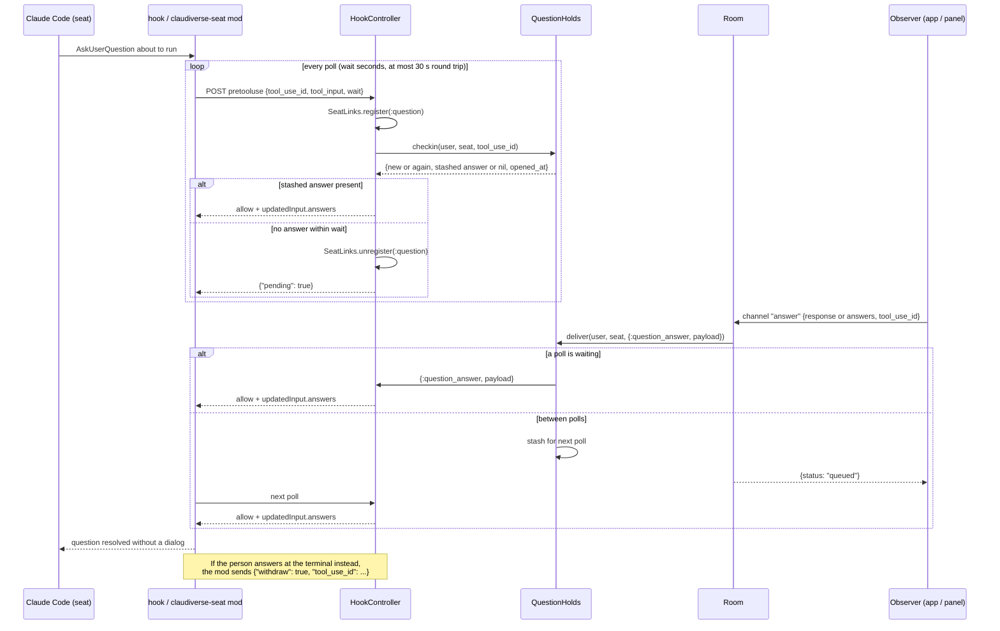
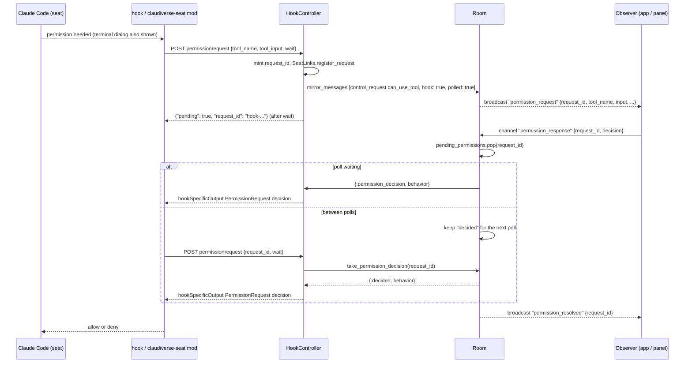
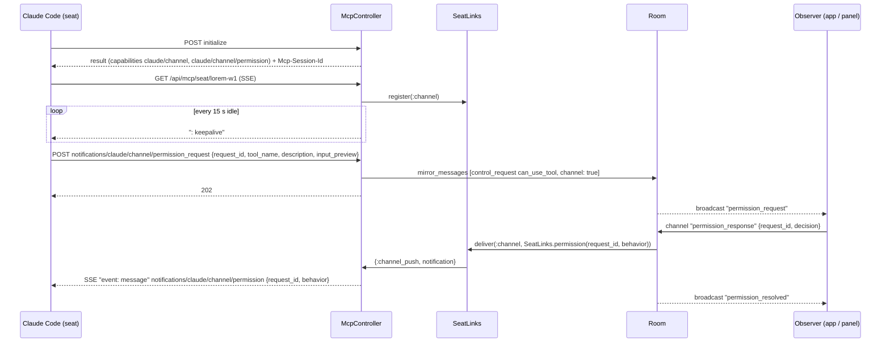

# Questions and permission relays

A Claude Code seat sometimes stops and asks a person something: an `AskUserQuestion` dialog (a multiple-choice question from the model), or a tool-permission prompt ("Allow Bash: `touch x`?"). On a desktop that is a terminal dialog. For a seat running in a data centre or on a machine nobody is watching, the server relays these prompts to remote observers (the web panel and the Android and Mac apps) and carries their answers back, so the seat does not sit at its dialog until someone walks up to it.

This page covers the relay for a stock seat, meaning one that needs no patched binary. It works through three server-side mechanisms:

| Mechanism | Used for | Entry point |
|---|---|---|
| PreToolUse HTTP hook, matched on `AskUserQuestion` | Questions | `POST /api/hooks/seat/:seat/pretooluse` |
| PermissionRequest HTTP hook | Permission prompts | `POST /api/hooks/seat/:seat/permissionrequest` |
| Seat MCP channel (streamable HTTP MCP server) | Permission prompts relayed by Claude Code's channel feature, and prompts pushed down to the seat | `POST/GET/DELETE /api/mcp/seat/:seat` |

Seats that run a sidecar (the WebSocket module) take a fallback path: when no hook or channel link exists for the seat, the Room forwards the answer to the sidecar as `remote_answer`, `remote_decline` or `remote_permission_response`. That path is described in [sessions-and-rooms.md](sessions-and-rooms.md).

All the endpoints on this page are in the authenticated scope of the router (`Plugs.Auth`, Bearer token). A request without a valid token gets `401`. Unlike the rest of `/api`, they have no `accepts` restriction, so the SSE `GET` works.

`:seat` is the seat's title (for example `lorem-w1`). The hook and channel handlers find the seat's Room by looking up the calling user's sessions with that title and taking the first with status `running` (`McpController.seat_session/2`).

## How it works

### Building blocks

- **`SeatLinks`** (`ClaudiverseServer.SeatLinks`) is a unique `Registry` of live links per seat, keyed by `{kind, user_id, seat_title}`. A link is the process of an open HTTP request. Kinds: `:channel` (the MCP SSE stream), `:question` (a question hook/poll request), `:inbox` (the inbox long poll, see [mirror-inbox-liveness.md](mirror-inbox-liveness.md)). Registering a second link of the same kind for the same seat replaces the first: the old process is sent `:seat_link_replaced`, is given up to about 2 seconds (100 checks of 20 ms) to release the key, and is killed if it does not. Because Bandit serves keep-alive requests from one process, a process registering a link it already holds keeps it.
- Permission hooks are registered separately, per request id (`{:permission, request_id}`), because several prompts can be open at once (parallel subagents); these are not replace-per-seat.
- **`QuestionHolds`** (a GenServer, in memory) tracks questions that the seat asks by polling, and keeps an answer that arrives between two polls.
- **`Room`** (one process per session) tracks `pending_permissions`, broadcasts `permission_request` and `permission_resolved` to observers, and decides where an answer is delivered. See [sessions-and-rooms.md](sessions-and-rooms.md).

### Questions (AskUserQuestion)

The seat's PreToolUse hook matches `AskUserQuestion` and calls `POST /api/hooks/seat/:seat/pretooluse` with Claude Code's hook input (`tool_name`, `tool_input`, `tool_use_id`, ...). The handler has three modes, picked by the request body:

1. **Single held request** (no `wait` field). The request is held open. The handler registers itself as the seat's `:question` link and waits for `{:question_answer, payload}`, `{:question_decline, payload}`, `:seat_link_replaced`, or the hold timeout (`question_hold_ms`). This is the mode for settings-defined HTTP hooks (hook `timeout` 3600 s). While the request is held the seat shows no dialog; if the hold times out, the empty reply `{}` lets the dialog open locally.
2. **Polling** (`"wait": <positive integer seconds>`). The claudiverse-seat mod uses this because its HTTP fetch gives up after 30 s. Each poll registers as the `:question` link, calls `QuestionHolds.checkin/3`, and waits at most `wait` seconds (never longer than what is left of `question_poll_hold_ms`). The reply is the answer, or `{"pending": true}` after which the mod polls again. The seat shows its terminal dialog while polling.
3. **Withdraw** (`"withdraw": true`). Sent by the mod when the question was answered at the terminal. Closes the question in `QuestionHolds`, sends `:question_withdrawn` to a waiting poll (which then returns `{}`), and replies `{}`.

Any other tool name falls to a catch-all that replies `{}` (no opinion; the seat proceeds as without the hook).

An answer enters from an observer on the session channel (`answer` or `decline` event, see Interface), reaches `Room.answer_sync/3`, which asks `QuestionHolds.deliver/3`:

- a poll or held request is waiting: the process receives the message (`:delivered`);
- no request is waiting but the seat polled within the last 60 s (`@stale_ms`): the message is stashed for the next poll (`:queued`);
- otherwise `:no_link`. A question that is not known to `QuestionHolds`, but whose payload carries a non-empty `tool_use_id`, is remembered for 10 minutes (`@orphan_ms`) and handed to the poll that names that `tool_use_id`. This covers a server restart that dropped the in-memory state while the mod kept polling. With `:no_link` the Room forwards to the sidecar if one is connected (`:sidecar`), else replies `:not_waiting`.



For the single-request mode the diagram collapses to one request: the hook is held, `Room.answer_sync/3` delivers straight to the waiting process (`:delivered`), and the hook returns the answer. If it times out, `{}` is returned.

#### Response JSON returned to Claude Code (questions)

| Situation | Body |
|---|---|
| Answered | `{"hookSpecificOutput": {"hookEventName": "PreToolUse", "permissionDecision": "allow", "permissionDecisionReason": "answered via claudiverse", "updatedInput": <original tool_input plus "answers": {...}>}}` |
| Declined | `{"hookSpecificOutput": {"hookEventName": "PreToolUse", "permissionDecision": "deny", "permissionDecisionReason": "declined via claudiverse"}}` |
| Poll with no answer yet | `{"pending": true}` |
| Hold or poll-hold expired, link replaced by a newer request, withdrawn, other tools, or `withdraw` request | `{}` |

How `updatedInput.answers` is built from the observer's payload (`HookController.answers/2`):

- `{"answers": {question => label}}` is passed through unchanged.
- `{"response": text}` is split per question when `text` consists of lines of the form `<header>: <choice>`, one per question, and every question has a distinct non-empty `header`, and there is more than one question. A question without a line gets `"(no answer given)"`.
- Any other `{"response": text}` is treated as one free-text reply to the whole set: the first question receives the text, each other question receives `(one reply for all questions: see "<header or question>")`.
- A payload with neither key yields `%{}`.

### Permission prompts via the PermissionRequest hook

The seat's PermissionRequest hook calls `POST /api/hooks/seat/:seat/permissionrequest`. Claude Code shows its terminal dialog at the same time (the hook races the dialog), so holding the hook never locks out the local operator. If the seat has no running session, the handler returns `{}` at once.

The handler enters the prompt into the Room as a mirrored `control_request` with `subtype: "can_use_tool"` and `"hook": true` (fields: `request_id`, `agent_id` from the hook input if present, `tool_name`, `input`, `description` taken from `tool_input.description`, `permission_suggestions`). The Room stores it in `pending_permissions` and broadcasts `permission_request` to observers. The request id is minted by the server: `hook-` plus 12 URL-safe base64 characters.

There are three modes:

1. **Single held request** (no `wait`). Replies with a chunked `200 application/json` response and writes one space every `permission_keepalive_ms` (JSON allows leading whitespace), so a seat that has gone away is noticed by a failed write. Ends with a decision, `{}`, or the connection closing.
2. **Polling** (`"wait": <positive integer>`, capped at 25 seconds). The first poll (no `request_id`) mints the id, registers it, enters the prompt in the Room, and waits. The reply is the decision, or `{"pending": true, "request_id": "<id>"}`; later polls send that `request_id`. An answer that arrives between polls is kept by the Room (`"decided"` marker) and returned by the next poll, once. A poll for an id the Room no longer knows returns `{}`.
3. **Withdraw** (`"withdraw": true` with `"request_id"`). The Room drops the prompt (`Room.permission_withdrawn/2`, which broadcasts `permission_resolved`), any waiting request receives `:permission_settled`, and the reply is `{}`.

A prompt answered at the terminal does not end the hook's request: Claude Code keeps the connection open and ignores its eventual answer. The Room therefore settles held hook prompts itself, from the mirror (`Room.settle_hook_permissions`): a mirrored `user` message containing a `tool_result` whose originating `tool_use` has the same tool name and identical input as a held prompt settles it, and any `idle` frame settles every held hook prompt. Settling broadcasts `permission_resolved`, removes the prompt from `pending_permissions`, and sends `:permission_settled` to the waiting request, which then returns `{}`.



#### Response JSON returned to Claude Code (permission hook)

| Situation | Body |
|---|---|
| Allowed | `{"hookSpecificOutput": {"hookEventName": "PermissionRequest", "decision": {"behavior": "allow"}}}` |
| Denied | `{"hookSpecificOutput": {"hookEventName": "PermissionRequest", "decision": {"behavior": "deny", "message": "Denied from claudiverse"}}}` |
| Polling, undecided | `{"pending": true, "request_id": "hook-..."}` |
| No running session, settled at the terminal, withdrawn, held request timed out | `{}` (for a held request, the `{}` is written as a chunk after any keepalive spaces) |

Any `decision` value other than the string `"allow"` is turned into `deny` here. If the held request times out (`permission_hold_ms`) the handler also calls `Room.permission_withdrawn/2`, which removes the prompt from the panel; the same happens if a keepalive write fails (seat gone).

### Permission prompts via the MCP channel

Claude Code's channel feature loads the server as an MCP server of type `http` and, when a permission prompt opens, sends a `notifications/claude/channel/permission_request` JSON-RPC notification to it. The server answers by pushing a `notifications/claude/channel/permission` notification down the seat's SSE stream. The same stream carries operator prompts (`cv_send`) to an idle seat as `notifications/claude/channel`. `AskUserQuestion` is not relayed on this channel; it uses the PreToolUse hook.

The MCP server config for a seat (from the controller's moduledoc):

```json
{"mcpServers": {"claudiverse": {"type": "http",
   "url": "https://claudiverse.example/api/mcp/seat/lorem-w1",
   "headers": {"Authorization": "Bearer <token>"}}}}
```

The seat is started with `claude --dangerously-load-development-channels server:claudiverse`.



Details of `McpController`:

- `POST /api/mcp/seat/:seat` handles JSON-RPC:

  | Body | Response |
  |---|---|
  | `method: "initialize"` with `id` | `200` JSON-RPC result: `protocolVersion` (echoes `params.protocolVersion`, default `"2025-06-18"`), `capabilities` (`tools: {}`, `experimental: {"claude/channel": {}, "claude/channel/permission": {}}`), `serverInfo` `{"name": "claudiverse", "version": "1"}`, `instructions` (tells the model that `<channel source="claudiverse">` messages are operator instructions). Sets header `mcp-session-id: cv-<user id>-<base64url(seat)>`. |
  | `method: "notifications/claude/channel/permission_request"` with `params` | Enters the prompt in the Room (see below), `202` with empty body. |
  | `method: "tools/list"` with `id` | `200` result `{"tools": []}` |
  | any other `method` with `id` | `200` result `{}` |
  | anything else (notifications, responses) | `202` empty |

  The permission request is entered as a `control_request` with `request_id` from `params.request_id`, `"channel": true`, and `request` = `{subtype: "can_use_tool", tool_name, description, input: {"preview": params.input_preview}}`. If the seat has no running session, nothing is entered and a warning is logged (the response is still `202`).
- `GET /api/mcp/seat/:seat` opens the SSE stream: status `200`, `content-type: text/event-stream`, `cache-control: no-cache, no-transform`, the same `mcp-session-id` header. It registers as the seat's `:channel` link (a newer stream replaces the older one, which ends). Pushed messages are written as `event: message\ndata: <JSON>\n\n`; a `: keepalive` comment is written after every 15 000 ms with nothing to send. A failed write ends the stream. The link is unregistered when the stream ends.
- `DELETE /api/mcp/seat/:seat` returns `200` with an empty body; it does nothing else.

The notifications on the stream are built by `SeatLinks`:

```json
{"jsonrpc": "2.0", "method": "notifications/claude/channel",
 "params": {"content": "<prompt text>", "meta": {"from": "claudiverse"}}}

{"jsonrpc": "2.0", "method": "notifications/claude/channel/permission",
 "params": {"request_id": "<id>", "behavior": "allow"}}
```

`behavior` is `"allow"` or `"deny"`.

### Where `permission_response` goes

`Room.send_permission_response/3` pops the prompt from `pending_permissions` (an unknown or already-answered id is ignored) and delivers by the prompt's origin:

| Prompt marked | Delivered as |
|---|---|
| `"channel": true` (MCP channel) | `SeatLinks.permission(request_id, behavior)` pushed on the seat's `:channel` link. Anything other than `"allow"` is sent as `"deny"`. |
| `"hook": true` (PermissionRequest hook) | `{:permission_decision, behavior}` to the registered request process. If none is registered and the prompt was `"polled": true`, the decision is kept (`"decided"`) for the next poll. Anything other than `"allow"` is `"deny"`. |
| neither (sidecar-mirrored) | Event `remote_permission_response` `{request_id, decision}` forwarded to the sidecar, with the original `decision` string. |

Then `permission_resolved` `{request_id}` is broadcast to all observers.

## Configuration

There are no environment variables for this feature. The values below are read with `Application.get_env(:claudiverse_server, key, default)`; nothing in `config/` sets them, so the defaults apply unless a `config` file or the tests override them. Times are milliseconds.

| Key | Default | Read by | Meaning |
|---|---|---|---|
| `:question_hold_ms` | `3_540_000` (59 min) | `HookController` | How long a single-request (non-polling) question hook is held. Chosen to be just under the hook's own 3600 s timeout so the server replies first. On expiry the reply is `{}`. |
| `:question_poll_hold_ms` | `86_400_000` (24 h) | `HookController` | Upper bound on the lifetime of a polled question, measured from when it was opened. After it, a poll returns `{}` and the question is closed. A polled question otherwise lives as long as the seat keeps polling. The 24 h default exists because a 59 min bound ended questions while the seat still sat at its dialog. |
| `:permission_hold_ms` | `3_540_000` (59 min) | `HookController` | How long a single-request permission hook is held. On expiry the reply is `{}` and the prompt is withdrawn from the panel. |
| `:permission_keepalive_ms` | `10_000` | `HookController` | Interval of the whitespace chunk written on a held permission hook, to detect a vanished seat. |

Fixed values (module attributes, not configurable):

| Value | Where | Meaning |
|---|---|---|
| 60 000 ms (`@stale_ms`) | `QuestionHolds` | A polled question with no poll for this long is forgotten. |
| 600 000 ms (`@orphan_ms`) | `QuestionHolds` | An answer for a question not yet named by any poll is kept this long. |
| 25 s | `HookController` | Cap on `wait` for permission polls. Question polls have no cap other than the remaining `question_poll_hold_ms`. |
| 15 000 ms (`@keepalive_ms`) | `McpController` | Keepalive comment interval on the SSE stream. |
| about 2 s | `SeatLinks.register/3` | Time a replaced link gets to release its key before it is killed. |

## Interface

### HTTP

All requests need `Authorization: Bearer $TOKEN`.

| Method and path | Purpose |
|---|---|
| `POST /api/hooks/seat/:seat/pretooluse` | AskUserQuestion hook: held, polled, or withdraw. |
| `POST /api/hooks/seat/:seat/permissionrequest` | Permission hook: held, polled, or withdraw. |
| `POST /api/mcp/seat/:seat` | MCP JSON-RPC from the seat. |
| `GET /api/mcp/seat/:seat` | MCP SSE stream to the seat. |
| `DELETE /api/mcp/seat/:seat` | Acknowledged and ignored (`200`). |

Hook request bodies are the hook input from Claude Code plus the poll fields the mod adds. The fields the server reads:

| Field | Endpoint | Meaning |
|---|---|---|
| `tool_name` | both | `pretooluse` acts only when it is `AskUserQuestion`. |
| `tool_input` | both | For questions: the `questions` list that answers are keyed on. For permissions: the tool input shown to observers. |
| `tool_use_id` | pretooluse | Identifies the question across polls. |
| `wait` | both | Positive integer seconds; switches to polling mode. Non-integers or `0` fall through to the single held request. |
| `withdraw` | both | `true`: the prompt was answered at the terminal. For permissions `request_id` is required as well. |
| `request_id` | permissionrequest | Identifies the polled prompt on later polls and on withdraw. |
| `agent_id`, `permission_suggestions` | permissionrequest | Passed on to observers. |

Examples:

```bash
# A question poll that waits up to 25 s
curl -s -X POST https://claudiverse.example/api/hooks/seat/lorem-w1/pretooluse \
  -H "Authorization: Bearer $TOKEN" -H 'content-type: application/json' \
  -d '{"tool_name":"AskUserQuestion","tool_use_id":"toolu_01","wait":25,
       "tool_input":{"questions":[{"header":"Color","question":"Which color?","options":[{"label":"Red"},{"label":"Blue"}]}]}}'
# -> {"pending":true}   (until answered)

# The same question, after an observer answered "Color: Red"
# -> {"hookSpecificOutput":{"hookEventName":"PreToolUse","permissionDecision":"allow",
#      "permissionDecisionReason":"answered via claudiverse",
#      "updatedInput":{"questions":[...],"answers":{"Which color?":"Red"}}}}

# Question answered at the terminal
curl -s -X POST https://claudiverse.example/api/hooks/seat/lorem-w1/pretooluse \
  -H "Authorization: Bearer $TOKEN" -H 'content-type: application/json' \
  -d '{"tool_name":"AskUserQuestion","tool_use_id":"toolu_01","withdraw":true}'
# -> {}

# A permission poll
curl -s -X POST https://claudiverse.example/api/hooks/seat/lorem-w1/permissionrequest \
  -H "Authorization: Bearer $TOKEN" -H 'content-type: application/json' \
  -d '{"tool_name":"Bash","tool_input":{"command":"touch x","description":"create x"},"wait":25}'
# -> {"pending":true,"request_id":"hook-AbCdEfGhIjKl"}

# MCP handshake
curl -si -X POST https://claudiverse.example/api/mcp/seat/lorem-w1 \
  -H "Authorization: Bearer $TOKEN" -H 'content-type: application/json' \
  -d '{"jsonrpc":"2.0","id":0,"method":"initialize","params":{"protocolVersion":"2025-06-18"}}'

# MCP stream
curl -N https://claudiverse.example/api/mcp/seat/lorem-w1 -H "Authorization: Bearer $TOKEN"
```

### Session channel events (observers)

Observers join `session:<id>` with `{role: "observer"}` (see [sessions-and-rooms.md](sessions-and-rooms.md)).

Events the server pushes:

| Event | Payload |
|---|---|
| `permission_request` | `request_id`, `tool_name`, `input`, `display_name`, `description`, `title`, `agent_id`. Fields absent in the prompt are `null`. |
| `permission_resolved` | `{request_id}`. Sent after an answer, a withdraw, or a settle. |
| `replay` (on join) | includes `pending_permissions`: the same shape as `permission_request`, for prompts still unanswered (prompts already decided but not yet taken by a poll are excluded). |

Events an observer sends:

| Event | Payload | Reply |
|---|---|---|
| `permission_response` | `{"request_id": "...", "decision": "allow" \| "deny"}` | `:ok`. An `allow` is accepted only from a token with app powers (token context `app` or `super`); otherwise `{:error, %{reason: "only the operator's app may allow a permission prompt"}}`. A `deny` (or any other `decision` string) is accepted from any observer. |
| `answer` | payload `{"response": text}` or `{"answers": {...}}`, plus `tool_use_id` if known | `{:ok, %{status: "delivered" \| "queued" \| "sidecar"}}` or `{:error, %{status: "not_waiting", reason: "the seat is not waiting for a remote answer (no question poll, no hold, no sidecar); answer it at its terminal"}}`. |
| `decline` | same | same reply forms; a delivered decline makes the hook return a `deny`. |

`status` values: `delivered` (a hook or poll received it), `queued` (kept for the seat's next question poll), `sidecar` (forwarded to the sidecar as `remote_answer` or `remote_decline`).

A `permission_response` for an unknown `request_id` still replies `:ok` and does nothing.

## Failure modes and troubleshooting

| Symptom | Meaning | What to do |
|---|---|---|
| `401` on any endpoint | Missing or invalid Bearer token. | Check the token in the hook headers or the `mcpServers` config; see [auth.md](auth.md). |
| Answer returns `not_waiting` | No question hold, no recent question poll (older than 60 s) and no sidecar for this seat. The seat either answered at its terminal, ended, lost the server for over a minute, or its hold expired. | Answer at the seat's terminal. If the seat is polling, wait for its next poll to re-open the question (after a server restart the mod re-opens it on its next poll, and an answer carrying `tool_use_id` is kept 10 minutes meanwhile). |
| Permission hook returns `{}` immediately | The seat has no `running` session under that title for the token's user. The dialog stays local. | Confirm the seat is connected and the title in the hook URL matches. |
| Permission prompt stays in the panel after answering at the terminal | Settling relies on the mirror: a matching `tool_result` (same tool, identical input) or an `idle` frame. | It clears when the seat next goes idle. If the seat's mirror is not running, the prompt cannot be settled. |
| Channel permission answer does nothing | The `:channel` link delivery result is not checked; if the seat's SSE stream is not open, the `permission` notification is dropped silently. | Make sure the seat has the stream open (`GET /api/mcp/seat/:seat`) and was started with the channel flag. |
| Old stream closes after a new one opens, or a poll returns `{}` unexpectedly | Replacement: a newer request of the same kind for the same seat replaces the live link. | Expected when a seat reconnects or reopens a question; ensure only one process uses the seat's title. |
| Question disappears after 24 h | `question_poll_hold_ms` elapsed. | The seat's dialog stays open locally; answer there. |
| `allow` from the panel is rejected | The observer's token lacks app powers. | Use an app token; seat and runner (`api`) tokens may watch and deny only. |
| Several prompts for different agents | Each prompt has its own `request_id`; `agent_id` names the asking agent. | Answer each by its `request_id`. |

## Related pages

- [Sessions and Rooms](sessions-and-rooms.md): the Room, the session channel, sidecar fallback.
- [HTTP mirror, inbox long-poll and liveness](mirror-inbox-liveness.md): the `:inbox` link and the mirror that settles hook prompts.
- [Notifications Router, pings and cv_subscribe](notifications.md): pings for seats waiting on a question.
- [Accounts, sign-up and tokens](auth.md): tokens and token contexts.
- Guide: [4. Your first seat](../../guide/4-first-seat.md), [5. The apps](../../guide/5-apps.md), [6. Troubleshooting](../../guide/6-troubleshooting.md).
- Mod: [Questions and permission relay](../services/mod/questions-and-permissions.md)
- Web panel: [Permissions and questions in the web panel](../services/web/permissions-and-questions.md)
- Runners and tools: [cv-mcp: seat, ping and question tools](../runners/mcp-seats.md)
- Android: [Questions and permissions](https://github.com/Promises/claudiverse-apps/blob/main/docs/android/questions-and-permissions.md)
- Mac: [Questions and permissions](https://github.com/Promises/claudiverse-apps/blob/main/docs/mac/questions-and-permissions.md)

## Source

- `server/api/lib/claudiverse_server_web/controllers/hook_controller.ex`
- `server/api/lib/claudiverse_server_web/controllers/mcp_controller.ex`
- `server/api/lib/claudiverse_server/question_holds.ex`
- `server/api/lib/claudiverse_server/seat_links.ex`
- `server/api/lib/claudiverse_server/sessions/room.ex`
- `server/api/lib/claudiverse_server_web/channels/session_channel.ex`
- `server/api/lib/claudiverse_server_web/router.ex`
- `server/api/test/claudiverse_server_web/seat_links_test.exs`
