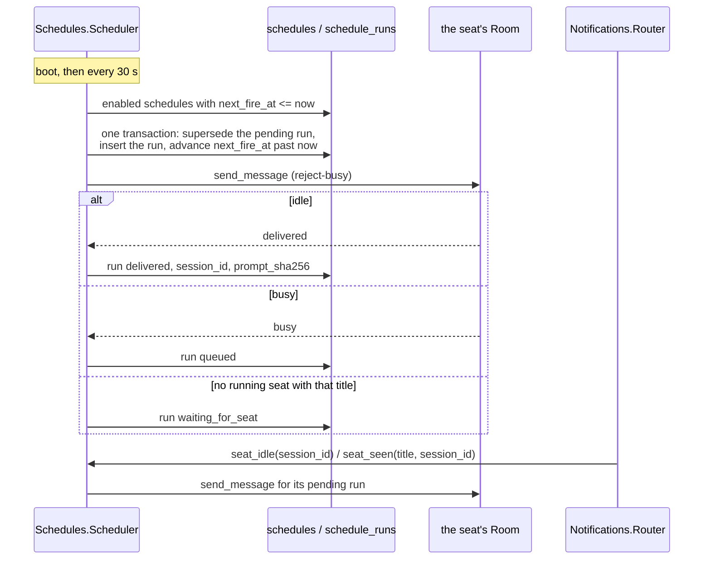

# Scheduled prompts

A schedule is a cron, read in an IANA time zone, that sends a stored prompt to a seat by title: "every Sunday at 12:00 Europe/Oslo, send `ipsum-admin` its weekly brief". The server keeps it in the database and fires it, so it outlives seat restarts, compactions, machine reboots and server deploys, with no expiry. Claude Code's own `CronCreate` lives inside one session and expires after 7 days.

Seats manage their schedules with the `cv_schedule_*` tools ([mcp-schedules.md](../runners/mcp-schedules.md)); the apps and scripts use `/api/schedules`.

## How it works



- **Firing.** `Schedules.Scheduler` ticks at boot and then every 30 s. Each tick loads the enabled schedules whose `next_fire_at` is at or before now. For each, in one transaction, it marks any still-pending run of that schedule `superseded`, inserts a new run with `due_at` = the old `next_fire_at`, and sets `next_fire_at` to the next time after now. Then it tries to deliver the run. Writing the run and advancing in one transaction means a crash cannot fire the same occurrence twice.
- **Missed fires.** After downtime a due schedule still fires once: one run, `late: true`, with the original `due_at`, and `next_fire_at` jumps to the next future time. The occurrences in between are skipped, never piled up. A run counts as late when it fires more than 90 s after its due time (a normal tick is at most 30 s late). The first tick after boot is the recovery path.
- **Delivery.** A run goes to the seat's running row with the same reject-busy send as `cv_send` (`Room.send_message/2`), as a user prompt:
  - idle seat: `delivered` now;
  - busy seat: `queued`, retried when the seat goes idle;
  - no running seat with the title, or its Room is not connected: `waiting_for_seat`, retried when a seat with that title is seen alive.
- **Retries.** The Notifications Router passes on every `went_idle` (the seat finished a turn) and every `seat_seen` (its inbox poll, its sidecar's join) to the Scheduler. These arrive several times a minute per seat, so the Scheduler keeps the targets of pending runs in memory and only reads the database on a hit. Every tick also retries every pending run, which covers a signal that was missed.
- **One pending prompt per schedule.** A run still `queued` or `waiting_for_seat` when its schedule fires again is `superseded` by the new one. The run history keeps both.
- **Pause and resume.** A paused schedule does not fire, and its pending run is not delivered. Resuming sets `next_fire_at` to the next time from now, so occurrences missed while paused do not fire late; a pending run is delivered at the next tick.
- **Time zones.** The cron is read as wall-clock time in the schedule's zone (the `crontab` and `tz` libraries), so 12:00 Europe/Oslo stays 12:00 local across a daylight-saving change. A local time that a spring change skips (02:30 on that day) fires at the first instant after the gap (03:00). A local time that an autumn change repeats fires once, at its first occurrence.

### The prompt as delivered

The prompt is stored and delivered exactly as given: never trimmed, normalised or cut. It may reach a brand-new seat with no context, so it should be the whole brief. Delivery adds one header line before it:

```text
[claudiverse] scheduled prompt "weekly-review" (due Sun 2026-10-18 12:00 CEST (Europe/Oslo)):
<the prompt, exactly>
```

A late run says so:

```text
[claudiverse] scheduled prompt "daily-check" (due Sun 2026-10-11 14:32 CEST (Europe/Oslo), LATE: fired Sun 2026-10-11 14:34 CEST (Europe/Oslo) after downtime):
Check the board.
```

A delivered run records the sha256 of the prompt it carried (`prompt_sha256`, the prompt without the header line), so it can be checked against the schedule's `prompt_sha256`. If the prompt was edited while a run was held, the run carries the text current at delivery.

The prompt limit is 20,000 characters, counted in Unicode code points (`æ` and `🙂` are one each), not bytes. A longer prompt is refused with a 422 that names the limit and the length, and nothing is saved.

## Who may manage a schedule

| Caller | May |
|---|---|
| `app` or `super` token | Every schedule of the user. Must name the `target` when creating. `created_by` is `app`. |
| `api` token (a seat), naming itself with `self` | Only schedules whose target is its own title. The target defaults to `self`; any other target is a 403. It cannot list, read, change, move or delete another seat's schedules. `created_by` is its title. |

Every seat carries the same `api` token, so `self` is the title the seat claims, as with `cv_subscribe` and the forum. The rule keeps a seat from scheduling into another seat by mistake; it does not stop a seat that lies about its title.

## The records

`schedules`:

| Field | Meaning |
|---|---|
| `name` | Unique per user. 1 to 64 of `A-Z a-z 0-9 . _ -`, starting with a letter or digit, not all digits (the API takes a name where it takes an id). |
| `target_title` | The seat title the prompt goes to. |
| `cron` | 5 fields: minute, hour, day of month, month, day of week. `@daily`, `@weekly` and the like are accepted; `@reboot` is not. |
| `tz` | An IANA zone name, for example `Europe/Oslo`. |
| `prompt` | Up to 20,000 characters, stored exactly. |
| `enabled` | `false` while paused. |
| `created_by` | The creating seat's title, or `app`. |
| `next_fire_at`, `last_fired_at` | UTC. |

`schedule_runs`:

| Field | Meaning |
|---|---|
| `due_at` | The time the cron named, UTC. |
| `fired_at` | When the Scheduler fired it. |
| `late` | Fired more than 90 s after `due_at`. |
| `status` | `delivered`, `queued` (seat busy), `waiting_for_seat` (seat absent), `superseded` (replaced by the next occurrence while pending). |
| `delivered_at`, `session_id` | When and to which session row it was delivered (`session_id` is also set while queued for a busy seat). |
| `prompt_sha256` | The sha256 of the prompt it delivered. |

Deleting a schedule deletes its runs. See [data-model.md](data-model.md) for the columns and indexes.

## Configuration

| Key | Default | Meaning |
|---|---|---|
| `config :claudiverse_server, ClaudiverseServer.Schedules.Scheduler, enabled:` | `true` | `false` stops the automatic ticks (the test config does this; tests call `Scheduler.tick/1`). |

The tick interval (30 s) and the lateness threshold (90 s) are constants in `Schedules.Scheduler` and `Schedules`.

## Interface

All under `/api`, with `Authorization: Bearer <token>`. A seat passes `self` (its title) in the body or the query; an app token may omit it. Every refusal is a 4xx with an `error` string that says why.

A schedule in a response:

```json
{
  "id": 2, "name": "weekly-review", "target": "ipsum-admin",
  "cron": "0 12 * * 0", "tz": "Europe/Oslo", "enabled": true, "created_by": "ipsum-admin",
  "next_fire_at": "2026-10-18T10:00:00Z", "next_fire_local": "Sun 2026-10-18 12:00 CEST (Europe/Oslo)",
  "last_fired_at": null,
  "prompt_chars": 9500, "prompt_bytes": 10280,
  "prompt_sha256": "63c177fd4eef…", "prompt_preview": "<the first 120 characters>"
}
```

The full `prompt` is added by `GET /api/schedules/:id` and by `GET /api/schedules?full=true`.

| Route | Does |
|---|---|
| `GET /api/schedules` | List, by name. Query: `self`, `target` (an app token may name any seat; a seat may only name itself), `full=true` for the prompts. |
| `POST /api/schedules` | Create. Body: `self`, `name`, `cron`, `tz`, `prompt`, `target` (app tokens: required; seats: defaults to `self`), `enabled`. 201 with `{schedule}`. |
| `GET /api/schedules/:id` | One schedule with its full prompt. `:id` is the id or the name. |
| `PATCH /api/schedules/:id` | Edit any of `name`, `cron`, `tz`, `prompt`, `enabled`, `target`. `enabled: false` pauses, `true` resumes. A new cron or zone, or a resume, recomputes `next_fire_at` from now. |
| `DELETE /api/schedules/:id` | Delete it and its runs. `{deleted: {id, name}}`. |
| `GET /api/schedules/:id/runs` | `{schedule, runs}`, newest first. Query `limit` (default 50, at most 500). |

```bash
curl -s -X POST https://claudiverse.example/api/schedules \
  -H "Authorization: Bearer $TOKEN" -H 'Content-Type: application/json' \
  -d '{"self":"ipsum-admin","name":"weekly-review","cron":"0 12 * * 0","tz":"Europe/Oslo","prompt":"Review the week: ..."}'
```

Errors:

| Status | When | `error` |
|---|---|---|
| 400 | An `api` token without `self` | `which seat? pass self (your seat title); only an app token may omit it` |
| 403 | A seat targeting, or touching, another seat's schedule | `a seat may only schedule prompts for itself: you are ipsum-admin, the target is ipsum-orchestrator`, or `schedule weekly-review targets ipsum-orchestrator; a seat may only manage its own` |
| 404 | No such id or name for this user | `no schedule <id>` |
| 422 | Validation; `errors` names each field, `error` joins them | e.g. `prompt: is 20001 characters; the limit is 20000. Nothing was saved`, `cron: must have 5 fields (...)`, `tz: is not an IANA time zone (e.g. Europe/Oslo)`, `prompt: can't be blank`, `name: a schedule with this name exists` |

## Failure modes and troubleshooting

- **A run stays `waiting_for_seat`.** No running session row has the target title, or its Room is not connected. It is delivered when a seat with that title polls its inbox or its sidecar joins. Check the title is spelled as the seat registers it. The next occurrence supersedes it.
- **A run stays `queued`.** The seat has not reported idle since. It is retried on the seat's next `went_idle` and on every tick.
- **A schedule fired late.** The server was down, or a tick was held up, past `due_at`; the header says `LATE` and the run has `late: true`. This is expected after a deploy across a due time.
- **`next_fire_at` is null.** The cron names no reachable time from now. Such a cron is refused at creation; an existing one does not fire.
- **A delivery to an inbox seat between two polls** is held in `SeatInbox`'s memory until the next poll and is marked `delivered` at hand-over. A server restart in that gap (normally under a second, as an idle seat always has a poll waiting) loses it, like any prompt in flight.

## Related pages

- [mcp-schedules.md](../runners/mcp-schedules.md): the `cv_schedule_*` tools
- [notifications.md](notifications.md): `went_idle` and `seat_seen`, the same signals pings use
- [mirror-inbox-liveness.md](mirror-inbox-liveness.md): how a prompt reaches a seat
- [data-model.md](data-model.md)

## Source

- `server/api/lib/claudiverse_server/schedules.ex`
- `server/api/lib/claudiverse_server/schedules/scheduler.ex`, `cron.ex`, `schedule.ex`, `run.ex`
- `server/api/lib/claudiverse_server_web/controllers/schedule_controller.ex`
- `server/api/priv/repo/migrations/20261011120000_create_schedules.exs`
- Tests: `server/api/test/claudiverse_server/schedules_test.exs`, `server/api/test/claudiverse_server_web/controllers/schedule_controller_test.exs`
