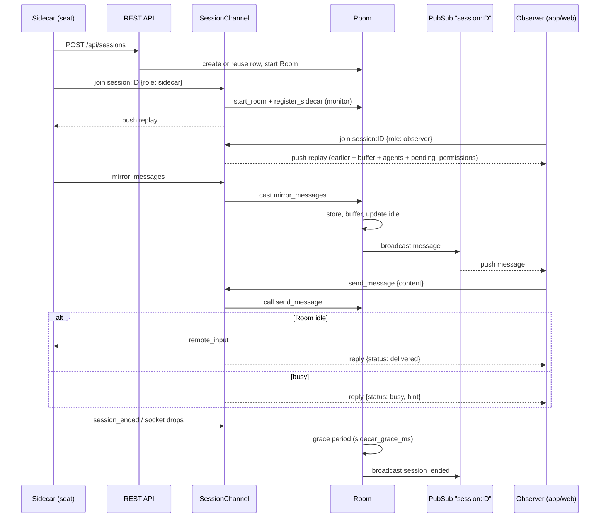
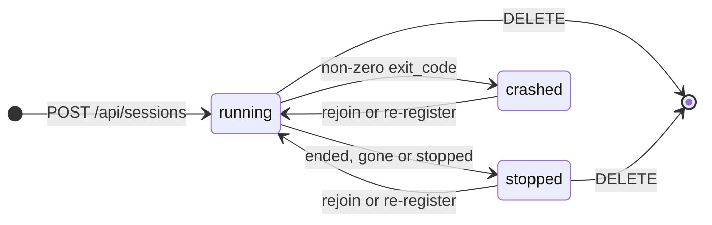

# Sessions and Rooms

A **session** is one row in the `sessions` table: one Claude Code seat as the server knows it (title, machine, status, model, and so on). A **Room** is the in-memory process that goes with a running session. It holds the session's live state (replay buffer, pending permission prompts, idle/busy flag, permission mode), stores the messages the seat mirrors, and fans them out to every connected viewer. Viewers and the seat's sidecar reach a Room through the `session:<id>` Phoenix channel.

This page covers the session and message data, the Room process, the channel protocol and the session REST endpoints. How messages get in over HTTP, the seat inbox and the liveness rules are on [mirror-inbox-liveness.md](mirror-inbox-liveness.md). Questions and permission prompts are on [questions-and-permissions.md](questions-and-permissions.md). Access and paging levels are on [access-and-notify.md](access-and-notify.md).

## How it works

### Data

**`sessions`** (`ClaudiverseServer.Sessions.Session`):

| Field | Type / default | Meaning |
|---|---|---|
| `title` | string | The seat's name. Not unique: lookups by title take the newest running row. |
| `display_title` | string | The name Claude Code's own picker shows. Display only; never address a seat by it. |
| `type` | enum `sidecar`, `spawned`, `proxy`; default `spawned` | `POST /api/sessions` always creates `sidecar`. `proxy` rows are fed from API traffic by the proxy observer, are titled `proxy:<seat>`, and are never matched for reuse. |
| `mode` | enum `json`, `pty`; default `json` | |
| `status` | enum `running`, `stopped`, `crashed`; default `running` | |
| `working_directory`, `model` (default `"sonnet"`), `permission_mode` (default `"default"`) | strings | `model` is overwritten by the Room from the `message.model` of assistant messages it mirrors (only when it changes). The `permission_mode` column is not updated by the Room; the live mode is in Room state (see below). |
| `claude_session_id` | string | Claude Code's own session UUID, reported by the seat. Stable across reconnects. |
| `conversation_id` | string | The conversation `claude --resume` must continue, when that differs from `claude_session_id` (a resumed seat reports a placeholder id). Not cast from request params; set by the server (host spawn/resume adoption). |
| `host`, `fleet`, `origin` | strings | Placement: which machine, which fleet, and how the seat was started. `origin` must be one of `manual`, `spawn`, `runner`, `profile`, `plain`. See [profiles-and-hosts.md](profiles-and-hosts.md). |
| `client_version` | string | Claude Code's version line as the seat reports it. |
| `profile_id`, `profile_revision`, `tmux_session` | integers / string | Set when the seat was started from a profile. |
| `can_notify`, `access`, `notify_grant`, `notify_until` | boolean, string, boolean, UTC datetime | Paging and tool-access settings. The API shows derived values; see [access-and-notify.md](access-and-notify.md). |
| `last_activity_at` | virtual | Not a column. Computed by the list/show queries as the newest message `inserted_at`, falling back to the session's `inserted_at`. |
| `user_id`, `inserted_at`, `updated_at` | | Owner and timestamps. |

**`messages`** (`ClaudiverseServer.Sessions.Message`): `type` (string), `payload` (JSON map: the message exactly as mirrored, plus a `timestamp` if it had none), `sequence` (integer), `session_id` (foreign key, `on_delete: :delete_all`), `inserted_at` (no `updated_at`). Indexed on `(session_id, sequence)`, and on `(session_id, inserted_at)` for the activity query.

`sequence` is seeded per Room as `max(sequence) + 1` when the Room starts and then incremented in memory. It is an ordering hint, not a guaranteed-unique key: the insert result is not checked, so gaps or ties are possible, which is why "last activity" is computed from `inserted_at` and not from the highest sequence.

### Session lifecycle in `Sessions`

- **Create or reuse** (`Sessions.create_session/1`). If the request carries a `claude_session_id`, the server looks for this user's newest (by `updated_at`, then `id`) non-proxy row whose `claude_session_id` equals it or whose `conversation_id` equals it. If found, that row is revived in place (status forced to `running`, incoming attributes win) instead of inserting a new row. Without a `claude_session_id` a new row is always inserted.
- **Listing** is bounded and running-first. `list_sessions/2` defaults to `status: :running` and `limit: 200`; `list_sessions_by_title/3` defaults to `status: :all`. Ordering is running rows first, then by last activity descending. The activity value is a correlated subquery per row, not a `GROUP BY` over `messages`, because the grouped form took tens of seconds on a large database.
- **Replay data**: `recent_payloads/2` and `recent_agent_payloads/2` seed a Room's buffers from stored rows; `earlier_conversation/2` returns up to 500 payloads (oldest first) from the same user's earlier rows of the same conversation, so a resumed seat's replay is not empty.
- `stamp_time/2` adds an ISO-8601 `"timestamp"` to a row that has none (and to the inner message of an `agent_message`), because the apps read message times from it. A row's own timestamp always wins.

### The Room

One `ClaudiverseServer.Sessions.Room` GenServer exists per active session, registered in `ClaudiverseServer.Sessions.Registry` (a `:unique` `Registry`) under the integer session id. Rooms are children of `ClaudiverseServer.Sessions.Supervisor`, a `DynamicSupervisor` (`:one_for_one`). `start_room/2` is idempotent: an already-started Room returns `{:ok, pid}`.

Rooms are started lazily, not at boot. Something has to touch the session: `POST /api/sessions`, a sidecar joining the channel, `POST /api/sessions/:id/mirror`, an inbox poll, or the proxy observer. A stopped session gets no Room after a server restart; the channel and `GET /api/sessions/:id` handle a missing Room (empty replay, `live: null`).

State kept in a Room:

| State | Detail |
|---|---|
| Replay buffer | Last 500 non-live-only main-thread messages, newest first, reversed on read. Seeded from the database at `init`. |
| Agent buffer | Last 300 `agent_*` rows (`agent_started`, `agent_message`, `agent_turn_complete`, `agent_ended`, `agents`), kept apart so a busy fork cannot push main's history out. Also the latest `agents` list and `background_tasks` list. |
| `idle` / `readiness_known` | Idle is true only after a mirrored `{"type": "idle"}` frame (or a `cvstate` heartbeat that says so). At `init`, the last stored `idle_transition` event restores it. |
| `pending_permissions` | `request_id` to the original `control_request` message (see below). |
| `permission_mode` | The mode as the seat last reported it; `nil` if never reported. |
| `pending_modes` | Callers waiting on a `set_permission_mode` answer. |
| `sidecar_channel_pid`, `sidecar_gone` | The sidecar's channel process (monitored), and the grace-period token. |
| `owner_id`, `sequence`, `status` | Owning user id, next message sequence, `running`/`stopped`. |

**Mirrored messages** (`{:mirror_messages, list}`, from the sidecar channel or `POST /api/sessions/:id/mirror`) are processed one by one:

- `cvstate` heartbeat: not stored; reconciles the idle flag and logs `idle_reconcile` / `tasks` events.
- `session_ended`: ends the session (status `stopped`, or `crashed` for a non-zero `exit_code`) and broadcasts `session_ended`.
- `background_tasks`: stored, broadcast as `message`, and kept as Room state.
- `agent_*` types: stored, broadcast, put in the agent buffer; they never change main's idle state or permissions.
- Everything else: images are moved to the file store, a timestamp is stamped, the model is noted, the row is stored (unless live-only), added to the replay buffer (unless live-only), broadcast as `message`, forwarded to the notification router for `idle`, `assistant` (AskUserQuestion) and `compact` types, and sets `idle` to `type == "idle"`. A transition of the flag is recorded as an `idle_transition` event.
- **Live-only types** are broadcast but neither stored nor buffered: `stream_event`, `progress`, `set_in_progress_tool_use_ids`, `interruptible_tool_in_progress`, `stream_request_start`.
- A `control_request` whose `request.subtype` is `can_use_tool` is a permission prompt: it is saved in `pending_permissions` and also broadcast as `permission_request`.

**Prompt delivery** (`send_message/2`): only if the Room is idle. If idle, the message is delivered and the Room flips to busy; if busy it is rejected with `{:busy, hint}`, where `hint` is the first 120 characters of the newest assistant text (or `"in progress"`). The route is the seat's MCP channel, else its inbox poller, else the sidecar (`remote_input`). `force_message/2` takes the same route without the idle check (used by the app's force send, see [notifications.md](notifications.md)). (`inject/2`, which skips the idle check, has no callers.) Route selection details: [mirror-inbox-liveness.md](mirror-inbox-liveness.md).

**Interrupt**: if the Room is not idle and no inbox poller is linked, the machine's host agent is asked to press Escape in the seat's tmux session (async); a `remote_interrupt` event is also sent to the sidecar, but the patched runtime has no handler for it.

**Permission mode**: `set_permission_mode/2` requires a connected sidecar, sends `remote_set_mode` with a random `request_id`, and waits up to `mode_reply_ms` for the sidecar's `permission_mode_result`. The seat also reports its mode on change with `permission_mode`.

**Sidecar loss**: when the sidecar's channel process goes down, the Room waits `sidecar_grace_ms` (default 20 000 ms). If the sidecar has not re-registered, the session row is set to `stopped`, `session_ended` (`exit_code` 0) is broadcast and the Room's `status` becomes `stopped`. A sidecar that re-joins within the grace period announces nothing. On re-join the row is persisted back to `running`.

**`NdjsonParser`** (`Sessions.NdjsonParser`) is a small stateful parser for newline-delimited JSON: `feed/2` appends data to a buffer, returns the decoded objects of all complete lines and keeps the trailing partial line; lines that fail to decode are dropped silently. Nothing in `lib/` or `test/` calls it today, so it plays no part in the sidecar path.



Session status as the server records it:



- **Ended, gone or stopped**: a `session_ended` frame with exit code 0, a sidecar gone past its grace, an inbox poll gone (see [mirror-inbox-liveness.md](mirror-inbox-liveness.md)), or a stop the host confirmed.
- **Non-zero exit_code**: a `session_ended` frame with a non-zero `exit_code`.
- **Rejoin or re-register**: a sidecar joins again, or `POST /api/sessions` arrives with a `claude_session_id` the server knows.
- **DELETE**: `DELETE /api/sessions/:id`.

## Configuration

Environment variables: none. Application config keys read by the Room (all optional):

| Key (`config :claudiverse_server, ...`) | Default | Meaning |
|---|---|---|
| `sidecar_grace_ms` | `20_000` | Grace period after a sidecar disconnects before the session is ended. `config/test.exs` sets `100`. |
| `mode_reply_ms` | `8_000` | How long `set_permission_mode` waits for the seat's answer. The caller's GenServer timeout is this plus 2 000 ms. |
| `room_liveness_ms` | `60_000` | Interval of the Room's inbox liveness tick (see [mirror-inbox-liveness.md](mirror-inbox-liveness.md)). |
| `inbox_stale_ms` | `120_000` | Age after which an unpolled inbox mark is ignored (same page). |

Compile-time constants (not configurable): replay buffer 500, agent buffer 300, session list default limit 200, `GET /api/sessions` maximum `limit` 5000, inbox miss limit 3.

## Interface

All REST endpoints are under `/api`, require `Authorization: Bearer $TOKEN`, and are scoped to the token's user (another user's session is a 404). A missing or invalid token gets `401 {"error": "Unauthorized"}`. A host-agent token (context starting `host:`) is also rejected with 401. Tokens have a context: `api` (seats, web), `app`, or `super`. "App-only" below means `app` or `super`.

### Session JSON

Returned by every session endpoint:

```json
{
  "id": 42,
  "title": "lorem-w1",
  "display_title": "Fix the build",
  "type": "sidecar",
  "mode": "json",
  "status": "running",
  "model": "claude-opus-5",
  "working_directory": "/home/me/project",
  "host": "lorem-mac",
  "fleet": "lorem-fleet",
  "origin": "spawn",
  "can_notify": false,
  "access": "full",
  "access_explicit": false,
  "notify_grant": null,
  "notify_until": null,
  "claude_session_id": "…uuid…",
  "conversation_id": null,
  "profile_id": null,
  "client_version": "…",
  "inserted_at": "2026-10-01T09:00:00",
  "last_activity_at": "2026-10-01T09:05:00",
  "activity": "idle",
  "background_running": 0
}
```

`can_notify`, `access`, `access_explicit`, `notify_grant`, `notify_until` are derived by `Sessions.Access` ([access-and-notify.md](access-and-notify.md)). `activity` is `busy`, `idle`, `disconnected` or `unknown`: `disconnected` for a stopped/crashed row, for a running row without a Room, or when neither a sidecar nor an inbox poll is connected; `unknown` when the Room did not answer within 200 ms. `background_running` is the count of pending/running background tasks the seat reported (0 if not connected). The session JSON does not include `permission_mode`, `profile_revision` or `tmux_session`.

### `GET /api/sessions`

Lists the caller's sessions, running first, then by last activity descending.

| Query param | Values | Default |
|---|---|---|
| `status` | `running`, `stopped`, `crashed`, `all` | `running` (or `all` when `title` is given). Unknown values fall back to the default. |
| `limit` | integer 1 to 5000 | 200. Anything else is ignored. |
| `title` | exact title | none. Switches to `list_sessions_by_title`, running-first, so the first element is the best match. |

```bash
curl -s -H "Authorization: Bearer $TOKEN" \
  "https://claudiverse.example/api/sessions?status=all&limit=50"
# {"sessions":[{...}, ...]}
```

Each running row costs one Room call with a 200 ms timeout, so the list cannot hang on a busy Room.

### `POST /api/sessions`

Registers a seat (or re-registers it). Returns `201 {"session": {...}}`.

| Body param | Meaning |
|---|---|
| `title` | Default `"Untitled"`. Always written. |
| `claude_session_id` | If it matches a known row (see reuse above), that row is revived instead of creating a new one. |
| `model`, `display_title`, `host`, `fleet`, `origin`, `working_directory`, `client_version`, `tmux_session` | Applied only when a non-empty string; absence means "no change", so a re-POST (for example after a rename) never wipes them. |
| `profile_id`, `profile_revision` | Applied only when a clean integer. |
| `notify` | `true`/`"1"`/`"true"` sets `can_notify` true; `false`/`"0"`/`"false"` sets it false; absent is no change. |

`type` is forced to `sidecar`, `mode` to `json`, `status` to `running`. The profile, if any, may override placement (`Profiles.registration_attrs/2`). After the insert/update the server places the seat on a machine by its source address (`Hosts.place/3`), starts the Room, and updates the seat's account assignment label with the new title (from the `X-Claudiverse-Client` header identity).

```bash
curl -s -X POST -H "Authorization: Bearer $TOKEN" -H 'Content-Type: application/json' \
  -d '{"title":"lorem-w1","claude_session_id":"3f2a…","host":"lorem-mac","fleet":"lorem-fleet"}' \
  https://claudiverse.example/api/sessions
```

Errors: `422 {"errors": {field: [messages]}}` on a changeset failure (for example an `origin` outside the allowed list).

### `GET /api/sessions/:id`

`200 {"session": {...}, "live": <status or null>}`. `live` is the Room's status map when a Room exists, else `null`:

```json
{"status": "running", "sidecar_connected": true, "has_sidecar": true, "idle": true,
 "busy_agents": 0, "background_running": 0, "readiness_known": true,
 "permission_mode": "default"}
```

`sidecar_connected` is true for a sidecar or a live inbox poll; `has_sidecar` only for a sidecar socket. `permission_mode` is `null` until the seat reports one. `404 {"error": "Not found"}` for an unknown or foreign id (including a non-integer id). Note this call waits the default 5 s for a busy Room, unlike the list.

### `DELETE /api/sessions/:id`

Stops the Room (if any) and deletes the row; its messages are deleted by the database foreign key. `200 {"ok": true}`, or `404 {"error": "Not found"}`. This does not tell the seat or its machine anything; to stop a running seat use the host stop endpoint ([profiles-and-hosts.md](profiles-and-hosts.md)).

### `POST /api/sessions/:id/title`

Asks a seat to rename itself. Body: `{"title": "lorem-w2"}`. The title is trimmed.

| Status | Body |
|---|---|
| 200 | `{"requested": "lorem-w2"}` |
| 400 | `{"error": "title cannot be blank"}`, `{"error": "title is required"}` (missing or not a string), `{"error": "bad session id"}` (non-integer id) |

This only sends a `set_title` event to the sidecar. The seat applies the name and re-POSTs `/api/sessions`, which is what updates the row. A seat pinned by `CLAUDIVERSE_TITLE` refuses and logs why. A 200 means "requested", not "renamed", and it is returned even if the session has no connected sidecar.

### `POST /api/sessions/:id/permission_mode`

App-only. Body: `{"mode": "plan"}` where `mode` is one of `default`, `acceptEdits`, `plan`, `auto` (`bypassPermissions` and `dontAsk` are deliberately not settable).

| Status | Body | Meaning |
|---|---|---|
| 200 | `{"status": "applied", "mode": "plan"}` | The seat reports the mode it applied. |
| 400 | `{"error": "mode must be one of default, acceptEdits, plan, auto"}` | |
| 403 | `{"error": "permission mode is app-only"}` | Token context is `api`. |
| 404 | `{"error": "session not found"}` | |
| 409 | `{"status": "refused", "error": "...", "code": ...}` | The seat (or the machine agent) declined it. |
| 503 | `{"error": "seat not connected"}` | No sidecar and the row has no `host`. |
| 503 | `{"error": "the agent on lorem-mac is offline"}` | Fallback path, host agent offline. |
| 504 | `{"error": "seat did not answer"}` | No answer within `mode_reply_ms` (for example a runtime without the mode hook). |
| 504 | `{"error": "the agent on lorem-mac did not answer"}` | Fallback path, 15 s timeout. |

If there is no sidecar but the row has a `host`, the machine's agent switches the mode in the seat's tmux pane (request `set_mode`) and the Room records the reported mode at once.

```bash
curl -s -X POST -H "Authorization: Bearer $TOKEN" -H 'Content-Type: application/json' \
  -d '{"mode":"acceptEdits"}' https://claudiverse.example/api/sessions/42/permission_mode
```

### `GET /api/models`

The models a seat can run, for the pickers in the web panel and the apps, so their lists cannot drift apart. Any token. The list is `server/api/priv/models.json`, read when the server is compiled (`ClaudiverseServer.Models`). Its values come from Claude Code's own built-in model catalog (2.1.296), so update the file when a model is released; its 1M fields follow Claude Code's own rule for when the 1M window applies (`Oa` in 2.1.296). The web panel's built-in copy (`server/web/src/lib/models.ts`, used until the list loads) is held equal to it by a test. The apps' core fetches the list and keeps its own built-in list as a fallback.

```json
{"source": "Claude Code 2.1.296's built-in model catalog and its 1M rule, and Anthropic's models overview, read 2026-10-13",
 "models": [{"id": "claude-opus-5-5", "label": "Opus 5.5", "family": "opus", "one_m": true, "accepts_1m_suffix": false, "since": null, "older": false},
            {"id": "claude-haiku-5-5", "label": "Haiku 5.5", "family": "haiku", "one_m": true, "accepts_1m_suffix": false, "since": "2.1.293", "older": false},
            {"id": "claude-sonnet-4-6", "label": "Sonnet 4.6", "family": "sonnet", "one_m": false, "accepts_1m_suffix": true, "since": null, "older": true}],
 "aliases": [{"id": "default", "label": "Default"}, {"id": "opus", "label": "Opus (latest)"}]}
```

`models` is in display order.

| Field | Meaning |
|---|---|
| `id` | Exact, as `/model` and `--model` take it. Match a seat's reported model against it exactly, never by prefix: `claude-opus-5` is a prefix of `claude-opus-5-5`. A seat reports the bare id in its replies; its row may add `[1m]`, and an older model may report a dated id (`claude-haiku-4-5-20251001`). |
| `one_m` | The bare id already has a 1M context window: Claude Code's "native" 1M (`native_1m` in its catalog), true of every Claude 5 model. |
| `accepts_1m_suffix` | `<id>[1m]` gives it the 1M window: Claude Code's "optIn" (`supports_1m_beta`, except for Claude 3, Opus 4.0, 4.1 and 4.5, and Haiku 4.5). In 2.1.296 that is Opus 4.6 and Sonnet 4.6, 4.5 and 4. False where `one_m` (nothing to add), and where Claude Code strips the suffix and ignores it. |
| `since` | The first Claude Code version that knows the id, or null for every version the fleet runs. Haiku 5.5 is `2.1.293` (its changelog; 2.1.292 does not know it, and there the `haiku` alias is Haiku 4.5). Compare it with a machine's `spawn.version` (`GET /api/hosts`). |
| `family` | `opus`, `sonnet`, `haiku`, `fable` or `mythos`. |
| `older` | An earlier generation, folded away in a picker. |
| `aliases` | Names Claude Code resolves to a model of its own choosing. |

```bash
curl -s -H "Authorization: Bearer $TOKEN" https://claudiverse.example/api/models
```

Other session endpoints are documented elsewhere: `POST /api/sessions/:id/mirror` ([mirror-inbox-liveness.md](mirror-inbox-liveness.md)), `/access` and `/notify` ([access-and-notify.md](access-and-notify.md)), `/stop`, `/resume` ([profiles-and-hosts.md](profiles-and-hosts.md)).

### WebSocket and channel

Connect to `wss://claudiverse.example/socket/websocket?token=$TOKEN` (Phoenix socket mounted at `/socket`). A missing or invalid token refuses the connection. A host-agent token can connect but cannot join `session:*` (join error `{"reason": "host tokens cannot join seats"}`). The socket id is `user_socket:<user id>`.

Join topic `session:<id>` with params `{"role": "sidecar"}` or `{"role": "observer"}` (default `observer`). Join errors: `{"reason": "not_found"}` for an id that is not this user's session. A non-integer id raises in the channel (no error reply). A sidecar join also: places the seat on its machine if the row has none, starts the Room if needed, registers the channel as the sidecar (replacing any previous one), and informs the notification router that the seat is seen. After joining, the server pushes `replay`.

Events from the **sidecar** (ignored from observers):

| Event | Payload | Effect |
|---|---|---|
| `mirror_messages` | `{"messages": [ {"type": ..., ...}, ... ]}` | Processed by the Room as above. |
| `permission_mode` | `{"mode": "plan"}` | Records the seat's current mode. |
| `permission_mode_result` | `{"request_id": ..., "ok": true, "mode": "plan"}` or `{"request_id": ..., "ok": false, "error": "...", "code": ...}` | Completes a `remote_set_mode` request. |
| `mirror_pty` | `{"data": "..."}` | Broadcast as `pty_output` to all viewers; not stored. |
| `session_ended` | `{"exit_code": 0}` | Row set to `stopped` (0) or `crashed`; `session_ended` broadcast. |

Events from an **observer** (ignored from sidecars; any unmatched event or role is silently dropped, no reply):

| Event | Payload | Reply |
|---|---|---|
| `send_message` | `{"content": "text"}` | `{status: "delivered"}`, `{status: "busy", hint: "..."}`, or `{status: "error", error: "not connected"}` (no Room). |
| `interrupt` | `{}` | none |
| `permission_response` | `{"request_id": "...", "decision": "allow" \| "deny" \| ...}` | `ok`. An `allow` needs an `app`/`super` token, else `{reason: "only the operator's app may allow a permission prompt"}`. Any other decision is treated as a deny by the Room's routes that only know allow and deny. An unknown or already-taken `request_id` is ignored. |
| `send_raw` | `{"data": "..."}` | `ok`; app/super token only, else `{reason: "only the operator's app may send keystrokes to a seat"}`. Sent to the sidecar as `remote_raw`. |
| `answer` / `decline` | question payload | `{status: "delivered" \| "queued" \| "sidecar"}`, or error `{status: "not_waiting", reason: "..."}` when nothing is listening ([questions-and-permissions.md](questions-and-permissions.md)). |

Events pushed to **all** members (observers and the sidecar, except that the sidecar does not receive `message`):

| Event | Payload |
|---|---|
| `replay` | See below. Pushed once after join. |
| `message` | The mirrored message map (with `timestamp`). Includes live-only frames. |
| `permission_request` | `{request_id, tool_name, input, display_name, description, title, agent_id}` (`agent_id` is absent/`null` for the main agent). |
| `permission_resolved` | `{"request_id": "..."}` |
| `pty_output` | `{"data": "..."}` |
| `session_ended` | `{"exit_code": n}` |

Events pushed to the **sidecar** only (from the Room):

| Event | Payload | Cause |
|---|---|---|
| `remote_input` | `{"content": "..."}` | Prompt delivery when no MCP channel or inbox takes it. |
| `remote_raw` | `{"data": "..."}` | `send_raw` |
| `remote_interrupt` | `{}` | `interrupt` |
| `remote_permission_response` | `{"request_id", "decision"}` | `permission_response` for prompts the sidecar itself raised |
| `remote_answer` / `remote_decline` | the question payload | `answer` / `decline` with no held question |
| `remote_set_mode` | `{"request_id", "mode"}` | `POST .../permission_mode` |
| `set_title` | `{"title": "..."}` | `POST .../title` |
| `anthropic_auth_upgrade` | `{}` | A preferred account is available again ([account-pool.md](account-pool.md)) |

`replay` payload:

```json
{
  "messages": [ ... ],
  "earlier_count": 0,
  "agent_messages": [ ... ],
  "agents": [ ... ],
  "busy_agents": 0,
  "background_tasks": [ ... ],
  "pending_permissions": [ {"request_id": "...", "tool_name": "...", ...} ]
}
```

`messages` is `earlier_conversation(...)` (up to 500 messages from earlier rows of a resumed conversation, oldest first) followed by the Room's buffer (up to 500, oldest first); `earlier_count` is the length of the first part so a viewer can mark where the resume began. `agent_messages` and the rest are the agent side. `pending_permissions` lists prompts not yet decided, so a late viewer can still answer. A session without a Room yields an empty buffer, not an error.

## Failure modes and troubleshooting

- **Join returns `not_found`.** The id is not a session of the token's user. Check the token belongs to the same user as the seat.
- **Join returns `host tokens cannot join seats`.** A host-agent token was used. Use an `api`, `app` or `super` token.
- **Viewer sees `{status: "error", error: "not connected"}` on `send_message`.** The session has no Room (stopped session, or server restarted and nothing has reconnected). Wait for the seat to reconnect, or check `GET /api/sessions/:id` (`live` is `null`).
- **`send_message` returns `busy`.** By design: messages are rejected, not queued, while the Room is not idle. Retry when the seat goes idle. If a seat sits idle but reads busy right after a server restart, see the readiness notes in [mirror-inbox-liveness.md](mirror-inbox-liveness.md).
- **A running seat shows as `stopped` or vanishes from the default list.** The default list shows `running` only. A seat that lost its socket for longer than `sidecar_grace_ms` is marked `stopped`; re-joining the channel sets it back to `running`. Use `?status=all` to see history.
- **Joining with a zero-padded id.** `session:0042` joins session 42; the channel then also subscribes to the Room's canonical topic `session:42` so broadcasts still arrive. Prefer the plain integer id.
- **`permission_mode` returns 504.** The seat did not answer: a runtime without the mode hook ignores the request. 503 means no sidecar and no machine to fall back on.
- **Rename returns 200 but the title is unchanged.** The endpoint only asks. The seat must be connected, and a `CLAUDIVERSE_TITLE`-pinned seat refuses.
- **`/api/sessions` is slow.** Large `limit` values and many busy Rooms make it slower; keep `limit` small. The per-row Room query is capped at 200 ms, so it will not hang, but `activity` may read `unknown`.

See also [6-troubleshooting](../../guide/6-troubleshooting.md).

## Related pages

- [HTTP mirror, inbox long-poll and liveness](mirror-inbox-liveness.md): HTTP mirror, inbox polling, heartbeats, zombie sweep
- [Questions and permission relays](questions-and-permissions.md): `answer`/`decline` and permission prompts in detail
- [Tool levels and paging](access-and-notify.md): `access`, `notify_grant`, `notify_until`
- [Notifications Router, pings and cv_subscribe](notifications.md): the router that reacts to `idle`, `assistant` and `compact` messages
- [Profiles and the host channel](profiles-and-hosts.md): `host`, `fleet`, `origin`, profiles, stop/resume
- [Accounts, sign-up and tokens](auth.md): token contexts (`api`, `app`, `super`)
- [Data model](data-model.md)
- Guide: [../../guide/4-first-seat.md](../../guide/4-first-seat.md), [../../guide/6-troubleshooting.md](../../guide/6-troubleshooting.md)
- Mod: [Slash commands](../services/mod/commands.md), [Registration](../services/mod/registration.md), [Server API used by the mod](../services/mod/server-api.md)
- Web panel: [Dashboard](../services/web/dashboard.md), [The seat view](../services/web/seat-view.md)
- Runners and tools: [cv-spawn.sh: starting a seat](../runners/cv-spawn.md)
- Host agent: [Seat control](../host-agent/seat-control.md), [Starting seats](../host-agent/starting-seats.md)
- Android: [Seat controls](https://github.com/Promises/claudiverse-apps/blob/main/docs/android/seat-controls.md), [Seat list (the Seats tab)](https://github.com/Promises/claudiverse-apps/blob/main/docs/android/seat-list.md)
- Mac: [Seat list](https://github.com/Promises/claudiverse-apps/blob/main/docs/mac/seat-list.md), [Seat view](https://github.com/Promises/claudiverse-apps/blob/main/docs/mac/seat-view.md)

## Source

- `server/api/lib/claudiverse_server/sessions.ex`
- `server/api/lib/claudiverse_server/sessions/room.ex`
- `server/api/lib/claudiverse_server/sessions/session.ex`
- `server/api/lib/claudiverse_server/sessions/message.ex`
- `server/api/lib/claudiverse_server/sessions/supervisor.ex`
- `server/api/lib/claudiverse_server/sessions/ndjson_parser.ex` (currently unreferenced)
- `server/api/lib/claudiverse_server_web/channels/session_channel.ex`
- `server/api/lib/claudiverse_server_web/channels/user_socket.ex`
- `server/api/lib/claudiverse_server_web/controllers/session_controller.ex`
- `server/api/lib/claudiverse_server/models.ex`, `server/api/priv/models.json`, `server/api/lib/claudiverse_server_web/controllers/model_controller.ex`, `test/claudiverse_server_web/model_test.exs`
- `server/api/lib/claudiverse_server_web/router.ex`
- `server/api/test/claudiverse_server_web/channels/session_channel_test.exs`, `test/claudiverse_server_web/controllers/session_controller_test.exs`, `test/claudiverse_server_web/controllers/permission_mode_test.exs`, `test/claudiverse_server/sessions/room_test.exs`
