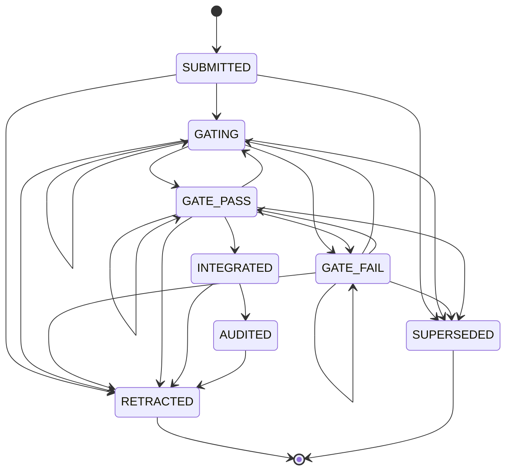

# Submissions and builds

The server contains a small gated code-delivery pipeline. It was built for a decompilation project, where workers produce one piece of source code per address and an orchestrator decides what lands in the repository. It is generic: it knows nothing about the language or toolchain of the code it carries.

It has two halves. The code calls them Component B and Component D.

- **Submissions (Component B).** A worker delivers a piece of code for an address and build with one HTTP call, without touching git. The server stores it durably, records the gate runs (compile, diff, test, whatever the operator defines) with their raw output, and tracks the submission through a fixed state machine until it is integrated into the repository.
- **Builds (Component D).** Per-submission gates can only see their own unit, and a whole-image build is too slow to run per submission. So integration is automatic on the cheap gate, and a full build runs periodically. A red build plus the previous green build define a closed set of integrations, one of which is at fault. The server records builds, says when the next one is due, and lists that set of suspects.

All endpoints require the usual Bearer token (`Authorization: Bearer $TOKEN`), see [auth.md](auth.md). The clients that gate and integrate submissions and run and record full builds are your own scripts. The server itself never runs a gate or a build; it only records results.

## How it works

### Submission states



The transition table is `Submission.transitions/0`. Any other move is refused with an error naming both ends, for example `cannot go SUBMITTED -> INTEGRATED (from SUBMITTED, only: GATING, SUPERSEDED, RETRACTED)`, or `(RETRACTED is terminal)`.

| State | Meaning |
|---|---|
| `SUBMITTED` | Accepted and durable. Nothing has been checked. |
| `GATING` | Gate evaluation has started. Reached automatically when a gate result arrives for a `SUBMITTED` row (see below). |
| `GATE_PASS` | Every gate run recorded for the submission has verdict `PASS`. |
| `GATE_FAIL` | At least one gate run is not `PASS` (`FAIL` or `UNRUNNABLE`). |
| `INTEGRATED` | Recorded as landed in the repository at a sha. `body_c` has been dropped. |
| `AUDITED` | Reserved for "integrated and independently checked". No HTTP endpoint and no server code moves a row here; the transition exists only in the table. |
| `RETRACTED` | Terminal. Set by `revert` after integration. |
| `SUPERSEDED` | Terminal. A newer submission for the same address and build arrived. |

`GATE_PASS`, `INTEGRATED` and `AUDITED` are deliberately three states: a gate returning green, a change being in the repository, and someone having verified it are three claims with different amounts of evidence.

### The rules the server enforces

1. **Durability is the acceptance.** `POST /api/kb/submissions` returns only after the row is committed. A worker killed one instruction later loses nothing, which is why it needs no branch or push access.
2. **State moves only along declared transitions.** See the diagram.
3. **A `PASS` gate must carry `raw_output`.** A `FAIL` or `UNRUNNABLE` gate may have empty output; the asymmetry is deliberate. A boolean cannot be re-audited; output can.
4. **Superseding.** Creating a submission marks every other submission with the same normalised `address` and the same `build` that is in `SUBMITTED`, `GATING`, `GATE_PASS` or `GATE_FAIL` as `SUPERSEDED` and sets its `superseded_by` to the new id. Submissions already `INTEGRATED`, `AUDITED` or `RETRACTED` are not touched. This happens in the same transaction as the insert.
5. **Address normalisation.** The address is trimmed, a leading `func_`, `FUN_` or `0x` (case-insensitive) is removed, the rest is lowercased and left-padded with zeros to 8 characters. `0x00100000`, `00100000` and `func_00100000` are all stored as `00100000`. The `address` filter on the index endpoint is normalised the same way. A longer address is kept as-is (only padded, never truncated). `unit` and `build` are stored exactly as sent.
6. **A stale `base_sha` cannot be integrated.** See "Integrate" below.
7. **`body_c` is dropped at integration.** After a successful integrate the code text is set to `NULL` and only `body_hash` (SHA-256 of the original `body_c`, lowercase hex, computed by the server at submit time) remains, so the repository is the only copy of the code.

### Gates

A gate run is one row in `kb_submission_gates`: `gate_name`, `ran_at`, `verdict` (`PASS`, `FAIL`, `UNRUNNABLE`), `raw_output`, `positive_control_output`, `runner`, `environment`.

`positive_control_output` is the evidence that the gate could have failed on this run (for example the output of the same gate run against a deliberately broken input). The API exposes this as the derived field `could_have_failed`, which is `true` when `positive_control_output` is non-blank. A gate that has silently lost the ability to fail reports `PASS` forever; `GET /api/kb/submissions/blind-gates` lists every gate run without a positive control so that set can be monitored and kept empty.

How a gate result moves the submission state:

- The gate row is inserted first.
- The target state is `GATE_PASS` only if **every** gate row ever recorded for that submission has verdict `PASS`; otherwise `GATE_FAIL`. The state follows the worst verdict among all rows, not the last one written. Consequence: a later `PASS` for the same `gate_name` does not cancel an earlier `FAIL` row. Once any non-`PASS` gate row exists, the submission cannot return to `GATE_PASS`; submit a new version instead (which supersedes it).
- If the submission is still `SUBMITTED`, it is first moved to `GATING`, then to the target. Nobody has to call a "start gating" step; there is none over HTTP.
- If the move is not a declared transition (for example gating an `INTEGRATED` or `RETRACTED` submission), the response is 422 with an error on `state`. The gate row has already been inserted and is kept (the insert and the state change are not one transaction).

### Integrate

`POST /api/kb/submissions/:id/integrate` with `sha` (the repository commit the code landed at) succeeds only when:

- the submission state is `GATE_PASS`, and
- `base_sha` is either unset, or equal to the `sha` being integrated.

Otherwise the call is refused with HTTP 409 and a message such as `gated at abc123def456 but integrating into 9f8e7d6c5b4a — re-gate at HEAD; ...`. 409 rather than 422 is deliberate: the submission is well-formed, the world moved, and the client should re-gate rather than fix its payload.

Passing JSON `"force": true` skips these two checks. The state machine still applies: only a `GATE_PASS` row can move to `INTEGRATED`, so `force` on any other state fails with 422.

On success the server sets state `INTEGRATED`, inserts a `kb_integrations` row (`integrated_sha`, `integrated_at` = now, `integrated_by`), and sets `body_c` to `NULL`.

Note on re-gating: the server does not re-gate or update `base_sha` on its own. `base_sha` is whatever the submitter sent at creation, and recording new gate runs does not change it. To integrate at a different sha you either submit again with `base_sha` set to the new sha (which supersedes the old row), or pass `force`.

### Revert

`POST /api/kb/submissions/:id/revert` with a non-empty `reason` records that an integration was undone: it sets `reverted_at` and `revert_reason` on the integration row and moves the submission to `RETRACTED`. The integration row is kept (it is the history). A revert without a reason is refused, because it would be indistinguishable from a mistake. A reverted integration no longer counts as a build suspect (see below).

### Builds

A build row (`kb_builds`) is one full link and build of the whole image, recorded by whoever ran it. The server does not run builds.

**The verdict is derived, not taken from the caller.** `POST /api/builds` computes it from the previous green build (the most recent `PASS` with the same `fleet` and `region`, ordered by `started_at` then id):

| Condition (checked in this order) | Verdict |
|---|---|
| Caller sent `verdict: "ERROR"` | `ERROR` (preserved: a build that could not run, for example toolchain missing or VM down, is not a failing build) |
| `elf_bytes` missing | `FAIL` |
| There is a previous green with non-null `differing_bytes`, and the new `differing_bytes` is an integer strictly greater | `FAIL` (a regression) |
| Otherwise | `PASS` |

Any other `verdict` the caller sends (including `PASS` or `FAIL`) is ignored and overwritten. The comparison keys on `differing_bytes`, never on `elf_bytes`: two builds of effectively the same source were measured to produce executables about a thousand bytes apart while `differing_bytes` was identical, so `elf_bytes` is evidence that an artifact was produced, not a comparator. A `differing_bytes` that goes down is a `PASS`. If the new `differing_bytes` is missing, it cannot regress.

**Due.** `GET /api/builds/due` answers "should a full build run now?". It looks at the most recent build of any verdict (for the default fleet and region, see the caveat below). It is due when:

- no build has ever been recorded, or
- the number of integrations with `integrated_at` strictly after that build's `started_at` is at least `every` (default 10), or
- at least `hours` hours (default 24) have passed since that build's `started_at`.

The integration threshold is the primary trigger. The time floor exists so a quiet week cannot go unchecked forever. The default is 24 hours, not a few hours, because a full build was measured at about an hour, and a short floor would keep the single build machine busy most of the time. The count includes reverted integrations.

**Suspects.** `GET /api/builds/suspects` is the blast radius: the integrations that landed after the last green build, which must contain the culprit when the current build is red.

- If a green build exists: all integrations with `integrated_at` strictly after that build's `started_at` and not reverted, newest first. The response is `bounded: true` and names the green build's sha.
- If no green build has ever been recorded: `bounded: false` and only a count of all integrations. Nothing bounds the set, and the server says so instead of returning a long list that looks short.

When `POST /api/builds` records a `FAIL`, the same suspects object is included in the response.

`integrations_since` on a build row is stored at insert time (unless the caller supplies it): the number of integrations after the previous green build's `started_at`, or the total number of integrations if there is no previous green. Note this is measured against the last green, whereas "due" is measured against the last build of any verdict.

Caveat: `fleet` defaults to a hard-coded legacy value in the schema and the context, and `region` defaults to `usa`. `due`, `suspects`, `GET /api/builds`'s `last_green`, and the PASS/FAIL comparison when `fleet` is omitted all use these defaults; the HTTP endpoints for due, suspects and last_green do not accept `fleet` or `region`. In practice, always send the same `fleet` and `region` on `POST /api/builds`, and expect due/suspects to reason only about builds recorded under the defaults. See "Surprising behaviour" below.

## Configuration

None. There are no environment variables and no `config :claudiverse_server` keys for either component. The thresholds are request parameters on `GET /api/builds/due` (`every`, `hours`); their defaults (10 and 24) are in the controller.

## Interface

All paths are under `/api`, behind the Bearer-token pipeline. Response bodies are JSON. Ids in the path that are not integers parse as `0`, which matches no row (see each endpoint for the resulting status).

### Submission object

Returned as `submission` (fields exactly as below). `body_c` itself is never returned; `has_body` says whether it is still stored.

```json
{
  "id": 7,
  "address": "00100000",
  "unit": "text/100000",
  "build": "lorem-build",
  "tier": "T1",
  "base_sha": "abc123def456",
  "compiler": "cc 1.0",
  "flags": "-O2",
  "body_hash": "e3b0c442...",
  "notes": null,
  "submitted_by": "lorem-w1",
  "state": "SUBMITTED",
  "superseded_by": null,
  "inserted_at": "2026-10-01T12:00:00",
  "has_body": true
}
```

### Gate object

```json
{
  "id": 3,
  "submission_id": 7,
  "gate_name": "unit_diff",
  "ran_at": "2026-10-01T12:05:00Z",
  "verdict": "PASS",
  "raw_output": "100.00%",
  "positive_control_output": "seeded change -> 99.6%, gate failed as expected",
  "runner": "linux-box",
  "environment": "ci",
  "could_have_failed": true
}
```

### Integration object

```json
{
  "id": 2,
  "submission_id": 7,
  "integrated_sha": "9f8e7d6c5b4a",
  "integrated_at": "2026-10-01T12:10:00Z",
  "integrated_by": "lorem-orchestrator",
  "reverted_at": null,
  "revert_reason": null
}
```

### Submissions

| Method and path | Purpose |
|---|---|
| `GET /api/kb/submissions/blind-gates` | Gate runs with no positive control. |
| `POST /api/kb/submissions` | Create a submission. |
| `GET /api/kb/submissions` | List, filtered. |
| `GET /api/kb/submissions/:id` | One submission with gates and integration. |
| `POST /api/kb/submissions/:id/gates` | Record a gate run. |
| `POST /api/kb/submissions/:id/integrate` | Record integration at a sha. |
| `POST /api/kb/submissions/:id/revert` | Record that an integration was undone. |

#### `POST /api/kb/submissions`

| Param | Required | Notes |
|---|---|---|
| `address` | yes | Normalised as described above. |
| `build` | yes | Free string, for example `lorem-build`. |
| `submitted_by` | yes | Free string, for example a seat name. |
| `body_c` | no, but see below | The code text. The server computes `body_hash` from it (an absent body hashes as the empty string). |
| `unit` | no | For example `text/100000`. |
| `tier` | no | `T1`, `T2` or `T3` if given; anything else is a 422. The server attaches no behaviour to the tier; it is a label for the caller's own policy. |
| `base_sha` | no | The repository commit the code was derived against. Used by the integrate check. |
| `compiler`, `flags`, `notes` | no | Free text. |

Do not send `state`, `superseded_by` or `body_hash`: the changeset accepts `state` and `superseded_by` from the payload, and `body_hash` is overwritten by the server. They are not meant to be client-controlled.

```bash
curl -s -X POST https://claudiverse.example/api/kb/submissions \
  -H "Authorization: Bearer $TOKEN" -H 'Content-Type: application/json' \
  -d '{"address":"0x00100000","unit":"text/100000","build":"lorem-build","tier":"T1",
       "base_sha":"abc123def456","body_c":"void f(void) {}","submitted_by":"lorem-w1"}'
```

Response, 200 (not 201):

```json
{"ok": true, "durable": true, "submission": { "id": 7, "address": "00100000", "state": "SUBMITTED", "...": "..." }}
```

422: `{"ok": false, "errors": {"submitted_by": ["can't be blank"]}}` (a map of field to messages).

#### `GET /api/kb/submissions`

Query params, all optional and combined with AND: `address` (any spelling), `build`, `unit`, `state`, `submitted_by`, `limit` (default 50). Ordered newest first (by id descending). A non-numeric `limit` parses as `0` and returns an empty list; there is no upper cap.

```bash
curl -s "https://claudiverse.example/api/kb/submissions?state=GATE_PASS&limit=20" -H "Authorization: Bearer $TOKEN"
```

Response, 200: `{"ok": true, "submissions": [ <submission>, ... ]}`.

#### `GET /api/kb/submissions/:id`

200:

```json
{"ok": true, "submission": { "...": "..." }, "gates": [ <gate>, ... ], "integration": null}
```

`gates` is ordered by `ran_at` descending. `integration` is the integration object or `null`. 404: `{"error": "no submission 99"}`.

#### `POST /api/kb/submissions/:id/gates`

| Param | Required | Notes |
|---|---|---|
| `gate_name` | yes | Free string. |
| `verdict` | yes | `PASS`, `FAIL` or `UNRUNNABLE`. |
| `raw_output` | required when `verdict` is `PASS` | Blank (whitespace only) counts as missing. |
| `positive_control_output` | no | Evidence the gate can fail. Without it the run shows up in blind-gates. |
| `ran_at` | no | ISO 8601 UTC; defaults to now (whole seconds). |
| `runner`, `environment` | no | Free text. |

```bash
curl -s -X POST https://claudiverse.example/api/kb/submissions/7/gates \
  -H "Authorization: Bearer $TOKEN" -H 'Content-Type: application/json' \
  -d '{"gate_name":"unit_diff","verdict":"PASS","raw_output":"100.00%",
       "positive_control_output":"seeded change -> 99.6%, gate failed as expected"}'
```

200: `{"ok": true, "gate": <gate>}`. 404 for an unknown submission: `{"error": "no submission 99"}`. 422: `{"ok": false, "errors": {"raw_output": ["a PASS must carry its output — ..."]}}`, or an `errors.state` message when the submission cannot move to the target state (the gate row is still stored in that case).

#### `POST /api/kb/submissions/:id/integrate`

| Param | Required | Notes |
|---|---|---|
| `sha` | yes | The commit integrated into. A request without `sha` is rejected by Phoenix as a bad request (400), not by the action. |
| `by` | no | Defaults to `integrator`. |
| `force` | no | Only the JSON boolean `true` counts. A string `"true"` does not. |

```bash
curl -s -X POST https://claudiverse.example/api/kb/submissions/7/integrate \
  -H "Authorization: Bearer $TOKEN" -H 'Content-Type: application/json' \
  -d '{"sha":"abc123def456","by":"lorem-orchestrator"}'
```

200: `{"ok": true, "integration": <integration>}`. 409: `{"ok": false, "error": "state is GATE_FAIL, not GATE_PASS — nothing has passed a gate"}` or the stale-sha message. 422: `{"ok": false, "error": "<inspected error>"}` for anything else (for example an unknown submission id, reported as `:no_such_submission`, or a refused transition under `force`). Note an unknown id here is 422, not 404.

#### `POST /api/kb/submissions/:id/revert`

| Param | Required | Notes |
|---|---|---|
| `reason` | yes | Non-blank. |

200: `{"ok": true, "integration": <integration with reverted_at and revert_reason set>}`. 409 `{"error": "not integrated"}` when the submission has no integration row (this includes unknown ids). 422 `{"ok": false, "errors": {"revert_reason": ["a revert must say why — ..."]}}` when the reason is blank.

#### `GET /api/kb/submissions/blind-gates`

Query: `limit` (default 100). Newest `ran_at` first. Includes gate runs of any verdict and any submission state.

```json
{
  "ok": true,
  "count": 1,
  "gates": [ <gate with "could_have_failed": false> ],
  "note": "these gate runs recorded no positive control — they cannot be shown to have been able to fail"
}
```

`count` is the number returned (capped by `limit`), not a total.

### Builds

| Method and path | Purpose |
|---|---|
| `GET /api/builds/due` | Is a full build due? |
| `GET /api/builds/suspects` | Integrations since the last green build. |
| `POST /api/builds` | Record a build result. |
| `GET /api/builds` | Recent builds plus the last green. |

#### `POST /api/builds`

| Param | Required | Notes |
|---|---|---|
| `sha` | yes | Commit built. Unique together with `region`. |
| `started_at` | yes | ISO 8601 UTC. |
| `verdict` | no | Only `ERROR` is honoured; any other value is discarded and replaced by the derived verdict. |
| `elf_bytes` | required for a `PASS` | Size of the produced artifact. Absent means the verdict becomes `FAIL`. |
| `differing_bytes` | no | The regression signal. |
| `undefined_symbols` | no | Stored and returned; not used in the verdict. |
| `finished_at`, `raw_output`, `runner`, `environment` | no | `raw_output` should be the full build output, not a truncated console view. |
| `fleet`, `region` | no | Default to a hard-coded legacy fleet value and `usa`. |
| `integrations_since` | no | Computed if absent. |

```bash
curl -s -X POST https://claudiverse.example/api/builds \
  -H "Authorization: Bearer $TOKEN" -H 'Content-Type: application/json' \
  -d '{"sha":"abc123def456","fleet":"lorem-fleet","region":"usa","started_at":"2026-10-01T12:00:00Z",
       "finished_at":"2026-10-01T13:00:00Z","elf_bytes":2591480,"differing_bytes":877540,
       "undefined_symbols":0,"runner":"lorem-mac","raw_output":"..."}'
```

200:

```json
{"ok": true, "build": {"id": 1, "sha": "abc123def456", "fleet": "lorem-fleet", "region": "usa",
  "verdict": "PASS", "started_at": "2026-10-01T12:00:00Z", "finished_at": "2026-10-01T13:00:00Z",
  "differing_bytes": 877540, "elf_bytes": 2591480, "undefined_symbols": 0,
  "integrations_since": 4, "runner": "lorem-mac", "environment": null},
 "suspects": null}
```

`suspects` is `null` unless the derived verdict is `FAIL`, in which case it is the suspects object below (computed against the default fleet and region). `raw_output` is stored but not returned. 422 `{"ok": false, "errors": {...}}` for validation errors, including `{"sha": ["has already been taken"]}` for a duplicate `sha` and `region`.

#### `GET /api/builds`

Query: `limit` (default 20). Builds are ordered by `started_at` descending, then id.

```json
{"ok": true, "builds": [ <build>, ... ], "last_green": <build or null>}
```

#### `GET /api/builds/due`

Query: `every` (default 10), `hours` (default 24); both parsed as integers (a non-numeric value becomes `0`, which makes the build due immediately).

```bash
curl -s "https://claudiverse.example/api/builds/due?every=10&hours=24" -H "Authorization: Bearer $TOKEN"
```

```json
{"ok": true, "due": true, "reason": "12 integrations since the last build (threshold 10)"}
```

The other reasons are `no build has ever been recorded`, `26.0h since the last build (threshold 24h)`, and, when not due, `3/10 integrations, 5.2/24h`. The integration threshold is checked before the time threshold.

#### `GET /api/builds/suspects`

Bounded:

```json
{"ok": true, "suspects": {
  "bounded": true, "since_sha": "abc123def456", "since": "2026-10-01T12:00:00Z", "count": 2,
  "integrations": [
    {"id": 9, "submission_id": 14, "integrated_sha": "9f8e7d6c5b4a", "integrated_at": "2026-10-01T14:00:00Z", "integrated_by": "lorem-orchestrator"}
  ],
  "note": "newest first — the most recent is both most likely and cheapest to revert"}}
```

Unbounded (no green build exists):

```json
{"ok": true, "suspects": {"bounded": false, "integration_count": 31, "note": "no green build has ever been recorded, so NOTHING bounds the suspect set. ..."}}
```

## Failure modes and troubleshooting

| Symptom | Meaning | What to do |
|---|---|---|
| Integrate returns 409 `state is GATE_FAIL, not GATE_PASS` (or another non-pass state) | Nothing has passed a gate, or a newer submission superseded this one. | Read the submission with `GET /api/kb/submissions/:id` and inspect `gates`. Fix and resubmit. |
| Integrate returns 409 `gated at X but integrating into Y — re-gate at HEAD` | The submission's `base_sha` differs from the sha being integrated. | Resubmit with `base_sha` set to the new sha and re-gate. Recording another gate run does not change `base_sha`. `force: true` skips the check; use only if you understand why the evidence is still valid. |
| Gate POST returns 422 with `raw_output` error | A `PASS` was sent without output. | Send the raw output of the gate. |
| Gate POST returns 422 with `state` error | The submission could not move to `GATE_PASS`/`GATE_FAIL` from its current state (for example already `INTEGRATED`, `RETRACTED` or `SUPERSEDED`). The gate row was still stored. | Gate the current submission instead of an old one. |
| A submission stays `GATE_FAIL` after a passing re-run | Every gate row ever recorded counts, so an old `FAIL` or `UNRUNNABLE` row keeps the target at `GATE_FAIL`. | Submit a new version. |
| A submission is `SUPERSEDED` unexpectedly | Another submission for the same normalised address and build was created. | Look at `superseded_by`. Only one open submission per address and build exists at a time. |
| Gate POST on a submission after `SUPERSEDED` fails | Terminal state. | As above. |
| Revert returns 409 `not integrated` | No integration row, or the id is unknown. | Check the submission state. |
| Revert returns 422 on `revert_reason` | Blank `reason`. | Send a reason. |
| Blind-gates `count` is not 0 | Some gate runs recorded no positive control, so they cannot be shown able to fail. | Fix the gate runner to send `positive_control_output`. |
| `POST /api/builds` returned `FAIL` though the caller sent `PASS` | Verdict is derived: no `elf_bytes`, or `differing_bytes` rose above the last green. | Send `elf_bytes`; investigate the regression using the `suspects` in the response. |
| `suspects.bounded` is `false` | No green build has been recorded for the default fleet and region. | Record a green build. |
| `due` is always true | `every` or `hours` was `0` or non-numeric, or no build exists under the default fleet and region. | Check the query string and the fleet/region of recorded builds. |

### Surprising behaviour (worth knowing before relying on it)

- `GET /api/builds/due`, `/suspects` and `GET /api/builds` (`last_green`) take no `fleet` or `region`. Builds recorded under another fleet or region are listed by `GET /api/builds` but are invisible to due and suspects. Integrations also have no fleet; suspects counts all integrations regardless of fleet.
- Unknown request keys: params are converted from strings to atoms with `String.to_existing_atom`; if any key is not an existing atom, the conversion is skipped for the whole map and the submit/gate calls will not behave as with clean keys. Send only the documented fields.
- `AUDITED` is unreachable from the API.
- `Submissions.revert/3` ignores the result of the state change, so a revert on an already `RETRACTED` row updates the integration timestamps but leaves the state unchanged.

## Related pages

- [Tasks and runners](tasks-and-runners.md): the task queue that dispatches the workers that submit.
- [The knowledge store](knowledge-store.md): the facts and documents anchored on the same addresses.
- [Accounts, sign-up and tokens](auth.md): the Bearer token used by every call here.
- [Data model](data-model.md): all tables, including `kb_submissions`, `kb_submission_gates`, `kb_integrations`, `kb_builds`.
- [Configuration](configuration.md): server configuration (neither component has any).
- Runners and tools: [cv-mcp: submission tools](../runners/mcp-submissions.md)

## Source

- `server/api/lib/claudiverse_server/submissions.ex`
- `server/api/lib/claudiverse_server/builds.ex`
- `server/api/lib/claudiverse_server/knowledge/submission.ex`
- `server/api/lib/claudiverse_server/knowledge/submission_gate.ex`
- `server/api/lib/claudiverse_server/knowledge/integration.ex`
- `server/api/lib/claudiverse_server/knowledge/build.ex`
- `server/api/lib/claudiverse_server_web/controllers/submission_controller.ex`
- `server/api/lib/claudiverse_server_web/controllers/build_controller.ex`
- `server/api/lib/claudiverse_server_web/router.ex`
- `server/api/priv/repo/migrations/20260909140000_create_submissions.exs`
- `server/api/priv/repo/migrations/20260910090000_create_builds.exs`
- `server/api/test/claudiverse_server/submissions_test.exs`
- `server/api/test/claudiverse_server/builds_test.exs`
- `server/api/test/claudiverse_server_web/controllers/submission_controller_test.exs`
- agent/tools/kb-integrate.mjs, agent/tools/kb-fullbuild.mjs (clients)
