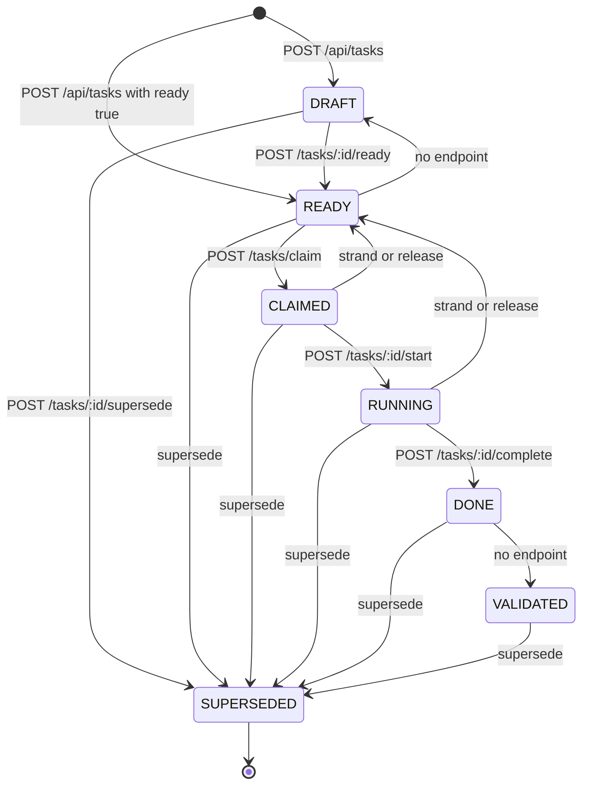
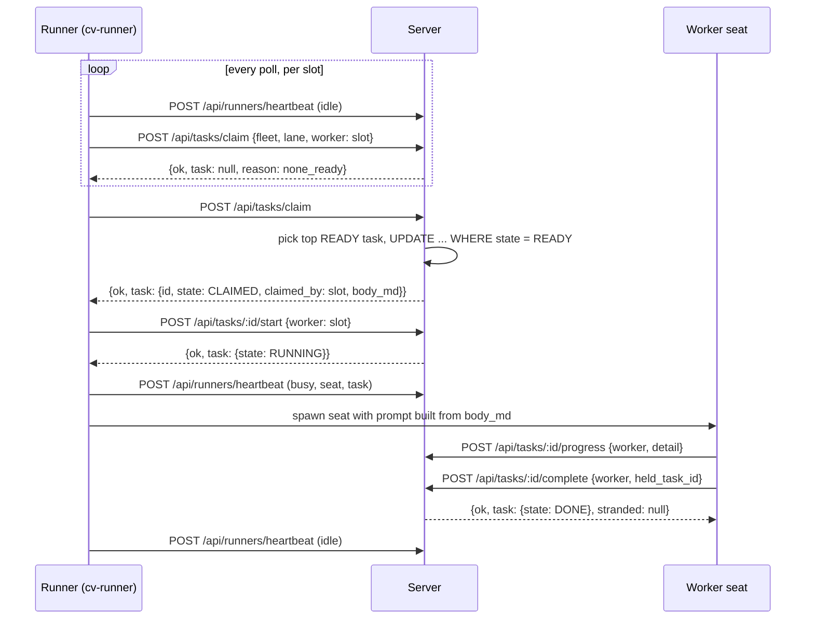
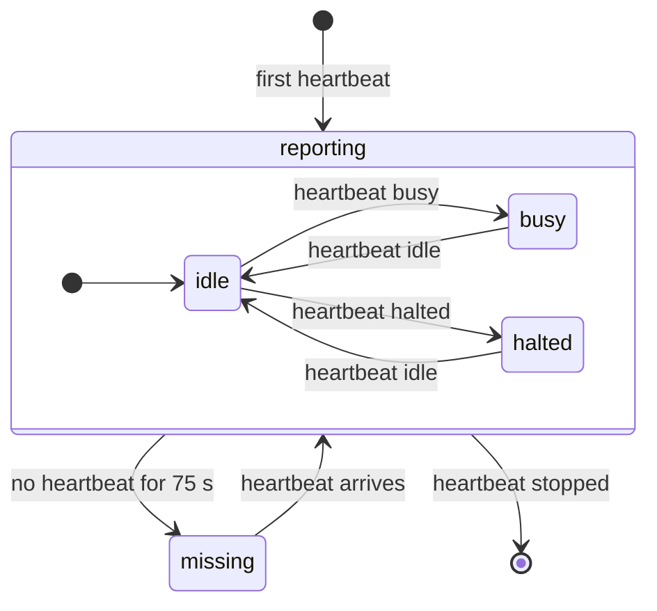

# Tasks and runners

Tasks are claimable units of work with an explicit state machine. A fleet's runners poll a lane for the highest-priority ready task, claim it atomically, run it, and report back. Runners are the long-lived processes (`cv-runner`) that do the polling. The server also keeps an in-memory registry of runner slots, fed by heartbeats, so a viewer can see which slots are idle, busy, halted or missing.

The queue itself is a plain table with a few guards: one worker per task, a real priority field instead of priority written into prose, dependency edges the claim query enforces, and a completion path that notices a worker finishing the wrong task. This page covers the server side only. The orchestrator is not documented here, except for what a runner sends.

## How it works

### Task states

A task is created `DRAFT` (the default) or `READY`. `READY` is the only claimable state.



The allowed transitions, from `ClaudiverseServer.Tasks.Task`:

| From | To |
|---|---|
| `DRAFT` | `READY`, `SUPERSEDED` |
| `READY` | `CLAIMED`, `SUPERSEDED`, `DRAFT` |
| `CLAIMED` | `RUNNING`, `RELEASED`, `SUPERSEDED`, `READY` |
| `RUNNING` | `DONE`, `RELEASED`, `SUPERSEDED`, `READY` |
| `DONE` | `VALIDATED`, `SUPERSEDED` |
| `VALIDATED` | `SUPERSEDED` |
| `RELEASED` | `READY`, `SUPERSEDED` |
| `SUPERSEDED` | none (terminal) |

Any other jump is refused with a 422 whose error reads `cannot go X -> Y (from X, only: ...)`, or `(X is terminal)` for `SUPERSEDED`. A `CLAIMED` or `RUNNING` task must have a non-blank `claimed_by`.

`RELEASED` is transient. The release endpoint moves a task to `RELEASED` and immediately on to `READY`, so a released task is never observed resting in `RELEASED`.

Two transitions have no HTTP route: `READY -> DRAFT` and `DONE -> VALIDATED`. Nothing in the server moves a task to `VALIDATED` today, which matters for dependencies (see below).

### The Task record

Table `tasks`. The JSON returned by every task endpoint contains exactly these fields:

| Field | Type | Notes |
|---|---|---|
| `id` | integer | |
| `fleet` | string | Required. Claims are scoped by fleet. |
| `lane` | string | Required. Routing to a class of runner slot. |
| `title` | string | Required. |
| `body_md` | string (text) | The task brief. A runner builds the worker prompt from it. |
| `state` | string | One of the eight states. Default `DRAFT`. |
| `priority` | integer | Default 0. Higher is claimed first. |
| `claimed_by` | string or null | The worker that holds it. Set on claim, cleared on release. |
| `claimed_at` | datetime or null | Seconds precision. |
| `started_at` | datetime or null | Set by `start`. |
| `completed_at` | datetime or null | Set by `complete`. |
| `validates_task_id` | integer or null | Links a validation task to the task it validates (see chain). Foreign key to `tasks`, `nilify_all` on delete. |
| `superseded_by` | integer or null | Set by `supersede`. Foreign key to `tasks`, `nilify_all` on delete. |
| `vm_required` | boolean | Default false. Marks work that needs the single-owner VM. |
| `created_by` | string | Required. |
| `inserted_at` | datetime | |

### Dependencies

A dependency is a row in `task_deps`: `task_id`, `depends_on_task_id`, `kind`. There is one row per pair (unique index), and a task cannot depend on itself.

| Kind | Meaning |
|---|---|
| `BLOCKS` (default) | The task cannot be made `READY`, and cannot be claimed, until the dependency is `DONE` or `VALIDATED`. |
| `INFORMS` | Advisory. Recorded so the graph is complete; never blocks. |

BLOCKS is enforced in two places:

- `POST /api/tasks/:id/ready` refuses with 409 while any BLOCKS dependency has a state other than `DONE` or `VALIDATED`.
- The claim query excludes any task with an unmet BLOCKS edge. This covers the case where an edge is added to a task that is already `READY`: adding a dependency does not demote the task, but it can no longer be claimed.

A dependency in state `SUPERSEDED` still counts as unmet. Nothing in the server marks a task `VALIDATED`, so in practice `DONE` is what unblocks.

### Events

Every task has an audit trail in `task_events`: `id`, `at`, `kind`, `actor`, `detail`. `GET /api/tasks/:id` returns it ordered by `at` then `id`. The valid kinds are `CREATED READY CLAIMED STARTED PROGRESS DONE VALIDATED RELEASED STRANDED STARVED STALLED DRIFTED REAPED SUPERSEDED EDITED DEP_ADDED`.

What the server actually writes:

| Event | Written when | `actor` / `detail` |
|---|---|---|
| `CREATED` | Task created | `created_by` |
| `READY` | Created with `ready: true`; any transition into `READY` (make ready, release, strand) | the acting worker or actor |
| `CLAIMED` | Claim; also when `complete` adopts a never-claimed `READY` task | the worker; detail `adopted at completion — never formally claimed` in the adoption case |
| `PROGRESS` | `progress` endpoint | worker; `detail` is the text sent |
| `DONE` | `complete` | worker |
| `RELEASED` | `release`; written twice (once by the transition, once with the reason as `detail`) | worker; reason |
| `STRANDED` | `complete` with a different `held_task_id` | worker; detail `worker completed #<id> while holding #<held>` |
| `SUPERSEDED` | `supersede` | actor |
| `EDITED` | `PATCH` or `PUT /api/tasks/:id` | actor; detail is the comma-separated sorted list of changed field names |
| `DEP_ADDED` | add dependency | actor; detail `<kind> <- #<depends_on>` |

`STARTED` is never written: the `start` transition goes to `RUNNING`, which is not an event kind, so starting a task leaves no event. `VALIDATED`, `STARVED`, `STALLED`, `DRIFTED` and `REAPED` are reserved kinds the server does not write today. The health endpoint computes starved, stranded and stalled tasks on demand and does not log them.

### Claim

`POST /api/tasks/claim` takes `fleet`, `lane` and `worker`. In one SQLite transaction (`mode: :immediate`, so a read-then-write cannot fail with "database busy" under WAL) the server:

1. Selects `READY` tasks where `fleet` and `lane` match and no unmet BLOCKS dependency exists.
2. If `vm_busy` is `true`, drops tasks with `vm_required = true`.
3. If `exclude` is given, drops those task ids.
4. Orders by `priority` descending, then `id` ascending, and takes the first.
5. Updates that row to `CLAIMED` with `claimed_by = worker` and `claimed_at = now`, but only `WHERE state = 'READY'`. If two runners race, the loser updates zero rows and gets `lost_race`.

The single-owner VM guard is a convention the caller drives: the server does not know whether the VM is busy. A runner sets `vm_busy: true` when it knows the VM is in use, and `vm_required` tasks are skipped for that call. The server never tracks VM ownership itself.

`exclude` exists for declines. A runner that releases a task it does not want sends that id in `exclude` on later claims; otherwise the released task is still the top of the lane and would come straight back. Only integers and strings that are entirely digits are accepted; anything else is dropped silently.

An empty queue is a normal result, not an error: HTTP 200 with `task: null` and `reason` `none_ready` or `lost_race`.

### Complete, and the strand rule

`POST /api/tasks/:id/complete` is tolerant on purpose, because the work is real even when the bookkeeping is wrong:

- A `RUNNING` task goes straight to `DONE`.
- A `CLAIMED` task is advanced to `RUNNING` first, then `DONE`. A worker that skips `start` is not penalised.
- A `READY` task (never claimed) is adopted: the server logs a `CLAIMED` event with the adoption detail, sets `claimed_by` to the worker, moves it through `CLAIMED` and `RUNNING`, then `DONE`.
- Any other state (including already `DONE`) fails with 422 from the state machine.
- The server does not check that `worker` is the task's `claimed_by`.

If the request carries `held_task_id` and it differs from the task id, the server treats that as a protocol violation. The completion is still honoured, and the held task gets a `STRANDED` event and is moved back to `READY` with its claim cleared. This frees a runner slot that would otherwise wait forever for a completion signal for a task the worker never finished. The response reports it in `stranded` and `note`. If the held task is already `READY` or in a state that cannot go to `READY`, the `STRANDED` event is still written but the state is left as it was.

### Chain

`GET /api/tasks/:id/chain` walks `validates_task_id` links from the given task up to the root and returns the tasks root-first, ending with the task asked for. It stops at a missing task or when a link would revisit a task already collected. An unknown id returns an empty list, not 404.

### Health

`POST /api/tasks/health` is a sweep as a query. The caller must supply liveness, because the server cannot see which runner processes are alive (a claimed task leaves the ready set, so "zero READY" looks identical for a fed lane and a starving one).

| Result field | Computed as |
|---|---|
| `starved_lanes` | Each lane in `live_lanes` that has zero `READY` tasks in the fleet. Not checked against the fleet's existing lanes: a lane you name that has no tasks at all counts as starved. |
| `stranded` | Tasks in the fleet in `CLAIMED` or `RUNNING` whose `claimed_by` is not in `live_workers`. |
| `stalled` | `RUNNING` tasks in the fleet with no `PROGRESS`, `STARTED` or `CLAIMED` event newer than `stall_minutes` (default 45), or with no such event at all. Since `STARTED` is never written, a task's silence is measured from its last `PROGRESS` or its claim. |

`stalled` samples silence, so it is advisory. A slow task that is genuinely working (a long build) also goes quiet. Confirm with another signal before reaping.

### Completion reporting to notifications

The server does not push task events to the notification router. There is no `tasks:<lane>` report source in the server code: no PubSub broadcast, no channel event and no Router call is made from the task code. Consumers poll `GET /api/tasks`, `GET /api/tasks/:id` and `POST /api/tasks/health`. Completion pings come from the client side: the orchestrator's `cv_task_done` tool calls `POST /api/notify/report` with `self` set to `tasks:<lane>` after completing a task ([notifications.md](notifications.md)). (`TaskEvent.alert_kinds/0` lists `STRANDED STARVED STALLED DRIFTED` as conditions meant to be notified, but nothing calls it.)

### Task flow



The runner claims with `worker` set to its slot name (for example `lorem-w1`), not the seat name, so `claimed_by` holds the slot. It sends `vm_busy: false` and an `exclude` list of ids it has declined. The seat it spawns for the task is named from the slot and task id.

## Runners

`ClaudiverseServer.Runners` is a GenServer, started under the supervision tree, holding a registry of runner slots. It is in memory only. A server restart forgets all slots until each runner's next heartbeat (runners beat at least every 30 seconds).

A runner posts a heartbeat on every change of state, seat or task, and every 30 seconds regardless. A runner started without a fleet does not beat and does not appear.

The registry is keyed by user and slot name, so slot names are unique per user across fleets. A new report for an existing key replaces the old one.

### Runner states

| `state` (reported) | Meaning |
|---|---|
| `idle` | Polling, nothing to do. |
| `busy` | Working a task; `seat` and `task` are set. |
| `halted` | The fleet is under a halt and the runner is not claiming. |
| `stopped` | The runner is closing cleanly. The slot is removed from the registry. |

Derived `status` in listings: the reported `state`, or `missing` when the slot's last heartbeat is older than `runner_missing_after_ms`. `stopped` is never listed; it only appears once, in the event announced at removal.



A sweep runs every `runner_sweep_ms`. It marks stale slots missing and announces each one once. A missing slot is kept in the list (so the board shows the gap) until it beats again or reports `stopped`.

### Events

Changes are broadcast as `"runner"` on the user's operator events topic (`operator:events:<user_id>`), with the runner map as payload (fields as in the heartbeat table below, plus `status` and `last_seen`). An event is sent:

- on the first heartbeat of a slot;
- when `state`, `seat`, `task`, `fleet`, `lane` or `host` changes, or when a slot comes back from missing;
- once, by the sweep, when a slot first goes missing;
- when a slot reports `stopped` (with `status: "stopped"`), provided it was known.

An unchanged repeat heartbeat produces no event. Changes to `channel`, `model`, `task_source` or `since` alone update the stored entry but are not announced.

### Seat stamping

When a heartbeat reports `state: "busy"` with a `seat` string, the server calls `Sessions.stamp_runner_seat/4`. On the user's newest running, non-proxy session titled `seat`, it fills in `fleet`, `origin` (`runner`) and `host` where the seat left them unset. It never overwrites values the seat set itself. This is how a worker seat that registered without a fleet gets grouped under its fleet.

## Configuration

Read with `Application.get_env(:claudiverse_server, key, default)`. They are not set in any `config/*.exs` and have no environment variable, so the defaults apply unless overridden in code.

| Key | Default | Meaning |
|---|---|---|
| `:runner_missing_after_ms` | `75_000` | A slot with no heartbeat for longer than this reads `missing`. |
| `:runner_sweep_ms` | `15_000` | Interval of the sweep that announces missing slots. The first sweep is scheduled at startup with this value. |

The runner side beats every 30 s, so 75 s tolerates two lost beats.

## Interface

All endpoints are under `/api` and need `Authorization: Bearer $TOKEN`. Task endpoints are not scoped to the calling user: any authenticated token sees and changes every task. Runner and fleet data is scoped to the calling user.

### Task endpoints

Errors from the state machine and validation return `{"ok": false, "errors": {...}}` with 422. Unknown task ids return 404 `{"ok": false, "error": "no task <id>"}`. A non-numeric id is read as 0 and therefore also 404.

| Method and path | Body or query | Success response | Other status codes |
|---|---|---|---|
| `POST /api/tasks` | `fleet`, `lane`, `title`, `created_by` (required); `body_md`, `priority`, `vm_required`, `validates_task_id`; `ready: true` to publish immediately | `{"ok": true, "task": {...}}` | 422 on missing required fields or a bad `state` |
| `GET /api/tasks` | query `fleet`, `lane`, `state`, `claimed_by`, `limit` (default 50) | `{"ok": true, "tasks": [...]}` ordered by priority desc, id asc | |
| `GET /api/tasks/:id` | | `{"ok": true, "task": {...}, "events": [...], "blocked_by": [ids]}` | 404 |
| `PATCH` or `PUT /api/tasks/:id` | any of `title`, `body_md`, `priority`, `lane`, `vm_required`; optional `actor` (or `by`) | `{"ok": true, "task": {...}}` | 404; 422 `{"error": "no editable field given", "editable": [...]}`; 409 `{"error", "state", "hint"}` if the task is not `DRAFT` or `READY` |
| `POST /api/tasks/:id/ready` | `actor` (required) | `{"ok": true, "task": {...}}`; idempotent on a `READY` task | 409 `{"ok": false, "error": "blocked by unmet BLOCKS dependencies", "blocked_by": [ids]}`; 422 `actor is required`; 404 |
| `POST /api/tasks/:id/deps` | `depends_on` (required), `kind` (`BLOCKS` default, or `INFORMS`), `actor` (required) | `{"ok": true}` | 422 on missing actor, self-dependency, bad kind or duplicate pair |
| `POST /api/tasks/claim` | `fleet`, `lane`, `worker` (required); `vm_busy` (boolean), `exclude` (list of ids) | `{"ok": true, "task": {...}}`, or `{"ok": true, "task": null, "reason": "none_ready" or "lost_race"}` | 400 if a required param is missing |
| `POST /api/tasks/:id/start` | `worker` | `{"ok": true, "task": {...}}` | 404; 422 if not `CLAIMED` |
| `POST /api/tasks/:id/progress` | `worker`; `detail` (free text) | `{"ok": true}` | 404 |
| `POST /api/tasks/:id/complete` | `worker`; optional `held_task_id` | `{"ok": true, "task": {...}, "stranded": null or {...}, "note": null or "protocol violation: ..."}` | 404; 422 |
| `POST /api/tasks/:id/release` | `worker`; optional `reason` | `{"ok": true, "task": {...}}` (the task, now `READY` with the claim cleared) | 404; 422 if the state is not `CLAIMED` or `RUNNING` |
| `POST /api/tasks/:id/supersede` | `superseded_by` (task id), `actor` (required) | `{"ok": true, "task": {...}}` | 404; 422 |
| `GET /api/tasks/:id/chain` | | `{"ok": true, "chain": [tasks root-first]}` | |
| `POST /api/tasks/health` | `fleet` (required); `live_lanes` (list), `live_workers` (list), `stall_minutes` (default 45) | `{"ok": true, "starved_lanes": [...], "stranded": [...], "stalled": [...], "note": "..."}` | 400 if `fleet` is missing |

Notes on bodies:

- `POST /api/tasks` accepts a `state` field directly (it is used when present; `ready: true` only sets the default). Creating with `state: "CLAIMED"` also needs `claimed_by`. Prefer `ready`.
- Endpoints that take `worker` require the key to be present in the body; its value is not checked against the task's holder.
- `actor` is required (non-blank) for `ready`, `deps` and `supersede` because these change what workers may claim. Create does not take `actor`; it takes `created_by`.
- `start` and `release` on the wrong state surface as 422 with the transition error.

Examples:

```bash
# Create and publish a task
curl -X POST https://claudiverse.example/api/tasks \
  -H "Authorization: Bearer $TOKEN" -H "Content-Type: application/json" \
  -d '{"fleet":"lorem-fleet","lane":"lorem-tasks","title":"Port module A","body_md":"Do the thing.","priority":5,"created_by":"lorem-orchestrator","ready":true}'

# Make a draft ready (refused with 409 while a BLOCKS dependency is open)
curl -X POST https://claudiverse.example/api/tasks/12/ready \
  -H "Authorization: Bearer $TOKEN" -H "Content-Type: application/json" \
  -d '{"actor":"lorem-orchestrator"}'

# Add a blocking dependency: task 12 waits for task 11
curl -X POST https://claudiverse.example/api/tasks/12/deps \
  -H "Authorization: Bearer $TOKEN" -H "Content-Type: application/json" \
  -d '{"depends_on":11,"kind":"BLOCKS","actor":"lorem-orchestrator"}'

# Claim
curl -X POST https://claudiverse.example/api/tasks/claim \
  -H "Authorization: Bearer $TOKEN" -H "Content-Type: application/json" \
  -d '{"fleet":"lorem-fleet","lane":"lorem-tasks","worker":"lorem-w1","vm_busy":false,"exclude":[7]}'
# {"ok":true,"task":{"id":12,"state":"CLAIMED","claimed_by":"lorem-w1","priority":5,...}}
# or {"ok":true,"task":null,"reason":"none_ready"}

# Complete
curl -X POST https://claudiverse.example/api/tasks/12/complete \
  -H "Authorization: Bearer $TOKEN" -H "Content-Type: application/json" \
  -d '{"worker":"lorem-w1","held_task_id":12}'

# Health sweep
curl -X POST https://claudiverse.example/api/tasks/health \
  -H "Authorization: Bearer $TOKEN" -H "Content-Type: application/json" \
  -d '{"fleet":"lorem-fleet","live_lanes":["lorem-tasks"],"live_workers":["lorem-w1","lorem-w2"],"stall_minutes":60}'
```

### Runner endpoints

`POST /api/runners/heartbeat` body:

| Field | Required | Validation |
|---|---|---|
| `slot` | yes | 1 to 64 characters of `A-Z a-z 0-9 . _ -` |
| `fleet` | yes | same pattern |
| `state` | yes | `idle`, `busy`, `halted` or `stopped` |
| `task` | no | integer or string |
| `host`, `lane`, `channel`, `task_source`, `model`, `seat`, `since` | no | text of at most 200 characters |

Response: `{"ok": true}`. Failures: 400 `{"error": "<message>"}` for any validation failure, for example `slot must be 1-64 of A-Z a-z 0-9 . _ -`. Unknown fields are ignored. `since` is not interpreted; the runner sets it to when the slot last changed state.

`GET /api/fleets` returns the caller's fleets, sorted by name. A fleet appears if it has a runner slot, a running seat, or a profile that declares it.

```json
{
  "fleets": [
    {
      "fleet": "lorem-fleet",
      "runners": [
        {"slot": "lorem-w1", "fleet": "lorem-fleet", "state": "busy", "status": "busy",
         "task": 12, "seat": "lorem-w1-t12", "host": "lorem-mac", "lane": "lorem-tasks",
         "channel": "lorem-tasks", "task_source": "tasks", "model": "...",
         "since": "2026-10-05T06:40:00.000Z", "last_seen": "2026-10-05T06:41:12.000000Z"}
      ],
      "seats": [{"id": "...", "title": "lorem-orchestrator", "origin": "manual", "host": "lorem-mac"}],
      "members": [{"id": 1, "name": "...", "role": "...", "machine": "lorem-mac", "status": "...", "seat": "..."}]
    }
  ]
}
```

- `runners`: this user's slots in the fleet, sorted by slot. Optional fields that were not sent are absent; `task` is `null` when none was sent.
- `seats`: the user's `running`, non-proxy sessions with a fleet set.
- `members`: profiles declaring the fleet, with the status as the profiles page derives it (see [profiles-and-hosts.md](profiles-and-hosts.md)).

## Failure modes and troubleshooting

| Symptom | Meaning and fix |
|---|---|
| Claim returns `task: null, reason: none_ready` though tasks exist | The tasks are `DRAFT`, in another fleet or lane, excluded by `exclude`, `vm_required` while `vm_busy` is true, or have an unmet BLOCKS dependency. Check `GET /api/tasks?fleet=...&lane=...&state=READY` and `blocked_by` on `GET /api/tasks/:id`. |
| `reason: lost_race` | Another runner claimed the same top task between the select and the update. Retry on the next poll. |
| `POST /ready` returns 409 with `blocked_by` | A BLOCKS dependency is not `DONE` or `VALIDATED`. Complete it, or supersede the task. |
| `actor is required` (422) | `ready`, `deps` and `supersede` need a non-blank `actor`. |
| `cannot go A -> B` (422) | The state machine refused the move. Read the allowed targets in the message. Example: `start` on a `READY` task, or `complete` on a `DONE` task. |
| PATCH returns 409 | The task is `CLAIMED` or later. A claimed brief is not edited under the worker. Supersede it and create a replacement. |
| Complete response has `stranded` | The worker held a different task than the one it completed. The held task was set back to `READY`; check the `STRANDED` event. |
| Health `stranded` lists tasks | `claimed_by` is not in the `live_workers` you sent. Check the list you sent first; the server cannot verify it. |
| Runner shows `missing` | No heartbeat for 75 s. The runner process is dead, cannot reach the server, or was started without `--fleet`. After a server restart, slots reappear within one beat (30 s). |
| Heartbeat returns 400 | A field failed validation; the message names the rule. |
| A task is stuck `CLAIMED` or `RUNNING` with no runner | Use health to find it, then `POST /api/tasks/:id/release` to return it to `READY`. |

## Related pages

- [Sessions and Rooms](sessions-and-rooms.md) for the seat sessions that runners spawn.
- [Profiles and the host channel](profiles-and-hosts.md) for fleet members and hosts.
- [Notifications Router, pings and cv_subscribe](notifications.md) for the notification router.
- [Submissions and builds](submissions-and-builds.md).
- [Data model](data-model.md) for the tables.
- Guide: [../../guide/6-troubleshooting.md](../../guide/6-troubleshooting.md).
- Runners and tools: [cv-mcp: task tools](../runners/mcp-tasks.md), [cv-runner: slots](../runners/runner.md), [cv-runner: claiming and reaping](../runners/runner-claim-and-reap.md)
- Android: [Tasks tab](https://github.com/Promises/claudiverse-apps/blob/main/docs/android/tasks.md)
- Mac: [Fleet board](https://github.com/Promises/claudiverse-apps/blob/main/docs/mac/fleet-board.md), [Tasks](https://github.com/Promises/claudiverse-apps/blob/main/docs/mac/tasks.md)

## Source

- `server/api/lib/claudiverse_server/tasks.ex`
- `server/api/lib/claudiverse_server/tasks/task.ex`
- `server/api/lib/claudiverse_server/tasks/task_dep.ex`
- `server/api/lib/claudiverse_server/tasks/task_event.ex`
- `server/api/lib/claudiverse_server_web/controllers/task_controller.ex`
- `server/api/lib/claudiverse_server/runners.ex`
- `server/api/lib/claudiverse_server_web/controllers/runner_controller.ex`
- `server/api/lib/claudiverse_server/sessions.ex` (`stamp_runner_seat/4`)
- `server/api/lib/claudiverse_server_web/router.ex`
- `server/api/priv/repo/migrations/20260909220000_create_tasks.exs`
- `server/api/test/claudiverse_server/tasks_test.exs`
- `server/api/test/claudiverse_server_web/controllers/task_controller_test.exs`
- `server/api/test/claudiverse_server_web/controllers/runner_test.exs`
