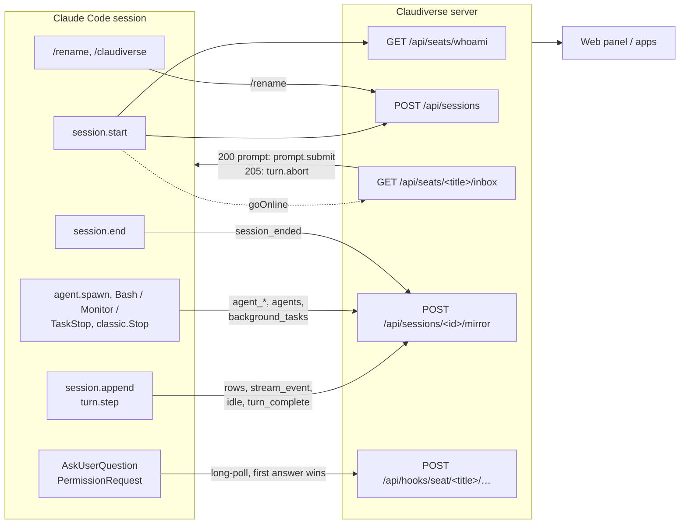

# claudiverse-seat mod reference

The claudiverse-seat mod is a Claude Code plugin (Claude Code 2.1.287 or
newer) that makes every session a Claudiverse seat, with no patched binary and
no wrapper. Configured once per machine with a server address and a seat token,
it registers the session with the server, polls the server's inbox for remote
prompts and interrupts, mirrors the conversation and live text to the apps,
relays questions and permission prompts so they can be answered remotely, and
reports agents and background tasks. With no server configured, or with the
server unreachable, Claude Code works exactly as stock.

It is one TypeScript module, `hooks/register.ts`, loaded through
`hooks/hooks.json`. Under the patched runtime (`CLAUDIVERSE_PATCHED_RUNTIME`
set) it stays inert, so a seat is never registered twice.

## Overview

## Pages

| Page | What it covers |
|---|---|
| [registration.md](registration.md) | Plugin options and launcher variables, the title, the `whoami` lookup, the registration body and `origin`, going online, the offline start |
| [inbox.md](inbox.md) | The inbox long-poll, its responses (200, 204, 205, 409), prompt delivery, the interrupt, `/compact` from the inbox, idle reporting |
| [mirroring.md](mirroring.md) | Batching, main-conversation rows (timestamps, model, effort, content as stored), agent rows, live text (`stream_event`), control rows, every row type |
| [questions-and-permissions.md](questions-and-permissions.md) | `AskUserQuestion` and permission prompts answered from the apps or the terminal, whichever comes first |
| [agents-and-background.md](agents-and-background.md) | Forks, subagents and teammates (`agent_started`, `agents`, `agent_ended`) and background shells and monitors (`background_tasks`) |
| [commands.md](commands.md) | `/rename` (the seat follows it) and `/claudiverse` |
| [outages-and-session-end.md](outages-and-session-end.md) | Behaviour per path while the server is down, recovery, and `session_ended` |
| [configuration.md](configuration.md) | Plugin options, environment variables, constants, every status line and log message |
| [server-api.md](server-api.md) | Every server call the mod makes, with requests and responses |

## Related pages

- [Documentation index](../../../README.md) and [glossary](../../../glossary.md)
- [Server reference](../../server/README.md)
- [Web panel reference](../web/README.md)
- [Runners and tools reference](../../runners/README.md)
- [Host agent reference](../../host-agent/README.md)
- [Android app](https://github.com/Promises/claudiverse-apps/blob/main/docs/android/README.md)
- [Mac app](https://github.com/Promises/claudiverse-apps/blob/main/docs/mac/README.md)

## Source

- `agent/mod/hooks/register.ts`
- `agent/mod/hooks/hooks.json`
- `agent/mod/.claude-plugin/plugin.json`
