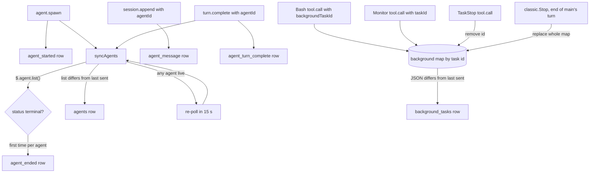

# Agents capture and background tasks

Besides the main conversation, a Claude Code session can run other work: forks, subagents and teammates (all called agents here), and background shells, monitors and similar tasks. The seat mod reports both to the server so the apps can show what a seat is doing behind the scenes: an agent list, a transcript per agent, and a list of background tasks. Agent rows and task rows are kept apart from the main conversation, so they never change what the apps think main is doing. All rows travel the same way as the rest of the mirror, through the queue and batching described in [Mirroring](mirroring.md); this page only covers what is specific to them.

## How it works

Nothing here is sent until the seat is registered (the mod holds a row id, see [Registration](registration.md)). Every hook below does nothing while the id is unknown.



### Agents

**Spawn.** The `agent.spawn` hook runs after the engine has created the agent. If it returned an `agentId`, the mod remembers `fork` and `background` for that agent, queues an `agent_started` row, flushes, and runs `syncAgents`. `tool_use_id` ties the agent to the `Agent` tool call in its parent's transcript.

**The list.** `syncAgents` reads `$.agent.list()` (if that throws, it returns and tries again at the next trigger) and builds one entry per agent. `fork` comes from the spawn event if it was seen, otherwise it is true when the agent's type is `fork`. `background` comes from the spawn event only; for an agent the mod did not see spawn it is omitted. The list is compared as JSON with the last one sent, and an `agents` row is queued only when it differs. The `agents` row replaces the previous list; it is a full snapshot, not a delta.

**Ending.** When an agent's status is `completed`, `failed` or `killed` and the mod has not yet reported it, it queues one `agent_ended` row for it. Each agent id is reported once.

**Re-polling.** While any agent in the list has a non-terminal status, `syncAgents` schedules itself again 15 s later (`AGENT_POLL_MS`, 15000 ms); only one such timer is pending at a time. The reason, from the code comment: an agent can end with no event of its own reaching the mod (a killed one, a background one), so the only way to notice is to read the list again. The polling stops once every agent is terminal.

**Triggers.** `syncAgents` runs after `agent.spawn` and after an agent's `turn.complete`, and by its own timer. It is not run for anything else.

**Agent transcript rows.** `session.append` rows that carry an `agentId` and are `user` or `assistant` messages are sent as `agent_message` rows, not as `user`/`assistant`. The wrapped inner row has the same shape as a main row (including `uuid`, `timestamp`, `isMeta`, and `model` when known). The main-conversation rows are described in [Mirroring](mirroring.md#main-conversation-rows).

**Why an agent's turn end is its own row.** When an agent's turn completes, the mod sends `agent_turn_complete` and does not send `turn_complete` or `idle`, and it leaves the stored main `turnId` alone. The code comment explains the history: up to version 0.8.8 a fork finishing a turn told the server that main was idle and dropped main's `turnId`, so the app's Interrupt could no longer reach a main turn that was still running. Keeping the agent's turn end separate avoids both.

### Background tasks

The mod keeps a map of background tasks keyed by task id and sends the whole map as one `background_tasks` row whenever its JSON differs from what it last sent.

- **Bash.** After a `Bash` tool call returns, if `result.backgroundTaskId` is a string (a call with `run_in_background`, Ctrl+B, or a timeout that moved it to the background), the task is added as type `shell`, status `running`, with the call's `description` and `command` and a `started_at` timestamp (ISO 8601, from the mod's clock).
- **Monitor.** After a `Monitor` tool call, if `result.taskId` is a string, the task is added as type `monitor`, status `running`, with `description`, and `command` set to the call's `command`, or to its `ws.url` when there is no command.
- **TaskStop.** After a `TaskStop` call, the id in `task_id` (or `shell_id` if `task_id` is absent) is removed from the map, unless the result was denied (`deny`) or an error (`isError`), or the id was not in the map.
- **End of main's turn.** The `classic.Stop` hook runs when main's turn ends. If the event carries a `background_tasks` array (the engine's own count of what is still in flight), the map is cleared and rebuilt from it, so the engine's list wins over whatever the calls recorded. Each entry keeps `id`, `type`, `status`, `description`, `command`, `agent_type`, `server`, `tool`, `name`. `started_at` is carried over from the earlier call's entry for the same id when the mod saw that call, otherwise it is omitted. A finished shell wakes main with a notification, so the turn that handles it ends with the shell absent from the engine's list, and the replacement drops it. Besides shells and monitors, the engine's list can hold other kinds (the code comment names subagents and workflows); the mod passes `type` through unchanged.

### What the server does with these rows

Confirmed in `claudiverse_server`:

- `agent_started`, `agent_message`, `agent_turn_complete`, `agent_ended` and `agents` are stored, broadcast to viewers as a `message`, and put in a separate agent replay buffer (most recent 300). They do not touch main's busy/idle, pings or permissions, and are left out of main's replay. The latest `agents` list is kept as the room's agent list. A viewer joining gets it in `replay` as `agent_messages` and `agents`, together with `busy_agents`, the count of agents whose `status` is `pending` or `running`.
- `background_tasks` is stored, broadcast as a `message`, and replaces the room's task list. It is excluded from main's replay and from the agent buffer; the `replay` push carries the list as `background_tasks`. The seat's status reports `background_running`, the count of tasks with status `pending` or `running`. A restarted room starts from the newest stored `background_tasks` row.
- None of these rows change the seat's `idle` flag; that is driven by main's `idle` row.

### What the web panel shows

`web/src/components/MessageBubble.tsx` returns `null` for rows of type `agents`, `agent_ended` and `background_tasks`, with a comment that this panel has no side panel for them. Nothing else in `web/src` handles these row types, so the web panel does not display agents or background tasks.

## Configuration

There are no settings for this feature. The only tunable is a constant in the mod:

| Constant | Value | Meaning |
|---|---|---|
| `AGENT_POLL_MS` | 15000 | Delay before `syncAgents` re-reads `$.agent.list()` while any agent is live. |
| `TERMINAL` | `completed`, `failed`, `killed` | Statuses that count as ended. |

## Interface

All rows go in the `messages` list of the mirror POST (see [Mirroring](mirroring.md)). Agent and task ids below are placeholders.

`agent_started`, sent once per spawn. `agent_type` is the event's `subagentType`; other fields are as the event gave them, and absent ones are left out of the JSON:

```json
{
  "type": "agent_started",
  "agent_id": "agent-1",
  "agent_type": "general-purpose",
  "description": "Search the repo for config loaders",
  "name": "searcher",
  "fork": false,
  "background": true,
  "parent_agent_id": "agent-0",
  "tool_use_id": "toolu_example"
}
```

`agents`, the full list, sent only when it changed:

```json
{
  "type": "agents",
  "agents": [
    {
      "agent_id": "agent-1",
      "agent_type": "general-purpose",
      "description": "Search the repo for config loaders",
      "name": "searcher",
      "fork": false,
      "background": true,
      "status": "running"
    }
  ]
}
```

`agent_ended`, once per agent:

```json
{ "type": "agent_ended", "agent_id": "agent-1", "status": "completed" }
```

`agent_message`, one agent transcript row:

```json
{
  "type": "agent_message",
  "agent_id": "agent-1",
  "timestamp": "2026-01-01T12:00:00.000Z",
  "message": {
    "type": "assistant",
    "uuid": "…",
    "timestamp": "2026-01-01T12:00:00.000Z",
    "message": { "role": "assistant", "content": [ { "type": "text", "text": "…" } ], "model": "…" }
  }
}
```

`agent_turn_complete`:

```json
{ "type": "agent_turn_complete", "agent_id": "agent-1" }
```

`background_tasks`, the whole list, sent only when it changed. A shell and a monitor, as recorded from their calls:

```json
{
  "type": "background_tasks",
  "tasks": [
    {
      "id": "task-1",
      "type": "shell",
      "status": "running",
      "description": "Run the test suite",
      "command": "npm test",
      "started_at": "2026-01-01T12:00:00.000Z"
    },
    {
      "id": "task-2",
      "type": "monitor",
      "status": "running",
      "description": "Watch the log",
      "command": "tail -f app.log",
      "started_at": "2026-01-01T12:01:00.000Z"
    }
  ]
}
```

After the end of main's turn the same list comes from the engine, with the extra fields (unset ones omitted):

```json
{
  "type": "background_tasks",
  "tasks": [
    {
      "id": "task-3",
      "type": "…",
      "status": "running",
      "description": "Index the docs",
      "agent_type": "general-purpose",
      "name": "indexer"
    }
  ]
}
```

An empty `tasks` array is sent when the last task goes away.

## Failure modes and troubleshooting

- **Agent list reading fails.** `$.agent.list()` errors are swallowed; the mod sends nothing and tries again at the next trigger (a spawn, an agent's turn end, or a pending 15 s poll). An agent that ended in that window is reported on the next successful read.
- **A batch is lost.** Rows go through the best-effort flush, so a failed POST drops them (see [Mirroring](mirroring.md#batching)). Lists are full snapshots, so the next `agents` or `background_tasks` row repairs the state, but an `agent_ended` or `agent_started` row is not resent; `agent_ended` is not repeated because the agent id is already marked reported.
- **Background task missing from the apps.** The task is only listed if the call's result carries `backgroundTaskId` (Bash) or `taskId` (Monitor), or if the engine's `background_tasks` at the end of main's turn includes it.
- **Task shows no `started_at`.** The mod did not see the starting call (for example it started before the mod loaded), so the engine's entry has no start time to carry over.
- **Stale task after TaskStop.** A denied or errored `TaskStop` leaves the task in place; it is corrected at the end of the turn by the engine's list.
- **Agent never shows as ended.** While an agent stays non-terminal in `$.agent.list()` the mod keeps polling every 15 s and reports no end. `waiting` and `idle` (a teammate waiting for a message, a finished turn) are non-terminal, so they keep the poll running; the server counts only `pending` and `running` as busy.
- **Nothing appears in the web panel.** Expected, see above.

## Related pages

- [Mirroring](mirroring.md): the queue, batching, and main-conversation rows.
- [Registration](registration.md): how the seat gets the row id these rows are sent to.
- [Outages and session end](outages-and-session-end.md)
- [Server API](server-api.md)
- [Overview](README.md)
- Android: [Seat view](https://github.com/Promises/claudiverse-apps/blob/main/docs/android/seat-view.md)
- Mac: [Agents and background tasks](https://github.com/Promises/claudiverse-apps/blob/main/docs/mac/agents-and-background-tasks.md)

## Source

- `mods/claudiverse-seat/hooks/register.ts` (`syncAgents`, `sendBackground`, and the `agent.spawn`, `session.append`, `tool.call`, `classic.Stop` and `turn.complete` hooks)
- `claudiverse_server/lib/claudiverse_server/sessions/room.ex` (agent and `background_tasks` handling)
- `claudiverse_server/lib/claudiverse_server/sessions.ex` (replay queries)
- `claudiverse_server/lib/claudiverse_server_web/channels/session_channel.ex` (replay push)
- `web/src/components/MessageBubble.tsx`
