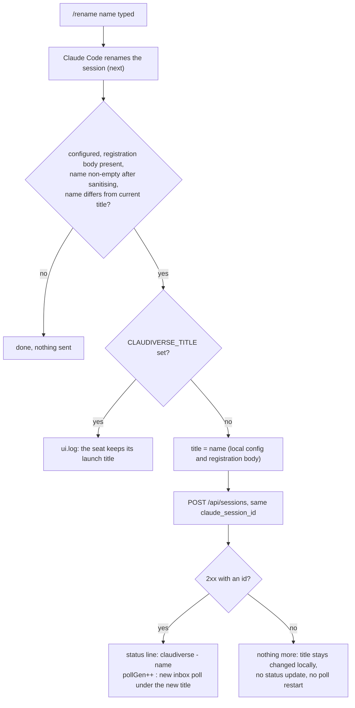

# Slash commands

The `claudiverse-seat` mod interacts with two slash commands typed in the Claude Code terminal. It hooks Claude Code's own `/rename` so that the seat follows the session's new name, and it adds one command of its own, `/claudiverse`, which prints where this seat is connected. Both exist so that a stock Claude Code (2.1.287 or later) behaves like a seat without a patched binary: renaming a session in the terminal should rename the seat in the apps, and a user should be able to check the link without leaving the session.

Slash commands sent remotely (by `cv_send` or an app) are a different path. They are covered at the end of this page.

## How it works

### `/rename <name>`

The mod does not replace `/rename`. It registers a `command.run` hook for `rename` that first calls `next`, which lets Claude Code perform its own rename, and then reacts to the argument the user typed. The command's own result is returned unchanged.

After Claude Code has renamed the session, the hook works through these steps in order and stops at the first that applies:

1. Sanitise the argument: trim whitespace, replace every run of characters outside `A-Za-z0-9._-` with `-`, trim leading and trailing `-`, and cut to 64 characters. `my new name!` becomes `my-new-name`.
2. Do nothing if the mod is not configured or not registered with a registration body (no URL or token at `session.start`, or `CLAUDIVERSE_PATCHED_RUNTIME` set), if the sanitised name is empty, or if it equals the current seat title.
3. If the title is pinned by `CLAUDIVERSE_TITLE`, log `claudiverse: the seat keeps its launch title <title> (CLAUDIVERSE_TITLE)` and stop. The seat keeps its name. The reason in the code: a launcher re-applies the pinned title on every restart, so a rename would revert anyway.
4. Otherwise set the new title in the mod's config and in the stored registration body, then re-register: `POST /api/sessions` with the same `claude_session_id` and the new `title`. The server reuses the existing row for that Claude session id, so this updates the row's title rather than creating a second seat.
5. If the re-registration succeeds, set the status line to `claudiverse · <name>` and restart the inbox poll under the new title.

"Not registered" here means the mod has no registration body. The row id does not matter for this check: if the server was unreachable at start and registration is still being retried, a `/rename` still goes through step 4, and a successful POST there also stores the row id.



#### Why the poll restarts

The inbox is keyed by title: the mod polls `GET /api/seats/<title>/inbox`. After a rename, the old request is still in flight under the old title. Bumping `pollGen` retires that loop: when its answer arrives, the mod sees that its generation is stale and drops the answer. A new loop starts at once under the new title. The restarted poll carries no `event` parameter (`SessionStart` is only sent on the first poll after going online). See [Inbox](inbox.md).

#### A bare `/rename`

`/rename` with no argument asks Claude Code to pick a name itself. The mod does not follow this: it cannot read the name Claude picked, and the empty argument fails the "name is non-empty" check, so nothing is sent. The seat keeps its old title until a `/rename <name>` with an explicit name.

#### When the re-registration fails

The code sets the new title before it sends the request and does nothing to undo it. If the POST fails (the server is unreachable, answers non-2xx, or the answer has no `id` or `session.id`):

- The mod's config and stored registration body already carry the new title.
- The server row keeps the old title, because the POST did not land.
- The status line is not updated; it still shows `claudiverse · <old title>`.
- `pollGen` is not bumped and nothing is logged. The poll request already in flight stays valid, and it was sent under the old title. The loop reads the title again for each following request, so its next request goes out under the new title. The server's inbox for that new title is whatever the server has for it, which for a not-yet-renamed row is not the seat's queue. The mod has no check for this.
- Later registrations use the new title: when the inbox recovers from an outage the mod re-registers with the stored body (see [Outages and session end](outages-and-session-end.md)), which then renames the server row as well.

The practical consequence is that a failed rename leaves the local mod and the server disagreeing about the seat's title until a later registration succeeds. Run `/claudiverse` to see the local title, and check the title in an app. Repeating the same `/rename <name>` does not retry: the title already equals the new name, so step 2 ends the hook. Rename to a different name and back, or wait for a re-registration after an outage.

### `/claudiverse`

`/claudiverse` is registered at `session.start` with `$.command.register`, with the description `Shows this seat's link to the claudiverse server`. A `command.run` hook for `claudiverse` answers it directly with a text result. The answer is not a turn: the model is not called and nothing is added to the conversation.

Output when the mod is configured:

```
claudiverse: seat <title> · session <row> · <url>
```

- `<title>` is the current seat title.
- `<row>` is the seat's session id on the server, or the text `not registered` if the registration has not succeeded (for example the server was down at start and the retry loop has not landed yet).
- `<url>` is the server URL with a trailing `/` removed.
- ` · host <host>` is appended when a host is known (`CLAUDIVERSE_HOST`, or the output of `hostname`).
- ` · fleet <fleet>` is appended when `CLAUDIVERSE_FLEET` is set.

Example:

```
claudiverse: seat lorem-w1 · session 42 · https://claudiverse.example · host my-laptop · fleet lorem-fleet
```

The token is never printed.

Output when not configured (as written in the code):

```
claudiverse: not configured (CLAUDIVERSE_URL, CLAUDIVERSE_TOKEN and CLAUDIVERSE_TITLE are needed)
```

This text names `CLAUDIVERSE_TITLE`, but the mod only needs a URL and a token; the title is optional (it is derived when unset, see [Registration](registration.md)).

#### What a user sees when the mod is not configured

In practice the "not configured" text is not reachable. `$.command.register` runs only after the URL and token check at `session.start` has passed (and after the config has been built), so on a machine with no URL or token, or with `CLAUDIVERSE_PATCHED_RUNTIME` set, the mod never registers `/claudiverse`. Typing it then does not reach the mod's handler. What Claude Code shows for a command that does not exist is Claude Code's own behaviour and is not defined by the mod. To check whether a session has the mod active, look for the status line `claudiverse · <title>` (or `claudiverse offline`), or run `/claudiverse` and see whether it exists.

## Configuration

The commands have no settings of their own. What they read:

| Item | Default | Effect on the commands |
|---|---|---|
| `CLAUDIVERSE_TITLE` | unset | When set, the title is pinned and `/rename` is ignored with the log line above. |
| `CLAUDIVERSE_URL` / plugin option `server_url` | none | Required for the mod to register `/claudiverse` at all. |
| `CLAUDIVERSE_TOKEN` / plugin option `seat_token` | none | Required, as above. |
| `CLAUDIVERSE_HOST`, `CLAUDIVERSE_FLEET` | `hostname` output, unset | Shown in the `/claudiverse` output. |
| Title length limit | 64 characters | Constant in `register.ts`, not configurable. |
| Allowed title characters | `A-Za-z0-9._-` | Constant in `register.ts`, not configurable. |

## Interface

### `/rename <name>`

Input: the argument of Claude Code's own `/rename`.

Server call, only when a rename is followed (same body as [Registration](registration.md), with the new title):

```
POST /api/sessions
Authorization: Bearer <seat token>
Content-Type: application/json
```

```json
{
  "title": "lorem-w2",
  "claude_session_id": "<Claude session id>",
  "working_directory": "/home/me/project",
  "client_version": "<version> (Claude Code) [claudiverse-mod]",
  "host": "my-laptop",
  "fleet": "lorem-fleet",
  "origin": "plain",
  "type": "sidecar"
}
```

Response: 201 `{"session": {"id": 42, "title": "lorem-w2", ...}}`.

What the server does with it (read from `SessionController.create` and `Sessions.create_session`):

- It looks for a row of the same user whose `claude_session_id` or `conversation_id` equals the posted `claude_session_id` (not of type `proxy`; the most recently updated one wins). If found, the row is updated in place with the incoming attributes, so the new `title` replaces the old one, and the status is forced back to `running`. The row id is unchanged.
- Fields that are absent or empty in the body (`host`, `fleet`, `origin`, `working_directory`, `client_version`, `tmux_session`) leave the stored values alone.
- The seat's account assignment label is updated to the new title (`AnthropicAuths.note_seat_title`).
- Title conflicts: the code read does not check that the new title is unused, and the session changeset has no uniqueness validation on `title`. Two rows may carry the same title; the mod and server do not warn about it. The inbox is looked up by title, so avoid reusing the title of another live seat.

### `/claudiverse`

No server call. Returns text, shown above.

## Failure modes and troubleshooting

| What you see | Cause and action |
|---|---|
| `/rename <name>` changes Claude Code's session name but the seat keeps its old name in the apps; log line `claudiverse: the seat keeps its launch title <title> (CLAUDIVERSE_TITLE)` | The title is pinned by a launcher. This is intended. Start the seat without `CLAUDIVERSE_TITLE` to let it follow renames. |
| `/rename` with no name; the seat name does not change | A bare `/rename` is not followed. Use `/rename <name>`. |
| `/rename <name>` where the name is only symbols (for example `!!!`) | It sanitises to an empty string and is ignored. |
| `/rename <name>` is different from the apps' title, status line shows the old title, no log line | The re-registration failed (server down, non-2xx, no id in the answer). See "When the re-registration fails". Run `/claudiverse` to see the local title; the server row catches up at the next successful registration. |
| The title in the apps is shortened or has dashes where the name had spaces or symbols | Sanitising: runs of characters outside `A-Za-z0-9._-` become `-`, ends are trimmed, 64 characters at most. |
| `/claudiverse` shows `session not registered` | The registration has not succeeded yet; the status line shows `claudiverse offline`. See [Registration](registration.md). |
| `/claudiverse` does not exist | The mod is not configured (no URL or token) or is inert (`CLAUDIVERSE_PATCHED_RUNTIME` set). Set the plugin options or the launcher variables. |

## Commands sent remotely

Slash text that arrives through the inbox (from `cv_send` or an app) is not treated like a command typed in the terminal. Only `/compact` is run; any other `/cmd` is refused with a log line. That path, its `INBOX_COMMANDS` set and its idle reporting are described in [Inbox](inbox.md). `/rename` and `/claudiverse` cannot be run remotely.

## Related pages

- [Mod overview](README.md)
- [Registration](registration.md)
- [Inbox](inbox.md)
- [Mirroring](mirroring.md)
- [Outages and session end](outages-and-session-end.md)
- [Configuration](configuration.md)
- [Server API](server-api.md)
- Server: [Sessions and Rooms](../../server/sessions-and-rooms.md)

## Source

- `agent/mod/hooks/register.ts`
- `agent/mod/.claude-plugin/plugin.json`
- `server/api/lib/claudiverse_server_web/controllers/session_controller.ex`
- `server/api/lib/claudiverse_server/sessions.ex`
- `server/api/lib/claudiverse_server/sessions/session.ex`
