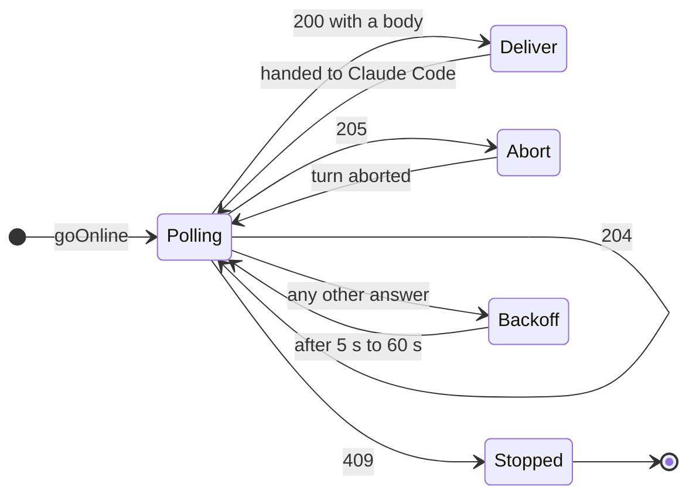

# The inbox: remote input and inbox commands

The inbox is how text typed in a Claudiverse app, or sent by a supervising seat with `cv_send`, reaches a running Claude Code session, and how the app's Interrupt button stops a turn. The `claudiverse-seat` mod holds a long-poll open against the server, hands whatever comes back to Claude Code, and reports back to the server when it is ready for the next message. The mod runs inside the Claude Code process, so there is no terminal automation: a prompt is submitted with the mods API and an interrupt is a native turn abort.

## How it works

Once the seat is registered (see [registration.md](registration.md)), the mod starts one poll loop. Each iteration sends one request, `GET /api/seats/<title>/inbox?wait=25`, with the seat token as a Bearer token. The server holds the request until a message, an interrupt, a takeover or the wait time arrives, then answers. The mod acts on the answer and sends the next request. There is never more than one request in flight for a loop.



### Query parameters

| Parameter | Value |
|---|---|
| `wait` | Always `25` (seconds). |
| `event` | `SessionStart`, only on the first poll after the seat goes online. `Stop` on each retry after a failed poll while no turn is running (0.11.0+): a server that restarted reads the seat as idle from it. Other polls carry no `event`. |
| `host` | The seat's host, when known. |
| `fleet` | The seat's fleet, when set. |
| `origin` | The seat's origin, when set. |

All values are URL-encoded. `host`, `fleet` and `origin` are the values the seat registered with (see [registration.md](registration.md) and [configuration.md](configuration.md)).

### Responses

| Status | Meaning | What the mod does |
|---|---|---|
| 200, non-empty body | One or more prompts, oldest first, separated by a blank line | Delivers the text (below), then polls again. |
| 204 | Nothing arrived within the wait | Polls again. |
| 205 | Interrupt requested from an app | Calls `$.turn.abort({turnId})` on the running main turn, then polls again. |
| 409 | A newer poll for this seat replaced this one | Logs `claudiverse: another poller took this seat over; inbox stopped` and does not poll again. |
| any other status, or a network error | Failure | Backs off and retries (below). |

### Interrupt (205)

The mod tracks `turnId` from `turn.start`. It clears it on a main `turn.complete`. A `turn.complete` that carries an `agentId` (a fork, subagent or teammate) does not clear it, and it is not main's idle either: it is mirrored as `agent_turn_complete`. This is deliberate. Earlier versions let a finishing fork clear main's `turnId`, after which Interrupt could no longer reach a main turn that was still running.

On 205 the mod does one of three things:

- `turnId` is set: `$.turn.abort({ turnId })`.
- `turnId` is not set: logs `claudiverse: interrupt received, but no running turn is known`.
- The abort rejects: logs `claudiverse: interrupt failed for turn <turnId>: <message>`.

Both log lines go to the Claude Code UI log through `$.ui.log`. Because the abort is awaited before the next poll, a hung abort holds the loop; the prompt path is the reverse and is deliberately not awaited (see below).

### Failed polls and recovery

A non-204 status that is not 200 with a body, 205 or 409 (for example a 401 or a 5xx), a network error, and a 200 with an empty body all call `pollFailed`:

1. `pollFailures` is incremented.
2. On the second consecutive failure the status line changes to `claudiverse offline`. The first failure is silent.
3. The next poll is scheduled after `min(5 s * 2^(failures-1), 60 s)`: 5 s, 10 s, 20 s, 40 s, then 60 s.

The first non-failing answer after a failure (204, 200 with a body, or 205) resets the counter to 0, sets the status line back to `claudiverse · <title>`, and calls `registerSeat`. The server may have restarted, and registration is idempotent by Claude's session id. Details of the outage behaviour, including what happens to mirroring, are in [outages-and-session-end.md](outages-and-session-end.md).

### Retiring a loop: `pollGen`

`pollGen` is a generation counter. Every loop captures its generation and checks it before each request and after each response; a stale loop returns without acting on the answer, so it can neither deliver a prompt nor schedule another poll. The counter is bumped by `goOnline` and by the `/rename` handler. The inbox is keyed by the seat's title, so after `/rename <name>` re-registers the seat under the new title, the mod starts a new loop under that title. A seat whose title was pinned by `CLAUDIVERSE_TITLE` keeps its title and its loop. The old title's request may still be held at the server; the stale loop ignores whatever answer it gets.

### Delivering a prompt

`deliver` first checks whether the trimmed text is a slash command: `^/([A-Za-z][\w-]*)(?:\s+([\s\S]*))?$`.

**Plain text** is submitted with `$.prompt.submit({ text, asUser: true })`. The call is not awaited. A prompt delivered while a turn is running is queued by Claude Code, and its `submit` promise resolves only when that queued turn starts. Awaiting it therefore stopped the inbox for the rest of the running turn. Two things followed: the server took the missing poll for a dead seat and stopped it after about 3 to 4 minutes, and the app's Interrupt, which arrives on this very poll, could not reach the turn. With the call not awaited, the loop polls again immediately.

If the submit rejects, the mod logs `claudiverse: could not submit an inbox prompt: <message>` and reports idle (below).

**Slash text** follows these rules:

- Only `/compact` is run, through `$.command.run({ command, args })`. It is queued by Claude Code until the session is idle. If it fails, the mod logs `claudiverse: /compact from the inbox failed: <message>`. Whether it succeeds or fails, the seat reports idle afterwards.
- Any other `/cmd` is not run. The mod logs `claudiverse: /<cmd> from the inbox was not run (only /compact is)` and reports idle. The reason is that `prompt.submit` refuses a `/` text (as a user prompt it would run a command as if the user had typed it), so the mod refuses it first and reports idle. The allowed set is the constant `INBOX_COMMANDS`, which contains only `compact`.

### Why `idleAgain` exists

The server marks a seat busy the moment it hands a prompt over (`Room.send_message` sets the room to not idle on `:delivered`). It marks the seat idle again only when the mod mirrors `{"type":"idle"}`, and the mod does that when a main turn completes (`turn_complete` followed by `idle`). A delivery that starts no turn would leave the seat marked busy forever, and every later `cv_send` would be answered `busy`. So `idleAgain` pushes `{"type":"idle"}` to the mirror whenever the delivery produced no turn: a refused slash command, a finished or failed `/compact`, a failed submit. It does nothing if a turn is running (`turnId` set) or the seat has no server row yet. The mod's own comments record the case that motivated it: a `cv_send` of `/compact` that was refused left a seat reading busy for 35 minutes.

### Server side

Confirmed in `claudiverse_server`:

- `InboxController.poll` reads `wait`. A missing value uses a default of 50 s; a non-numeric or non-positive value also falls back to 50 s; every value is capped at `inbox_max_wait_s`, whose default is 60 s. The mod's 25 s is therefore well inside the cap. The cap exists because a held poll cannot notice its client disappearing, and the poll is the seat's heartbeat, so a long wait made a killed seat look alive.
- Each poll registers as the seat's `:inbox` link (`SeatLinks.register`), and registering replaces any older poller for the same user and seat title; the older request is told `:seat_link_replaced` and answers 409. This is what 409 means: a newer poll took over.
- A poll also marks the seat as an inbox seat, records the `event` if it is one of `SessionStart`, `UserPromptSubmit`, `Stop`, `Notification`, updates `host`, `fleet`, `origin` (and `working_directory`) of the seat's row when they changed and marks it running, starts its Room, and acts as the seat's heartbeat.
- 200: prompts waiting for the seat, or arriving during the wait, joined by a blank line (`text/plain`). A prompt that arrives while no poll is waiting is queued and given to the next poll.
- 204: the wait ran out with nothing queued.
- 205: `SeatInbox.interrupt` found the live poller and sent it `:inbox_interrupt`. An interrupt is never queued: with no poller waiting it is not delivered through the inbox.
- Sources: a prompt comes from `Room.send_message` (the app's `send_message` channel event, and `POST /api/notify/send`, which is the endpoint behind `cv_send`) or `Room.force_message` (`force: true` on that endpoint, app tokens only). Both prefer an MCP channel link, then the inbox, and fall back to the sidecar only if the seat never polled or its poll is stale (no poll for 120 s while a sidecar is connected). `send_message` and `cv_send` are reject-busy: they deliver only when the Room reads the seat idle. An interrupt comes from the `interrupt` channel event; if the Room reads the seat busy it is sent to the inbox poller, and falls back to the machine's host agent only when no poller is linked.
- Slash commands: `POST /api/notify/send` refuses up front, with `{"status":"refused", ...}`, a text starting with `/<name>` where the name is not `compact`, but only for a seat whose registered `client_version` contains `[claudiverse-mod`. The mod registers `client_version` as `<version> (Claude Code) [claudiverse-mod]`. The `send_message` channel event path does not apply this check in the code read; there the mod's own refusal is what happens.

## Configuration

The inbox has no setting of its own. These are fixed in `register.ts`:

| Constant | Value | Meaning |
|---|---|---|
| `POLL_WAIT_S` | 25 | `wait` sent with each poll. |
| `RETRY_MS` | 5000 | First delay after a failed poll. |
| `POLL_RETRY_MAX_MS` | 60 000 | Longest delay between failed polls. |
| `INBOX_COMMANDS` | `compact` | The only slash command run from the inbox. |

The URL, token, title, host, fleet and origin it sends come from the plugin options and `CLAUDIVERSE_*` variables described in [configuration.md](configuration.md).

## Interface

Request:

```
GET https://claudiverse.example/api/seats/lorem-w1/inbox?wait=25&event=SessionStart&host=my-laptop&fleet=lorem-fleet&origin=manual
Authorization: Bearer <seat token>
```

Responses:

```
HTTP/1.1 200 OK
Content-Type: text/plain

Run the migration and report the result.
```

```
HTTP/1.1 204 No Content
HTTP/1.1 205 Reset Content
HTTP/1.1 409 Conflict
```

What the mod sends to the mirror because of the inbox: `{"type":"idle"}` after anything that started no turn (see [mirroring.md](mirroring.md)).

Accepted slash text from the inbox: `/compact` or `/compact <focus instructions>` (anything after the command name is passed as `args`). Anything else starting with `/` is not run.

## Failure modes and troubleshooting

| Symptom | Cause | What to do |
|---|---|---|
| Status line reads `claudiverse offline` | Two or more consecutive failed polls. | Check the server is reachable from the machine and the seat token is valid. The loop recovers on its own; see [outages-and-session-end.md](outages-and-session-end.md). |
| Log: `claudiverse: another poller took this seat over; inbox stopped` | Another process polled the same title (a second `claude` with the same title, or a restarted seat). | The loop does not restart. Restart the session, or `/rename` the seat, which starts a new loop. |
| Log: `claudiverse: interrupt received, but no running turn is known` | Interrupt arrived while no main turn had started, or after it completed. | None needed; nothing was running. |
| Log: `claudiverse: interrupt failed for turn <id>: <message>` | `$.turn.abort` rejected. | Press Escape in the terminal. |
| Log: `claudiverse: /<cmd> from the inbox was not run (only /compact is)` | A supervisor sent a slash command. | Send plain text instead. The sender of a `cv_send` is told `refused` by the server for mod seats. |
| Log: `claudiverse: could not submit an inbox prompt: <message>` | `prompt.submit` rejected. | Resend. The seat has already reported idle. |
| Log: `claudiverse: /compact from the inbox failed: <message>` | `/compact` failed. | Run `/compact` in the terminal. |
| `cv_send` answers `busy` for a seat that sits at its prompt | Server marked it busy and nothing reported idle. The mod does this itself for refused, failed and non-turn deliveries. | If it persists, send `force` from an app, or check the mod version. |
| A prompt sent mid-turn is not answered immediately | Claude Code queued it behind the running turn. | Expected; it runs when the turn ends. Note `cv_send` itself is reject-busy and will not hand a prompt over mid-turn. |

## Related pages

- [claudiverse-seat mod reference](README.md)
- [Registration](registration.md)
- [Mirroring](mirroring.md)
- [Questions and permission relay](questions-and-permissions.md)
- [Agents capture and background tasks](agents-and-background.md)
- [Slash commands](commands.md)
- [Outages and session end](outages-and-session-end.md)
- [Configuration reference](configuration.md)
- [Server API used by the mod](server-api.md)
- Server: [HTTP mirror, inbox long-poll and liveness](../../server/mirror-inbox-liveness.md)
- Web panel: [The seat view](../web/seat-view.md)
- Runners and tools: [cvctl: the orchestrator CLI](../../runners/cvctl.md), [cv-mcp: seat, ping and question tools](../../runners/mcp-seats.md)
- Android: [Seat controls](https://github.com/Promises/claudiverse-apps/blob/main/docs/android/seat-controls.md)
- Mac: [Seat view](https://github.com/Promises/claudiverse-apps/blob/main/docs/mac/seat-view.md)

## Source

- `mods/claudiverse-seat/hooks/register.ts` (`poll`, `deliver`, `idleAgain`, `pollFailed`, `INBOX_COMMANDS`, the `turn.start` and `turn.complete` handlers)
- `claudiverse_server/lib/claudiverse_server_web/controllers/inbox_controller.ex`
- `claudiverse_server/lib/claudiverse_server/seat_inbox.ex`
- `claudiverse_server/lib/claudiverse_server/seat_links.ex`
- `claudiverse_server/lib/claudiverse_server/sessions/room.ex`
- `claudiverse_server/lib/claudiverse_server_web/controllers/notify_controller.ex`
- `claudiverse_server/lib/claudiverse_server_web/channels/session_channel.ex`
