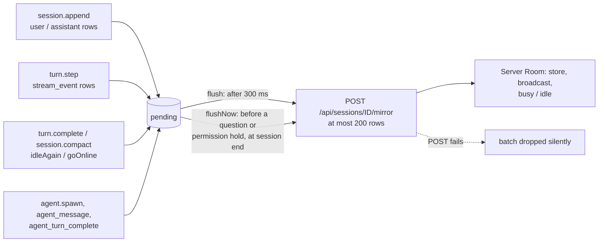

# Mirroring

The mod copies a session's conversation to the server so the apps can show it: finished messages, live text as it streams, and a few control rows that tell the server whether the seat is busy or idle. Everything is sent as JSON rows to `POST /api/sessions/<row id>/mirror`, where `<row id>` is the seat's session id on the server (the id the mod got when it registered, see [Registration](registration.md)). Mirroring is one-way and best effort: it never changes what the session does.

## How it works

Hooks in the mod push rows onto an in-memory queue, `pending`. A flush sends the queue to the server in batches. Nothing is sent until the seat is registered (the mod holds a row id); rows are only queued while the id is known.



### Batching

- `flush` schedules one send `FLUSH_MS` (300 ms) after the first row is queued. Rows queued in that window go out together. While a flush is scheduled, further `flush` calls do nothing.
- Each POST carries at most `MAX_BATCH` (200) rows, the server's limit per call. A longer queue is sent as several POSTs in a row.
- `flushNow` drains the queue immediately, in the same batches. The mod uses it before it holds on a question or a permission prompt (the app must see the question before the hold starts, see [Questions and permissions](questions-and-permissions.md)) and when the session ends.
- A failed POST is dropped: the batch has already left the queue and the error is swallowed. A lost batch only thins the mirror; it never touches the session. There is no retry and no re-queue.

### Main-conversation rows

The `session.append` hook runs after the row is stored. Only rows whose `message.type` is `user` or `assistant` are mirrored. Rows without an `agentId` are main's; they are sent as:

```json
{
  "type": "assistant",
  "uuid": "…",
  "timestamp": "2026-01-01T12:00:00.000Z",
  "isMeta": true,
  "effort": "high",
  "message": { "role": "assistant", "content": [ { "type": "text", "text": "…" } ], "model": "…" }
}
```

- `uuid` is the stored row's uuid, or the event's uuid when the store returns none.
- `timestamp` is `$.clock.now()` as an ISO string, read when the row is stored. The append event carries no time of its own, and the server's arrival time is late by the flush wait, or by a whole outage for rows queued through one. The apps use it for message times and day dividers.
- `isMeta` is present only when true.
- `effort` is set on assistant rows only. It is the effort of the main loop's last `turn.step` (the last model request), because the row itself does not carry it. User rows have no `effort`.
- `message.model` is present only when the row's origin is of kind `model`, and is that origin's model.
- `message.content` is forwarded as stored, unchanged: the content array of a user row (including any image or `tool_result` blocks) and of an assistant row (text, thinking, `tool_use` blocks) travels as-is.

On the server, inline base64 image blocks are not kept in the message row: when the server has file storage, it saves the picture and replaces the block with a reference (`source.type` `url`, `/api/files/<id>`, plus `size`). A block it cannot store is left as it was. If the row has no `timestamp`, the server stamps its arrival time.

### Agent rows

A row with an `agentId` (a fork, subagent or teammate) is sent under its own type so it stays out of main's transcript, main's busy/idle and main's live reply:

```json
{
  "type": "agent_message",
  "agent_id": "…",
  "timestamp": "2026-01-01T12:00:00.000Z",
  "message": {
    "type": "assistant",
    "uuid": "…",
    "timestamp": "2026-01-01T12:00:00.000Z",
    "isMeta": true,
    "message": { "role": "assistant", "content": [], "model": "…" }
  }
}
```

The inner `message` has the shape of a main row (without `effort`). The server keeps agent rows in a separate buffer and they never change main's busy/idle. When an agent's turn ends the mod sends `{"type": "agent_turn_complete", "agent_id": "…"}`. The agent lifecycle rows (`agent_started`, `agents`, `agent_ended`) are described in [Agents and background work](agents-and-background.md).

### Live text

The `turn.step` hook watches the main loop's model requests (a request with an `agentId` is skipped) and rebuilds the API's stream as `stream_event` rows, so the apps can show a reply as it is written. Each chunk is passed on to Claude Code unchanged; a failure while mirroring a chunk is swallowed.

| Moment | Row |
| --- | --- |
| Step starts | `{"type":"stream_event","event":{"type":"message_start","message":{"role":"assistant","model":"<e.model>","content":[]}}}` |
| First chunk of a text block | `content_block_start` with `{"type":"text","text":""}` |
| First chunk of a thinking block | `content_block_start` with `{"type":"thinking","thinking":""}` |
| Tool call chunk | `content_block_start` with `{"type":"tool_use","id":…,"name":…,"input":{}}` |
| Text | `content_block_delta`, `delta` `{"type":"text_delta","text":…}` |
| Thinking | `content_block_delta`, `delta` `{"type":"thinking_delta","thinking":…}` |
| Tool input | `content_block_delta`, `delta` `{"type":"input_json_delta","partial_json":…}` |
| Stop chunk | `content_block_stop` for every open block, then `message_delta` with `delta.stop_reason` |
| Step ends | `content_block_stop` for any block still open, then `{"type":"message_stop"}` |

Consecutive deltas of the same block (same `index` and delta type) that arrive within a flush window are merged into one delta, so a reply is a few rows rather than one per token. Empty text is dropped (thinking arrives empty where the build does not show it). The finished message is still mirrored whole by `session.append`. The server treats `stream_event` rows as live only: they are broadcast to viewers but not stored or kept in the replay buffer.

### Control rows

| Row | Sent when |
| --- | --- |
| `{"type":"idle"}` | the seat goes online (registration succeeded); at the end of a main turn (after `turn_complete`); from `idleAgain` when something that started no turn finished (a `/compact` sent by `cv_send`, a refused slash command, a failed prompt submit) and no turn is running; on the first good inbox answer after an outage, when no turn is running |
| `{"type":"turn_complete","reason":"…"}` | a main turn completes (queued together with `idle`), whatever ended it. `reason` is `answer`, `aborted`, `refusal` or `error`; for `error` also `error` (Claude Code's kind of API error, e.g. `rate_limit`, `server_error`) and `error_text` (what it showed, e.g. `API Error: ... cv-proxy: no pool account is available (:no_available_auth)`), from `classic.StopFailure`, which fires just before `turn.complete` |
| `{"type":"compact"}` | `session.compact` finished |
| `{"type":"agent_turn_complete","agent_id":"…"}` | an agent's turn completes |

An agent finishing a turn does not send `turn_complete` or `idle`, and does not clear the running main turn id.

### Every row type the mod emits

| `type` | Fields | Page |
| --- | --- | --- |
| `user`, `assistant` | `uuid`, `timestamp`, `isMeta`, `effort` (assistant only), `message` `{role, content, model?}` | this page |
| `agent_message` | `agent_id`, `timestamp`, `message` `{type, uuid, timestamp, isMeta, message {role, content, model?}}` | this page |
| `stream_event` | `event` (API stream event) | this page |
| `idle` | none | this page |
| `turn_complete` | `reason`; `error`, `error_text` when `reason` is `error` (0.11.0+) | this page |
| `compact` | none | this page |
| `agent_turn_complete` | `agent_id` | this page |
| `agent_started` | `agent_id`, `agent_type`, `description`, `name`, `fork`, `background`, `parent_agent_id`, `tool_use_id` | [Agents and background work](agents-and-background.md) |
| `agents` | `agents` (list of `{agent_id, agent_type, description, name, fork, background, status}`) | [Agents and background work](agents-and-background.md) |
| `agent_ended` | `agent_id`, `status` | [Agents and background work](agents-and-background.md) |
| `background_tasks` | `tasks` | [Agents and background work](agents-and-background.md) |
| `session_ended` | `reason`, `exit_code` (always `0`) | [Outages and session end](outages-and-session-end.md) |

## Configuration

Mirroring has no settings of its own. The constants are fixed in the mod:

| Constant | Value | Meaning |
| --- | --- | --- |
| `FLUSH_MS` | 300 | wait before a queued row is sent |
| `MAX_BATCH` | 200 | rows per POST, the server's limit |

The server and token come from the plugin options or the launcher's environment, see [Configuration](configuration.md).

## Interface

`POST /api/sessions/<row id>/mirror`, with the seat's token as `Authorization: Bearer <seat token>` and `Content-Type: application/json`.

```json
{ "messages": [ { "type": "idle" } ] }
```

Response `202 Accepted`:

```json
{ "ok": true, "count": 1 }
```

Errors the server returns:

| Status | Body | Cause |
| --- | --- | --- |
| 400 | `{"error":"at most 200 messages per call"}` | more than 200 rows |
| 400 | `{"error":"each message must be an object with a type"}` | a row is not an object with a string `type` |
| 400 | `{"error":"messages must be a list"}` | `messages` missing or not a list |
| 404 | `{"error":"Not found"}` | the id is not a session of the token's user |

The server treats each row as it would a sidecar's `mirror_messages`: stored, broadcast to viewers, and used for the seat's readiness. Readiness is read from the row type: any other row reads the seat as busy, and a `{"type":"idle"}` row reads it as idle. That is why `turn_complete` is always followed by `idle` in the same batch, including for a turn that died on an API error: the seat is at its prompt, so reject-busy delivery (a `cv_send`, a scheduled prompt, [auto-resume](../../server/auto-resume.md)'s `continue`) must reach it. `turn_complete` alone does not make the seat idle, and the server does not use it to notify watchers; an `idle` row does. `compact` does not change readiness. Agent row types (`agent_started`, `agent_message`, `agent_turn_complete`, `agent_ended`, `agents`) never change main's busy/idle. A seat that is busy rejects a `cv_send`; an idle one accepts it.

## Failure modes and troubleshooting

- **The server is unreachable or a POST fails.** The mod logs nothing and drops that batch. The apps show a gap in the conversation; the session itself is unaffected. Every flush takes its rows off the queue before it sends them, so rows produced while the server is down are lost, not held for later.
- **The seat reads busy in the apps while it is at its prompt.** The server only marks a seat idle on an `idle` row. If an `idle` row was lost with a dropped batch, the seat stays busy until the next turn ends. Coming back from an outage, the mod registers again but does not send a new `idle` row (see [Outages and session end](outages-and-session-end.md)).
- **Rows missing from the apps, nothing logged.** Check that the seat is registered (`/claudiverse` shows the session id, or `not registered`). Before registration, rows are not queued.
- **A fork's rows are not in the main transcript.** By design: they arrive as `agent_message`.
- **A batch is refused with 400.** The mod never sends more than 200 rows or a row without a `type`, so a 400 means a different client or a changed server limit.

## Related pages

- [Registration](registration.md)
- [Inbox](inbox.md)
- [Questions and permissions](questions-and-permissions.md)
- [Agents and background work](agents-and-background.md)
- [Outages and session end](outages-and-session-end.md)
- [Configuration](configuration.md)
- [Server API](server-api.md)
- Server: [HTTP mirror, inbox long-poll and liveness](../../server/mirror-inbox-liveness.md)
- Web panel: [The seat view](../web/seat-view.md)
- Android: [Seat view](https://github.com/Promises/claudiverse-apps/blob/main/docs/android/seat-view.md)
- Mac: [Transcript](https://github.com/Promises/claudiverse-apps/blob/main/docs/mac/transcript.md)

## Source

- `mods/claudiverse-seat/hooks/register.ts`
- `claudiverse_server/lib/claudiverse_server_web/controllers/session_controller.ex`
- `claudiverse_server/lib/claudiverse_server/sessions/room.ex`
- `claudiverse_server/lib/claudiverse_server/seat_files.ex`
