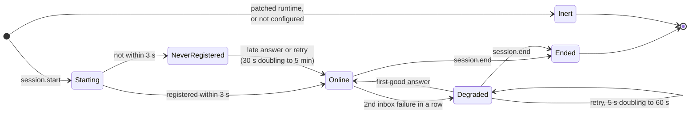

# Outages and session end

This page gathers two things that decide how the `claudiverse-seat` mod behaves at the edges of a session: what it does while the Claudiverse server is unreachable or restarting, and what it tells the server when the Claude Code process leaves. The rule behind both is that Claude Code always works as stock. A missing, slow or restarting server never blocks start-up, a turn, a dialog or an exit, and the person at the terminal is never locked out.

## How it works

### The principle

Every call from the mod to the server is either fire-and-forget (mirror rows), bounded (session start, withdraw) or a wait that the terminal can end on its own (questions, permissions, the inbox). Nothing in the mod holds a Claude Code turn on the server. When the server is out, the seat stops being steerable from the apps and its mirror thins out, and everything at the terminal keeps working.

### What counts as an outage

The questions and permissions code uses one predicate, `outage`:

```ts
const outage = (r) => r === null || r.status === 0 || r.status >= 500
```

An outage is therefore: no response (the request threw), status `0`, or any status of 500 or above. A 4xx is not an outage. For a question or permission poll, a 4xx (or any non-ok answer that is not an outage, or a body that does not parse) means the server refused the request, and the poll ends with no remote answer: the terminal dialog decides alone.

The other paths do not use `outage`. The inbox poll treats any answer other than 200 with a body, 204, 205 or 409 as a failure, so a 4xx there (for example a rejected token) is retried with backoff like a network error. Registration treats anything that does not return a session id as a failure and retries. See [inbox.md](inbox.md) and [registration.md](registration.md).

### Behaviour per path

| Path | Server unreachable or restarting | Timing |
|---|---|---|
| Session start: seat lookup (`GET /api/seats/whoami`) | No answer within the wait means no existing seat is known. The session starts under a derived title. | At most 3 s (`SERVER_WAIT_MS`). Skipped when `CLAUDIVERSE_TITLE` is set. |
| Session start: registration (`POST /api/sessions`) | If it has not succeeded within the wait, the status line reads `claudiverse offline` and Claude Code finishes starting. The same request keeps running; if it answers successfully later, the seat goes online from it. If it fails, the retry loop below starts. Start is never held longer. | At most 3 s (`SERVER_WAIT_MS`) per request. |
| Registration retry | `registerUntilUp` tries again with a growing delay, quietly. On success the seat goes online: status `claudiverse · <title>`, an `idle` row, and the inbox poll starts. | 30 s (`REGISTER_RETRY_MS`), doubling each time, capped at 5 min (`REGISTER_RETRY_MAX_MS`). |
| Inbox poll | A failed poll (network error, or any status other than 200 with a body, 204, 205, 409) waits and polls again. The status line changes to `claudiverse offline` on the second consecutive failure, not the first. Each retry names `Stop` as its inbox `event` when no turn is running, which a restarted server reads as idle as soon as the poll arrives. | 5 s (`RETRY_MS`), doubling, capped at 60 s (`POLL_RETRY_MAX_MS`). |
| Recovery on the first good inbox answer | `pollFailures` resets to 0, the status line returns to `claudiverse · <title>`, the mod registers again (idempotent by Claude's session id, so a restarted server learns the seat), and, when no turn is running, mirrors `idle`. The next poll follows at once. | On the first 204, 205 or 200 with a body after failures. |
| Mirror | A batch that fails is dropped without a message and not retried. Rows produced during an outage are lost, so the apps see a gap when the server returns. Nothing reaches the session. | Batches of up to 200 rows, flushed 300 ms after the first row. |
| Questions (`AskUserQuestion`) | The remote poll waits out an outage indefinitely and tries again. The terminal dialog is open the whole time and can be answered at any moment. | Backoff 5 s doubling to 60 s, reset to 5 s after any answer that is not an outage. |
| Permissions | The remote poll waits out an outage for up to 15 minutes (`PERMISSION_OUTAGE_MS`), then gives up and the terminal dialog decides alone. | Same 5 s to 60 s backoff. The 15 minutes count from the start of that prompt's poll and are checked after each failed attempt. |
| Withdraw (question answered at the terminal) | The withdraw request is sent and abandoned if it has not finished. | At most 3 s (`SERVER_WAIT_MS`). |

Notes on the table:

- The mirror and the questions and permissions paths only run once the seat has a server row (`row != null`). A seat that never registered mirrors nothing and never asks the server about a dialog, so those prompts are the terminal's from the start.
- Before holding on a question or a permission prompt, the mod drains the mirror queue with `flushNow` so the app sees the question first. If the server is out, that drain fails silently and the hold proceeds as above.
- A turn that ends while the server is out (a restart cut its stream, and Claude Code's retries met the server still down) sends its `turn_complete` and `idle` into the void, and a restarted Room restores the seat's last stored state, which was busy. Before 0.11.0 the seat then read busy until its next turn, so every `cv_send` bounced (measured 2026-10-11: 30 minutes after a deploy). Now the retry poll's `Stop` event and the `idle` row on recovery set it right, so the server's [auto-resume](../../server/auto-resume.md) `continue` reaches it. The lost `turn_complete` itself is not sent again. See [mirroring.md](mirroring.md).
- Recovery after an outage is only detected by the inbox poll. A seat that never went online keeps retrying registration instead.

### Seat states



`Online` means the seat has a server row and the inbox loop is running. A single failed poll leaves the seat `Online` (the status line is unchanged until the second failure).

## Session end

The mod listens to the `session.end` hook. For every reason except `clear` and `resume`, and only if the seat has a server row and a configuration, it:

1. Queues one row, `{"type": "session_ended", "reason": "<reason>", "exit_code": 0}`. `reason` is the reason Claude Code reports for the end of the session; `exit_code` is always `0`.
2. Calls `flushNow`, which sends everything pending, including that row, and ignores any failure. This runs inside the short time Claude Code gives `session.end`, so it is a best effort: if the server is out, the row is lost.
3. Sets the row to `null`. After that no other hook sends anything, so nothing can follow the `session_ended` row to the server.
4. Passes the event on.

Why: a seat with no WebSocket is only noticed as gone by the server's liveness check. The code comment gives about 3 minutes for that, during which the ended seat reads `running`, next to the seat that replaced it. The `session_ended` row ends it at once.

Not on `clear` and `resume`: after a `/clear` or an in-session resume the Claude Code process goes on, and no `session.start` follows a `/clear`. Ending the row there would leave a live seat with no row and nothing to bring it back, so the row stays.

### What the server does with it

Confirmed in `claudiverse_server`:

- A mirrored message of type `session_ended` ends the session at once: the session row is set to `stopped` (to `crashed` if `exit_code` is a non-zero integer, which the mod never sends), viewers receive a `session_ended` event with that exit code, and the room's inbox liveness is cleared. The server logs `Session <id> ended by its seat (<reason>)`.
- Without that row, a seat that has no WebSocket (an inbox-polled seat, which is what this mod is) is kept alive by its inbox poll. The room checks every 60 s (`@default_liveness_ms`) and stops the session after 3 consecutive checks (`@inbox_miss_limit`) with no live poll, logging `Inbox poll gone for session <id>; stopping it`. That is the roughly 3 minutes in the comment. Any mirrored message also counts as a sign of life for such a seat, so a seat that is still mirroring is not stopped for a paused poll.
- A seat that ended is not kept alive by its last frames: the liveness flag is cleared when the session ends.

### Patched runtime

If `CLAUDIVERSE_PATCHED_RUNTIME` is set to a non-empty value, `session.start` does nothing but pass the event on. The configuration, `row` and the registration stay unset, so every later hook is a no-op too, including `session.end`. The patched binary's own runtime registers the seat, mirrors, polls and ends it. The mod never registers or mirrors a second time.

## Configuration

There are no settings for outage behaviour; the timings are constants in the mod. The inputs that decide whether the mod acts at all are in [configuration.md](configuration.md).

| Constant | Value | Used for |
|---|---|---|
| `SERVER_WAIT_MS` | 3000 | Seat lookup, registration at start, withdraw. |
| `REGISTER_RETRY_MS` / `REGISTER_RETRY_MAX_MS` | 30 s / 5 min | Registration retry. |
| `RETRY_MS` / `POLL_RETRY_MAX_MS` | 5 s / 60 s | Inbox poll retry and the question and permission poll backoff. |
| `PERMISSION_OUTAGE_MS` | 15 min | How long a permission poll waits out an outage. |
| `FLUSH_MS` / `MAX_BATCH` | 300 ms / 200 | Mirror batching. |
| `CLAUDIVERSE_PATCHED_RUNTIME` | unset | When non-empty, the mod stays inert. |

## Failure modes and troubleshooting

| What you see | Cause | What to do |
|---|---|---|
| Status line `claudiverse offline` right after start | Registration did not finish within 3 s, or failed. | Nothing is required. The mod retries from 30 s, doubling to 5 min, and goes online by itself. Check the server URL and seat token if it never does ([registration.md](registration.md)). |
| Status line `claudiverse offline` mid-session | Two inbox polls in a row failed. | Wait for the server. On the first good answer the status returns and the seat registers again. |
| The apps lack messages from a period when the server was down | Failed mirror batches are dropped, not retried. | None; those rows are not recoverable from the mod. |
| A seat reads busy in the apps at its prompt after an outage | A mod older than 0.11.0: an `idle` row was lost, and recovery did not send a new one. | Update the mod. Meanwhile an app's force send reaches it, and its next turn end reports `idle`. |
| A question or permission prompt is not offered in the apps during an outage | The remote poll is waiting out the outage. | Answer at the terminal. A question stays pending remotely for as long as the outage lasts; a permission poll gives up after 15 minutes. |
| An exited seat still reads `running` for about 3 minutes | The `session_ended` row could not be sent in session.end's budget (server out), or the process was killed without a `session.end` hook. | The server's liveness check stops it after 3 missed 60 s checks. |
| A seat stays listed after `/clear` | Intended: the process continues and the row stays. | None. |

## Related pages

- [Registration](registration.md)
- [Inbox](inbox.md)
- [Mirroring](mirroring.md)
- [Questions and permissions](questions-and-permissions.md)
- [Configuration](configuration.md)
- [Server API](server-api.md)
- Server: [HTTP mirror, inbox long-poll and liveness](../../server/mirror-inbox-liveness.md)

## Source

- `mods/claudiverse-seat/hooks/register.ts`
- `claudiverse_server/lib/claudiverse_server/sessions/room.ex`
- `claudiverse_server/lib/claudiverse_server_web/controllers/inbox_controller.ex`
